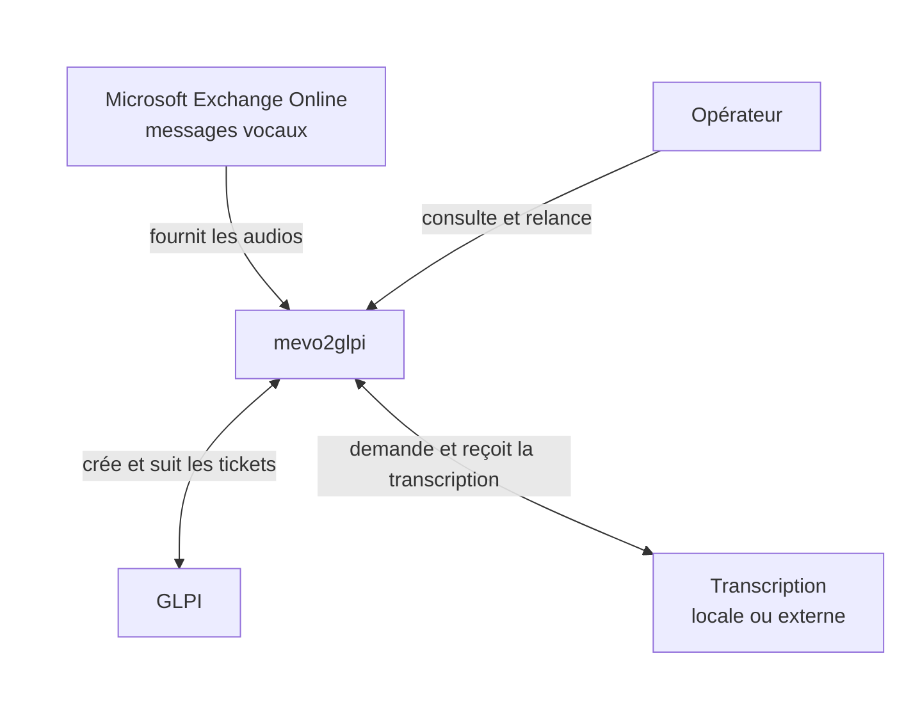

  <picture>
    <source
      media="(prefers-color-scheme: dark)"
      srcset="assets/logo_circulaire_sombre.png"
    >
    <source
      media="(prefers-color-scheme: light)"
      srcset="assets/logo_circulaire_claire.png"
    >
    
  </picture>

  Automatise la transformation des messages vocaux reçus via Exchange Online
  en tickets GLPI transcrits.

## Sommaire

- [Sommaire](#sommaire)
- [Fonctionnalités principales](#fonctionnalités-principales)
- [Architecture](#architecture)
  - [mevo2glpi](#mevo2glpi)
  - [Services connectés](#services-connectés)
- [Procédures par environnement](#procédures-par-environnement)
- [Documentation](#documentation)
- [Feuille de route](#feuille-de-route)
  - [Évolutions prioritaires](#évolutions-prioritaires)
  - [Sécurité de l'interface web](#sécurité-de-linterface-web)
  - [Génération assistée du ticket par LLM](#génération-assistée-du-ticket-par-llm)
- [Licence](#licence)

## Fonctionnalités principales

- récupération et validation des messages vocaux reçus via Exchange Online ;
- transcription des fichiers audio par un service local ou externe ;
- création automatique des tickets GLPI avec la transcription et l'audio ;
- suivi des traitements et des messages rejetés depuis un dashboard ;
- gestion configurable de la conservation des audios et des données associées.

## Architecture

La [référence d'architecture détaillée](docs/reference/architecture.md)
présente les services internes, la persistance et le volume audio.

### mevo2glpi

L'application orchestre l'ingestion, la transcription, la création des tickets
et leur suivi. Son dashboard permet à l'opérateur de consulter les traitements
et de relancer ceux qui ne nécessitent pas de correction manuelle.

### Services connectés

- **Exchange Online** fournit les messages vocaux et leurs pièces jointes ;
- le **provider de transcription**, local ou externe, transforme les audios en
  texte ;
- **GLPI** reçoit les tickets et expose leur état jusqu'à leur clôture.

## Procédures par environnement

Les déploiements en staging et en production s'effectuent avec **Dokploy**.

- [développement local](docs/procedures/developpement-local.md) ;
- [staging](docs/procedures/staging.md) ;
- [production](docs/procedures/production.md) ;
- [mise à jour](docs/procedures/mise-a-jour.md).

## Documentation

- [guide d'adoption par un autre établissement](docs/adoption.md) ;
- [architecture technique détaillée](docs/reference/architecture.md) ;
- [architecture du dépôt et workspace uv](docs/reference/depot.md) ;
- [cycle CI/CD et convention des tags](docs/reference/ci-cd.md) ;
- [stratégie de tests](docs/reference/tests.md) ;
- [historique des versions](CHANGELOG.md) ;
- [contribution](CONTRIBUTING.md), [sécurité](SECURITY.md) et
  [support](SUPPORT.md).

## Feuille de route

Cette feuille de route contient uniquement les évolutions prévues. Les
fonctionnalités déjà disponibles sont décrites dans les sections précédentes.

### Évolutions prioritaires

- [x] Appliquer une durée de conservation configurable aux ingestions Exchange
  rejetées sans job associé, avec un déploiement sécurisé en modes `report`
  puis `apply`.

### Sécurité de l'interface web

- [ ] Intégrer ultérieurement une authentification OIDC avec Keycloak et des
  autorisations applicatives avant d'étendre l'accès aux audios ou les actions
  opérateur.

En attendant, le web reste strictement limité au réseau interne par le DNS, le
pare-feu et la configuration Traefik de Dokploy.

### Génération assistée du ticket par LLM

- [ ] Générer à partir de la transcription le contenu métier complet du ticket,
  notamment son titre et sa description structurée, avec un LLM maîtrisé et
  désactivable.
- [ ] Valider la sortie du modèle avec un contrat structuré avant tout envoi à
  GLPI. Les champs techniques et les valeurs imposées par la configuration
  restent déterministes.
- [ ] Extraire uniquement un numéro de rappel explicitement demandé dans la
  transcription et le distinguer du numéro d'origine fourni par Exchange.
- [ ] Conserver un contenu de repli déterministe lorsque le générateur est
  absent, indisponible ou produit une réponse invalide.
- [ ] Valider les règles de confidentialité avant d'envoyer une transcription
  à un modèle supplémentaire.

## Licence

Copyright © 2026 CTRE HOSPITALIER SPECIALISE VAUCLAIRE.

Ce projet est distribué sous la Licence publique de l'Union européenne,
version 1.2 (`EUPL-1.2`). Les versions ultérieures de l'EUPL restent
autorisées conformément aux conditions de la licence.

Le texte intégral est disponible dans [LICENSE](LICENSE) et l'avis de droits
d'auteur dans [NOTICE](NOTICE).
