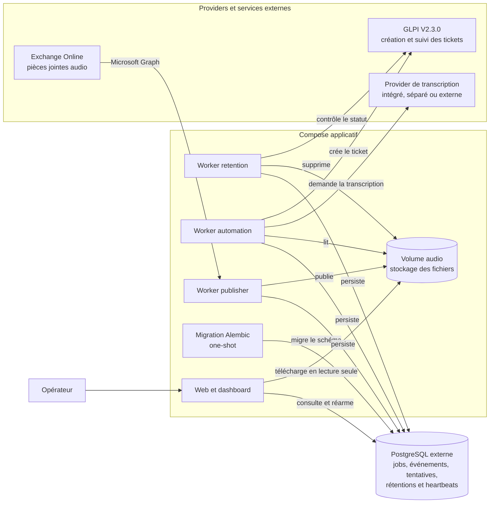

# GLPI Ticketing Automation

GLPI Ticketing Automation transforme les messages vocaux d'une boîte Exchange
Online dédiée en tickets GLPI. Le système récupère les audios, les transcrit,
crée les tickets, expose leur progression et conserve les fichiers jusqu'à la
fermeture du ticket ou leur échéance absolue.

La branche stable est `main`. Les releases courantes utilisent des tags
immuables `vX.Y.Z`. Les tags `poc-*` et `mvp-*` sont uniquement des archives
historiques.

## Sommaire

- [Fonctionnalités principales](#fonctionnalités-principales)
- [Architecture](#architecture)
  - [Compose applicatif](#compose-applicatif)
  - [Providers et services externes](#providers-et-services-externes)
- [Procédures par environnement](#procédures-par-environnement)
- [Architecture du dépôt](#architecture-du-dépôt)
  - [Workspace uv](#workspace-uv)
  - [Répertoires structurants](#répertoires-structurants)
- [Convention des tags](#convention-des-tags)
- [Feuille de route](#feuille-de-route)
  - [Évolutions prioritaires](#évolutions-prioritaires)
  - [Sécurité de l'interface web](#sécurité-de-linterface-web)
  - [Génération assistée du ticket par LLM](#génération-assistée-du-ticket-par-llm)

## Fonctionnalités principales

- récupération et filtrage des pièces jointes d'une boîte Exchange Online via
  Microsoft Graph, avec des identifiants immuables ;
- orchestration du pipeline par une base de données PostgreSQL : jobs,
  événements, tentatives, rétentions et heartbeats ;
- transcription des pièces jointes par un provider interchangeable :
  Transcribe AI ou un service compatible OpenAI ;
- API locale optionnelle sur CPU avec Parakeet Ultra, `transcribe.cpp` et
  normalisation FFmpeg ;
- création de tickets GLPI V2.3.0 contenant la transcription et un accès à
  l'audio ;
- suppression crash-safe des audios à la clôture du ticket ou à une échéance
  configurable ;
- dashboard des jobs, des événements, de l'état des workers et des alertes,
  avec relance par l'opérateur.

## Architecture

### Compose applicatif

Le Compose applicatif regroupe les cinq services du projet et crée le volume
audio partagé. PostgreSQL reste un service externe, rejoint par un réseau
Docker privé.

#### Worker retention

Il contrôle l'état du ticket GLPI et supprime l'audio lorsque le ticket est
fermé ou que son échéance absolue est atteinte. Ses transitions permettent de
reprendre une suppression interrompue sans perdre la traçabilité.

#### Worker automation

Il récupère les jobs éligibles dans PostgreSQL, transmet l'audio au provider de
transcription sélectionné, puis crée le ticket GLPI. Il applique les retries et
finalise le job dès que l'identifiant GLPI est durablement persisté.

#### Worker publisher

Il surveille la boîte Exchange, valide les pièces jointes WAV ou OGG, publie
l'audio dans le volume partagé, puis crée le job `pending` dans PostgreSQL.

#### Migration Alembic one-shot

Elle attend que PostgreSQL soit disponible, exécute `alembic upgrade head`,
puis s'arrête. Les quatre services persistants démarrent uniquement après son
succès.

#### Web et dashboard

Le web expose le dashboard, les détails et événements des jobs, les alertes,
le téléchargement des audios autorisés et la relance par l'opérateur. Il ne
constitue plus une voie d'ingestion.

#### PostgreSQL

PostgreSQL est la source de vérité du système. Il persiste notamment les jobs,
les événements, les tentatives, les échéances de retry, les rétentions et les
heartbeats des workers.

#### Volume audio

Le volume nommé stocke les fichiers audio sous une clé canonique. Le publisher
et le worker de rétention y accèdent en lecture-écriture ; le worker
d'automatisation et le web y accèdent uniquement en lecture.

### Providers et services externes

#### Provider de transcription

Il transforme un audio en texte. Le contrat permet d'utiliser un service
intégré au Compose applicatif, une stack Docker locale indépendante ou un
provider externe. Dans l'état actuel du dépôt, l'API CPU locale est déployée
dans un projet Compose indépendant ; son intégration au Compose applicatif
nécessiterait une modification de l'infrastructure, mais pas du pipeline métier.

#### Exchange Online

La boîte Exchange dédiée fournit les pièces jointes audio. Le publisher y
accède avec Microsoft Graph, puis classe les messages dans `Processed` ou
`Rejected` selon le résultat de l'ingestion.

#### GLPI

GLPI reçoit les demandes de création de ticket et expose leur état au worker de
rétention. L'identifiant du ticket est persisté dans PostgreSQL avant la
finalisation du job.

## Procédures par environnement

Les déploiements en staging et en production s'effectuent avec **Dokploy**.

- [développement local](docs/procedures/developpement-local.md) ;
- [staging](docs/procedures/staging.md) ;
- [production](docs/procedures/production.md) ;
- [mise à jour](docs/procedures/mise-a-jour.md).

Les références transversales décrivent la
[CI/CD](docs/reference/ci-cd.md) et la
[stratégie de tests](docs/reference/tests.md).

## Architecture du dépôt

### Workspace uv

La racine est un workspace uv non publiable. `uv.lock` est l'unique verrou de
dépendances pour ses douze membres. Le tableau ci-dessous reprend uniquement les
chemins déclarés dans `[tool.uv.workspace].members` du fichier
[`pyproject.toml`](pyproject.toml).

| Membre | Responsabilité | Documentation |
| --- | --- | --- |
| `apps/database-migrations` | Migration Alembic one-shot | [README](apps/database-migrations/README.md) |
| `apps/transcription-api` | API OpenAI-compatible CPU | [README](apps/transcription-api/README.md) |
| `apps/web` | Dashboard, API de lecture et retry opérateur | [README](apps/web/README.md) |
| `apps/worker-publisher` | Ingestion Exchange et publication audio | [README](apps/worker-publisher/README.md) |
| `apps/worker-automation` | Transcription et création GLPI | [README](apps/worker-automation/README.md) |
| `apps/worker-retention` | Contrôle GLPI et purge audio | [README](apps/worker-retention/README.md) |
| `packages/common` | Audio, backoff, attente et identité de release | [README](packages/common/README.md) |
| `packages/database` | Modèles, repositories et verrous PostgreSQL | [README](packages/database/README.md) |
| `packages/glpi-client` | Client et contrats GLPI V2.3.0 | [README](packages/glpi-client/README.md) |
| `providers/simulators/microsoft-graph-simulator` | Simulateur Graph de staging | [README](providers/simulators/microsoft-graph-simulator/README.md) |
| `providers/simulators/openai-transcription-simulator` | Simulateur synchrone OpenAI-compatible | [README](providers/simulators/openai-transcription-simulator/README.md) |
| `providers/simulators/transcribe-ai-simulator` | Simulateur Transcribe AI | [README](providers/simulators/transcribe-ai-simulator/README.md) |

Les applications n'importent pas les modules internes d'une autre application.
Le code partagé appartient aux packages.

### Répertoires structurants

| Répertoire | Rôle |
| --- | --- |
| `apps/` | Contient les six applications exécutables du projet. Leurs tests unitaires et d'intégration propres restent au plus près du code concerné. |
| `packages/` | Contient les trois bibliothèques partagées par les applications : utilitaires communs, persistance PostgreSQL et client GLPI. |
| `providers/` | Contient les simulateurs Microsoft Graph, Transcribe AI et OpenAI-compatible réservés au développement, au staging et aux tests. |
| `infra/` | Regroupe les images, les fichiers Compose et les exemples de configuration nécessaires aux différents environnements. |
| `docs/` | Contient les procédures d'exploitation, les références techniques et les conceptions futures validées. |
| `tests/` | Contient les tests transversaux de déploiement, d'intégration et de bout en bout, ainsi que leur support partagé. |
| `.github/` | Définit les workflows d'intégration continue et le modèle de Pull Request. |

Le dossier `infra/docker/` est organisé par périmètre de déploiement :

- `apps/` construit et orchestre les applications pour le staging et la
  production ;
- `development/` orchestre PostgreSQL et les services de test locaux ;
- `providers/` regroupe les images des services de test et leur orchestration
  staging ;
- `transcription/` déploie indépendamment le service local de transcription
  CPU.

## Convention des tags

Les releases suivent la convention `vMAJEUR.MINEUR.CORRECTIF` :

- `MAJEUR` évolue lors d'un changement incompatible ;
- `MINEUR` évolue lors de l'ajout rétrocompatible d'une fonctionnalité ;
- `CORRECTIF` évolue lors d'une correction rétrocompatible.

Un tag de release doit pointer vers un commit de `main` préalablement validé en
staging. Il est immuable : il ne doit jamais être déplacé, réutilisé ou
supprimé pour republier une autre révision. L'environnement déployé référence
ce tag exact et le SHA Git correspondant, jamais `latest` ni une branche
mutable.

## Feuille de route

Cette feuille de route contient uniquement les évolutions prévues. Les
fonctionnalités déjà disponibles sont décrites dans les sections précédentes.

### Évolutions prioritaires

- [ ] Exécuter le serveur FastAPI web avec une configuration explicitement
  destinée à la production et désactiver les routes Swagger/OpenAPI dans les
  environnements exposés.
- [ ] Extraire le numéro d'origine depuis l'objet du message et l'afficher comme
  métadonnée distincte dans le corps du ticket, sans l'assimiler au numéro de
  rappel demandé.
- [ ] Générer l'UUID d'ingestion de manière déterministe à partir de l'identité
  immuable du message Exchange afin de renforcer l'idempotence et les reprises
  après rollback.
- [ ] Mettre en œuvre la
  [rétention de l'historique PostgreSQL](docs/conception/retention-postgresql.md)
  selon la politique validée.
- [ ] Étendre l'ingestion Exchange aux formats MP3 et M4A après validation de
  leur structure et de leur compatibilité avec le service de transcription.

### Sécurité de l'interface web

- [ ] Définir avec les équipes réseau et système le mécanisme SSO placé devant
  l'application.
- [ ] Ajouter une authentification et des autorisations applicatives avant
  d'étendre l'accès aux audios ou les actions opérateur.

En attendant, le web reste strictement limité au réseau interne par le DNS, le
pare-feu et la configuration Traefik de Dokploy.

### Génération assistée du ticket par LLM

- [ ] Générer à partir de la transcription le contenu métier complet du ticket,
  notamment son titre et sa description structurée, avec un LLM maîtrisé et
  désactivable.
- [ ] Valider la sortie du modèle avec un contrat structuré avant tout envoi à
  GLPI. Les champs techniques et les valeurs imposées par la configuration
  restent déterministes.
- [ ] Extraire uniquement un numéro de rappel explicitement demandé dans la
  transcription et le distinguer du numéro d'origine fourni par Exchange.
- [ ] Conserver un contenu de repli déterministe lorsque le générateur est
  absent, indisponible ou produit une réponse invalide.
- [ ] Valider les règles de confidentialité avant d'envoyer une transcription
  à un modèle supplémentaire.
