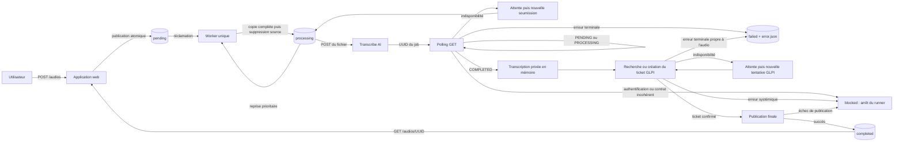

# GLPI Ticketing Automation

Projet Python destiné à automatiser la création de tickets GLPI à partir de
fichiers audio. Le dépôt conserve deux repères clairement séparés : le POC
figé, fondé sur quatre répertoires, et la branche MVP en cours, fondée sur
PostgreSQL et un volume audio canonique unique.

L'état démonstratif du POC est archivé par le tag immuable `poc-v0.1.0`. La
branche `mvp/job-lifecycle`, destinée à rejoindre `main`, a basculé l'ingestion
web et les deux workers sur
PostgreSQL et fournit désormais l'API de consultation, le dashboard par lot et
la rétention crash-safe des audios. Les deux workers publient désormais leur
heartbeat pendant leurs attentes coopératives ; le dashboard distingue leurs
états frais, périmés ou absents et agrège les jobs et rétentions nécessitant une
attention. La structure et les pipelines sont suivis dans le document vivant
[`docs/mvp-architecture.md`](docs/mvp-architecture.md).
Le MVP part d'une base PostgreSQL et d'un volume audio neufs ; il ne migre pas
automatiquement les répertoires de travail du POC.

## État du périmètre

### Périmètre figé du POC

Les éléments suivants décrivent le tag `poc-v0.1.0`, et non l'architecture
active de la branche MVP :

- réception d'un fichier `.wav`, `.mp3`, `.ogg` ou `.m4a` par l'application
  web, avec limite de taille configurable ;
- attribution d'un UUID au fichier et publication complète dans `pending` via
  un fichier temporaire `.part` ;
- téléchargement par UUID d'un audio déjà présent dans `completed` ;
- réclamation par le worker d'un audio de `pending` vers `processing`, avec
  reprise prioritaire d'un fichier déjà présent dans `processing` ;
- soumission de l'audio à l'API batch de Transcribe AI puis récupération du
  résultat par polling ;
- nouvelle tentative en cas d'indisponibilité, sans sortir l'audio de
  `processing` ;
- isolation des erreurs terminales dans `failed`, accompagnées d'un sidecar
  JSON expurgé ;
- conservation interne de la transcription en mémoire, sans journaliser son
  contenu ;
- authentification OAuth Password auprès de GLPI V2.3.0 ;
- récupération ou création d'un ticket GLPI corrélé par l'`external_id` de
  l'audio, sans rejeu aveugle d'une création au résultat incertain ;
- orchestration transcription → ticketing → finalisation avec des résultats
  typés `idle`, `retry`, `completed`, `failed` et `blocked` ;
- conservation privée de la transcription en mémoire pendant les reprises
  GLPI, puis publication du fichier dans `completed` après confirmation du
  ticket ;
- point d'entrée exécutable du worker, composition des clients HTTP et arrêt
  coopératif sur `SIGINT` ou `SIGTERM` ;
- point d'entrée exécutable de l'application web, composition FastAPI/Uvicorn
  et écoute configurable avec loopback par défaut ;
- images runtime séparées, Docker Compose mono-serveur durci et runbook de
  déploiement du POC sur un serveur de test.

### Avancement de la branche MVP

- package SQLAlchemy partagé décrivant les jobs, la rétention audio, leur
  historique expurgé et le heartbeat des workers du MVP ;
- application one-shot Alembic capable d'attendre PostgreSQL puis de migrer
  une base neuve jusqu'à la révision courante ;
- ingestion MVP par `POST /api/jobs` : publication atomique dans le volume
  unique, création transactionnelle du job `pending` et de son événement
  initial, puis consultation minimale avec `GET /api/jobs/{uuid}` ;
- téléchargement MVP contrôlé par l'état PostgreSQL `completed`, sans scan du
  volume audio ;
- worker piloté exclusivement par PostgreSQL, avec reprise prioritaire du job
  `processing`, puis retries dus et jobs `pending` ;
- backoff exponentiel configurable, transitions persistantes, événements et
  planification initiale de la rétention ;
- stockage audio immuable : aucun déplacement entre états et aucun sidecar ;
- contrôle de la taille persistée avant transcription et blocage des réponses
  distantes ambiguës sans resoumission automatique en boucle ;
- verrou advisory mono-worker dont la connexion porte aussi les transactions
  métier, revalidé aux frontières externes avec arrêt fail-closed en cas de
  perte, et heartbeat runtime périodique pendant les attentes coopératives ;
- tests d'intégration du cycle de vie sur PostgreSQL migré et pipeline E2E
  persistant avec Transcribe AI et GLPI ;
- API paginée des jobs et de leurs événements, recherche exacte par UUID,
  détail expurgé et téléchargement distinguant un audio purgé ;
- dashboard interne avec dépôt multiple borné à trois requêtes simultanées,
  actualisation du suivi et relance opérateur des jobs `failed` ou `blocked` ;
- instantané d'observabilité avec cartes des deux workers, seuil stale
  configurable, alertes agrégées des jobs/retries/rétentions et deadline audio ;
- réarmement transactionnel qui conserve l'ID GLPI durable, désactive la
  rétention et ajoute un événement d'audit sans scanner le volume ;
- worker de rétention singleton qui contrôle GLPI par l'identifiant de ticket
  persisté, vérifie l'`external_id`, respecte les deadlines absolues et évite le
  fan-out pendant une panne globale ;
- purge audio crash-safe via la quarantaine privée `.purge`, avec publication
  create-only et reprise après chaque frontière disque ou PostgreSQL.

Le déploiement Compose du MVP contient uniquement la migration one-shot, les
deux workers et le web. PostgreSQL est provisionné séparément et Dokploy
fournit Traefik. Le POC à quatre répertoires reste disponible avec le tag
`poc-v0.1.0`.

### Limites du POC ciblées par le MVP

- persistance et observabilité du cycle de vie des jobs ;
- alertes dashboard et mécanisme opérateur pour les traitements bloqués ou
  classés dans `failed` ;
- rétention contrôlée des audios et sauvegarde de PostgreSQL ;
- reprise autonome des traitements et des suppressions après un crash.

### Limites restant à traiter avant une production renforcée

- authentification et autorisation applicatives ;
- gestion des secrets par fichiers ou coffre externe ;
- chiffrement au repos des audios ;
- haute disponibilité et parallélisation des workers ;
- acquittement, historique et notifications externes des alertes ;
- séparation du rôle propriétaire utilisé par Alembic et des rôles PostgreSQL
  runtime limités au DML ; le MVP partage encore un rôle entre les services ;
- garantie distante d'unicité GLPI : un résultat de création inconnu suivi
  d'une recherche encore vide peut nécessiter une décision opérateur pour
  exclure tout doublon.

Chaque application possède désormais une racine de composition dans
`application.py`, une commande console et une exécution équivalente avec
`python -m`. Les fabriques FastAPI et les composants du pipeline restent
séparés de ces points d'entrée afin d'être testés sans démarrer leur boucle
d'exécution.

## Architecture du workspace

La racine est un [workspace uv](pyproject.toml) non publiable
(`package = false`). Elle centralise le verrouillage des dépendances dans un
seul `uv.lock`, les outils de développement et la configuration de Pytest et
Ruff. Chaque membre conserve son propre `pyproject.toml` et déclare
explicitement ses dépendances d'exécution.

| Membre | Distribution Python | Responsabilité actuelle | Documentation |
| --- | --- | --- | --- |
| `apps/database-migrations` | `glpi-ticketing-database-migrations` | Application one-shot Alembic et historique versionné du schéma MVP | [Migrations de la base](apps/database-migrations/README.md) |
| `apps/web` | `glpi-ticketing-web` | Ingestion persistée, dashboard interne, retry opérateur et téléchargement contrôlé | [Application web](apps/web/README.md) |
| `apps/worker-automation` | `glpi-ticketing-worker-automation` | Sélection et orchestration persistantes, transcription, ticket GLPI et finalisation | [Worker d'automatisation](apps/worker-automation/README.md) |
| `apps/worker-retention` | `glpi-ticketing-worker-retention` | Contrôles GLPI, deadlines, backoff et purge audio crash-safe | [Worker de rétention](apps/worker-retention/README.md) |
| `packages/common` | `glpi-ticketing-common` | Publication, résolution et purge crash-safe du stockage audio canonique | [Package commun](packages/common/README.md) |
| `packages/database` | `glpi-ticketing-database` | Modèles, sessions, repositories de cycle de vie/runtime et verrous advisory | [Package database](packages/database/README.md) |
| `packages/glpi-client` | `glpi-ticketing-glpi` | Contrats étroits de création/lecture et adaptateur HTTP GLPI V2.3.0 | [Client GLPI](packages/glpi-client/README.md) |

Le web et les deux workers dépendent des packages commun et database. Les
workers d'automatisation et de rétention dépendent en plus du client GLPI
partagé. L'application de migration dépend du package database pour importer
`Base.metadata`. Ces dépendances sont déclarées comme sources workspace à la
racine. Une application ne doit pas importer directement les modules internes
d'une autre application.

Le [Compose Dokploy](infra/docker/docker-compose.prod.yml) et les quatre
Dockerfiles sous `infra/docker/` ne constituent pas un membre Python
supplémentaire. Ils assemblent le déploiement mono-serveur du MVP ; le
déploiement historique du POC reste figé par `poc-v0.1.0`.

La convention générale est un layout `src` : le code de chaque membre se
trouve dans `<membre>/src/<package_python>` et ses tests dans
`<membre>/tests`. Les conventions propres à chaque membre sont détaillées dans
son README.

## Flux global du POC (`poc-v0.1.0`)



1. L'application web valide l'extension et la taille du flux reçu. Elle
   remplace le nom fourni par un UUID canonique et publie le contenu dans
   `pending`. Le fichier final n'apparaît qu'après écriture et synchronisation
   complètes d'un fichier `.part`.
2. Le worker regarde d'abord `processing`. Cette priorité permet de reprendre
   un audio abandonné après un redémarrage. S'il n'en trouve pas, il réclame le
   premier audio prêt de `pending`. Les fichiers `.part` sont toujours ignorés.
3. Le worker soumet le fichier à Transcribe AI, récupère l'UUID du job puis
   interroge son état. L'audio reste dans `processing` pendant toute cette
   séquence.
4. Une indisponibilité réseau, une réponse temporaire ou l'expiration du délai
   de polling produit un résultat `retry`. La boucle attend puis relance une
   transcription du même audio. L'API ne fournissant pas de clé d'idempotence,
   un nouveau job distant peut alors être créé.
5. Seul un rejet explicite de la soumission sous HTTP 200 ou un job au statut
   exact `FAILED` est terminal pour l'audio. Une erreur d'authentification,
   d'autorisation, un autre `4xx`, une réponse malformée ou un statut distant
   inconnu produit `blocked` et conserve l'audio dans `processing`.
6. Une transcription réussie est conservée dans l'état privé du processeur.
   Elle n'est exposée dans aucun résultat public et elle est réutilisée sans
   retranscription tant que les tentatives GLPI restent dans le même processus.
7. Le client GLPI épinglé en V2.3.0 recherche le ticket par `external_id`, le
   crée si nécessaire, puis retourne son identifiant. Une indisponibilité ou un
   résultat de création incertain produit `retry` sans déplacer l'audio.
8. Une erreur terminale propre à l'audio publie d'abord l'audio et un sidecar
   expurgé dans `failed`, puis supprime `processing`. Une erreur systémique,
   une incohérence ou une publication impossible produit `blocked` et arrête
   la boucle afin que l'opérateur inspecte le résultat et les artefacts
   éventuellement déjà publiés.
9. Après confirmation du ticket, l'audio est publié dans `completed`. Le
   résultat `completed` contient l'UUID, le chemin final et l'identifiant GLPI,
   mais jamais la transcription.

Les publications inter-volumes ne supposent pas qu'un renommage atomique soit
possible entre deux systèmes de fichiers. La destination est copiée dans un
fichier `.part`, synchronisée puis publiée par renommage dans son propre
répertoire ; la source n'est supprimée qu'après cette publication.

Si une synchronisation signale un `OSError` après la suppression de la source,
le processeur vérifie l'état observable avant de bloquer. Une destination
`completed` complète produit malgré tout `CompletedOutcome`. Pour `failed`,
l'audio et le sidecar doivent tous deux être présents et le JSON doit
correspondre exactement à l'échec mémorisé pour produire `FailedOutcome`.

Un sidecar terminal porte le nom `{uuid}.error.json` et contient uniquement :

- l'UUID de l'audio ;
- l'étape `transcription` ou `ticketing` ;
- une catégorie d'erreur ;
- un code technique non sensible ;
- un horodatage UTC.

Il ne contient ni transcription, ni clé API, ni réponse HTTP brute.

La politique Transcribe AI suit une allowlist terminale : une enveloppe
`status=error` ne représente un rejet propre à l'audio que sur la réponse HTTP
200 de soumission, et seul le statut de job exact `FAILED` est terminal pendant
le polling. Les erreurs HTTP non réessayables, y compris `401`, `403` et les
autres `4xx`, ainsi que les réponses incompatibles avec le contrat, produisent
`blocked`. Cette prudence empêche une clé invalide ou une évolution distante de
classer toute la file dans `failed`.

La version Transcribe AI `1.0.0` épinglée pour les tests représente encore un
job distant en échec par une enveloppe HTTP `500`, sans code métier stable.
Cette réponse reste donc volontairement réessayable : le client ne peut pas la
distinguer sûrement d'une panne serveur. Le contrat distant devra exposer
`data.status=FAILED` ou un code d'erreur métier stable avant le MVP pour rendre
ce cas terminal sans fragiliser les erreurs systémiques.

La politique GLPI est conservatrice : un statut HTTP ne suffit jamais à rendre
une création terminale. Seuls un `external_id` dupliqué et une réponse `400`
reconnue par le client comme rejet sémantique des champs dynamiques
`content`/`external_id` conduisent à `failed`. Les autres `400`, ainsi que les
`409`, `422` et erreurs de contrat non reconnues, conduisent à `blocked` afin
de ne pas isoler tous les audios à cause d'une configuration ou d'une évolution
de l'API.

### État et résultats du worker

`AudioProcessor` est volontairement avec état et réservé au worker unique du
POC. Son état privé distingue `_AwaitingTranscription`, `_AwaitingTicket`,
`_AwaitingFinalization` et `_AwaitingFailurePublication`. La transcription
n'existe que dans l'attente du ticket et son `repr` est masqué. L'état de
publication d'échec conserve l'étape, le code expurgé et l'horodatage afin qu'un
nouvel appel sur la même instance reprenne uniquement la publication dans
`failed`, sans rappeler Transcribe AI ou GLPI.

Un redémarrage perd cet état : le scanner reprend alors l'audio dans
`processing`, le retranscrit et laisse `ensure_ticket()` réconcilier le ticket
par `external_id`.

Chaque appel à `AudioProcessor.run_once()` retourne un objet immuable et
expurgé :

| Résultat | Effet de `run_forever()` |
| --- | --- |
| `IdleOutcome` | Attend l'intervalle de scan. |
| `RetryOutcome` | Attend l'intervalle propre à l'étape, puis reprend le même état privé. |
| `CompletedOutcome` | Continue immédiatement avec l'audio suivant. |
| `FailedOutcome` | Continue immédiatement ; le fichier est terminal dans `failed`. |
| `BlockedOutcome` | Persiste un blocage propre au job, puis laisse la boucle poursuivre avec la file. |
| `SystemBlockedOutcome` | Conserve le processus observable en `blocked`, sans relancer une opération distante ambiguë. |

Aucun de ces résultats ne transporte la transcription, un secret ou une
réponse distante brute.

Un résultat `blocked` expose normalement le chemin encore présent dans
`processing`. Si une erreur de synchronisation rend la localisation ambiguë
après suppression de la source, ce chemin vaut `None` et `inspection_paths`
indique explicitement les artefacts que l'opérateur doit contrôler.

## Technologies

Les contraintes déclarées dans les fichiers `pyproject.toml` sont la source de
vérité ; `uv.lock` fixe les versions exactes installées pour le dépôt.

| Technologie | Contrainte déclarée | Utilisation |
| --- | --- | --- |
| Python | `>=3.12` | Langage commun aux sept membres |
| uv | workspace et lock partagé | Résolution, environnement, exécution et build |
| FastAPI | `>=0.116,<1` | Routes HTTP et validation de l'application web |
| Uvicorn | `>=0.35,<1` | Serveur ASGI composé par le point d'entrée web |
| Jinja2 | `>=3.1,<4` | Pages HTML de dépôt et de confirmation |
| Pydantic Settings | `>=2.10,<3` | Configuration typée depuis l'environnement |
| SQLAlchemy | `>=2.0,<3` | Modèles, moteur et sessions synchrones partagés |
| Psycopg 3 | `>=3.2,<4` | Pilote PostgreSQL synchrone |
| Alembic | `>=1.16,<2` | Historique et application one-shot de migration |
| HTTPX | `>=0.28,<1` | Clients HTTP de Transcribe AI et GLPI |
| HTTPX 2 | `>=2,<3`, groupe de développement | Anticipation de migration et compatibilité des tests |
| Pytest | `>=8.4,<10` | Tests unitaires et tests d'intégration opt-in |
| Ruff | `>=0.12,<1` | Formatage et analyse statique |
| Testcontainers | `>=4.12,<5`, groupe de développement | Stacks PostgreSQL, GLPI/MySQL et Transcribe AI jetables pour les tests d'intégration |
| Docker Engine / Compose | hors workspace Python | Construction et exécution des quatre applications conteneurisées |
| Dokploy / Traefik | services externes | Déploiement du Compose, routage HTTP(S) et terminaison TLS |

Les sept distributions du projet utilisent `uv_build` comme backend de
construction et portent actuellement la version `0.1.0`.

## Prérequis

- Python 3.12 ou supérieur ;
- [`uv`](https://docs.astral.sh/uv/) ;
- pour la branche MVP : une base PostgreSQL neuve ou compatible, joignable par
  les quatre applications ; la migration Alembic est appliquée au démarrage ;
- pour exécuter spécifiquement le tag POC : ses quatre répertoires audio
  historiques ;
- uniquement pour les tests marqués `database`, `glpi`, `transcribe_ai` ou
  `e2e` : Docker avec le plugin Compose ;
- uniquement pour construire ou déployer le MVP : Docker Engine avec le plugin
  Compose, ou un serveur Dokploy opérationnel avec Traefik et un PostgreSQL
  provisionné séparément ;
- uniquement pour `transcribe_ai` ou `e2e` : un hôte et un daemon Docker
  `linux/amd64`, ainsi qu'un accès réseau à chaque session pour le modèle
  Whisper ; le premier lancement télécharge aussi les images. Le mode GPU
  requiert en plus un GPU NVIDIA et NVIDIA Container Toolkit.

Docker, GLPI et Transcribe AI ne sont pas nécessaires pour exécuter la suite
unitaire par défaut. Les deux stacks d'intégration sont démarrées et détruites
automatiquement ; aucune installation locale de GLPI ou de Transcribe AI n'est
attendue.

## Installation depuis la racine

```bash
uv sync --all-packages --all-groups
cp .env.example .env
```

En CI, ou pour refuser toute modification implicite du verrou, utilisez :

```bash
uv sync --frozen --all-packages --all-groups
```

## Configuration locale et secrets

Le fichier [.env.example](.env.example) décrit les variables applicatives.
Copiez-le vers `.env`, puis fournissez uniquement des valeurs adaptées à votre
machine. `.env` et `.env.*` sont ignorés par Git, à l'exception du modèle ; ils
ne doivent jamais être ajoutés au dépôt.

`WebSettings`, `WorkerSettings` et `RetentionWorkerSettings` valident ce
contrat. La composition du worker d'automatisation transforme `WorkerSettings`
en adaptateurs Transcribe AI/GLPI, stages, `AutomationWorker` et
`run_forever(...)`. Le worker de rétention compose séparément son lecteur GLPI,
sa purge crash-safe et son orchestrateur. Chaque runtime possède ses ressources
et son verrou. Le point d'entrée du web transforme `WebSettings` en application
FastAPI puis en serveur Uvicorn.

| Variables | Propriétaire | Rôle défini par la configuration |
| --- | --- | --- |
| `DATABASE_URL` | migration, web et workers | URL SQLAlchemy obligatoire utilisant `postgresql+psycopg` |
| `DATABASE_READY_TIMEOUT_SECONDS` | application de migration | Durée maximale d'attente de PostgreSQL |
| `DATABASE_READY_INTERVAL_SECONDS` | application de migration | Intervalle entre deux sondes de disponibilité |
| `DATABASE_CONNECT_TIMEOUT_SECONDS` | migration et workers | Timeout borné de chaque tentative de connexion |
| `AUDIO_ROOT` | web et workers | Volume unique contenant les clés canoniques `{uuid}.{extension}` |
| `WEB_HOST`, `WEB_PORT` | web | Adresse IP et port d'écoute Uvicorn ; `127.0.0.1:8000` par défaut |
| `WEB_TRUST_PROXY_HEADERS` | web | Confiance explicite dans les en-têtes du proxy ; désactivée par défaut |
| `MAX_UPLOAD_BYTES` | web | Taille maximale d'un upload |
| `WORKER_HEARTBEAT_INTERVAL_SECONDS` | workers et web | Intervalle maximal entre deux checkpoints coopératifs et cadence attendue par l'observabilité, `10` secondes par défaut |
| `WORKER_HEALTHCHECK_STALE_AFTER_SECONDS` | healthchecks Docker des workers | Âge maximal du heartbeat conteneur, `45` secondes par défaut et strictement supérieur à la cadence |
| `DASHBOARD_WORKER_STALE_AFTER_SECONDS` | web | Seuil sans checkpoint avant alerte, `45` secondes par défaut |
| `DASHBOARD_PENDING_ALERT_AFTER_SECONDS` | web | Durée depuis la dernière entrée en `pending`, `900` secondes par défaut |
| `DASHBOARD_RETRY_OVERDUE_GRACE_SECONDS` | web | Grâce après l'échéance d'un retry job ou rétention, `60` secondes par défaut |
| `DASHBOARD_RETENTION_DEADLINE_GRACE_SECONDS` | web | Grâce après une deadline audio, `120` secondes par défaut |
| `WORKER_LOG_LEVEL` | worker d'automatisation | Niveau des logs applicatifs (`INFO` par défaut, `DEBUG` temporairement pour les diagnostics réseau/TLS expurgés) |
| `WORKER_IDLE_INTERVAL_SECONDS` | worker | Attente lorsqu'aucun job n'est éligible, `1` seconde par défaut |
| `WORKER_RETRY_INITIAL_SECONDS` | worker | Premier délai du backoff exponentiel, `5` secondes par défaut |
| `WORKER_RETRY_MAX_SECONDS` | worker | Plafond du backoff, `300` secondes par défaut |
| `WORKER_SYSTEM_PROBE_INTERVAL_SECONDS` | worker | Attente avant de sonder un blocage système, `60` secondes par défaut |
| `COMPLETED_RETENTION_DAYS` | worker | Deadline absolue d'un job terminé, `90` jours par défaut |
| `FAILED_RETENTION_DAYS` | worker | Deadline absolue d'un échec terminal, `30` jours par défaut |
| `BLOCKED_RETENTION_DAYS` | worker | Deadline absolue d'un job bloqué, `90` jours par défaut |
| `RETENTION_POLL_INTERVAL_SECONDS` | worker de rétention | Attente maximale sans opération éligible, `60` secondes par défaut |
| `RETENTION_RETRY_INITIAL_SECONDS` | worker de rétention | Premier délai du backoff de rétention, `5` secondes par défaut |
| `RETENTION_RETRY_MAX_SECONDS` | worker de rétention | Plafond du backoff de rétention, `300` secondes par défaut |
| `RETENTION_SYSTEM_PROBE_INTERVAL_SECONDS` | worker de rétention | Attente avant une nouvelle sonde GLPI bloquée, `60` secondes par défaut |
| `RETENTION_CHECK_INTERVAL_HOURS` | workers | Intervalle entre les contrôles d'un ticket terminé, également utilisé avant le premier contrôle ; `6` heures par défaut |
| `PUBLIC_BASE_URL` | worker | Base utilisée par la composition pour construire l'URL audio du ticket |
| `LEGACY_TRANSCRIPTION_BASE_URL` | worker | URL obligatoire de l'API batch actuellement intégrée |
| `LEGACY_TRANSCRIPTION_API_KEY` | worker | Clé obligatoire, représentée par un type secret |
| `TRANSCRIPTION_HTTP_TIMEOUT_SECONDS` | worker | Délai maximal d'une requête HTTP |
| `TRANSCRIPTION_POLL_INTERVAL_SECONDS` | worker | Intervalle entre deux lectures d'un job |
| `TRANSCRIPTION_JOB_TIMEOUT_SECONDS` | worker | Durée maximale d'une tentative de polling |
| `GLPI_BASE_URL`, `GLPI_USERNAME` | worker | Instance GLPI et utilisateur du grant OAuth Password |
| `GLPI_PASSWORD`, `GLPI_CLIENT_ID`, `GLPI_CLIENT_SECRET` | worker | Identifiants OAuth obligatoires, avec les deux secrets masqués |
| `GLPI_HTTP_TIMEOUT_SECONDS` | worker | Timeout des opérations OAuth, recherche et création |
| `GLPI_TICKET_TITLE`, `GLPI_TICKET_TYPE` | worker | Titre fixe et type appliqués aux tickets |
| `GLPI_TICKET_URGENCY`, `GLPI_TICKET_IMPACT` | worker | Niveaux fixes dont GLPI déduit la priorité |

`TRANSCRIBE_AI_TEST_DEVICE` appartient uniquement à la fixture d'intégration.
Sa valeur est `cpu` par défaut ou `gpu` pour demander explicitement CUDA. Les
identifiants de la stack sont générés en mémoire à chaque session pytest :
aucune clé Transcribe AI ne doit être fournie par le développeur.

## Workflow Git et déploiement

`main` est la branche d'intégration stable. Le travail passe par des branches
courtes (`feature/*`, `fix/*` ou `chore/*`) revues avant fusion ; une branche
d'environnement longue n'est pas utilisée comme source de vérité.

Dokploy déploie directement la révision Git sélectionnée et construit les
quatre images depuis leurs Dockerfiles. Un rollback consiste donc à
redéployer le commit ou le tag Git précédemment validé. Le tag historique
`poc-v0.1.0` reste l'archive du POC.

## Déploiement Dokploy du MVP

Le point d'entrée unique fourni à Dokploy est
[`infra/docker/docker-compose.prod.yml`](infra/docker/docker-compose.prod.yml).
Il charge explicitement `infra/docker/.env`, puis inclut le fragment interne
`docker-compose.prod.services.yml` qui contient la migration Alembic one-shot,
le web, le worker d'automatisation et le worker de rétention. PostgreSQL, GLPI
et Transcribe AI sont externes au Compose. Les trois applications persistantes
partagent le volume `audio-data` ; le worker d'automatisation le monte en
lecture seule.

Ce wrapper contourne temporairement la régression
[Dokploy #5252](https://github.com/Dokploy/dokploy/issues/5252) : depuis la
version `0.30.3`, Dokploy peut créer le `.env` à côté du Compose tout en lançant
Docker Compose avec la racine du dépôt comme répertoire de projet.

Nginx n'est pas embarqué. Le web écoute sur le port interne `8000`, sans port
hôte publié, et Dokploy configure son Traefik depuis l'onglet **Domains**. La
migration attend la base externe et doit réussir avant le démarrage du web et
des deux workers.

Configuration minimale dans Dokploy :

1. créer un service **Docker Compose** depuis ce dépôt ;
2. utiliser le chemin `./infra/docker/docker-compose.prod.yml` ;
3. copier et renseigner toutes les valeurs de
   [`infra/docker/.env.example`](infra/docker/.env.example) dans l'onglet
   **Environment** ; Dokploy génère alors `./infra/docker/.env` et le wrapper
   le charge explicitement malgré le `--project-directory` positionné à la
   racine du dépôt ;
4. créer le réseau privé `DATABASE_NETWORK_NAME`, y attacher le PostgreSQL
   externe et renseigner son URL dans `DATABASE_URL` ;
5. rendre le bundle indiqué par `CA_BUNDLE_HOST_PATH` lisible sur l'hôte ; il
   doit contenir la CA interne de GLPI et Transcribe AI si nécessaire ;
6. ajouter un domaine pour le service `web`, port conteneur `8000`, puis
   activer HTTPS selon la politique du serveur ;
7. limiter ce domaine au réseau interne par DNS, pare-feu ou middleware
   Traefik, puis vérifier qu'il est inaccessible depuis un réseau non autorisé ;
8. lancer le déploiement.

Le fichier d'environnement réel contient des secrets et ne doit jamais être
commité. `PUBLIC_BASE_URL` doit correspondre au domaine réellement configuré
dans Dokploy. Le Compose ne fournit pas d'authentification HTTP : l'isolation
réseau ou le middleware Traefik constitue donc une barrière obligatoire et
externe à l'application. La vérification TLS ne doit jamais être désactivée ;
les quatre conteneurs montent le bundle de confiance en lecture seule.

Le contrat Compose peut être vérifié sans démarrer les services :

```bash
GTA_DOKPLOY_ENV_FILE=./infra/docker/.env.example docker compose \
  --project-directory . \
  --file infra/docker/docker-compose.prod.yml \
  config --quiet
```

Ne lancez jamais `docker compose down -v` : cette option supprimerait le
volume audio persistant. La sauvegarde de PostgreSQL relève du service de base
externe.

### Démarrage de l'application web du POC

Ce démarrage correspond au tag `poc-v0.1.0`. Sur la branche MVP, utiliser les
instructions PostgreSQL et `AUDIO_ROOT` du
[README du web](apps/web/README.md).

Après avoir sélectionné le tag et créé les répertoires `pending` et
`completed` configurés :

```bash
uv run glpi-ticketing-web
```

La forme module est équivalente :

```bash
uv run python -m glpi_ticketing_web
```

Le serveur écoute uniquement sur `127.0.0.1:8000` par défaut. L'image construite
par `infra/docker/web/Dockerfile` définit explicitement `WEB_HOST=0.0.0.0` dans
le conteneur ; le Compose expose ce port au Traefik de Dokploy sans le publier
sur l'hôte. Le processus retourne `0`
après l'arrêt normal, `1` pour une erreur inattendue, `2` pour une
configuration invalide et `130` pour un `KeyboardInterrupt` non pris en charge
par Uvicorn.

### Démarrage du worker MVP

Après avoir renseigné `.env`, appliqué la migration et créé `AUDIO_ROOT` :

```bash
uv run glpi-ticketing-worker
```

La forme module est équivalente :

```bash
uv run python -m glpi_ticketing_worker_automation
```

Le processus retourne `0` après un arrêt normal ou un `SIGINT`/`SIGTERM` géré,
`1` pour une erreur inattendue, `2` pour une configuration invalide, `3` pour
une seconde instance refusée par le verrou advisory et `130` si un
`KeyboardInterrupt` échappe aux gestionnaires. Un blocage métier ou système
n'arrête plus le worker : le premier est persisté avant de continuer, le second
est sondé après une attente configurable. Les attentes sont réveillées par le
signal ; un appel HTTP synchrone déjà en cours peut toutefois aller jusqu'à son
timeout configuré.

### Démarrage du worker de rétention MVP

Après la migration, la création de `AUDIO_ROOT` et la configuration GLPI :

```bash
uv run --package glpi-ticketing-worker-retention \
  glpi-ticketing-worker-retention
```

La forme module est équivalente :

```bash
uv run --package glpi-ticketing-worker-retention \
  python -m glpi_ticketing_worker_retention
```

Ce processus applique les deadlines et les contrôles GLPI sans scanner le
volume. Il retourne les mêmes codes de frontière que le worker
d'automatisation, notamment `3` si le verrou singleton est déjà détenu.

## Politique de tests

La suite par défaut doit être déterministe, locale et sans appel externe. Les
tests utilisent des stockages temporaires, des repositories simulés et
l'injection de l'horloge et de la fonction de sommeil. Ils vérifient les
outcomes, la classification des erreurs, le backoff et les frontières de
transaction sans attendre réellement.

Les tests du worker d'automatisation sont répartis sous
`apps/worker-automation/tests/unit/worker/` entre outcomes, politiques,
inspection audio, transitions, stages, service d'orchestration et runner. Les
tests de composition, runtime, heartbeat et signaux sont séparés au niveau de
l'application. L'ancien scanner et les assertions de déplacement ou de sidecar
ont été retirés. Les contrats HTTP restent testés séparément au niveau de leurs
adaptateurs.

Le worker de rétention suit la même séparation sous
`apps/worker-retention/tests` : unités déterministes, intégration PostgreSQL et
stockage réel, puis contrats GLPI sur la stack jetable partagée.

L'application web possède en plus un test d'intégration local : il démarre le
vrai serveur Uvicorn sur un socket loopback et un port aléatoire, interroge
`GET /health` par polling borné puis vérifie son arrêt. Il ne requiert aucun
service externe. Ses tests PostgreSQL vérifient également les frontières des
seuils d'observabilité, les agrégats expurgés et le contrat
`GET /api/observability` sans démarrer GLPI ou Transcribe AI.

Pytest est configuré avec `--strict-config`, `--strict-markers` et le mode
d'import `importlib`. Les marqueurs enregistrés sont :

| Marqueur | Politique |
| --- | --- |
| `database` | Démarre un PostgreSQL 16 jetable et vérifie migrations, repositories, verrous et cycles applicatifs réels |
| `deployment` | Valide le Compose Dokploy, ses quatre images, la migration et le volume audio avec un PostgreSQL jetable |
| `transcribe_ai` | Démarre une stack Transcribe AI v1 jetable et exécute le contrat POST/polling réel |
| `glpi` | Démarre une seule stack GLPI 11/MySQL jetable et teste le client V2.3.0 réel |
| `e2e` | Assemble les quatre applications et les instances PostgreSQL, GLPI et Transcribe AI jetables ; cette suite reste strictement séquentielle |

La suite `database` lance une seule image PostgreSQL épinglée par digest sur un
réseau privé et un port loopback aléatoire. Chaque test reçoit une base isolée,
puis la fixture détruit les bases, le conteneur et le réseau. Elle vérifie le
passage Alembic jusqu'à `head`, sa seconde exécution, la concordance avec
`Base.metadata`, les invariants réellement appliqués par PostgreSQL et les
reprises de purge du worker de rétention sur un volume temporaire réel. Cette
suite ne doit pas être parallélisée.

La suite `transcribe_ai` lance PostgreSQL, Redis, l'API, le worker batch et le
service Whisper STT une seule fois par session. Les images sont épinglées par
digest, l'API utilise un port loopback aléatoire et les secrets sont éphémères.
Un court WAV vocal non sensible est généré dans le conteneur : aucun audio local
n'est lu. Le mode CPU est le défaut ; un overlay distinct réserve le GPU et la
fixture vérifie le périphérique réellement vu par PyTorch. Cette suite ne doit
pas être parallélisée.

La suite `glpi` construit une image strictement réservée aux tests à partir de
GLPI 11.0.8, épinglé par digest, et utilise une image MySQL 8.4.11 également
épinglée. Une fixture de session expose GLPI sur un port aléatoire lié à
`127.0.0.1`, attend sa disponibilité HTTP, puis crée avec les classes métier
GLPI un utilisateur et un client OAuth Password limités au scope `api`. Tous
les identifiants sont éphémères et transmis par variables d'environnement. La
suite récupère le token par `GlpiClient`, crée réellement un ticket, le relit
directement par son ID et vérifie sa corrélation par `external_id`. Elle ne doit
pas être parallélisée. Le worker de rétention réutilise la même stack de session
pour vérifier qu'un ticket `SOLVED` conserve l'audio, qu'un ticket `CLOSED`
corrélé le purge et qu'une corrélation incohérente bloque uniquement la
rétention. Le teardown supprime les conteneurs, le réseau, les volumes Compose
et l'image custom construite pour la session.

Le test E2E ciblé du worker sous
`apps/worker-automation/tests/integration/e2e` réutilise ces deux fixtures de
session, une base PostgreSQL migrée et la vraie racine de composition du
worker. Il conserve une régression directe du pipeline nominal sans démarrer
la façade web ni les images du déploiement.

La suite E2E racine sous [`tests/e2e`](tests/e2e/README.md) construit les quatre
applications du Compose, leur ajoute un PostgreSQL strictement jetable et les
connecte aux instances GLPI et Transcribe AI de test. Le web est publié
uniquement sur loopback ; le Traefik de Dokploy n'est pas simulé. Le sous-jalon
8A porte le socle, ses sondes de disponibilité, ses identifiants éphémères et
son nettoyage borné. Le sous-jalon 8B ajoute neuf scénarios métier sur
l'upload, les retries, la reprise, les alertes et la purge. Toute la suite E2E
s'exécute seule, sans `pytest-xdist` ni autre stack Docker concurrente. Son
runbook de démonstration est disponible dans
[`docs/mvp-demo-runbook.md`](docs/mvp-demo-runbook.md).

## Commandes de validation depuis la racine

Suite locale sans service externe :

```bash
uv run --all-packages pytest \
  -m "not database and not deployment and not glpi and not transcribe_ai and not e2e"
```

Intégration PostgreSQL jetable, à exécuter séparément et sans
parallélisation :

```bash
uv run --all-packages pytest -m database \
  apps/database-migrations/tests/integration \
  apps/web/tests/integration/test_job_ingestion.py \
  packages/database/tests/integration \
  apps/worker-automation/tests/integration/database \
  apps/worker-retention/tests/integration/database \
  -vv --maxfail=1
```

Smoke test du packaging de déploiement MVP, à exécuter séparément et sans
parallélisation :

```bash
uv run pytest -m deployment tests/deployment -vv --maxfail=1
```

Intégration GLPI jetable, à exécuter séparément et sans parallélisation :

```bash
uv run --all-packages pytest -m glpi \
  packages/glpi-client/tests/integration/glpi \
  apps/worker-retention/tests/integration/glpi -vv --maxfail=1
```

Tests ciblés par membre :

```bash
uv run --all-packages pytest apps/web/tests
uv run --all-packages pytest apps/worker-automation/tests/unit
uv run --all-packages pytest apps/worker-retention/tests/unit
uv run --all-packages pytest packages/common/tests
uv run --all-packages pytest packages/database/tests/unit
uv run --package glpi-ticketing-glpi pytest packages/glpi-client/tests/unit
uv run --all-packages pytest apps/database-migrations/tests/unit
```

Tests ciblés du pipeline et de sa boucle :

```bash
uv run --all-packages pytest apps/worker-automation/tests/unit/worker
```

Vérifications de style :

```bash
uv run ruff format --check .
uv run ruff check .
```

Formatage du code après modification :

```bash
uv run ruff format .
```

Intégration Transcribe AI jetable sur CPU :

```bash
TRANSCRIBE_AI_TEST_DEVICE=cpu \
uv run --all-packages pytest -m transcribe_ai -vv --maxfail=1
```

Le CPU est sélectionné lorsque la variable est absente. Pour utiliser le GPU :

```bash
TRANSCRIBE_AI_TEST_DEVICE=gpu \
uv run --all-packages pytest -m transcribe_ai -vv --maxfail=1
```

Recette E2E racine sur CPU, validation obligatoire des sous-jalons 8A et 8B :

```bash
TRANSCRIBE_AI_TEST_DEVICE=cpu \
uv run pytest -m e2e tests/e2e -vv --maxfail=1
```

Le mode GPU est une validation optionnelle qui ne remplace jamais le passage
CPU obligatoire :

```bash
TRANSCRIBE_AI_TEST_DEVICE=gpu \
uv run pytest -m e2e tests/e2e -vv --maxfail=1
```

N'ajoutez pas `-n` et ne lancez pas cette commande en même temps que les suites
`deployment`, `glpi` ou `transcribe_ai`. Chaque session télécharge le modèle
Whisper `tiny` ; le premier lancement télécharge aussi les images, dont l'image
STT volumineuse. La topologie, les scénarios 8A/8B et le teardown de la suite de
release sont documentés dans [`tests/e2e/README.md`](tests/e2e/README.md). Le
runbook de démonstration se trouve dans
[`docs/mvp-demo-runbook.md`](docs/mvp-demo-runbook.md). Les détails de
Transcribe AI et du test ciblé du worker restent disponibles dans leurs
documentations
[`transcribe-ai`](apps/worker-automation/tests/integration/transcribe-ai/README.md)
et [`e2e`](apps/worker-automation/tests/integration/e2e/README.md).
