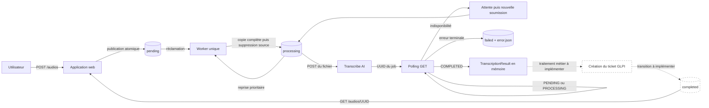

# GLPI Ticketing Automation

POC Python destiné à automatiser la création de tickets GLPI à partir de
fichiers audio. Le dépôt couvre actuellement la publication robuste d'un audio,
son cycle de vie sur des volumes partagés et sa transcription asynchrone. La
création du ticket GLPI et la finalisation du fichier audio constituent encore
la suite du pipeline à implémenter.

Le POC repose volontairement sur une architecture simple : une application
web, un worker unique et des répertoires partagés utilisés comme file de
travail. Il n'utilise actuellement ni base de données, ni broker de messages.

## État du périmètre

### Fonctionnalités implémentées

- réception d'un fichier `.wav`, `.mp3`, `.ogg` ou `.m4a` par l'application
  web, avec limite de taille configurable ;
- attribution d'un UUID au fichier et publication complète dans `pending` via
  un fichier temporaire `.part` ;
- téléchargement par UUID d'un audio déjà présent dans `completed` ;
- réclamation par le worker d'un audio de `pending` vers `processing`, avec
  reprise prioritaire d'un fichier déjà présent dans `processing` ;
- soumission de l'audio à l'API batch de Transcribe AI puis récupération du
  résultat par polling ;
- nouvelle tentative en cas d'indisponibilité, sans sortir l'audio de
  `processing` ;
- isolation des erreurs terminales dans `failed`, accompagnées d'un sidecar
  JSON expurgé ;
- retour de la transcription en mémoire, sans journaliser son contenu.

### Fonctionnalités restant à intégrer

- point d'entrée exécutable pour assembler et démarrer l'application web ;
- point d'entrée exécutable pour construire le client HTTP et démarrer le
  worker ;
- traitement métier de la transcription et création du ticket dans GLPI ;
- transition d'un traitement réussi de `processing` vers `completed` ;
- orchestration complète de bout en bout, déploiement et supervision.

Le dépôt ne fournit donc pas encore de commande de démarrage applicatif. Le
module web expose une fabrique `create_app(...)` et le worker expose des
fonctions injectables `run_once(...)` et `run_forever(...)`. Documenter une
commande `uvicorn` ou une CLI worker à ce stade masquerait l'absence de ces
bootstraps.

## Architecture du workspace

La racine est un [workspace uv](pyproject.toml) non publiable
(`package = false`). Elle centralise le verrouillage des dépendances dans un
seul `uv.lock`, les outils de développement et la configuration de Pytest et
Ruff. Chaque membre conserve son propre `pyproject.toml` et déclare
explicitement ses dépendances d'exécution.

| Membre | Distribution Python | Responsabilité actuelle | Documentation |
| --- | --- | --- | --- |
| `apps/web` | `glpi-ticketing-web` | Interface FastAPI de dépôt dans `pending` et de lecture depuis `completed` | [Application web](apps/web/README.md) |
| `apps/worker-automation` | `glpi-ticketing-worker-automation` | Réclamation des audios, appel de Transcribe AI, polling, reprise et traitement des erreurs | [Worker d'automatisation](apps/worker-automation/README.md) |
| `packages/common` | `glpi-ticketing-common` | Nommage UUID, découverte des audios et transitions robustes entre volumes | [Package commun](packages/common/README.md) |

Les deux applications dépendent du package commun par la source workspace
déclarée à la racine. Une application ne doit pas importer directement les
modules internes de l'autre application.

La convention générale est un layout `src` : le code de chaque membre se
trouve dans `<membre>/src/<package_python>` et ses tests dans
`<membre>/tests`. Les conventions propres à chaque membre sont détaillées dans
son README.

## Flux global



1. L'application web valide l'extension et la taille du flux reçu. Elle
   remplace le nom fourni par un UUID canonique et publie le contenu dans
   `pending`. Le fichier final n'apparaît qu'après écriture et synchronisation
   complètes d'un fichier `.part`.
2. Le worker regarde d'abord `processing`. Cette priorité permet de reprendre
   un audio abandonné après un redémarrage. S'il n'en trouve pas, il réclame le
   premier audio prêt de `pending`. Les fichiers `.part` sont toujours ignorés.
3. Le worker soumet le fichier à Transcribe AI, récupère l'UUID du job puis
   interroge son état. L'audio reste dans `processing` pendant toute cette
   séquence.
4. Une indisponibilité réseau, une réponse temporaire ou l'expiration du délai
   de polling provoque une attente puis une nouvelle soumission du même audio.
   L'API ne fournissant pas de mécanisme d'idempotence exploitable, un nouveau
   job distant peut alors être créé.
5. Une erreur explicitement terminale publie d'abord l'audio et son sidecar
   dans `failed`, puis supprime la source de `processing`. Le worker ne parcourt
   jamais `failed` : une nouvelle tentative nécessite une décision opérateur.
6. En cas de succès, le worker retourne l'UUID de l'audio, son chemin et la
   transcription dans un `TranscriptionResult`. Le fichier reste dans
   `processing`. Le gestionnaire appelé par `run_forever(...)` doit le faire
   avancer avant de rendre la main ; ce gestionnaire métier n'est pas encore
   implémenté.
7. La route de téléchargement web ne lit que `completed`. Elle est déjà
   disponible, mais le pipeline actuel ne produit pas encore lui-même ce
   fichier final.

Les publications inter-volumes ne supposent pas qu'un renommage atomique soit
possible entre deux systèmes de fichiers. La destination est copiée dans un
fichier `.part`, synchronisée puis publiée par renommage dans son propre
répertoire ; la source n'est supprimée qu'après cette publication.

Un sidecar terminal porte le nom `{uuid}.error.json` et contient uniquement :

- l'UUID de l'audio ;
- l'étape `transcription` ;
- une catégorie d'erreur ;
- un code technique non sensible ;
- un horodatage UTC.

Il ne contient ni transcription, ni clé API, ni réponse HTTP brute.

## Technologies

Les contraintes déclarées dans les fichiers `pyproject.toml` sont la source de
vérité ; `uv.lock` fixe les versions exactes installées pour le dépôt.

| Technologie | Contrainte déclarée | Utilisation |
| --- | --- | --- |
| Python | `>=3.12` | Langage commun aux trois membres |
| uv | workspace et lock partagé | Résolution, environnement, exécution et build |
| FastAPI | `>=0.116,<1` | Routes HTTP et validation de l'application web |
| Uvicorn | `>=0.35,<1` | Serveur ASGI prévu pour le futur bootstrap web |
| Jinja2 | `>=3.1,<4` | Pages HTML de dépôt et de confirmation |
| Pydantic Settings | `>=2.10,<3` | Configuration typée depuis l'environnement |
| HTTPX | `>=0.28,<1` | Client HTTP actuel de Transcribe AI |
| HTTPX 2 | `>=2,<3`, groupe de développement | Anticipation de migration et compatibilité des tests |
| Pytest | `>=8.4,<10` | Tests unitaires et tests d'intégration opt-in |
| Ruff | `>=0.12,<1` | Formatage et analyse statique |
| Testcontainers | `>=4.12,<5`, groupe de développement | Stack GLPI/MySQL jetable pour les tests d'intégration OAuth |

Les trois distributions du projet utilisent `uv_build` comme backend de
construction et portent actuellement la version `0.1.0`.

## Prérequis

- Python 3.12 ou supérieur ;
- [`uv`](https://docs.astral.sh/uv/) ;
- Bash pour le script de test réel de transcription ;
- des répertoires audio distincts et accessibles au processus lors de la
  future exécution des applications ;
- uniquement pour le test `live_transcribe` : une instance accessible de
  Transcribe AI, une clé API et un audio local pris en charge.
- uniquement pour les tests marqués `glpi` : Docker avec le plugin Compose.

Docker, GLPI et Transcribe AI ne sont pas nécessaires pour exécuter la suite
unitaire par défaut. L'instance GLPI utilisée par les tests d'intégration est
construite et détruite automatiquement ; aucune installation GLPI locale n'est
attendue.

## Installation depuis la racine

```bash
uv sync --all-packages --all-groups
cp .env.example .env
```

En CI, ou pour refuser toute modification implicite du verrou, utilisez :

```bash
uv sync --frozen --all-packages --all-groups
```

## Configuration locale et secrets

Le fichier [.env.example](.env.example) décrit les variables applicatives.
Copiez-le vers `.env`, puis fournissez uniquement des valeurs adaptées à votre
machine. `.env` et `.env.*` sont ignorés par Git, à l'exception du modèle ; ils
ne doivent jamais être ajoutés au dépôt.

`WebSettings` et `WorkerSettings` valident déjà ce contrat, mais les futurs
points de démarrage devront encore injecter ces valeurs dans `create_app(...)`,
`TranscriptionClient` et `run_forever(...)`.

| Variables | Propriétaire | Rôle défini par la configuration |
| --- | --- | --- |
| `AUDIO_PENDING_DIR` | web et worker | Dépôt des uploads et entrée de la file |
| `AUDIO_PROCESSING_DIR` | worker | Audio réclamé et traitement en cours |
| `AUDIO_COMPLETED_DIR` | web et worker | Lecture web ; écriture worker encore future |
| `AUDIO_FAILED_DIR` | worker | Audio terminal et sidecar expurgé |
| `MAX_UPLOAD_BYTES` | web | Taille maximale d'un upload |
| `PUBLIC_BASE_URL` | worker | URL publique requise par sa configuration, prévue pour les futurs liens audio |
| `LEGACY_TRANSCRIPTION_BASE_URL` | worker | URL obligatoire de l'API batch actuellement intégrée |
| `LEGACY_TRANSCRIPTION_API_KEY` | worker | Clé obligatoire, représentée par un type secret |
| `TRANSCRIPTION_HTTP_TIMEOUT_SECONDS` | worker | Délai maximal d'une requête HTTP |
| `TRANSCRIPTION_POLL_INTERVAL_SECONDS` | worker | Intervalle entre deux lectures d'un job |
| `TRANSCRIPTION_JOB_TIMEOUT_SECONDS` | worker | Durée maximale d'une tentative de polling |
| `GLPI_PASSWORD`, `GLPI_CLIENT_SECRET` | worker | Secrets optionnels réservés à l'intégration GLPI future |

Les variables `LIVE_TRANSCRIBE_*` et `RUN_LIVE_TRANSCRIBE` appartiennent au
test réel, pas à la configuration applicative. Le script fourni demande la clé
sans écho si elle n'est pas déjà exportée, puis retire ses variables à la fin.
Évitez de placer une clé dans une commande conservée par l'historique du shell.

## Politique de tests

La suite par défaut doit être déterministe, locale et sans appel externe. Les
tests utilisent notamment des répertoires temporaires, des clients simulés et
l'injection de l'horloge et de la fonction de sommeil. Ils vérifient les
résultats observables et les invariants de publication des fichiers, sans
attendre réellement.

Pytest est configuré avec `--strict-config`, `--strict-markers` et le mode
d'import `importlib`. Les marqueurs enregistrés sont :

| Marqueur | Politique |
| --- | --- |
| `live_transcribe` | Appelle une véritable instance locale de Transcribe AI ; opt-in et susceptible de créer un job |
| `glpi` | Démarre une seule stack GLPI 11/MySQL jetable, configure l'API V2 et vérifie le grant OAuth Password |
| `e2e` | Réservé au futur scénario complet avec services externes |

Le test réel de transcription possède une double protection : le marqueur
`live_transcribe` et la variable `RUN_LIVE_TRANSCRIBE=1`. Il ne doit jamais
utiliser un audio contenant des données sensibles non autorisées.

La suite `glpi` construit une image strictement réservée aux tests à partir de
GLPI 11.0.8, épinglé par digest, et utilise une image MySQL 8.4.11 également
épinglée. Une fixture de session expose GLPI sur un port aléatoire lié à
`127.0.0.1`, attend sa disponibilité HTTP, puis crée avec les classes métier
GLPI un utilisateur et un client OAuth Password limités au scope `api`. Tous
les identifiants sont éphémères et transmis par variables d'environnement. La
suite ne doit pas être parallélisée ; son teardown supprime les conteneurs, le
réseau, les volumes Compose et l'image custom construite pour la session.

## Commandes de validation depuis la racine

Suite locale sans service externe :

```bash
uv run --all-packages pytest -m "not glpi and not live_transcribe and not e2e"
```

Intégration GLPI jetable, à exécuter séparément et sans parallélisation :

```bash
uv run pytest -m glpi tests/integration/glpi -vv --maxfail=1
```

Tests ciblés par membre :

```bash
uv run --all-packages pytest apps/web/tests
uv run --all-packages pytest apps/worker-automation/tests/unit
uv run --all-packages pytest packages/common/tests
```

Vérifications de style :

```bash
uv run ruff format --check .
uv run ruff check .
```

Formatage du code après modification :

```bash
uv run ruff format .
```

Test réel de Transcribe AI, uniquement lorsque le service est disponible :

```bash
./scripts/run-live-transcription-test.sh /chemin/absolu/vers/audio.m4a
```

Sans argument, le script cherche `audio.m4a` à la racine et utilise
`http://localhost:5000`. Ce fichier audio local doit rester non suivi. L'URL et
le chemin peuvent être surchargés sans exposer la clé :

```bash
LIVE_TRANSCRIBE_BASE_URL=http://localhost:5000 \
LIVE_TRANSCRIBE_AUDIO_PATH=/chemin/absolu/vers/audio.m4a \
./scripts/run-live-transcription-test.sh
```

Le script demande alors la clé API de manière interactive et lance uniquement
le test marqué `live_transcribe`.
