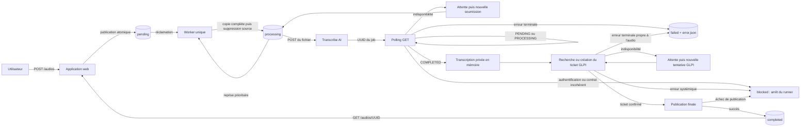

# GLPI Ticketing Automation

POC Python destiné à automatiser la création de tickets GLPI à partir de
fichiers audio. Le dépôt couvre actuellement la publication robuste d'un audio,
son cycle de vie sur des volumes partagés, sa transcription asynchrone et le
traitement complet par le worker jusqu'à la création d'un ticket GLPI et la
publication de l'audio dans `completed`.

Le POC repose volontairement sur une architecture simple : une application
web, un worker unique et des répertoires partagés utilisés comme file de
travail. Il n'utilise actuellement ni base de données, ni broker de messages.

## État du périmètre

### Fonctionnalités implémentées

- réception d'un fichier `.wav`, `.mp3`, `.ogg` ou `.m4a` par l'application
  web, avec limite de taille configurable ;
- attribution d'un UUID au fichier et publication complète dans `pending` via
  un fichier temporaire `.part` ;
- téléchargement par UUID d'un audio déjà présent dans `completed` ;
- réclamation par le worker d'un audio de `pending` vers `processing`, avec
  reprise prioritaire d'un fichier déjà présent dans `processing` ;
- soumission de l'audio à l'API batch de Transcribe AI puis récupération du
  résultat par polling ;
- nouvelle tentative en cas d'indisponibilité, sans sortir l'audio de
  `processing` ;
- isolation des erreurs terminales dans `failed`, accompagnées d'un sidecar
  JSON expurgé ;
- conservation interne de la transcription en mémoire, sans journaliser son
  contenu ;
- authentification OAuth Password auprès de GLPI V2.3.0 ;
- récupération ou création d'un ticket GLPI corrélé par l'`external_id` de
  l'audio, sans rejeu aveugle d'une création au résultat incertain ;
- orchestration transcription → ticketing → finalisation avec des résultats
  typés `idle`, `retry`, `completed`, `failed` et `blocked` ;
- conservation privée de la transcription en mémoire pendant les reprises
  GLPI, puis publication du fichier dans `completed` après confirmation du
  ticket ;
- point d'entrée exécutable du worker, composition des clients HTTP et arrêt
  coopératif sur `SIGINT` ou `SIGTERM` ;
- point d'entrée exécutable de l'application web, composition FastAPI/Uvicorn
  et écoute configurable avec loopback par défaut ;
- images runtime séparées, Docker Compose mono-serveur durci et runbook de
  déploiement du POC sur un serveur de test.

### Limites restant à traiter avant un MVP

- authentification et autorisation applicatives ;
- gestion des secrets par fichiers ou coffre externe ;
- supervision et mécanisme opérateur pour les traitements bloqués ou classés
  dans `failed` ;
- sauvegarde, rétention et chiffrement au repos des audios.

Chaque application possède désormais une racine de composition dans
`application.py`, une commande console et une exécution équivalente avec
`python -m`. Les fabriques FastAPI et les composants du pipeline restent
séparés de ces points d'entrée afin d'être testés sans démarrer leur boucle
d'exécution.

## Architecture du workspace

La racine est un [workspace uv](pyproject.toml) non publiable
(`package = false`). Elle centralise le verrouillage des dépendances dans un
seul `uv.lock`, les outils de développement et la configuration de Pytest et
Ruff. Chaque membre conserve son propre `pyproject.toml` et déclare
explicitement ses dépendances d'exécution.

| Membre | Distribution Python | Responsabilité actuelle | Documentation |
| --- | --- | --- | --- |
| `apps/web` | `glpi-ticketing-web` | Interface FastAPI de dépôt dans `pending` et de lecture depuis `completed` | [Application web](apps/web/README.md) |
| `apps/worker-automation` | `glpi-ticketing-worker-automation` | Pipeline avec état privé : réclamation, transcription, ticket GLPI et finalisation | [Worker d'automatisation](apps/worker-automation/README.md) |
| `packages/common` | `glpi-ticketing-common` | Nommage UUID, découverte des audios et transitions robustes entre volumes | [Package commun](packages/common/README.md) |

Les deux applications dépendent du package commun par la source workspace
déclarée à la racine. Une application ne doit pas importer directement les
modules internes de l'autre application.

Les artefacts sous [`infra/docker/`](infra/docker/README.md) ne constituent pas
un membre Python supplémentaire. Ils empaquettent ces trois distributions sans
déplacer leurs responsabilités ni réutiliser les stacks Testcontainers.

La convention générale est un layout `src` : le code de chaque membre se
trouve dans `<membre>/src/<package_python>` et ses tests dans
`<membre>/tests`. Les conventions propres à chaque membre sont détaillées dans
son README.

## Flux global



1. L'application web valide l'extension et la taille du flux reçu. Elle
   remplace le nom fourni par un UUID canonique et publie le contenu dans
   `pending`. Le fichier final n'apparaît qu'après écriture et synchronisation
   complètes d'un fichier `.part`.
2. Le worker regarde d'abord `processing`. Cette priorité permet de reprendre
   un audio abandonné après un redémarrage. S'il n'en trouve pas, il réclame le
   premier audio prêt de `pending`. Les fichiers `.part` sont toujours ignorés.
3. Le worker soumet le fichier à Transcribe AI, récupère l'UUID du job puis
   interroge son état. L'audio reste dans `processing` pendant toute cette
   séquence.
4. Une indisponibilité réseau, une réponse temporaire ou l'expiration du délai
   de polling produit un résultat `retry`. La boucle attend puis relance une
   transcription du même audio. L'API ne fournissant pas de clé d'idempotence,
   un nouveau job distant peut alors être créé.
5. Seul un rejet explicite de la soumission sous HTTP 200 ou un job au statut
   exact `FAILED` est terminal pour l'audio. Une erreur d'authentification,
   d'autorisation, un autre `4xx`, une réponse malformée ou un statut distant
   inconnu produit `blocked` et conserve l'audio dans `processing`.
6. Une transcription réussie est conservée dans l'état privé du processeur.
   Elle n'est exposée dans aucun résultat public et elle est réutilisée sans
   retranscription tant que les tentatives GLPI restent dans le même processus.
7. Le client GLPI épinglé en V2.3.0 recherche le ticket par `external_id`, le
   crée si nécessaire, puis retourne son identifiant. Une indisponibilité ou un
   résultat de création incertain produit `retry` sans déplacer l'audio.
8. Une erreur terminale propre à l'audio publie d'abord l'audio et un sidecar
   expurgé dans `failed`, puis supprime `processing`. Une erreur systémique,
   une incohérence ou une publication impossible produit `blocked` et arrête
   la boucle afin que l'opérateur inspecte le résultat et les artefacts
   éventuellement déjà publiés.
9. Après confirmation du ticket, l'audio est publié dans `completed`. Le
   résultat `completed` contient l'UUID, le chemin final et l'identifiant GLPI,
   mais jamais la transcription.

Les publications inter-volumes ne supposent pas qu'un renommage atomique soit
possible entre deux systèmes de fichiers. La destination est copiée dans un
fichier `.part`, synchronisée puis publiée par renommage dans son propre
répertoire ; la source n'est supprimée qu'après cette publication.

Si une synchronisation signale un `OSError` après la suppression de la source,
le processeur vérifie l'état observable avant de bloquer. Une destination
`completed` complète produit malgré tout `CompletedOutcome`. Pour `failed`,
l'audio et le sidecar doivent tous deux être présents et le JSON doit
correspondre exactement à l'échec mémorisé pour produire `FailedOutcome`.

Un sidecar terminal porte le nom `{uuid}.error.json` et contient uniquement :

- l'UUID de l'audio ;
- l'étape `transcription` ou `ticketing` ;
- une catégorie d'erreur ;
- un code technique non sensible ;
- un horodatage UTC.

Il ne contient ni transcription, ni clé API, ni réponse HTTP brute.

La politique Transcribe AI suit une allowlist terminale : une enveloppe
`status=error` ne représente un rejet propre à l'audio que sur la réponse HTTP
200 de soumission, et seul le statut de job exact `FAILED` est terminal pendant
le polling. Les erreurs HTTP non réessayables, y compris `401`, `403` et les
autres `4xx`, ainsi que les réponses incompatibles avec le contrat, produisent
`blocked`. Cette prudence empêche une clé invalide ou une évolution distante de
classer toute la file dans `failed`.

La version Transcribe AI `1.0.0` épinglée pour les tests représente encore un
job distant en échec par une enveloppe HTTP `500`, sans code métier stable.
Cette réponse reste donc volontairement réessayable : le client ne peut pas la
distinguer sûrement d'une panne serveur. Le contrat distant devra exposer
`data.status=FAILED` ou un code d'erreur métier stable avant le MVP pour rendre
ce cas terminal sans fragiliser les erreurs systémiques.

La politique GLPI est conservatrice : un statut HTTP ne suffit jamais à rendre
une création terminale. Seuls un `external_id` dupliqué et une réponse `400`
reconnue par le client comme rejet sémantique des champs dynamiques
`content`/`external_id` conduisent à `failed`. Les autres `400`, ainsi que les
`409`, `422` et erreurs de contrat non reconnues, conduisent à `blocked` afin
de ne pas isoler tous les audios à cause d'une configuration ou d'une évolution
de l'API.

### État et résultats du worker

`AudioProcessor` est volontairement avec état et réservé au worker unique du
POC. Son état privé distingue `_AwaitingTranscription`, `_AwaitingTicket`,
`_AwaitingFinalization` et `_AwaitingFailurePublication`. La transcription
n'existe que dans l'attente du ticket et son `repr` est masqué. L'état de
publication d'échec conserve l'étape, le code expurgé et l'horodatage afin qu'un
nouvel appel sur la même instance reprenne uniquement la publication dans
`failed`, sans rappeler Transcribe AI ou GLPI.

Un redémarrage perd cet état : le scanner reprend alors l'audio dans
`processing`, le retranscrit et laisse `ensure_ticket()` réconcilier le ticket
par `external_id`.

Chaque appel à `AudioProcessor.run_once()` retourne un objet immuable et
expurgé :

| Résultat | Effet de `run_forever()` |
| --- | --- |
| `IdleOutcome` | Attend l'intervalle de scan. |
| `RetryOutcome` | Attend l'intervalle propre à l'étape, puis reprend le même état privé. |
| `CompletedOutcome` | Continue immédiatement avec l'audio suivant. |
| `FailedOutcome` | Continue immédiatement ; le fichier est terminal dans `failed`. |
| `BlockedOutcome` | Lève `WorkerBlockedError` et arrête la boucle pour intervention. |

Aucun de ces résultats ne transporte la transcription, un secret ou une
réponse distante brute.

Un résultat `blocked` expose normalement le chemin encore présent dans
`processing`. Si une erreur de synchronisation rend la localisation ambiguë
après suppression de la source, ce chemin vaut `None` et `inspection_paths`
indique explicitement les artefacts que l'opérateur doit contrôler.

## Technologies

Les contraintes déclarées dans les fichiers `pyproject.toml` sont la source de
vérité ; `uv.lock` fixe les versions exactes installées pour le dépôt.

| Technologie | Contrainte déclarée | Utilisation |
| --- | --- | --- |
| Python | `>=3.12` | Langage commun aux trois membres |
| uv | workspace et lock partagé | Résolution, environnement, exécution et build |
| FastAPI | `>=0.116,<1` | Routes HTTP et validation de l'application web |
| Uvicorn | `>=0.35,<1` | Serveur ASGI composé par le point d'entrée web |
| Jinja2 | `>=3.1,<4` | Pages HTML de dépôt et de confirmation |
| Pydantic Settings | `>=2.10,<3` | Configuration typée depuis l'environnement |
| HTTPX | `>=0.28,<1` | Clients HTTP de Transcribe AI et GLPI |
| HTTPX 2 | `>=2,<3`, groupe de développement | Anticipation de migration et compatibilité des tests |
| Pytest | `>=8.4,<10` | Tests unitaires et tests d'intégration opt-in |
| Ruff | `>=0.12,<1` | Formatage et analyse statique |
| Testcontainers | `>=4.12,<5`, groupe de développement | Stacks GLPI/MySQL et Transcribe AI jetables pour les tests d'intégration |
| Nginx | `1.30.4-alpine3.24`, image épinglée par digest | Terminaison TLS, authentification Basic et reverse proxy du POC |
| Docker Engine / Compose | `28.3.3+` / `2.24+`, hors workspace Python | Images Nginx/web/worker et déploiement mono-serveur du POC |

Les trois distributions du projet utilisent `uv_build` comme backend de
construction et portent actuellement la version `0.1.0`.

## Prérequis

- Python 3.12 ou supérieur ;
- [`uv`](https://docs.astral.sh/uv/) ;
- quatre répertoires audio distincts, existants et accessibles pour démarrer le
  worker ;
- uniquement pour les tests marqués `glpi`, `transcribe_ai` ou `e2e` : Docker
  avec le plugin Compose ;
- uniquement pour construire ou déployer le POC : Docker Engine 28.3.3 ou
  supérieur, Docker Compose 2.24 ou supérieur, un certificat TLS avec sa clé
  privée et l'utilitaire `htpasswd` ;
- uniquement pour `transcribe_ai` ou `e2e` : un hôte et un daemon Docker
  `linux/amd64`, ainsi qu'un accès réseau à chaque session pour le modèle
  Whisper ; le premier lancement télécharge aussi les images. Le mode GPU
  requiert en plus un GPU NVIDIA et NVIDIA Container Toolkit.

Docker, GLPI et Transcribe AI ne sont pas nécessaires pour exécuter la suite
unitaire par défaut. Les deux stacks d'intégration sont démarrées et détruites
automatiquement ; aucune installation locale de GLPI ou de Transcribe AI n'est
attendue.

## Installation depuis la racine

```bash
uv sync --all-packages --all-groups
cp .env.example .env
```

En CI, ou pour refuser toute modification implicite du verrou, utilisez :

```bash
uv sync --frozen --all-packages --all-groups
```

## Configuration locale et secrets

Le fichier [.env.example](.env.example) décrit les variables applicatives.
Copiez-le vers `.env`, puis fournissez uniquement des valeurs adaptées à votre
machine. `.env` et `.env.*` sont ignorés par Git, à l'exception du modèle ; ils
ne doivent jamais être ajoutés au dépôt.

`WebSettings` et `WorkerSettings` valident ce contrat. Le point d'entrée du
worker transforme `WorkerSettings` en `TranscriptionClient`, `GlpiClient`,
`AudioProcessor` et `run_forever(...)`. Celui du web transforme `WebSettings`
en application FastAPI puis en serveur Uvicorn.

| Variables | Propriétaire | Rôle défini par la configuration |
| --- | --- | --- |
| `AUDIO_PENDING_DIR` | web et worker | Dépôt des uploads et entrée de la file |
| `AUDIO_PROCESSING_DIR` | worker | Audio réclamé et traitement en cours |
| `AUDIO_COMPLETED_DIR` | web et worker | Publication des succès par le worker et lecture par le web |
| `AUDIO_FAILED_DIR` | worker | Audio terminal et sidecar expurgé |
| `WEB_HOST`, `WEB_PORT` | web | Adresse IP et port d'écoute Uvicorn ; `127.0.0.1:8000` par défaut |
| `WEB_TRUST_PROXY_HEADERS` | web | Confiance explicite dans les en-têtes du proxy ; désactivée par défaut |
| `MAX_UPLOAD_BYTES` | web | Taille maximale d'un upload |
| `WORKER_SCAN_INTERVAL_SECONDS` | worker | Attente d'un résultat `idle`, `1` seconde par défaut |
| `PUBLIC_BASE_URL` | worker | Base utilisée par la composition pour construire l'URL audio du ticket |
| `LEGACY_TRANSCRIPTION_BASE_URL` | worker | URL obligatoire de l'API batch actuellement intégrée |
| `LEGACY_TRANSCRIPTION_API_KEY` | worker | Clé obligatoire, représentée par un type secret |
| `TRANSCRIPTION_HTTP_TIMEOUT_SECONDS` | worker | Délai maximal d'une requête HTTP |
| `TRANSCRIPTION_POLL_INTERVAL_SECONDS` | worker | Intervalle entre deux lectures d'un job |
| `TRANSCRIPTION_JOB_TIMEOUT_SECONDS` | worker | Durée maximale d'une tentative de polling |
| `GLPI_BASE_URL`, `GLPI_USERNAME` | worker | Instance GLPI et utilisateur du grant OAuth Password |
| `GLPI_PASSWORD`, `GLPI_CLIENT_ID`, `GLPI_CLIENT_SECRET` | worker | Identifiants OAuth obligatoires, avec les deux secrets masqués |
| `GLPI_HTTP_TIMEOUT_SECONDS` | worker | Timeout des opérations OAuth, recherche et création |
| `GLPI_RETRY_INTERVAL_SECONDS` | worker | Attente avant de reprendre un résultat GLPI `retry`, `2` secondes par défaut |
| `GLPI_TICKET_TITLE`, `GLPI_TICKET_TYPE` | worker | Titre fixe et type appliqués aux tickets |
| `GLPI_TICKET_URGENCY`, `GLPI_TICKET_IMPACT` | worker | Niveaux fixes dont GLPI déduit la priorité |

`TRANSCRIBE_AI_TEST_DEVICE` appartient uniquement à la fixture d'intégration.
Sa valeur est `cpu` par défaut ou `gpu` pour demander explicitement CUDA. Les
identifiants de la stack sont générés en mémoire à chaque session pytest :
aucune clé Transcribe AI ne doit être fournie par le développeur.

## Déploiement mono-serveur du POC

Le mode validé pour un serveur de test construit trois images : Nginx, `web` et
`worker`. GLPI et Transcribe AI restent des services externes. Quatre bind
mounts persistants conservent le cycle de vie des audios ; le web ne voit que
`pending` en écriture et `completed` en lecture seule.

Nginx est le seul service publié. Il termine TLS, exige une authentification
Basic et relaie vers `web:8000` sur un réseau Docker interne. Par défaut, son
port HTTPS est lié au loopback de l'hôte ; l'ouverture sur l'adresse du serveur
doit être explicite et protégée par le pare-feu. Les trois conteneurs utilisent
un rootfs en lecture seule, aucune capability Linux et une rotation locale des
logs ; les applications Python partagent l'UID `10001`, Nginx utilise l'UID
non-root `101`.

Le worker n'est volontairement pas redémarré automatiquement : son code de
sortie `3` est un signal d'intervention, pas une panne à masquer. Le démarrage
systemd fourni refuse également de reprendre un ancien worker sorti avec un
code non nul ; la reprise reste une décision opérateur explicite.

Le runbook complet, la préparation des volumes, les fichiers de configuration,
l'overlay de CA interne, Nginx et la procédure de rollback se trouvent
dans la [documentation de déploiement](infra/docker/README.md).

### Démarrage de l'application web

Après avoir créé les répertoires `pending` et `completed` configurés :

```bash
uv run glpi-ticketing-web
```

La forme module est équivalente :

```bash
uv run python -m glpi_ticketing_web
```

Le serveur écoute uniquement sur `127.0.0.1:8000` par défaut. L'image construite
par `infra/docker/web/Dockerfile` définit explicitement `WEB_HOST=0.0.0.0` dans
le conteneur, mais Compose expose ce port uniquement à Nginx sur le réseau
`web-private` et ne le publie jamais sur l'hôte. Le processus retourne `0`
après l'arrêt normal, `1` pour une erreur inattendue, `2` pour une
configuration invalide et `130` pour un `KeyboardInterrupt` non pris en charge
par Uvicorn.

### Démarrage du worker

Après avoir renseigné `.env` et créé les quatre répertoires audio configurés :

```bash
uv run glpi-ticketing-worker
```

La forme module est équivalente :

```bash
uv run python -m glpi_ticketing_worker_automation
```

Le processus retourne `0` après un arrêt normal ou un `SIGINT`/`SIGTERM` géré,
`1` pour une erreur inattendue, `2` pour une configuration invalide, `3` pour
un pipeline bloqué et `130` si un `KeyboardInterrupt` échappe aux gestionnaires.
Les attentes sont réveillées par le signal ; un appel HTTP synchrone déjà en
cours peut toutefois aller jusqu'à son timeout configuré.

## Politique de tests

La suite par défaut doit être déterministe, locale et sans appel externe. Les
tests utilisent notamment des répertoires temporaires, des clients simulés et
l'injection de l'horloge et de la fonction de sommeil. Ils vérifient les
résultats observables et les invariants de publication des fichiers, sans
attendre réellement.

Les anciens tests unitaires plats du scanner et du worker ont été répartis sous
`apps/worker-automation/tests/unit/worker/` : outcomes, scanner, transcription
du processeur, ticketing du processeur et runner. Les contrats HTTP restent
testés séparément au niveau de leurs adaptateurs.

L'application web possède en plus un test d'intégration local : il démarre le
vrai serveur Uvicorn sur un socket loopback et un port aléatoire, interroge
`GET /health` par polling borné puis vérifie son arrêt. Il ne requiert aucun
service externe.

Pytest est configuré avec `--strict-config`, `--strict-markers` et le mode
d'import `importlib`. Les marqueurs enregistrés sont :

| Marqueur | Politique |
| --- | --- |
| `deployment` | Construit les trois images runtime et vérifie TLS, Nginx et le Compose durci sans appeler les API externes |
| `transcribe_ai` | Démarre une stack Transcribe AI v1 jetable et exécute le contrat POST/polling réel |
| `glpi` | Démarre une seule stack GLPI 11/MySQL jetable et teste le client V2.3.0 réel |
| `e2e` | Assemble le worker réel avec les stacks Transcribe AI et GLPI jetables |

La suite `transcribe_ai` lance PostgreSQL, Redis, l'API, le worker batch et le
service Whisper STT une seule fois par session. Les images sont épinglées par
digest, l'API utilise un port loopback aléatoire et les secrets sont éphémères.
Un court WAV vocal non sensible est généré dans le conteneur : aucun audio local
n'est lu. Le mode CPU est le défaut ; un overlay distinct réserve le GPU et la
fixture vérifie le périphérique réellement vu par PyTorch. Cette suite ne doit
pas être parallélisée.

La suite `glpi` construit une image strictement réservée aux tests à partir de
GLPI 11.0.8, épinglé par digest, et utilise une image MySQL 8.4.11 également
épinglée. Une fixture de session expose GLPI sur un port aléatoire lié à
`127.0.0.1`, attend sa disponibilité HTTP, puis crée avec les classes métier
GLPI un utilisateur et un client OAuth Password limités au scope `api`. Tous
les identifiants sont éphémères et transmis par variables d'environnement. La
suite récupère le token par `GlpiClient`, crée réellement un ticket et vérifie
sa corrélation par `external_id`. Elle ne doit pas être parallélisée ; son
teardown supprime les conteneurs, le réseau, les volumes Compose et l'image
custom construite pour la session.

La suite `e2e` réutilise ces deux fixtures de session et la vraie racine de
composition du worker. Elle génère un UUID, publie le WAV synthétique dans
`pending`, vérifie une transcription non vide dans le ticket corrélé par
`external_id`, puis contrôle l'audio dans `completed` et l'absence d'artefact
dans `failed`. Les deux fixtures restent responsables de leur teardown. Cette
suite ne doit pas être parallélisée.

## Commandes de validation depuis la racine

Suite locale sans service externe :

```bash
uv run --all-packages pytest \
  -m "not deployment and not glpi and not transcribe_ai and not e2e"
```

Smoke test du packaging de déploiement, à exécuter séparément et sans
parallélisation :

```bash
uv run pytest -m deployment tests/deployment -vv --maxfail=1
```

Intégration GLPI jetable, à exécuter séparément et sans parallélisation :

```bash
uv run pytest -m glpi \
apps/worker-automation/tests/integration/glpi -vv --maxfail=1
```

Tests ciblés par membre :

```bash
uv run --all-packages pytest apps/web/tests
uv run --all-packages pytest apps/worker-automation/tests/unit
uv run --all-packages pytest packages/common/tests
```

Tests ciblés du pipeline et de sa boucle :

```bash
uv run --all-packages pytest apps/worker-automation/tests/unit/worker
```

Vérifications de style :

```bash
uv run ruff format --check .
uv run ruff check .
```

Formatage du code après modification :

```bash
uv run ruff format .
```

Intégration Transcribe AI jetable sur CPU :

```bash
TRANSCRIBE_AI_TEST_DEVICE=cpu \
uv run --all-packages pytest -m transcribe_ai -vv --maxfail=1
```

Le CPU est sélectionné lorsque la variable est absente. Pour utiliser le GPU :

```bash
TRANSCRIBE_AI_TEST_DEVICE=gpu \
uv run --all-packages pytest -m transcribe_ai -vv --maxfail=1
```

Flux E2E complet sur CPU, utilisé par défaut :

```bash
uv run pytest -m e2e \
apps/worker-automation/tests/integration/e2e -vv --maxfail=1
```

Le même flux sur GPU :

```bash
TRANSCRIBE_AI_TEST_DEVICE=gpu \
uv run pytest -m e2e \
apps/worker-automation/tests/integration/e2e -vv --maxfail=1
```

Chaque session télécharge le modèle Whisper `tiny` ; le premier lancement
télécharge aussi les images, dont l'image STT volumineuse. Les détails du flux,
des prérequis GPU et du teardown sont documentés dans
[`apps/worker-automation/tests/integration/transcribe-ai/README.md`](apps/worker-automation/tests/integration/transcribe-ai/README.md).
Le scénario combiné est détaillé dans
[`apps/worker-automation/tests/integration/e2e/README.md`](apps/worker-automation/tests/integration/e2e/README.md).
