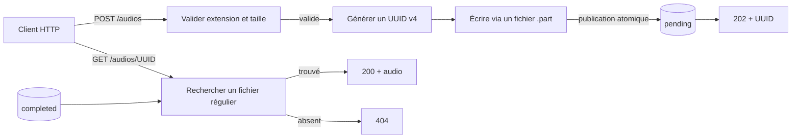

# Application web

L'application `glpi-ticketing-web` est la façade HTTP du POC. Dans son état
actuel, elle remplit deux responsabilités :

- recevoir un fichier audio et le publier dans le répertoire `pending` ;
- restituer un audio uniquement lorsqu'il est présent dans le répertoire
  `completed`.

Elle ne transcrit pas les audios et ne crée pas de ticket GLPI. Ces traitements
appartiennent au pipeline d'automatisation, en dehors de cette application.

## Technologies et dépendances

- Python 3.12 ou supérieur ;
- FastAPI pour les routes et la validation HTTP ;
- Jinja2 pour les deux pages HTML ;
- `python-multipart` pour la réception du formulaire d'upload ;
- Pydantic Settings pour la configuration typée ;
- Uvicorn comme serveur ASGI, composé et démarré par le point d'entrée de
  l'application ;
- `glpi-ticketing-common` pour les extensions audio autorisées et l'écriture
  atomique des fichiers.

Les outils de test et de qualité (`pytest`, HTTPX/`httpx2` et Ruff) sont
déclarés au niveau de la racine du workspace uv.

## Contrat HTTP actuel

| Méthode et route | Entrée | Sortie nominale | Erreurs principales |
| --- | --- | --- | --- |
| `GET /health` | Aucune | `200` et `{"status":"ok"}` | — |
| `GET /` | Aucune | `200`, formulaire HTML d'envoi | — |
| `POST /audios` | `multipart/form-data`, champ obligatoire `audio_file` | `202`, page HTML contenant l'UUID et en-tête `Location: /audios/{uuid}` | `413` si le fichier dépasse la limite, `415` si son extension n'est pas acceptée, `422` si le formulaire est invalide |
| `GET /audios/{audio_uuid}` | UUID valide dans le chemin | `200`, contenu binaire de l'audio terminé et en-tête `X-Audio-UUID` | `404` si aucun audio terminé ne correspond, `422` si l'UUID est invalide, `500` si plusieurs extensions existent pour le même UUID |

Les extensions acceptées sont `.wav`, `.mp3`, `.ogg` et `.m4a`. À l'upload,
la validation porte actuellement sur l'extension du nom fourni, pas sur le
contenu binaire ni sur le type MIME annoncé par le client.

La réponse `202` confirme uniquement la publication dans `pending`. La route
de lecture peut donc répondre `404` tant qu'un autre composant n'a pas publié
le fichier correspondant dans `completed`.

## Flux de l'application



L'écriture d'un upload passe par un fichier temporaire suffixé `.part`. Le
package commun synchronise ce fichier, le renomme atomiquement vers son nom
final `{uuid}.{extension}`, puis synchronise le répertoire. Un consommateur qui
ignore les fichiers `.part` ne sélectionne donc que des fichiers complètement
publiés.

La frontière de stockage est volontairement restrictive :

- l'application écrit dans `pending` ;
- elle lit dans `completed` ;
- elle ne connaît ni `processing` ni `failed`.

Pour la lecture, seuls les fichiers réguliers sont servis. Un lien symbolique
n'est pas considéré comme un audio terminé.

## Configuration

La classe `WebSettings` reconnaît les variables suivantes :

| Variable | Valeur par défaut | Rôle |
| --- | --- | --- |
| `AUDIO_PENDING_DIR` | `/data/audio-pending` | Répertoire de publication des nouveaux audios |
| `AUDIO_COMPLETED_DIR` | `/data/audio-completed` | Répertoire depuis lequel les audios terminés sont servis |
| `WEB_HOST` | `127.0.0.1` | Adresse IP IPv4 ou IPv6 d'écoute Uvicorn |
| `WEB_PORT` | `8000` | Port TCP d'écoute, entre 1 et 65535 |
| `WEB_TRUST_PROXY_HEADERS` | `false` | Autorise explicitement Uvicorn à interpréter les en-têtes du proxy |
| `MAX_UPLOAD_BYTES` | `26214400` (25 MiB) | Taille maximale acceptée par upload |

Les deux répertoires doivent être distincts. Lors de la création de
l'application, ils doivent également exister et être des répertoires. Le
fichier `.env` situé dans le répertoire courant peut fournir ces valeurs ; les
valeurs locales et les secrets ne doivent pas être versionnés. L'adresse
loopback est le défaut prudent pour une exécution locale. L'image du
[Dockerfile web](../../infra/docker/web/Dockerfile) surcharge
explicitement `WEB_HOST=0.0.0.0` dans le conteneur ; Compose ne publie pas ce
port sur l'hôte. Seul le service Nginx peut joindre `web:8000` sur le réseau
interne `web-private`.

`WEB_TRUST_PROXY_HEADERS=true` ne doit être utilisé que lorsque ce réseau
reste une frontière de confiance et que Nginx est le seul pair du web. La stack
de déploiement respecte et teste cet invariant. Une exécution locale ou une
publication directe conserve la valeur `false`.

## Démarrage et cycle de vie

Depuis la racine, créer d'abord les deux répertoires configurés, puis lancer :

```bash
uv run glpi-ticketing-web
```

Le lancement sous forme de module est équivalent :

```bash
uv run python -m glpi_ticketing_web
```

La racine de composition charge `WebSettings`, vérifie immédiatement les
répertoires, construit FastAPI puis démarre un unique processus Uvicorn. Les
signaux `SIGINT` et `SIGTERM` suivent l'arrêt gracieux standard d'Uvicorn. Une
configuration Pydantic invalide ou un répertoire absent produit le code de
sortie `2`. Une erreur inattendue produit le code `1` et une interruption non
gérée le code `130`. Les diagnostics applicatifs n'affichent ni les valeurs de
configuration ni le message brut d'une exception inattendue.

## Organisation des fichiers

```text
apps/web/
├── pyproject.toml
├── README.md
├── src/glpi_ticketing_web/
│   ├── __init__.py          # version du package
│   ├── __main__.py          # lancement avec python -m
│   ├── application.py       # composition, Uvicorn et frontière CLI
│   ├── settings.py          # configuration typée propre à l'application
│   ├── web.py               # fabrique FastAPI, routes et helpers HTTP
│   └── templates/
│       ├── index.html       # formulaire d'upload
│       └── uploaded.html    # confirmation avec UUID
└── tests/
    ├── integration/
    │   └── test_server_startup.py  # vrai serveur HTTP sur loopback
    └── unit/
        ├── test_application.py     # composition et diagnostics CLI
        ├── test_settings.py        # contrat des variables d'environnement
        └── test_web.py             # contrats HTTP et stockage
```

## Conventions d'architecture

- Le package utilise une disposition `src/` afin que les tests importent le
  package installé et non un module trouvé accidentellement dans le dépôt.
- `create_app(...)` est une fabrique : les chemins autorisés sont injectés,
  ce qui rend les tests indépendants du stockage réel.
- Les actions et liens internes rendus pour le navigateur restent relatifs. Le
  web n'a ainsi pas à faire confiance à des en-têtes de proxy pour reconstruire
  le schéma ou un port public, et le même HTML fonctionne derrière le frontal
  HTTPS du POC.
- `application.py` est la seule racine de composition exécutable. Les routes
  ne chargent pas directement l'environnement et restent testables sans
  démarrer de serveur.
- `settings.py` ne contient que la configuration appartenant à l'application
  web. Les chemins `processing` et `failed` restent sous la responsabilité du
  worker.
- Les primitives de cycle de vie partagées, comme `atomic_write`, restent dans
  `packages/common` ; elles ne doivent pas être dupliquées dans l'application.
- Les routes sont publiques dans la fabrique. Les helpers préfixés par `_`
  sont des détails d'implémentation du module.
- Les templates ne portent pas de logique métier : ils rendent uniquement les
  données préparées par la route.
- Les noms stockés suivent la convention `{uuid}.{extension}`. Le nom de
  fichier envoyé par l'utilisateur n'est pas conservé.

## Commandes depuis la racine

Installer l'ensemble du workspace et ses outils de développement :

```bash
uv sync --all-packages --all-groups
```

Exécuter uniquement les tests de l'application web :

```bash
uv run --package glpi-ticketing-web pytest apps/web/tests
```

Exécuter séparément les contrats HTTP ou de configuration :

```bash
uv run --package glpi-ticketing-web pytest apps/web/tests/unit/test_web.py
uv run --package glpi-ticketing-web pytest apps/web/tests/unit/test_settings.py
```

Exécuter le test de démarrage du vrai serveur Uvicorn :

```bash
uv run --package glpi-ticketing-web pytest \
  apps/web/tests/integration/test_server_startup.py
```

Vérifier le formatage et les règles statiques de ce workspace :

```bash
uv run ruff format --check apps/web
uv run ruff check apps/web
```

## Politique de test

Les contrats de routes sont des tests unitaires rapides et déterministes.
FastAPI est appelé avec `TestClient` et chaque test utilise des répertoires
temporaires isolés. Aucun service de transcription ou GLPI réel n'est
contacté.

Ils couvrent notamment :

- le healthcheck et le rendu du formulaire ;
- la génération de l'UUID et le contrat de la réponse `202` ;
- la publication atomique sans fichier `.part` résiduel ;
- le rejet des extensions inconnues et des fichiers trop volumineux ;
- la restitution depuis `completed` et ses principaux cas d'erreur ;
- l'absence d'accès aux répertoires `processing` et `failed` ;
- les valeurs par défaut, les surcharges et les invariants de configuration.

Le test d'intégration réserve un port aléatoire fourni par le système, démarre
le vrai `uvicorn.Server` issu de la racine de composition, puis interroge
`GET /health` sur loopback par polling borné. Il demande ensuite l'arrêt et
vérifie que le thread serveur se termine. Il n'utilise ni Docker, ni service
externe, ni attente fixe supposant une durée de démarrage.

Le smoke test Docker transversal reste à la racine sous `tests/deployment` : il
vérifie l'installation des templates dans l'image, un upload réel, le montage
`completed` en lecture seule et l'absence de `processing`/`failed` dans le
conteneur web. Le runbook est documenté dans
[`infra/docker/README.md`](../../infra/docker/README.md).

## Limites et évolutions futures

Les éléments suivants ne sont pas implémentés dans l'application web actuelle :

- l'authentification et l'autorisation des dépôts ou des téléchargements ;
- l'inspection du contenu audio au-delà de l'extension ;
- un endpoint de statut du traitement ;
- l'affichage d'une transcription ou d'un ticket GLPI ;
- la liste, la suppression ou la nouvelle tentative d'un audio ;
- un healthcheck vérifiant réellement l'accès aux volumes de stockage ;
- plusieurs processus web coordonnés ou une politique de montée en charge.

Ces points décrivent des capacités absentes, pas des engagements
d'implémentation. Leur contrat devra être défini avant de les ajouter.
