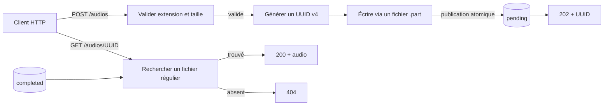

# Application web

L'application `glpi-ticketing-web` est la façade HTTP du POC. Dans son état
actuel, elle remplit deux responsabilités :

- recevoir un fichier audio et le publier dans le répertoire `pending` ;
- restituer un audio uniquement lorsqu'il est présent dans le répertoire
  `completed`.

Elle ne transcrit pas les audios et ne crée pas de ticket GLPI. Ces traitements
appartiennent au pipeline d'automatisation, en dehors de cette application.

## Technologies et dépendances

- Python 3.12 ou supérieur ;
- FastAPI pour les routes et la validation HTTP ;
- Jinja2 pour les deux pages HTML ;
- `python-multipart` pour la réception du formulaire d'upload ;
- Pydantic Settings pour la configuration typée ;
- Uvicorn comme serveur ASGI déclaré dans les dépendances ;
- `glpi-ticketing-common` pour les extensions audio autorisées et l'écriture
  atomique des fichiers.

Les outils de test et de qualité (`pytest`, HTTPX/`httpx2` et Ruff) sont
déclarés au niveau de la racine du workspace uv.

## Contrat HTTP actuel

| Méthode et route | Entrée | Sortie nominale | Erreurs principales |
| --- | --- | --- | --- |
| `GET /health` | Aucune | `200` et `{"status":"ok"}` | — |
| `GET /` | Aucune | `200`, formulaire HTML d'envoi | — |
| `POST /audios` | `multipart/form-data`, champ obligatoire `audio_file` | `202`, page HTML contenant l'UUID et en-tête `Location: /audios/{uuid}` | `413` si le fichier dépasse la limite, `415` si son extension n'est pas acceptée, `422` si le formulaire est invalide |
| `GET /audios/{audio_uuid}` | UUID valide dans le chemin | `200`, contenu binaire de l'audio terminé et en-tête `X-Audio-UUID` | `404` si aucun audio terminé ne correspond, `422` si l'UUID est invalide, `500` si plusieurs extensions existent pour le même UUID |

Les extensions acceptées sont `.wav`, `.mp3`, `.ogg` et `.m4a`. À l'upload,
la validation porte actuellement sur l'extension du nom fourni, pas sur le
contenu binaire ni sur le type MIME annoncé par le client.

La réponse `202` confirme uniquement la publication dans `pending`. La route
de lecture peut donc répondre `404` tant qu'un autre composant n'a pas publié
le fichier correspondant dans `completed`.

## Flux de l'application



L'écriture d'un upload passe par un fichier temporaire suffixé `.part`. Le
package commun synchronise ce fichier, le renomme atomiquement vers son nom
final `{uuid}.{extension}`, puis synchronise le répertoire. Un consommateur qui
ignore les fichiers `.part` ne sélectionne donc que des fichiers complètement
publiés.

La frontière de stockage est volontairement restrictive :

- l'application écrit dans `pending` ;
- elle lit dans `completed` ;
- elle ne connaît ni `processing` ni `failed`.

Pour la lecture, seuls les fichiers réguliers sont servis. Un lien symbolique
n'est pas considéré comme un audio terminé.

## Configuration

La classe `WebSettings` reconnaît les variables suivantes :

| Variable | Valeur par défaut | Rôle |
| --- | --- | --- |
| `AUDIO_PENDING_DIR` | `/data/audio-pending` | Répertoire de publication des nouveaux audios |
| `AUDIO_COMPLETED_DIR` | `/data/audio-completed` | Répertoire depuis lequel les audios terminés sont servis |
| `MAX_UPLOAD_BYTES` | `26214400` (25 MiB) | Taille maximale acceptée par upload |

Les deux répertoires doivent être distincts. Lors de la création de
l'application, ils doivent également exister et être des répertoires. Le
fichier `.env` situé dans le répertoire courant peut fournir ces valeurs ; les
valeurs locales et les secrets ne doivent pas être versionnés.

### Limite actuelle du démarrage

`web.py` expose la fabrique `create_app(...)` et `settings.py` expose
`WebSettings`, mais aucun point d'entrée ne les relie encore. Il n'existe donc
pas, à ce stade, d'objet ASGI global ni de commande Uvicorn opérationnelle
supportée par le dépôt.

Le futur point de composition devra effectuer explicitement l'équivalent de :

```python
settings = WebSettings()
app = create_app(
    pending_directory=settings.audio_pending_dir,
    completed_directory=settings.audio_completed_dir,
    max_upload_bytes=settings.max_upload_bytes,
)
```

Ce bloc décrit le câblage attendu ; il n'est pas encore présent dans le code.

## Organisation des fichiers

```text
apps/web/
├── pyproject.toml
├── README.md
├── src/glpi_ticketing_web/
│   ├── __init__.py          # version du package
│   ├── settings.py          # configuration typée propre à l'application
│   ├── web.py               # fabrique FastAPI, routes et helpers HTTP
│   └── templates/
│       ├── index.html       # formulaire d'upload
│       └── uploaded.html    # confirmation avec UUID
└── tests/unit/
    ├── test_settings.py     # contrat des variables d'environnement
    └── test_web.py          # contrats HTTP et frontières de stockage
```

## Conventions d'architecture

- Le package utilise une disposition `src/` afin que les tests importent le
  package installé et non un module trouvé accidentellement dans le dépôt.
- `create_app(...)` est une fabrique : les chemins autorisés sont injectés,
  ce qui rend les tests indépendants du stockage réel.
- `settings.py` ne contient que la configuration appartenant à l'application
  web. Les chemins `processing` et `failed` restent sous la responsabilité du
  worker.
- Les primitives de cycle de vie partagées, comme `atomic_write`, restent dans
  `packages/common` ; elles ne doivent pas être dupliquées dans l'application.
- Les routes sont publiques dans la fabrique. Les helpers préfixés par `_`
  sont des détails d'implémentation du module.
- Les templates ne portent pas de logique métier : ils rendent uniquement les
  données préparées par la route.
- Les noms stockés suivent la convention `{uuid}.{extension}`. Le nom de
  fichier envoyé par l'utilisateur n'est pas conservé.

## Commandes depuis la racine

Installer l'ensemble du workspace et ses outils de développement :

```bash
uv sync --all-packages --all-groups
```

Exécuter uniquement les tests de l'application web :

```bash
uv run --package glpi-ticketing-web pytest apps/web/tests
```

Exécuter séparément les contrats HTTP ou de configuration :

```bash
uv run --package glpi-ticketing-web pytest apps/web/tests/unit/test_web.py
uv run --package glpi-ticketing-web pytest apps/web/tests/unit/test_settings.py
```

Vérifier le formatage et les règles statiques de ce workspace :

```bash
uv run ruff format --check apps/web
uv run ruff check apps/web
```

## Politique de test

Les tests actuels sont des tests unitaires rapides et déterministes. FastAPI
est appelé avec `TestClient` et chaque test utilise des répertoires temporaires
isolés. Aucun serveur HTTP, service de transcription ou GLPI réel n'est
contacté.

Ils couvrent notamment :

- le healthcheck et le rendu du formulaire ;
- la génération de l'UUID et le contrat de la réponse `202` ;
- la publication atomique sans fichier `.part` résiduel ;
- le rejet des extensions inconnues et des fichiers trop volumineux ;
- la restitution depuis `completed` et ses principaux cas d'erreur ;
- l'absence d'accès aux répertoires `processing` et `failed` ;
- les valeurs par défaut, les surcharges et les invariants de configuration.

La suite ne constitue pas encore un test d'intégration d'un serveur ASGI lancé
avec sa configuration réelle, puisque le point d'entrée de démarrage reste à
implémenter.

## Limites et évolutions futures

Les éléments suivants ne sont pas implémentés dans l'application web actuelle :

- le point d'entrée ASGI qui charge `WebSettings` ;
- l'authentification et l'autorisation des dépôts ou des téléchargements ;
- l'inspection du contenu audio au-delà de l'extension ;
- un endpoint de statut du traitement ;
- l'affichage d'une transcription ou d'un ticket GLPI ;
- la liste, la suppression ou la nouvelle tentative d'un audio ;
- un test d'intégration couvrant le démarrage réel du serveur.

Ces points décrivent des capacités absentes, pas des engagements
d'implémentation. Leur contrat devra être défini avant de les ajouter.
