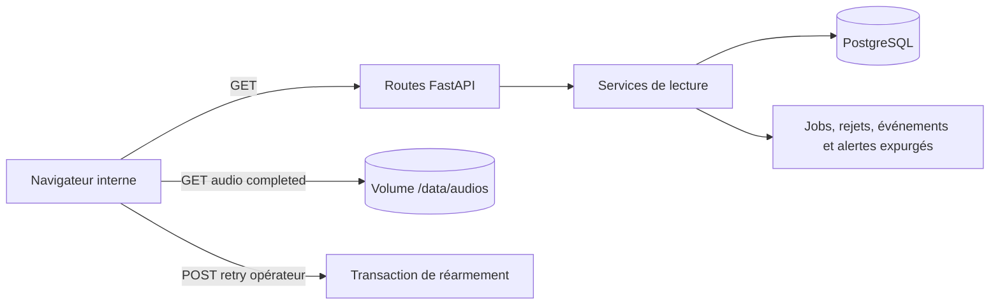
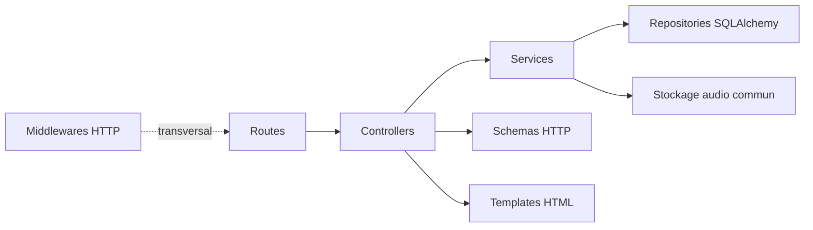

# Application web

`mevo2glpi-web` expose le tableau de bord interne du MVP. L'ingestion des
messages Exchange et la publication des audios appartiennent au
`worker-publisher` : le web ne crée plus de job par upload. PostgreSQL est
l'unique source de vérité et le web ne déduit jamais l'état d'un job en
parcourant le volume audio.

Le tag `poc-v0.1.0` conserve l'ancienne application fondée sur `pending` et
`completed`. La branche courante utilise le stockage canonique et PostgreSQL ;
elle est assemblée dans la stack Docker Compose du MVP.

## Entrées et sorties

| Route | Entrée | Sortie nominale |
| --- | --- | --- |
| `GET /health` | aucune | `200`, liveness du processus uniquement |
| `GET /api/version` | aucune | environnement, release et SHA Git complet du déploiement |
| `GET /` | aucune | dashboard interne en consultation |
| `GET /api/jobs` | `state`, UUID exact, `limit`, curseur optionnels | page triée par dernière transition décroissante |
| `GET /api/jobs/{uuid}` | UUID canonique | détail persistant et rétention, ou `404` |
| `GET /api/jobs/{uuid}/events` | `limit` et curseur optionnels | historique expurgé, paginé séparément |
| `POST /api/jobs/{uuid}/retry` | UUID d'un job `failed` ou `blocked` | `202`, état `pending` et `Location` |
| `GET /api/rejections` | `limit` et curseur optionnels | rejets Exchange terminaux avec catégorie et code expurgés |
| `GET /api/observability` | aucune | état des trois workers et alertes opérationnelles agrégées |
| `GET /audios/{uuid}` | UUID canonique | audio `completed`, `410` si purgé, sinon `404` |

La collection `/api/jobs` est volontairement en lecture seule : un `POST`
retourne `405 Method Not Allowed`. La pagination utilise un curseur opaque fondé
sur `(updated_at, uuid)` ; le client ne doit ni l'interpréter ni le fabriquer.

Le dashboard lit séparément l'état des jobs, les rejets Exchange et
l'instantané d'observabilité. La vue des rejets n'expose ni identifiant Graph,
ni nom de pièce jointe, ni contenu du message.

La documentation interactive FastAPI (`/docs`, `/redoc` et
`/openapi.json`) reste disponible en développement et en staging. Elle est
désactivée automatiquement lorsque `APP_ENVIRONMENT=production`, sans option
de réactivation indépendante de l'environnement.
Son header affiche l'environnement, la release et les 12 premiers caractères
du SHA Git. L'endpoint `/api/version` expose le SHA complet avec
`Cache-Control: no-store` pour permettre une vérification opérateur fiable ;
il ne contient ni secret ni donnée métier. `/health` reste une simple liveness.
Il affiche toujours une carte pour chacun des workers `publisher`, `automation`
et `retention`, même si aucun heartbeat n'a encore été publié. La carte du
publisher expose son UUID d'ingestion mail courant, lorsqu'il existe. Les
alertes jobs et rétentions sont agrégées par condition :
leur compteur donne le nombre de lignes concernées et un bouton applique le
filtre d'état correspondant lorsque celui-ci existe. Le navigateur remplace
l'instantané à chaque lecture ; il ne conserve ni historique d'alerte ni
acquittement local.

La relance opérateur est autorisée uniquement lorsque le job est `failed` ou
`blocked`, que son fichier canonique existe encore et que sa taille correspond
aux métadonnées persistées. Une transaction verrouillée réarme le job, rend sa
rétention `inactive` et ajoute `operator_retry_requested`. Elle conserve
notamment `glpi_ticket_id` : si cet ID existe déjà, le worker finalise ensuite
localement sans rappeler GLPI.

Une perte de l'accusé de réception du `COMMIT` de relance est réconciliée dans
une nouvelle session : job `pending`, rétention `inactive` et événement
opérateur doivent être tous les trois présents. Le web retourne alors `202` ;
une issue encore ambiguë reste un `503` et n'entraîne jamais un second
réarmement aveugle.

Erreurs principales :

- `422` : filtre ou curseur invalide ;
- `404` : job inconnu ou audio non terminé ;
- `409` : état ou audio incompatible avec une relance opérateur ;
- `410` : audio terminé déjà en suppression ou supprimé ;
- `500` : ligne `completed` incohérente avec sa rétention ou son stockage ;
- `503` : stockage ou PostgreSQL temporairement indisponible.

Les réponses et les logs n'incluent ni URL SQL, ni chemin absolu, ni contenu
audio, ni message brut provenant d'une exception d'infrastructure. Un audio
autorisé est servi comme pièce jointe sous son nom UUID canonique, avec
`Cache-Control: private, no-store` afin d'éviter sa conservation par un cache
HTTP partagé ou par le navigateur.

## Image et stockage Docker

Le [Dockerfile web](../../infra/docker/apps/web/Dockerfile) produit une image
multi-stage non-root contenant uniquement l'environnement Python installé
depuis `uv.lock`. Dans Compose, le web monte le volume canonique
`/data/audios` uniquement pour valider les retries et servir les audios
terminés, sans déduire leur état depuis ce volume. Le code web ne requiert plus
de droit d'écriture pour une ingestion.

Le healthcheck de l'image appelle `/health`, qui reste une liveness locale et
ne transforme pas PostgreSQL en dépendance de disponibilité HTTP. Le service
web ne publie aucun port hôte ; le Traefik fourni par Dokploy route son port
interne `8000`. Les contrôles de déploiement sont décrits dans les procédures
de [staging](../../docs/procedures/staging.md) et de
[production](../../docs/procedures/production.md).

## Flux de consultation



Les lectures ne modifient ni PostgreSQL ni le volume. L'unique commande métier
conservée est la relance opérateur d'un job `failed` ou `blocked`; elle est
auditée par l'événement `operator_retry_requested`. Les messages rejetés restent
consultables jusqu'à l'expiration de leur durée de rétention. La vue présente
uniquement l'UUID d'ingestion, les dates et le motif technique expurgé.

## Architecture

La direction des appels applicatifs est volontairement unidirectionnelle :



| Couche | Responsabilité |
| --- | --- |
| `routes` | Associer méthode, URL, paramètres FastAPI et controller, sans règle ni accès aux données |
| `middlewares` | Réserver les traitements HTTP transversaux ; aucun middleware applicatif n'est nécessaire actuellement |
| `schemas` | Définir uniquement les contrats Pydantic exposés par HTTP |
| `controllers` | Traduire le protocole HTTP et les erreurs, puis construire statut, en-têtes, corps ou template |
| `services` | Porter les use cases et orchestrer stockage, règles et transactions PostgreSQL |
| `templates` / `static` | Fournir les pages HTML et leurs assets CSS/JavaScript, sans accès aux services |

Les repositories restent dans le package partagé `database`. Ils ne connaissent
ni FastAPI ni les contrats HTTP, peuvent exécuter `flush()`, mais ne font jamais
`commit()`, `rollback()` ou `close()`.

```text
apps/web/
├── src/mevo2glpi_web/
│   ├── application.py       # moteur, sessions, services et Uvicorn
│   ├── web.py               # assemblage FastAPI, controllers et routers
│   ├── settings.py          # configuration typée et secrets masqués
│   ├── auth/                # modes local/OIDC, sessions et protections HTTP
│   ├── routes/              # déclarations URL/méthode et délégation pure
│   ├── controllers/         # adaptation du protocole HTTP
│   ├── services/
│   │   ├── jobs/            # requêtes, download, retry et DTO internes
│   │   ├── observability/   # seuils, priorités et projection opérationnelle
│   │   └── rejections/      # liste expurgée des messages rejetés
│   ├── schemas/             # contrats HTTP Pydantic
│   ├── middlewares/         # authentification et traitements HTTP transversaux
│   ├── templates/           # pages HTML Jinja
│   └── static/
│       ├── css/             # présentation visuelle
│       └── js/              # interactions strictement côté navigateur
└── tests/
    ├── unit/                # couches, dépendances, contrats et configuration
    └── integration/         # Uvicorn et API sur PostgreSQL réel
```

Conventions :

- `application.py` possède le moteur SQLAlchemy et le libère à l'arrêt ;
- `web.py` assemble les couches, mais ne définit aucun endpoint ;
- une route appelle uniquement son controller ;
- un controller ne dépend ni de SQLAlchemy, ni du package commun de stockage ;
- un service ne dépend ni de FastAPI, ni de Starlette, ni de Jinja2 ;
- les enums HTTP sont possédés par `schemas` et mappés explicitement depuis
  l'état interne afin qu'une migration SQL ne modifie pas implicitement l'API ;
- une réponse de streaming ferme son descripteur dans un `finally` couvrant
  l'intégralité de son appel ASGI, y compris avant le premier octet ;
- une `Session` SQLAlchemy est l'unité de travail, sans classe `UnitOfWork` ;
- `TicketCreationJobRepository` et `TicketCreationJobEventRepository` ne
  manipulent chacun que leur modèle et font `flush()`, jamais `commit()`,
  `rollback()` ou `close()` ;
- aucun accès fichier n'est exécuté pendant la transaction SQL ;
- le nom original n'entre jamais dans `storage_key`.

L'interface utilise du JavaScript natif segmenté en `api.js`, `dashboard.js`,
`rejections.js`, `observability.js` et `app.js`. `app.js` possède l'unique
ordonnanceur de rafraîchissement : les lectures jobs, rejets et observabilité
sont attendues indépendamment, sans `setInterval`, et le polling est suspendu
lorsque l'onglet est masqué. Les valeurs venant de l'API sont ajoutées au DOM
avec `textContent` ou `replaceChildren`, jamais interprétées comme du HTML.
Le dashboard et ses API sont protégés par un mode d'authentification explicite,
`local` ou `oidc`. Il n'existe ni mode désactivé, ni repli automatique d'OIDC
vers les comptes locaux. Le fonctionnement détaillé est décrit dans la
[conception de l'authentification](../../docs/conception/authentification-oidc-keycloak.md).

## Configuration

| Variable | Défaut | Rôle |
| --- | --- | --- |
| `DATABASE_URL` | obligatoire | URL `postgresql+psycopg`, traitée comme secret |
| `AUDIO_ROOT` | `/data/audios` | volume canonique existant et accessible |
| `WEB_HOST` | `127.0.0.1` | adresse IP d'écoute |
| `WEB_PORT` | `8000` | port Uvicorn |
| `WEB_TRUST_PROXY_HEADERS` | `false` | confiance explicite dans le reverse proxy |
| `WEB_AUTH_MODE` | obligatoire | mode exclusif : `local` ou `oidc` |
| `WEB_AUTH_SESSION_SECRET` | obligatoire | secret de signature des sessions applicatives, 32 caractères minimum |
| `WEB_AUTH_SESSION_MAX_AGE_SECONDS` | `1800` | durée absolue de la session applicative |
| `WEB_AUTH_COOKIE_SECURE` | `true` | impose le cookie HTTPS ; `false` autorisé uniquement en développement |
| `WEB_AUTH_REQUIRED_ROLE` | `mevo2glpi-access` | rôle unique requis pour accéder au web |
| `WEB_AUTH_ROLES_CLAIM` | `roles` | claim OIDC multivaluée portant les rôles |
| `WEB_AUTH_ISSUER_URL` | obligatoire en OIDC | issuer découvert via OpenID Connect |
| `WEB_AUTH_CLIENT_ID` | obligatoire en OIDC | identifiant du client confidentiel |
| `WEB_AUTH_CLIENT_SECRET` | obligatoire en OIDC | secret du client confidentiel |
| `WEB_AUTH_REDIRECT_URI` | obligatoire en OIDC | callback exact déclaré auprès du fournisseur |
| `APP_ENVIRONMENT` | `development` | environnement : `development`, `staging` ou `production` |
| `APP_RELEASE` | `development` | branche `main` en staging ou tag stable `vX.Y.Z` en production |
| `APP_COMMIT_SHA` | `unknown` | SHA Git complet obligatoire hors développement local |
| `WORKER_HEARTBEAT_INTERVAL_SECONDS` | `10` | cadence attendue des checkpoints, utilisée pour valider le seuil stale |
| `DASHBOARD_WORKER_STALE_AFTER_SECONDS` | `45` | absence de checkpoint avant alerte worker |
| `DASHBOARD_PENDING_ALERT_AFTER_SECONDS` | `900` | durée depuis la dernière entrée en `pending` avant alerte |
| `DASHBOARD_RETRY_OVERDUE_GRACE_SECONDS` | `60` | grâce après l'échéance d'un retry job ou rétention |
| `DASHBOARD_RETENTION_DEADLINE_GRACE_SECONDS` | `120` | grâce après une deadline audio avant alerte critique |

Les durées doivent être positives et finies. Le seuil stale doit être
strictement supérieur à la cadence attendue du heartbeat. Le moteur est
construit de façon paresseuse avec `pool_pre_ping`. `/health` reste une sonde de
liveness indépendante de PostgreSQL ; une lecture d'observabilité impossible
retourne séparément un `503` expurgé.

En mode local, les comptes sont administrés par la commande
`mevo2glpi-web-users`. En mode OIDC, Authlib applique le flux Authorization
Code, la découverte du fournisseur et PKCE S256. Les deux modes produisent le
même cookie applicatif signé ; aucun token OIDC n'y est conservé.

## Commandes

Le package expose deux exécutables : `mevo2glpi-web` pour servir l'application
et `mevo2glpi-web-users` pour administrer les comptes locaux.

### Démarrer l'application

Depuis la racine du workspace :

```bash
uv sync --all-packages --all-groups
uv run --package mevo2glpi-web mevo2glpi-web
```

Dans le conteneur web, l'environnement Python est déjà installé :

```bash
mevo2glpi-web
```

Cette commande n'accepte pas d'argument : l'écoute, la base, l'identité de
release et l'authentification proviennent exclusivement des variables
d'environnement documentées plus haut.

### Administrer les comptes locaux

Ces commandes sont utiles uniquement avec `WEB_AUTH_MODE=local`. Elles exigent
une `DATABASE_URL` valide et la migration `0010_web_authentication` déjà
appliquée. Dans le terminal du conteneur web :

| Commande | Effet |
| --- | --- |
| `mevo2glpi-web-users --help` | Afficher l'aide et les sous-commandes disponibles |
| `mevo2glpi-web-users list` | Lister les identifiants et leur état `enabled` ou `disabled` |
| `mevo2glpi-web-users create IDENTIFIANT` | Créer un compte actif après saisie interactive du mot de passe |
| `mevo2glpi-web-users disable IDENTIFIANT` | Désactiver le compte et révoquer ses sessions actives |
| `mevo2glpi-web-users enable IDENTIFIANT` | Réactiver le compte sans restaurer les sessions déjà révoquées |
| `mevo2glpi-web-users reset-password IDENTIFIANT` | Remplacer le mot de passe et révoquer les sessions actives |

Depuis la racine du workspace, préfixer la même sous-commande par
`uv run --package mevo2glpi-web`. Par exemple :

```bash
uv run --package mevo2glpi-web mevo2glpi-web-users create operator-local
```

L'identifiant normalisé contient entre 3 et 64 caractères ASCII parmi les
lettres minuscules, les chiffres, `.`, `_` et `-`. Le mot de passe contient
entre 15 et 128 caractères, diffère de l'identifiant et ne figure pas dans la
liste de valeurs bloquées. `create` et `reset-password` le lisent et le
confirment interactivement : il n'est jamais transmis comme argument ni
affiché. Une commande réussie retourne `0`, une erreur de configuration ou de
validation retourne `2`, et une interruption interactive retourne `130`.

### Valider l'application

Tests sans service externe :

```bash
uv run --all-packages pytest apps/web/tests/unit \
  apps/web/tests/integration/test_server_startup.py
```

Intégration PostgreSQL jetable, non parallélisée :

```bash
uv run pytest -m database \
  apps/web/tests/integration -vv --maxfail=1
```

Qualité :

```bash
uv run ruff format --check apps/web
uv run ruff check apps/web
```

## Limites actuelles

- un rôle applicatif global seulement, sans permissions fonctionnelles fines ;
- la déconnexion OIDC ferme la session mevo2glpi, mais pas la session SSO du
  fournisseur d'identité ;
- pas d'acquittement, d'historique ou de notification externe des alertes ;
- un job `failed` ou `blocked` reste signalé jusqu'à son retry opérateur, même
  si la deadline de son audio a ensuite conduit à une purge ;
- un heartbeat `stale` indique seulement l'absence récente de checkpoint : un
  appel HTTP synchrone long peut rendre un processus vivant potentiellement non
  réactif dans le dashboard ;
- pas encore de suppression des orphelins ;
- pas de détail HTTP individuel ni de rejeu des ingestions depuis le dashboard ;
- pas encore de test E2E dans un navigateur réel ; les contrats JavaScript sont
  vérifiés statiquement et l'API est testée avec FastAPI.
