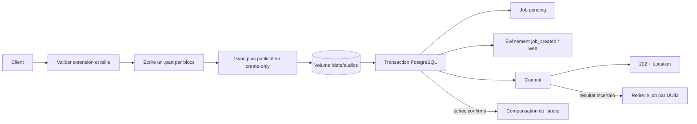
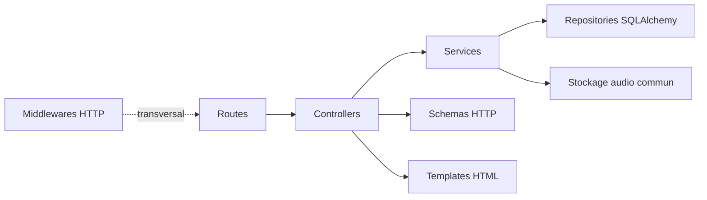

# Application web

`glpi-ticketing-web` reçoit les audios, crée leur état persistant et expose le
dashboard interne du MVP. PostgreSQL est l'unique source de vérité : le web ne
déduit jamais l'état d'un job en parcourant le volume audio.

Le tag `poc-v0.1.0` conserve l'ancienne application fondée sur `pending` et
`completed`. La branche courante utilise le stockage canonique et PostgreSQL ;
le Compose MVP complet appartient à une itération ultérieure.

## Entrées et sorties

| Route | Entrée | Sortie nominale |
| --- | --- | --- |
| `GET /health` | aucune | `200`, liveness du processus uniquement |
| `GET /` | aucune | dépôt multiple et dashboard interne |
| `POST /api/jobs` | multipart `audio_file` | `202`, UUID, `state=pending` et `Location` |
| `GET /api/jobs` | `state`, UUID exact, `limit`, curseur optionnels | page triée par dernière transition décroissante |
| `GET /api/jobs/{uuid}` | UUID canonique | détail persistant et rétention, ou `404` |
| `GET /api/jobs/{uuid}/events` | `limit` et curseur optionnels | historique expurgé, paginé séparément |
| `POST /api/jobs/{uuid}/retry` | UUID d'un job `failed` ou `blocked` | `202`, état `pending` et `Location` |
| `GET /audios/{uuid}` | UUID canonique | audio `completed`, `410` si purgé, sinon `404` |

Exemple de réponse :

```json
{
  "audio_uuid": "8ce23f5b-4e31-49f1-ae23-4eacdbba48f8",
  "state": "pending"
}
```

`Location` vaut `/api/jobs/{audio_uuid}` et désigne donc immédiatement une
ressource consultable. Les extensions acceptées sont `wav`, `mp3`, `ogg` et
`m4a`. L'extension du nom est validée, mais le contenu binaire et le type MIME
ne sont pas encore inspectés.

Le navigateur émet une requête par fichier et limite le lot à trois requêtes
simultanées. Chaque résultat reste indépendant, le formulaire est remis à zéro
après le lot et le tableau se rafraîchit sans recharger la page. La pagination
utilise un curseur opaque fondé sur `(updated_at, uuid)` ; le client ne doit ni
l'interpréter ni le fabriquer.

La relance opérateur est autorisée uniquement lorsque le job est `failed` ou
`blocked`, que son fichier canonique existe encore et que sa taille correspond
aux métadonnées persistées. Une transaction verrouillée réarme le job, rend sa
rétention `inactive` et ajoute `operator_retry_requested`. Elle conserve
notamment `glpi_ticket_id` : si cet ID existe déjà, le worker finalise ensuite
localement sans rappeler GLPI.

Une perte de l'accusé de réception du `COMMIT` de relance est réconciliée dans
une nouvelle session : job `pending`, rétention `inactive` et événement
opérateur doivent être tous les trois présents. Le web retourne alors `202` ;
une issue encore ambiguë reste un `503` et n'entraîne jamais un second
réarmement aveugle.

Erreurs principales :

- `413` : limite de taille dépassée ;
- `415` : extension inconnue ;
- `422` : champ absent, fichier vide, filtre ou curseur invalide ;
- `404` : job inconnu ou audio non terminé ;
- `409` : collision de destination, ou état/audio incompatible avec une
  relance opérateur ;
- `410` : audio terminé déjà en suppression ou supprimé ;
- `500` : ligne `completed` incohérente avec sa rétention ou son stockage ;
- `503` : stockage ou PostgreSQL temporairement indisponible.

Les réponses et les logs n'incluent ni URL SQL, ni chemin absolu, ni contenu
audio, ni message brut provenant d'une exception d'infrastructure. Un audio
autorisé est servi comme pièce jointe sous son nom UUID canonique, avec
`Cache-Control: private, no-store` afin d'éviter sa conservation par un cache
HTTP partagé ou par le navigateur.

## Flux d'ingestion



L'audio est publié et synchronisé avant le premier `INSERT`. Le worker ne
consommera que des lignes PostgreSQL : un crash entre le fichier et la
transaction peut produire un orphelin, mais jamais un job pointant vers un
fichier encore partiel.

Une erreur pendant `commit()` est ambiguë : le serveur peut avoir validé la
transaction alors que la connexion a été perdue avant l'accusé de réception.
Le web ouvre donc une nouvelle session et relit l'UUID :

- ligne cohérente : le dépôt est accepté et l'audio reste en place ;
- ligne absente ou PostgreSQL toujours indisponible : l'issue reste ambiguë et
  l'audio est conservé comme orphelin non consommable. Une lecture négative
  immédiate ne prouve pas que le serveur n'achèvera pas encore le `COMMIT`.

Seule une erreur obtenue avant l'envoi du `COMMIT`, suivie d'un rollback, permet
une compensation immédiate. Cette politique privilégie un orphelin réconciliable
à un job `pending` dont les octets auraient été supprimés.

La maintenance différée de ces orphelins appartient au worker de rétention.

## Architecture

La direction des appels applicatifs est volontairement unidirectionnelle :



| Couche | Responsabilité |
| --- | --- |
| `routes` | Associer méthode, URL, paramètres FastAPI et controller, sans règle ni accès aux données |
| `middlewares` | Réserver les traitements HTTP transversaux ; aucun middleware applicatif n'est nécessaire actuellement |
| `schemas` | Définir uniquement les contrats Pydantic exposés par HTTP |
| `controllers` | Prévalider le transport, traduire les erreurs, puis construire statut, en-têtes, corps ou template |
| `services` | Porter les use cases et orchestrer stockage, règles et transactions PostgreSQL |
| `templates` / `static` | Fournir les pages HTML et leurs assets CSS/JavaScript, sans accès aux services |

Les repositories restent dans le package partagé `database`. Ils ne connaissent
ni FastAPI ni les contrats HTTP, peuvent exécuter `flush()`, mais ne font jamais
`commit()`, `rollback()` ou `close()`.

```text
apps/web/
├── src/glpi_ticketing_web/
│   ├── application.py       # moteur, sessions, services et Uvicorn
│   ├── web.py               # assemblage FastAPI, controllers et routers
│   ├── settings.py          # configuration typée et secrets masqués
│   ├── routes/              # déclarations URL/méthode et délégation pure
│   ├── controllers/         # adaptation du protocole HTTP
│   ├── services/
│   │   └── jobs/            # ingestion, requêtes, download, retry et DTO internes
│   ├── schemas/             # contrats HTTP Pydantic
│   ├── middlewares/         # traitements HTTP transversaux futurs
│   ├── templates/           # pages HTML Jinja
│   └── static/
│       ├── css/             # présentation visuelle
│       └── js/              # interactions strictement côté navigateur
└── tests/
    ├── unit/                # couches, dépendances, contrats et configuration
    └── integration/         # Uvicorn et ingestion PostgreSQL réelle
```

Conventions :

- `application.py` possède le moteur SQLAlchemy et le libère à l'arrêt ;
- `web.py` assemble les couches, mais ne définit aucun endpoint ;
- une route appelle uniquement son controller ;
- un controller ne dépend ni de SQLAlchemy, ni du package commun de stockage ;
- un service ne dépend ni de FastAPI, ni de Starlette, ni de Jinja2 ;
- les enums HTTP sont possédés par `schemas` et mappés explicitement depuis
  l'état interne afin qu'une migration SQL ne modifie pas implicitement l'API ;
- une réponse de streaming ferme son descripteur dans un `finally` couvrant
  l'intégralité de son appel ASGI, y compris avant le premier octet ;
- une `Session` SQLAlchemy est l'unité de travail, sans classe `UnitOfWork` ;
- `TicketCreationJobRepository` et `TicketCreationJobEventRepository` ne
  manipulent chacun que leur modèle et font `flush()`, jamais `commit()`,
  `rollback()` ou `close()` ;
- aucun accès fichier n'est exécuté pendant la transaction SQL ;
- le nom original n'entre jamais dans `storage_key`.

L'interface utilise du JavaScript natif segmenté en `api.js`, `uploads.js`,
`dashboard.js` et `app.js`. Les valeurs venant de l'API sont ajoutées au DOM
avec `textContent` ou `replaceChildren`, jamais interprétées comme du HTML.
Cette itération suppose un accès limité au réseau interne et n'ajoute pas de
mécanisme d'authentification applicative.

## Configuration

| Variable | Défaut | Rôle |
| --- | --- | --- |
| `DATABASE_URL` | obligatoire | URL `postgresql+psycopg`, traitée comme secret |
| `AUDIO_ROOT` | `/data/audios` | volume canonique existant et accessible |
| `WEB_HOST` | `127.0.0.1` | adresse IP d'écoute |
| `WEB_PORT` | `8000` | port Uvicorn |
| `WEB_TRUST_PROXY_HEADERS` | `false` | confiance explicite dans le reverse proxy |
| `MAX_UPLOAD_BYTES` | `26214400` | limite par fichier |

Le moteur est construit de façon paresseuse avec `pool_pre_ping`. `/health`
reste une sonde de liveness et ne dépend pas de PostgreSQL ; une readiness
complète sera ajoutée avec l'observabilité du MVP.

## Commandes

Depuis la racine :

```bash
uv sync --all-packages --all-groups
uv run glpi-ticketing-web
```

Tests sans service externe :

```bash
uv run --all-packages pytest apps/web/tests/unit \
  apps/web/tests/integration/test_server_startup.py
```

Intégration PostgreSQL jetable, non parallélisée :

```bash
uv run pytest -m database \
  apps/web/tests/integration -vv --maxfail=1
```

Qualité :

```bash
uv run ruff format --check apps/web
uv run ruff check apps/web
```

## Limites actuelles

- pas d'authentification applicative ;
- pas encore d'alertes sur les heartbeats périmés ou les jobs en retard ;
- pas de détection du format réel de l'audio ;
- la limite applicative est vérifiée pendant la lecture de `UploadFile`, donc
  après le parsing multipart de Starlette ; une exposition réseau doit imposer
  aussi une limite de corps en amont, par exemple avec Nginx ;
- pas d'idempotence HTTP : un retry après perte de la réponse peut créer un
  second UUID ;
- pas encore de suppression des orphelins ;
- pas encore de test E2E dans un navigateur réel ; les contrats JavaScript sont
  vérifiés statiquement et l'API est testée avec FastAPI ;
- Compose MVP PostgreSQL non encore assemblé.
