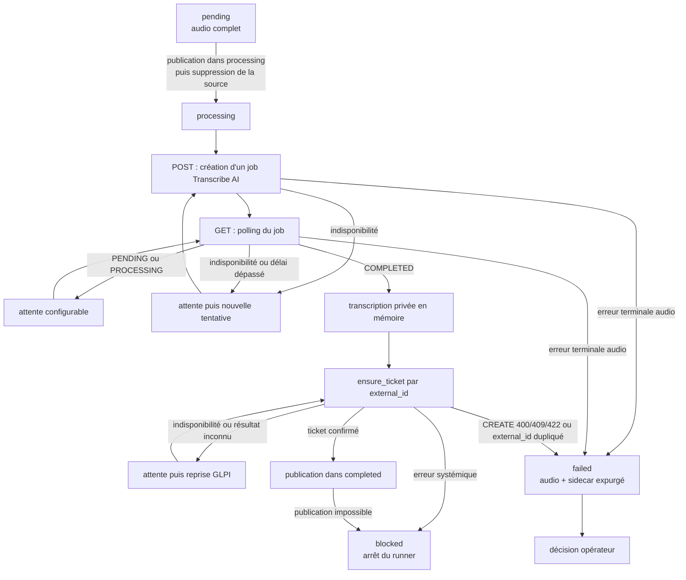

# Worker d'automatisation

Ce workspace contient l'application chargée de consommer les fichiers audio,
de demander leur transcription, de retrouver ou créer le ticket GLPI associé,
puis de publier l'audio terminé. Le POC fonctionne avec **un seul worker** :
`AudioProcessor` conserve l'avancement d'un seul audio en mémoire et
`run_forever()` planifie ses reprises.

Le pipeline applicatif est implémenté et testable par injection. Il ne possède
pas encore de point d'entrée exécutable assemblant `WorkerSettings`, les deux
clients HTTP et leurs ressources ; cette composition relève d'une étape
ultérieure.

## Entrées et sorties

### Entrées

- un fichier audio complet dans `processing`, ou à défaut dans `pending` ;
- les quatre répertoires du cycle de vie audio ;
- un objet respectant `TranscriberProtocol` ;
- un objet respectant `GlpiClientProtocol` ;
- une fonction `audio_url_for(UUID)` ;
- les intervalles de scan, de transcription et de reprise GLPI.

Le processeur transforme lui-même la transcription réussie en
`GlpiTicketInput`. Les identifiants OAuth Password et les valeurs fixes du
ticket proviennent de `WorkerSettings` lors de la future composition.

Un nom de fichier audio doit suivre la convention
`{uuid}.{extension}` avec un UUID canonique et une extension parmi `.wav`,
`.mp3`, `.ogg` et `.m4a`. Les liens symboliques, les noms invalides et les
fichiers terminant par `.part` ne sont pas consommés.

### Sorties

`AudioProcessor.run_once()` retourne toujours un `RunOutcome` immuable et
expurgé :

| Résultat | Signification |
| --- | --- |
| `IdleOutcome` | Aucun audio prêt ; porte l'intervalle de scan. |
| `RetryOutcome` | Échec récupérable ; conserve l'audio et l'état privé pour une reprise après l'intervalle indiqué. |
| `CompletedOutcome` | Ticket confirmé et audio publié dans `completed`. |
| `FailedOutcome` | Échec terminal propre à l'audio, publié dans `failed` avec son sidecar. |
| `BlockedOutcome` | Le traitement ne peut progresser sûrement sans intervention ; le runner s'arrête sans lancer de transition automatique supplémentaire. |

La transcription n'appartient à aucun résultat public. `CompletedOutcome`
contient uniquement l'UUID, le chemin final et l'identifiant du ticket.
`BlockedOutcome` porte le chemin `processing` tant qu'il est observable. Si la
source a déjà disparu lors d'une publication ambiguë, ce champ vaut `None` et
`inspection_paths` désigne les emplacements que l'opérateur doit vérifier.

## Cycle de vie d'un audio



Le scanner applique les règles suivantes :

1. il reprend en priorité le premier fichier valide déjà présent dans
   `processing` ;
2. sinon, il réclame le premier fichier valide de `pending` et le publie dans
   `processing` ;
3. il ne parcourt jamais `failed` ;
4. l'ordre est déterministe : les noms de fichiers sont triés.

Le déplacement fourni par `glpi-ticketing-common` est compatible avec des
volumes distincts : le fichier est copié vers un nom temporaire `.part`, vidé
sur disque, publié sous son nom définitif, puis la source est supprimée. Un
fichier partiel ne devient donc jamais visible comme travail prêt.
Si la synchronisation du répertoire `pending` échoue après cette suppression,
le scanner reconnaît le fichier complet déjà visible dans `processing` et le
retourne comme réclamé au lieu de provoquer un rejeu ambigu.

### Signification des volumes

| Volume | Responsabilité actuelle |
| --- | --- |
| `pending` | Fichiers complets en attente de réclamation. |
| `processing` | Fichier réclamé, conservé pendant la transcription et le ticketing. Il est prioritaire après un redémarrage. |
| `failed` | Échecs terminaux. Le scanner n'y reprend rien automatiquement ; une décision opérateur est nécessaire. |
| `completed` | Audio dont le ticket GLPI a été confirmé ; il devient téléchargeable par l'application web. |

## Package `worker` et état privé

L'ancien module unique `worker.py` est devenu un package cohésif :

- `worker/models.py` définit les répertoires, étapes, statuts et cinq outcomes
  publics ;
- `worker/processor.py` contient `claim_next_audio()` et `AudioProcessor`, le
  cas d'usage complet d'un audio ;
- `worker/runner.py` contient la boucle de planification et
  `WorkerBlockedError` ;
- `worker/__init__.py` constitue l'API publique stable du package.

`AudioProcessor` possède un état privé non persistant parmi quatre phases :

1. `_AwaitingTranscription` : chemin et UUID de l'audio ;
2. `_AwaitingTicket` : mêmes identifiants et transcription masquée du `repr` ;
3. `_AwaitingFinalization` : identifiants de l'audio et du ticket confirmé ;
4. `_AwaitingFailurePublication` : audio, étape, erreur expurgée et horodatage
   figé du sidecar à publier.

Un appel traverse immédiatement les phases qui réussissent et s'arrête au
premier résultat observable. Il peut donc produire directement `completed`, ou
rendre la main plus tôt avec `retry`, `failed` ou `blocked`.

Cet état permet de réessayer GLPI sans retranscrire et de réessayer une
publication dans `completed` ou `failed` sans rappeler un service externe. Une
publication `failed` interrompue reprend le même échec et le même horodatage
lorsqu'on rappelle `run_once()` sur la même instance. L'état privé n'est ni
exporté, ni sérialisé dans les outcomes. Après un redémarrage, il est perdu : le
fichier prioritaire de `processing` est retranscrit, puis le client GLPI
réconcilie le ticket par `external_id`.

`run_forever()` interprète les outcomes sans connaître les services :

- `idle` et `retry` provoquent l'attente portée par le résultat ;
- `completed` et `failed` passent immédiatement au prochain audio ;
- `blocked` lève `WorkerBlockedError` et arrête la boucle pour intervention.

## Transcription

La couche `transcription` sépare le contrat stable de l'API HTTP historique :

- `TranscriptionClientProtocol` expose l'identifiant du fournisseur,
  `submit(audio_path)` et `get_job(job_uuid)` ;
- `TranscriptionClient` adapte l'API batch HTTP à ce contrat ;
- `TranscriptionPoller` orchestre une soumission puis le polling ;
- les modèles et énumérations normalisent les jobs, statuts et opérations ;
- les exceptions transportent des codes techniques sûrs, sans réponse HTTP
  brute.

`TranscriptionClient` reçoit lui-même un `httpx.Client` injecté. Le code de
composition qui sera ajouté ultérieurement devra donc créer et fermer cette
ressource HTTP ; le client de domaine ne masque pas son cycle de vie.

Le client effectue actuellement :

- `POST /api/batchTranscription/createJob` avec le fichier dans le champ
  multipart `audioFile` et la clé dans l'en-tête `X-API-KEY` ;
- `GET /api/batchTranscription/result?job_uuid=...` jusqu'à un état normalisé
  `COMPLETED` ou `FAILED`.

Les états `PENDING` et `PROCESSING` déclenchent une attente injectée, puis un
nouveau `GET`. Le contenu transcrit n'est produit qu'à l'état `COMPLETED`.

### Politique de nouvelle tentative

Les situations suivantes sont considérées comme des indisponibilités :

- erreur de transport sans réponse exploitable ;
- codes HTTP explicitement temporaires, notamment `408`, `425` et `429` ;
- tous les codes HTTP `5xx` ;
- délai global d'un job dépassé pendant le polling.

Dans ces cas, l'audio reste dans `processing`. Le poller lève une
`TranscriptionRetryRequired`, le processeur retourne `RetryOutcome`, puis le
runner attend l'intervalle de transcription avant une nouvelle tentative qui
crée un nouveau job distant. Le futur bootstrap devra alimenter cet intervalle
depuis `TRANSCRIPTION_POLL_INTERVAL_SECONDS`. Il n'y a actuellement ni nombre
maximal de tentatives, ni backoff progressif, ni jitter.

### Erreurs terminales

Une soumission explicitement refusée, une erreur HTTP non réessayable, un
contrat de réponse invalide, un UUID distant incohérent, un job distant en
échec ou une transcription absente à l'état `COMPLETED` sont terminaux.

Le poller traduit ces situations en `TranscriptionTerminalError` sans déplacer
l'audio. `AudioProcessor` est l'unique responsable de publier ensuite dans
`failed` :

1. l'audio complet ;
2. le sidecar `{uuid}.error.json` complet ;
3. puis seulement supprime l'audio de `processing`.

Si la publication échoue tant que la source existe, les artefacts partiellement
publiés sont nettoyés et la source reste dans `processing`. Le processeur
conserve alors `_AwaitingFailurePublication` : après intervention, un nouvel
appel sur la même instance réessaie uniquement la publication, sans rappeler
Transcribe AI ou GLPI.

Un `OSError` de synchronisation peut survenir après la publication effective.
Le processeur réconcilie ce cas au lieu de déclarer un blocage si la source a
disparu et que la destination complète est déjà visible : audio plus sidecar
strictement conforme dans `failed`, ou audio régulier dans `completed`. Il
retourne alors respectivement `FailedOutcome` ou `CompletedOutcome`.

Le sidecar contient exactement les informations opérationnelles suivantes :

```json
{
  "uuid": "00000000-0000-0000-0000-000000000000",
  "step": "transcription",
  "category": "terminal",
  "code": "remote_job_failed",
  "timestamp": "2026-08-27T10:15:30Z"
}
```

Le même schéma est utilisé pour une erreur terminale de ticketing, avec
`"step": "ticketing"` et les identifiants expurgés du client GLPI. Il ne
contient ni transcription, ni clé API, ni réponse HTTP brute, ni message fourni
par un service distant.

## GLPI

La couche `glpi` adapte explicitement l'API GLPI V2.3.0. Elle n'utilise pas
l'alias mobile `/api.php/v2` : l'authentification et les tickets passent par
les routes épinglées sous `/api.php/v2.3.0`.

`GlpiClientProtocol` expose uniquement l'opération métier
`ensure_ticket(...)`, qui recherche d'abord le ticket par `external_id`, puis
le crée uniquement s'il n'existe pas.

Le client concret expose également `authenticate()` afin de permettre un test
de santé explicite du grant OAuth Password. Ce détail d'infrastructure ne fait
pas partie du protocole injecté dans l'orchestrateur.

Le titre du ticket est une valeur fixe de configuration. Son `external_id`
reçoit actuellement l'UUID local de l'audio, tandis que sa description HTML
contient la transcription échappée et l'URL publique de l'audio. Un même UUID
permet ainsi de retrouver le ticket lors d'une reprise. GLPI ne garantit
toutefois pas l'unicité de ce champ : cette stratégie limite les doublons avec
le worker unique du POC, sans fournir une exclusion atomique entre plusieurs
workers.

À terme, l'UUID de l'audio, l'UUID du job Transcribe AI et l'`external_id` GLPI
devront représenter le même identifiant. Cette convergence deviendra possible
lorsque Transcribe AI acceptera un UUID fourni par son appelant à la création
du job. En attendant, l'UUID local reste la clé stable de corrélation du
pipeline.

Le client n'effectue jamais un second `POST` aveugle après une réponse de
création ambiguë. Il recherche à nouveau l'`external_id` ; s'il ne trouve rien,
il expose un résultat inconnu à l'orchestrateur. Les tokens, identifiants
secrets, transcriptions et réponses HTTP brutes sont exclus des logs et des
exceptions.

### Politique ticketing, failed et blocked

Le processeur applique la classification du client GLPI :

- une erreur réessayable ou un résultat de création inconnu produit
  `RetryOutcome` à l'étape `ticketing` ; la transcription privée est conservée
  et le prochain appel reprend directement GLPI ;
- `FailedOutcome` est volontairement limité à un `external_id` dupliqué ou à
  une erreur HTTP `400`, `409` ou `422` produite par l'opération
  `CREATE_TICKET` ; dans la politique actuelle, ces cas sont traités comme
  propres à l'entrée audio ;
- une erreur déclarée invalide pendant une autre opération, ainsi qu'un `404`
  ou `405` même pendant `CREATE_TICKET`, produit `BlockedOutcome` : elle peut
  révéler une route, une version d'API ou un contrat mal configuré ;
- une erreur d'authentification, d'autorisation ou une autre erreur systémique
  non réessayable produit `BlockedOutcome` afin de ne pas classer à tort
  l'audio dans `failed` ;
- une URL audio impossible à construire ou une incohérence entre le résultat
  d'une étape et l'audio actif bloque également le worker ;
- une impossibilité de publier dans `failed` ou `completed` produit
  `BlockedOutcome`, en conservant l'état nécessaire à une intervention sûre.

Après confirmation du ticket, le processeur mémorise uniquement son ID avant
de déplacer l'audio vers `completed`. Un nouvel appel sur la même instance peut
donc réessayer uniquement cette finalisation. La boucle standard s'arrête
toutefois dès le premier résultat `blocked`.

## Configuration

`WorkerSettings` charge les variables d'environnement et, en développement, le
fichier `.env` situé dans le répertoire courant. Les secrets utilisent
`pydantic.SecretStr` et sont masqués dans leur représentation Python.

Important : aucun bootstrap n'instancie encore `WorkerSettings`, les deux
clients HTTP et `run_forever()` ensemble. Ces variables définissent le contrat
de configuration validé, mais les exporter ne suffit pas encore à configurer
ou démarrer un daemon.

| Variable | Obligatoire | Défaut | Rôle prévu lors de la composition |
| --- | --- | --- | --- |
| `PUBLIC_BASE_URL` | oui | — | Base destinée à la fonction `audio_url_for()` qui construit le lien placé dans le ticket. |
| `AUDIO_PENDING_DIR` | non | `/data/audio-pending` | Volume d'entrée. |
| `AUDIO_PROCESSING_DIR` | non | `/data/audio-processing` | Volume de travail et de reprise. |
| `AUDIO_COMPLETED_DIR` | non | `/data/audio-completed` | Volume de publication après confirmation du ticket. |
| `AUDIO_FAILED_DIR` | non | `/data/audio-failed` | Volume terminal et sidecars d'erreur. |
| `WORKER_SCAN_INTERVAL_SECONDS` | non | `1` | Attente portée par `IdleOutcome` lorsqu'aucun audio n'est prêt. |
| `LEGACY_TRANSCRIPTION_BASE_URL` | oui | — | URL de l'API batch actuellement adaptée par `TranscriptionClient`. |
| `LEGACY_TRANSCRIPTION_API_KEY` | oui | — | Clé envoyée dans `X-API-KEY`. |
| `TRANSCRIPTION_HTTP_TIMEOUT_SECONDS` | non | `10` | Timeout à transmettre au client pour chaque appel HTTP. |
| `TRANSCRIPTION_POLL_INTERVAL_SECONDS` | non | `2` | Attente entre deux polls et avant une nouvelle tentative du worker. |
| `TRANSCRIPTION_JOB_TIMEOUT_SECONDS` | non | `900` | Durée maximale d'une tentative de job avant une nouvelle soumission. |
| `GLPI_BASE_URL` | oui | — | URL de l'instance GLPI ; le client ajoute les routes V2.3.0 épinglées. |
| `GLPI_USERNAME` | oui | — | Utilisateur du grant OAuth Password. |
| `GLPI_PASSWORD` | oui | — | Mot de passe OAuth conservé comme secret. |
| `GLPI_CLIENT_ID` | oui | — | Identifiant du client OAuth autorisé pour le scope `api`. |
| `GLPI_CLIENT_SECRET` | oui | — | Secret du client OAuth conservé comme secret. |
| `GLPI_HTTP_TIMEOUT_SECONDS` | non | `10` | Timeout de chaque requête HTTP vers GLPI. |
| `GLPI_RETRY_INTERVAL_SECONDS` | non | `2` | Attente portée par un `RetryOutcome` de ticketing. |
| `GLPI_TICKET_TITLE` | oui | — | Titre fixe des tickets, imprimable et limité à 255 caractères. |
| `GLPI_TICKET_TYPE` | oui | — | Type GLPI : `1` pour un incident, `2` pour une demande. |
| `GLPI_TICKET_URGENCY` | oui | — | Urgence fixe comprise entre `1` et `5`. |
| `GLPI_TICKET_IMPACT` | oui | — | Impact fixe compris entre `1` et `5`. |

GLPI calcule lui-même la priorité du ticket à partir de l'urgence et de
l'impact. Le client ne transmet donc pas de priorité configurable : le test
réel a confirmé qu'une valeur envoyée serait recalculée par GLPI.

Les quatre répertoires audio doivent être distincts après normalisation. Les
URL de base refusent les identifiants intégrés, query strings et fragments. Les
identifiants, clés, secrets et valeurs textuelles doivent être non vides, sans
espaces périphériques ni caractère de contrôle. Les types et niveaux de ticket
sont validés par des énumérations même si GLPI accepte lui-même des valeurs
hors contrat.

Un modèle sans secret est disponible à la racine dans `.env.example`. Il ne
faut jamais versionner le `.env` local.

## Architecture du workspace

```text
apps/worker-automation/
├── pyproject.toml
├── README.md
├── src/glpi_ticketing_worker_automation/
│   ├── __init__.py
│   ├── settings.py
│   ├── glpi/
│   │   ├── __init__.py
│   │   ├── client.py
│   │   ├── contracts.py
│   │   └── models.py
│   ├── transcription/
│   │   ├── __init__.py
│   │   ├── client.py
│   │   ├── contracts.py
│   │   ├── models.py
│   │   └── poller.py
│   └── worker/
│       ├── __init__.py
│       ├── models.py
│       ├── processor.py
│       └── runner.py
└── tests/
    ├── unit/
    │   ├── test_glpi_client.py
    │   ├── test_settings.py
    │   ├── test_transcription_clients.py
    │   ├── test_transcription_poller.py
    │   └── worker/
    │       ├── test_outcomes.py
    │       ├── test_processor_ticketing.py
    │       ├── test_processor_transcription.py
    │       ├── test_runner.py
    │       └── test_scanner.py
    └── integration/
        ├── glpi/
        │   ├── compose.yml
        │   ├── conftest.py
        │   ├── image/
        │   ├── test_compose.py
        │   └── test_glpi_client.py
        └── transcribe-ai/
            ├── conftest.py
            ├── compose.yml
            ├── compose.cpu.yml
            ├── compose.gpu.yml
            ├── test_compose.py
            └── test_transcription_client.py
```

Conventions à préserver :

- conserver le *src layout* : le code importable reste sous `src/` ;
- laisser les primitives de cycle de vie des fichiers dans
  `glpi-ticketing-common.audio_files` ;
- laisser les outcomes expurgés dans `worker/models.py`, le cas d'usage dans
  `worker/processor.py` et la planification dans `worker/runner.py` ;
- isoler les détails HTTP dans les adaptateurs `transcription/client.py` et
  `glpi/client.py` ;
- faire dépendre le poller et le processeur de protocoles, pas des clients
  concrets, afin de pouvoir injecter des doubles en test ;
- exprimer les contrats avec des modèles typés et les valeurs fermées avec des
  énumérations (`JobStatus`, `TranscriptionOperation`, `TicketType`,
  `TicketLevel`) plutôt qu'avec des valeurs primitives dispersées ;
- injecter le sommeil et l'horloge dans les composants qui attendent, pour
  conserver des tests rapides et déterministes ;
- regrouper sous `tests/unit/worker/` les tests des outcomes, du scanner, des
  deux étapes du processeur et du runner ; réserver `tests/integration/` aux
  appels réels explicitement activés.

## Journalisation et sécurité

Le worker journalise l'UUID local de l'audio au démarrage et au succès. Les
nouvelles tentatives et les échecs ajoutent un code technique constant. Il ne
journalise jamais le contenu de la transcription.

Les règles suivantes font partie du contrat de sécurité :

- ne pas journaliser ou sérialiser `LEGACY_TRANSCRIPTION_API_KEY` ;
- ne pas journaliser `GLPI_PASSWORD`, `GLPI_CLIENT_SECRET` ou les tokens OAuth ;
- ne pas inclure le corps brut des réponses distantes dans les exceptions ou
  sidecars ;
- ne pas placer la transcription dans un sidecar d'erreur, une exception ou un
  log ;
- ne pas accepter de lien symbolique comme audio ;
- conserver les fichiers `.part` invisibles au scanner ;
- ne jamais reprendre automatiquement un fichier de `failed`.

## Commandes depuis la racine

Toutes les commandes suivantes se lancent à la racine du dépôt.

Installer et verrouiller les dépendances de tous les membres du workspace :

```bash
uv sync --all-packages
```

Exécuter tous les tests unitaires du worker :

```bash
uv run --all-packages pytest apps/worker-automation/tests/unit
```

Exécuter les tests du nouveau package `worker` :

```bash
uv run --all-packages pytest apps/worker-automation/tests/unit/worker
```

Exécuter séparément une responsabilité du pipeline :

```bash
uv run --all-packages pytest apps/worker-automation/tests/unit/worker/test_outcomes.py
uv run --all-packages pytest apps/worker-automation/tests/unit/worker/test_scanner.py
uv run --all-packages pytest apps/worker-automation/tests/unit/worker/test_processor_transcription.py
uv run --all-packages pytest apps/worker-automation/tests/unit/worker/test_processor_ticketing.py
uv run --all-packages pytest apps/worker-automation/tests/unit/worker/test_runner.py
```

Exécuter la suite locale du dépôt sans service externe :

```bash
uv run --all-packages pytest -m "not glpi and not transcribe_ai and not e2e"
```

Vérifier le formatage et le lint de ce workspace :

```bash
uv run ruff format --check apps/worker-automation
uv run ruff check apps/worker-automation
```

### Intégration conteneurisée de l'API de transcription

Le test marqué `transcribe_ai` démarre avec Testcontainers une stack v1
complète : PostgreSQL, Redis, API, worker batch et service Whisper STT. La
fixture génère une clé éphémère et un court WAV vocal non sensible, puis le vrai
`TranscriptionClient` exécute le `POST` et le polling `GET`. Aucune instance,
clé ou donnée audio locale n'est attendue.

Exécution CPU, utilisée par défaut :

```bash
TRANSCRIBE_AI_TEST_DEVICE=cpu \
uv run --all-packages pytest -m transcribe_ai -vv --maxfail=1
```

Exécution GPU, avec NVIDIA Container Toolkit :

```bash
TRANSCRIBE_AI_TEST_DEVICE=gpu \
uv run --all-packages pytest -m transcribe_ai -vv --maxfail=1
```

La fixture vérifie que PyTorch utilise réellement le périphérique demandé et
supprime ensuite les conteneurs, le réseau et les volumes. Cette suite ne doit
pas être parallélisée. Elle valide le contrat réel du client, pas la boucle
`run_forever()` du worker de ce dépôt.

### Intégration conteneurisée de GLPI

La suite `glpi` et son image de test sont également rattachées au worker, seul
consommateur prévu de l'API GLPI. Elle se lance séparément et sans
parallélisation :

```bash
uv run pytest -m glpi \
apps/worker-automation/tests/integration/glpi -vv --maxfail=1
```

Cette suite vérifie le document OpenAPI V2.3.0 épinglé, obtient un token OAuth
Password par l'intermédiaire de `GlpiClient`, crée un ticket réel et confirme
qu'un second appel avec le même `external_id` retrouve ce ticket.

Dans chaque sous-répertoire d'intégration, le `conftest.py` possède la fixture
de session de son service. Chaque fichier `test_compose.py` contrôle l'image,
le bootstrap et la stack ; les fichiers
`test_glpi_client.py` et `test_transcription_client.py` vérifient séparément le
contrat du client Python contre cette même stack.

## Politique de test

Les tests unitaires couvrent séparément :

- la validation des paramètres ;
- le format des requêtes et la normalisation des réponses du client ;
- la recherche et la création idempotente au mieux d'un ticket GLPI ;
- le polling, les délais, les reprises et la classification des erreurs ;
- l'ordre de sélection `processing` puis `pending` ;
- les transitions sûres dans `failed` et `completed` ;
- la reprise locale d'une publication `failed` et la réconciliation des
  erreurs de synchronisation sur une destination déjà complète ;
- les cinq outcomes, leurs invariants et l'absence de canal public pour la
  transcription ;
- la conservation privée de la transcription pendant une reprise GLPI ;
- la séparation `retry`/`failed`/`blocked` et l'arrêt explicite du runner ;
- la non-divulgation de la transcription dans les logs et sidecars ;
- la reprise après interruption depuis le fichier présent dans `processing`.

Le sommeil, l'horloge et le client sont injectés dans les tests : la suite
unitaire ne dort pas et ne contacte aucun service. Les marqueurs globaux du
dépôt sont :

- `transcribe_ai` : stack Transcribe AI jetable via Testcontainers ;
- `glpi` : instance GLPI jetable via Testcontainers ;
- `e2e` : flux complet avec services externes.

## Limites actuelles

- L'application n'a pas encore de CLI, de fonction `main` ni de composition qui
  transforme `WorkerSettings` en clients HTTP et lance `run_forever()`.
- L'état privé du processeur, notamment la transcription, l'identifiant du
  ticket avant finalisation et une publication d'échec en attente, n'est pas
  persisté. Après redémarrage, le fichier de `processing` repart donc de la
  transcription.
- L'UUID local de l'audio sert actuellement d'`external_id` GLPI sans être
  aligné sur l'UUID du job Transcribe AI. Cet alignement dépend d'une évolution
  future de l'API de transcription.
- `external_id` n'est pas une contrainte d'unicité dans GLPI. La recherche avant
  création est adaptée au worker unique du POC, mais ne fournit pas
  d'idempotence atomique en présence de plusieurs auteurs concurrents.
- La classification terminale des réponses `CREATE_TICKET` `400`/`409`/`422`
  est une convention du POC. Avant la production, elle devra s'appuyer sur un
  code métier GLPI stable afin de distinguer un ticket réellement rejeté d'une
  dérive de configuration ou de contrat.
- L'API ne fournit pas de clé d'idempotence. Après une réponse ambiguë, un délai
  dépassé ou un redémarrage, un fichier conservé dans `processing` est resoumis
  et peut créer plusieurs jobs distants pour le même audio.
- La politique `retry` réessaie indéfiniment avec des intervalles fixes ; elle
  ne propose encore ni backoff, ni jitter, ni circuit breaker.
- Le POC suppose un seul worker et un seul auteur pour un UUID audio. Il n'y a
  pas de verrou distribué pour plusieurs consommateurs concurrents.
- `failed` est terminal : aucun outil de décision opérateur ou de réinjection
  n'est fourni actuellement.
- `blocked` arrête le runner, mais aucun superviseur ni commande opérateur ne
  fournit encore la correction et la reprise contrôlée du traitement.
