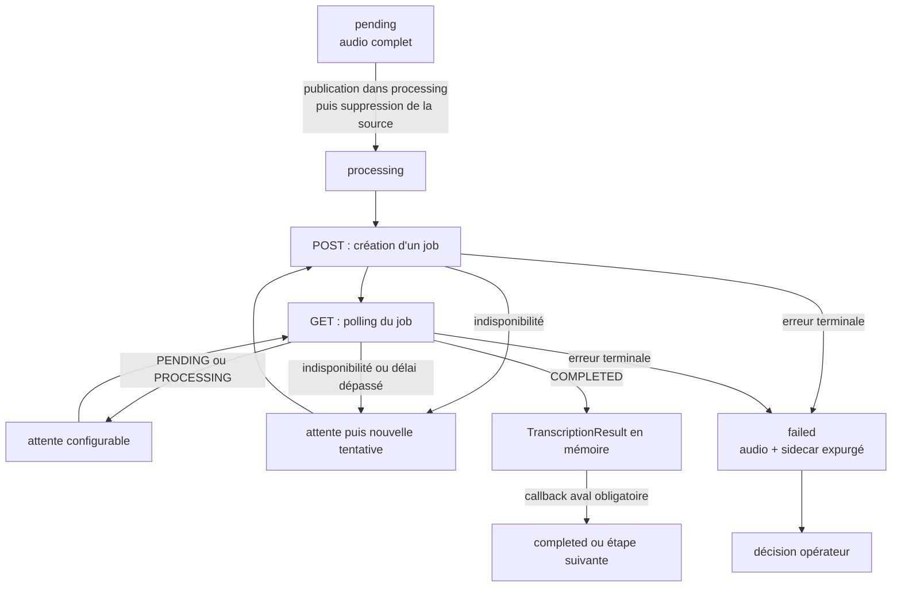

# Worker d'automatisation

Ce workspace contient l'application chargée de consommer les fichiers audio et
de demander leur transcription. Le POC fonctionne avec **un seul worker** : il
scrute des répertoires partagés, traite un audio à la fois et s'appuie sur le
package commun pour publier les changements de volume de manière sûre.

Le worker ne crée pas encore de ticket GLPI et ne possède pas encore de point
d'entrée exécutable. Les fonctions d'orchestration, le client HTTP et leurs
tests sont implémentés ; leur assemblage dans un processus déployable relève
d'une étape ultérieure.

## Entrées et sorties

### Entrées

- un fichier audio complet dans `processing`, ou à défaut dans `pending` ;
- les quatre répertoires du cycle de vie audio ;
- un objet respectant `TranscriptionClientProtocol` ;
- les intervalles et délais de transcription ;
- pour le client réel, l'URL de base et la clé de l'API de transcription.

Un nom de fichier audio doit suivre la convention
`{uuid}.{extension}` avec un UUID canonique et une extension parmi `.wav`,
`.mp3`, `.ogg` et `.m4a`. Les liens symboliques, les noms invalides et les
fichiers terminant par `.part` ne sont pas consommés.

### Sorties

`run_once()` produit l'une des sorties suivantes :

- `None` lorsqu'aucun audio prêt n'est disponible ;
- un `TranscriptionResult` en cas de succès, contenant l'UUID local de l'audio,
  son chemin dans `processing` et la transcription en mémoire ;
- une `TranscriptionProcessingFailed` après isolation d'une erreur terminale
  dans `failed`.

Une indisponibilité n'est pas une sortie terminale de `run_once()` : la
fonction attend l'intervalle configuré puis réessaie le **même fichier**.

## Cycle de vie d'un audio



Le scanner applique les règles suivantes :

1. il reprend en priorité le premier fichier valide déjà présent dans
   `processing` ;
2. sinon, il réclame le premier fichier valide de `pending` et le publie dans
   `processing` ;
3. il ne parcourt jamais `failed` ;
4. l'ordre est déterministe : les noms de fichiers sont triés.

Le déplacement fourni par `glpi-ticketing-common` est compatible avec des
volumes distincts : le fichier est copié vers un nom temporaire `.part`, vidé
sur disque, publié sous son nom définitif, puis la source est supprimée. Un
fichier partiel ne devient donc jamais visible comme travail prêt.

### Signification des volumes

| Volume | Responsabilité actuelle |
| --- | --- |
| `pending` | Fichiers complets en attente de réclamation. |
| `processing` | Fichier réclamé, conservé pendant la soumission et tout le polling. Il est prioritaire après un redémarrage. |
| `failed` | Échecs terminaux. Le scanner n'y reprend rien automatiquement ; une décision opérateur est nécessaire. |
| `completed` | Destination configurée pour la suite du pipeline. Le worker de transcription ne déplace pas encore lui-même les succès vers ce volume. |

## Scanner et boucle du worker

Les trois fonctions publiques de `worker.py` ont des responsabilités séparées :

- `claim_next_audio()` sélectionne ou réclame un fichier, sans appeler de
  service externe ;
- `run_once()` réclame au plus un fichier, construit le poller et attend son
  succès ou son échec terminal ;
- `run_forever()` répète `run_once()` et attend l'intervalle de scan lorsqu'il
  n'y a aucun travail.

`run_forever()` reçoit obligatoirement un callback
`handle_transcription(TranscriptionResult)`. Avant de rendre la main, ce
callback doit faire avancer le fichier réussi hors de `processing`, normalement
vers `completed` après le traitement aval. Si le fichier existe encore à son
chemin initial au retour du callback, le worker lève une `RuntimeError` afin de
ne pas soumettre silencieusement le même audio en boucle.

Le callback concret et le traitement métier post-transcription ne sont pas
encore fournis dans ce workspace.

## Transcription

La couche `transcription` sépare le contrat stable de l'API HTTP historique :

- `TranscriptionClientProtocol` expose l'identifiant du fournisseur,
  `submit(audio_path)` et `get_job(job_uuid)` ;
- `TranscriptionClient` adapte l'API batch HTTP à ce contrat ;
- `TranscriptionPoller` orchestre une soumission puis le polling ;
- les modèles et énumérations normalisent les jobs, statuts et opérations ;
- les exceptions transportent des codes techniques sûrs, sans réponse HTTP
  brute.

`TranscriptionClient` reçoit lui-même un `httpx.Client` injecté. Le code de
composition qui sera ajouté ultérieurement devra donc créer et fermer cette
ressource HTTP ; le client de domaine ne masque pas son cycle de vie.

Le client effectue actuellement :

- `POST /api/batchTranscription/createJob` avec le fichier dans le champ
  multipart `audioFile` et la clé dans l'en-tête `X-API-KEY` ;
- `GET /api/batchTranscription/result?job_uuid=...` jusqu'à un état normalisé
  `COMPLETED` ou `FAILED`.

Les états `PENDING` et `PROCESSING` déclenchent une attente injectée, puis un
nouveau `GET`. Le contenu transcrit n'est produit qu'à l'état `COMPLETED`.

### Politique de nouvelle tentative

Les situations suivantes sont considérées comme des indisponibilités :

- erreur de transport sans réponse exploitable ;
- codes HTTP explicitement temporaires, notamment `408`, `425` et `429` ;
- tous les codes HTTP `5xx` ;
- délai global d'un job dépassé pendant le polling.

Dans ces cas, l'audio reste dans `processing`. `run_once()` attend la valeur de
son argument injecté `transcription_poll_interval_seconds` (deux secondes par
défaut), puis démarre une nouvelle tentative qui crée un nouveau job distant.
Le futur bootstrap devra alimenter cet argument depuis
`TRANSCRIPTION_POLL_INTERVAL_SECONDS`. Il n'y a actuellement ni nombre maximal
de tentatives, ni backoff progressif, ni jitter.

### Erreurs terminales

Une soumission explicitement refusée, une erreur HTTP non réessayable, un
contrat de réponse invalide, un UUID distant incohérent, un job distant en
échec ou une transcription absente à l'état `COMPLETED` sont terminaux.

Dans ce cas, le package commun publie d'abord dans `failed` :

1. l'audio complet ;
2. le sidecar `{uuid}.error.json` complet ;
3. puis seulement supprime l'audio de `processing`.

Si la publication échoue tant que la source existe, les artefacts partiellement
publiés sont nettoyés et la source reste dans `processing`.

Le sidecar contient exactement les informations opérationnelles suivantes :

```json
{
  "uuid": "00000000-0000-0000-0000-000000000000",
  "step": "transcription",
  "category": "terminal",
  "code": "remote_job_failed",
  "timestamp": "2026-08-27T10:15:30Z"
}
```

Il ne contient ni transcription, ni clé API, ni réponse HTTP brute, ni message
fourni par le service distant.

## Configuration

`WorkerSettings` charge les variables d'environnement et, en développement, le
fichier `.env` situé dans le répertoire courant. Les secrets utilisent
`pydantic.SecretStr` et sont masqués dans leur représentation Python.

Important : aucun bootstrap n'instancie encore `WorkerSettings`,
`TranscriptionClient` et `run_forever()` ensemble. Ces variables définissent le
contrat de configuration validé, mais les exporter ne suffit pas encore à
configurer ou démarrer un daemon.

| Variable | Obligatoire | Défaut | Rôle prévu lors de la composition |
| --- | --- | --- | --- |
| `PUBLIC_BASE_URL` | oui | — | URL publique validée et réservée à la construction de futurs liens audio ; pas encore utilisée par le flux de transcription. |
| `AUDIO_PENDING_DIR` | non | `/data/audio-pending` | Volume d'entrée. |
| `AUDIO_PROCESSING_DIR` | non | `/data/audio-processing` | Volume de travail et de reprise. |
| `AUDIO_COMPLETED_DIR` | non | `/data/audio-completed` | Volume prévu pour les succès traités par l'étape aval. |
| `AUDIO_FAILED_DIR` | non | `/data/audio-failed` | Volume terminal et sidecars d'erreur. |
| `LEGACY_TRANSCRIPTION_BASE_URL` | oui | — | URL de l'API batch actuellement adaptée par `TranscriptionClient`. |
| `LEGACY_TRANSCRIPTION_API_KEY` | oui | — | Clé envoyée dans `X-API-KEY`. |
| `TRANSCRIPTION_HTTP_TIMEOUT_SECONDS` | non | `10` | Timeout à transmettre au client pour chaque appel HTTP. |
| `TRANSCRIPTION_POLL_INTERVAL_SECONDS` | non | `2` | Attente entre deux polls et avant une nouvelle tentative du worker. |
| `TRANSCRIPTION_JOB_TIMEOUT_SECONDS` | non | `900` | Durée maximale d'une tentative de job avant une nouvelle soumission. |
| `GLPI_PASSWORD` | non | — | Réservé à l'intégration GLPI, non utilisée actuellement. |
| `GLPI_CLIENT_SECRET` | non | — | Réservé à l'intégration GLPI, non utilisé actuellement. |

Les quatre répertoires audio doivent être distincts après normalisation. Les URL
refusent les identifiants intégrés, query strings et fragments. La clé API doit
être non vide, sans espaces périphériques ni caractère de contrôle.

Un modèle sans secret est disponible à la racine dans `.env.example`. Il ne
faut jamais versionner le `.env` local.

## Architecture du workspace

```text
apps/worker-automation/
├── pyproject.toml
├── README.md
├── src/glpi_ticketing_worker_automation/
│   ├── __init__.py
│   ├── settings.py
│   ├── worker.py
│   └── transcription/
│       ├── __init__.py
│       ├── client.py
│       ├── contracts.py
│       ├── models.py
│       └── poller.py
└── tests/
    ├── unit/
    └── integration/
```

Conventions à préserver :

- conserver le *src layout* : le code importable reste sous `src/` ;
- laisser les primitives de cycle de vie des fichiers dans
  `glpi-ticketing-common.audio_files` ;
- laisser la sélection et l'orchestration globale dans `worker.py` ;
- isoler tout détail HTTP propre au fournisseur dans `transcription/client.py` ;
- faire dépendre le poller du protocole, pas du client concret, afin de pouvoir
  injecter un faux client en test ou remplacer l'adaptateur HTTP ;
- exprimer les contrats avec des modèles typés et les valeurs fermées avec des
  énumérations (`JobStatus`, `TranscriptionOperation`) plutôt qu'avec des chaînes
  dispersées ;
- injecter le sommeil et l'horloge dans les composants qui attendent, pour
  conserver des tests rapides et déterministes ;
- placer les tests unitaires au même niveau fonctionnel que le module testé et
  réserver `tests/integration/` aux appels réels explicitement activés.

## Journalisation et sécurité

Le worker journalise l'UUID local de l'audio au démarrage et au succès. Les
nouvelles tentatives et les échecs ajoutent un code technique constant. Il ne
journalise jamais le contenu de la transcription.

Les règles suivantes font partie du contrat de sécurité :

- ne pas journaliser ou sérialiser `LEGACY_TRANSCRIPTION_API_KEY` ;
- ne pas inclure le corps brut des réponses distantes dans les exceptions ou
  sidecars ;
- ne pas placer la transcription dans un sidecar d'erreur ;
- ne pas accepter de lien symbolique comme audio ;
- conserver les fichiers `.part` invisibles au scanner ;
- ne jamais reprendre automatiquement un fichier de `failed`.

## Commandes depuis la racine

Toutes les commandes suivantes se lancent à la racine du dépôt.

Installer et verrouiller les dépendances de tous les membres du workspace :

```bash
uv sync --all-packages
```

Exécuter tous les tests unitaires du worker :

```bash
uv run --all-packages pytest apps/worker-automation/tests/unit
```

Exécuter séparément les tests du scanner et de l'intégration de transcription
dans le worker :

```bash
uv run --all-packages pytest apps/worker-automation/tests/unit/test_worker_scanner.py
uv run --all-packages pytest apps/worker-automation/tests/unit/test_worker_transcription.py
```

Exécuter la suite locale du dépôt sans service externe :

```bash
uv run --all-packages pytest -m "not glpi and not live_transcribe and not e2e"
```

Vérifier le formatage et le lint de ce workspace :

```bash
uv run ruff format --check apps/worker-automation
uv run ruff check apps/worker-automation
```

### Test réel de l'API de transcription

Le test marqué `live_transcribe` crée réellement un job distant. Il est donc
désactivé par défaut. Le script racine valide le fichier, demande la clé sans
l'afficher si elle n'est pas déjà exportée, positionne les variables nécessaires
et lance le test :

```bash
scripts/run-live-transcription-test.sh /chemin/vers/audio.m4a
```

Variables comprises par ce test :

- `LIVE_TRANSCRIBE_BASE_URL` (défaut : `http://localhost:5000`) ;
- `LIVE_TRANSCRIBE_API_KEY` (demandée interactivement si absente) ;
- `LIVE_TRANSCRIBE_AUDIO_PATH` (ou argument du script) ;
- `RUN_LIVE_TRANSCRIBE=1` (positionnée par le script).

Ce test valide uniquement le contrat réel du client (`POST` puis polling
`GET`) ; ce n'est pas un test de bout en bout de `run_forever()`.

## Politique de test

Les tests unitaires couvrent séparément :

- la validation des paramètres ;
- le format des requêtes et la normalisation des réponses du client ;
- le polling, les délais, les reprises et la classification des erreurs ;
- l'ordre de sélection `processing` puis `pending` ;
- la publication sûre dans `failed` et l'expurgation du sidecar ;
- la non-divulgation de la transcription dans les logs ;
- la reprise après interruption et le contrat du callback de succès.

Le sommeil, l'horloge et le client sont injectés dans les tests : la suite
unitaire ne dort pas et ne contacte aucun service. Les marqueurs globaux du
dépôt sont :

- `live_transcribe` : serveur de transcription réel ;
- `glpi` : instance GLPI jetable via Testcontainers ;
- `e2e` : flux complet avec services externes.

## Limites actuelles

- L'application n'a pas encore de CLI, de fonction `main` ni de composition qui
  transforme `WorkerSettings` en client HTTP et lance `run_forever()`.
- Le callback aval qui consomme `TranscriptionResult` et déplace le succès vers
  `completed` n'est pas encore implémenté.
- La transcription et l'UUID du job distant ne sont pas persistés par le worker.
- L'API ne fournit pas de clé d'idempotence. Après une réponse ambiguë, un délai
  dépassé ou un redémarrage, un fichier conservé dans `processing` est resoumis
  et peut créer plusieurs jobs distants pour le même audio.
- La politique d'indisponibilité réessaie indéfiniment avec un intervalle fixe ;
  elle ne propose encore ni backoff, ni jitter, ni circuit breaker.
- Le POC suppose un seul worker et un seul auteur pour un UUID audio. Il n'y a
  pas de verrou distribué pour plusieurs consommateurs concurrents.
- `failed` est terminal : aucun outil de décision opérateur ou de réinjection
  n'est fourni actuellement.
