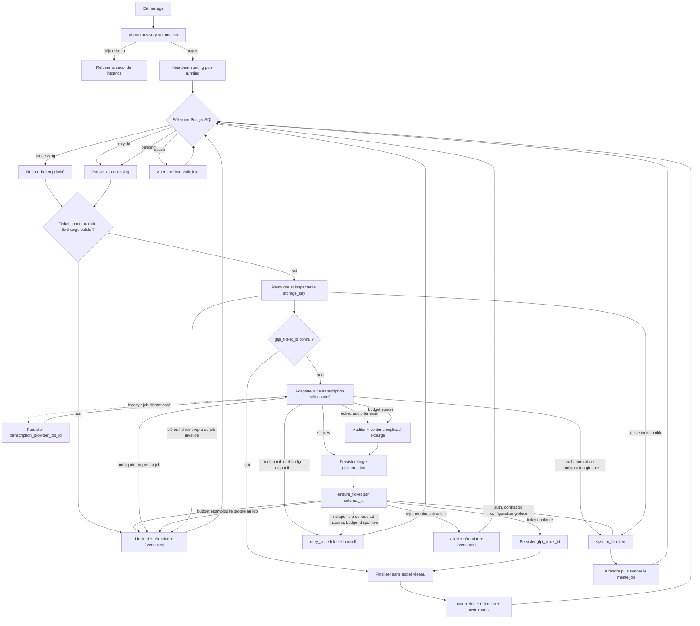

# Worker d'automatisation

Cette application consomme les jobs persistés par le web, demande leur
transcription, retrouve ou crée le ticket GLPI correspondant, puis finalise le
cycle de vie en base. Depuis l'itération 3 du MVP, **PostgreSQL est l'unique
source de vérité** : le worker ne scanne aucun répertoire et ne déplace jamais
un audio pour représenter son état.

Le MVP reste volontairement mono-worker. Une connexion PostgreSQL dédiée
conserve un verrou advisory pendant toute la durée du processus ; une seconde
instance est refusée avant de traiter un job.

## Entrées et sorties

### Entrées

- une base PostgreSQL migrée contenant les jobs et leurs événements ;
- une racine audio canonique, `/data/audios` par défaut ;
- un objet respectant `TranscriberProtocol` ;
- un objet respectant `GlpiTicketCreationProtocol` ;
- une fonction construisant l'URL publique d'un audio à partir de son UUID ;
- les politiques configurables de retry, de rétention et de sommeil.

La base conserve une `storage_key` immuable de la forme
`{uuid}.{extension}`. Le worker résout directement
`audio_root / storage_key`, vérifie qu'il s'agit d'un fichier régulier non
symbolique et que sa taille correspond à `audio_size_bytes`, puis transmet ce
chemin au client de transcription. Les états
`pending`, `processing`, `retry_scheduled`, `completed`, `failed` et `blocked`
sont exclusivement des valeurs PostgreSQL.

### Sorties de `run_once()`

`AutomationWorker.run_once()` retourne un résultat immuable et expurgé :

| Résultat | Signification |
| --- | --- |
| `IdleOutcome` | Aucun job n'est éligible ; contient l'attente avant une nouvelle sélection. |
| `InterruptedOutcome` | Un arrêt coopératif a interrompu le polling ; le job reste `processing` sans faux retry. |
| `RetryOutcome` | Une indisponibilité est persistée avec sa prochaine échéance. |
| `CompletedOutcome` | Le ticket est confirmé et le job est durablement finalisé. |
| `FailedOutcome` | Une erreur terminale propre au job est persistée. |
| `BlockedOutcome` | Une ambiguïté propre au job est persistée pour intervention opérateur. |
| `SystemBlockedOutcome` | Une erreur globale suspend la consommation ; le job reste `processing`, avec sonde automatique seulement si elle est sûre. |

Aucun résultat, log, événement ou heartbeat ne transporte la transcription,
un secret ou une réponse HTTP brute. Les erreurs observables se limitent à une
portée (`job` ou `system`), une catégorie et un code technique expurgés.

## Sélection et reprise

Une transaction courte exécute une seule acquisition selon cet ordre :

1. reprendre le job déjà `processing`, s'il existe ;
2. sinon réclamer le retry dont `next_attempt_at` est atteint ;
3. sinon réclamer le plus ancien job `pending` ;
4. sinon retourner `IdleOutcome`.

Un retry système planifié agit comme une sonde de disponibilité : tant qu'il
n'est pas dû, aucun nouveau job `pending` n'est réclamé. Cette règle évite de
répliquer la même panne globale sur toute la file. L'index unique partiel du
schéma et le verrou advisory garantissent qu'un seul job est `processing` dans
le MVP.

La réclamation passe le job à `processing`, incrémente `attempt_count`, efface
l'erreur courante et ajoute un événement. Elle ne touche pas aux octets audio.

## Pipeline persistant



Chaque mutation SQL est validée avant l'étape suivante. Aucune transaction ne
reste ouverte pendant un appel de transcription, un polling, un appel GLPI ou un
sommeil. Les frontières de reprise importantes sont donc durables :

- la date de réception Exchange est relue depuis l'ingestion liée au job dans
  la même transaction que son acquisition ;
- avec le provider historique uniquement, l'identifiant distant est persisté
  immédiatement après le `POST`, avant le premier `GET` de polling ;
- l'identifiant GLPI est persisté avant la transition `completed` ;
- l'état terminal, la rétention et l'événement associé sont écrits dans une
  même transaction.

La transcription n'étant pas persistée localement, un redémarrage retranscrit
tout job `processing` sans `glpi_ticket_id`. Si l'identifiant GLPI est déjà présent,
le worker reprend directement la finalisation sans rappeler Transcribe AI ni
GLPI. `ensure_ticket()` réconcilie les autres reprises grâce à
`external_id = audio_uuid`.

Pour un nouveau ticket, `mail_ingestions.received_at` reste la source de vérité
UTC. Le client la convertit avec le fuseau IANA `Europe/Paris` avant de
renseigner la date d'ouverture métier `date` de GLPI. Il ne modifie jamais
`date_creation`, qui conserve l'heure technique d'insertion dans GLPI. Une
ingestion absente ou incohérente bloque le job avec le code expurgé
`source_received_at_missing`, sans inventer de date de repli et avant tout appel
à Transcribe AI ou GLPI. Un ticket dont l'identifiant est déjà persisté reste
finalisé sans dépendre de cette métadonnée.

Si la persistance de l'identifiant Transcribe AI échoue juste après un `POST`
accepté, l'exception d'origine est remplacée par le code expurgé
`submission_persistence_failed`. Le worker traite cette ambiguïté comme un
blocage **système**, jamais comme un échec terminal du job : celui-ci reste
`processing`, mais le blocage est verrouillé et aucune nouvelle soumission
automatique n'est effectuée. Une reprise exige donc une décision opérateur ou
un redémarrage contrôlé. Le job distant accepté peut devenir orphelin ; cette
limite est inévitable tant que le provider n'accepte ni UUID fourni par
l'appelant ni clé d'idempotence.

## Retries, échecs et blocages

### Retry récupérable

Une indisponibilité réseau, un statut HTTP temporaire ou un résultat GLPI
inconnu produit `retry_scheduled`. Le délai exponentiel est calculé à partir du
nombre d'échecs consécutifs : **5, 10, 20, 40, 80, 160 puis 300 secondes** avec
les valeurs par défaut. Le plafond reste ensuite à 300 secondes. Le MVP
n'ajoute volontairement pas de jitter puisqu'un seul worker est prévu.

Le compteur est global au pipeline d'un job : chaque tentative qui se termine
par un retry l'incrémente, que l'indisponibilité vienne de Transcribe AI ou de
GLPI. Une étape intermédiaire réussie ne le remet pas à zéro, puisque la reprise
GLPI doit actuellement retranscrire l'audio. L'action opérateur de réarmement
prévue à l'itération 4 réinitialisera cette série.

Par défaut, le worker autorise trois reprogrammations après la tentative
initiale. À épuisement, une indisponibilité de transcription devient le code
expurgé `transcription_retry_exhausted` et le pipeline crée un ticket explicatif.
Une indisponibilité ou un résultat inconnu GLPI devient un job `blocked` avec
`glpi_retry_exhausted`, afin de libérer la file tout en conservant l'audio pour
une décision opérateur. Cette limite ne s'applique pas aux sondes de blocage
système, qui suivent leur politique dédiée.

Le runner ne dort pas sur un `RetryOutcome` : il revient immédiatement à la
sélection afin qu'un autre job éligible puisse progresser. PostgreSQL empêche
le job en retry d'être repris avant `next_attempt_at`.

### Transcription dégradée avec création de ticket

Un rejet audio explicite du provider (`400`, `413`, `415`, `422` pour le
contrat OpenAI compatible), son erreur HTTP `500`, un statut distant legacy
`FAILED`, une soumission legacy rejetée, un texte vide/invalide ou l'épuisement
des retries de transcription n'arrête plus le pipeline. Le worker ajoute un
événement `transcription_failed`, construit un contenu explicatif fixe avec un
code technique expurgé, puis crée le ticket GLPI. L'audio suit ensuite la
rétention normale d'un job `completed` afin de rester disponible à l'opérateur.
Ni réponse HTTP brute ni transcription invalide ne sont persistées ou
journalisées. Les autres erreurs HTTP temporaires, notamment `502`, `503` et
`504`, restent reprogrammables dans la limite configurée.

### `failed` : erreur terminale propre au job

Un job devient `failed` uniquement lorsqu'une nouvelle tentative avec les
mêmes données n'a pas de chance raisonnable de réussir, notamment :

- rejet sémantique GLPI explicitement reconnu par le client.

Le worker persiste l'erreur et planifie une suppression absolue à 30 jours par
défaut, puis continue avec un autre job. Il ne déplace pas l'audio dans un
répertoire `failed` et n'écrit aucun sidecar JSON.

### Blocage propre à un job

Une incohérence limitée à un job, par exemple une `storage_key` invalide, un
audio absent ou plusieurs tickets portant le même `external_id`, devient un
état `blocked` persistant. Sa rétention absolue est planifiée à 90 jours par
défaut. Le runner continue avec la file ; une future action opérateur devra
réarmer explicitement le job.

### Blocage système

Une erreur d'authentification, de configuration, de contrat global ou
d'accès à la racine audio produit `SystemBlockedOutcome`. L'échec de
persistance d'un identifiant distant accepté appartient aussi à cette
catégorie. Le job reste `processing` et le heartbeat passe à `blocked`.

Deux politiques sont explicites : une panne sondable sans effet distant
ambigu, telle qu'une racine audio momentanément indisponible, est réévaluée
après 60 secondes par défaut ; une réponse acceptée non persistée, une rupture
de contrat après soumission ou un contrat GLPI incohérent est **latched**. Dans
ce second cas, le processus reste vivant et observable mais ne rappelle jamais
le worker avant son arrêt, afin de ne pas créer un job distant toutes les
60 secondes.

## Transcription

La couche `transcription` expose un `TranscriberProtocol` indépendant du mode
synchrone, du polling et des identifiants distants :

- `LegacyTranscriptionClient` et `LegacyPollingTranscriber` encapsulent le
  `POST /api/batchTranscription/createJob`, le polling et la persistance de
  l'identifiant distant historique ;
- `OpenAICompatibleTranscriber` consomme uniquement le sous-ensemble commun
  `POST /audio/transcriptions` avec `file`, `model`, `language` et
  `response_format=json` ;
- `TranscriptionResult` ne transporte que l'identité locale de l'audio, le
  texte et d'éventuels segments neutres.

Le fichier reste à sa clé canonique pendant tout ce flux. La transcription est
gardée uniquement en mémoire le temps de construire le ticket GLPI.

## GLPI

Le package partage `glpi-ticketing-glpi` adapte l'API GLPI V2.3.0.
`GlpiClient.ensure_ticket()` cherche
d'abord l'UUID audio dans `external_id`, puis crée le ticket uniquement si
aucun résultat exact n'existe. Le titre et les niveaux du ticket proviennent de
la configuration ; la description contient la transcription et l'URL audio.
`TitleGeneratorProtocol` isole désormais la génération du titre ; cette
itération utilise `DefaultTitleGenerator`, qui retourne le titre configuré.

Une réponse de création ambiguë reste récupérable et sera réconciliée à la
tentative suivante. Une duplication réelle d'`external_id` bloque uniquement
le job ; une recherche filtrée qui retourne un autre `external_id` révèle une
rupture systémique du contrat. Les réponses inconnues ne sont jamais reclassées
automatiquement comme terminales sur la seule base de leur code HTTP.

Le verrou singleton est contrôlé avant et après chaque requête OAuth, de
recherche et de création. Ces contrôles empêchent une instance déjà reconnue
comme obsolète d'initier l'appel suivant, mais ne peuvent ni annuler un `POST`
GLPI déjà en vol ni imposer une contrainte d'unicité distante. La recherche
par `external_id` reste donc la réconciliation du MVP, pas un verrou distribué.
Si le résultat d'un `POST` reste inconnu et que la recherche suivante est
encore vide, une future itération peut tenter une nouvelle création. Sans
unicité GLPI, ce délai de visibilité constitue un risque résiduel explicite du
MVP ; sa suppression demande une intention de création persistée et une reprise
« reconciliation-only », ou une contrainte d'unicité fournie par GLPI.

## Rétention planifiée

L'itération 3 crée ou active la ligne `audio_retentions` en même temps que
l'état final :

| État du job | Politique par défaut |
| --- | --- |
| `completed` | Premier contrôle GLPI après 6 h, suppression absolue après 90 jours. |
| `failed` | Suppression absolue après 30 jours. |
| `blocked` | Suppression absolue après 90 jours. |

Le worker d'automatisation ne supprime lui-même aucun audio. Les contrôles GLPI
et les purges sont exécutés par l'application `worker-retention` à partir des
échéances qu'il persiste.

## Runtime, heartbeat et arrêt

`composition.py` assemble les deux adaptateurs, les politiques, les stages et
`AutomationWorker`. `runtime/context.py` possède la base, le verrou et le client
HTTP partagé, tandis que `application.py` reste limité au CLI et au lancement
de la boucle. Le runtime :

1. ouvre le moteur et acquiert le verrou advisory `automation` ;
2. écrit les états `starting`, puis `running` ;
3. exécute toutes les transactions du worker sur la connexion qui détient le
   verrou, puis le vérifie aussi autour de chaque `run_once()` et appel
   Transcribe AI ou GLPI ;
4. le revalide avant la soumission, autour de chaque lecture du polling et
   après chaque attente de transcription ;
5. écrit `degraded` après un retry ou `blocked` après un blocage système ;
6. écrit `running` après une frontière terminale de job ;
7. tente d'écrire `stopped`, ferme HTTP, libère le verrou et dispose le moteur.

La perte détectée de la connexion propriétaire est traitée en **fail-closed** :
elle supplante le résultat du provider et remonte comme une erreur inattendue.
Une transaction SQL du worker ne peut pas être validée après la perte du verrou,
car les deux partagent la même connexion PostgreSQL. L'ancienne instance
n'initie alors pas l'étape externe suivante. Cette garantie clôt les écritures
locales, mais ne constitue pas un jeton de fencing distribué auprès de
Transcribe AI ou de GLPI.

Le heartbeat est rafraîchi aux frontières du pipeline et pendant chaque
attente coopérative. Une attente plus longue que
`WORKER_HEARTBEAT_INTERVAL_SECONDS` est découpée en tranches ; entre deux
tranches, le reporter vérifie le verrou puis republie son dernier état. Cette
cadence est implémentée sans thread : heartbeat et transactions continuent
d'utiliser exclusivement la connexion propriétaire du verrou advisory.

Une requête HTTP synchrone déjà commencée n'est pas interrompue pour publier un
heartbeat ; celui-ci est vérifié avant et après l'appel. Les timeouts HTTPX
bornent l'inactivité des phases réseau, pas une deadline murale totale : un
upload lent mais progressif peut donc dépasser le seuil d'alerte. Un heartbeat
périmé signifie « aucun checkpoint récent, processus potentiellement non
réactif » et non une preuve d'arrêt ; le dashboard expose cette distinction.

L'image exécute également le module
`glpi_ticketing_worker_automation.runtime.healthcheck`. Cette sonde vérifie
PostgreSQL, exige un heartbeat `worker_automation` présent, non `stopped` et
récent, puis confirme que `/data/audios` est lisible mais réellement non
inscriptible. Un état `blocked` ou `degraded` encore frais reste healthy : une
indisponibilité métier ne demande pas un redémarrage aveugle du processus. Le
seuil `WORKER_HEALTHCHECK_STALE_AFTER_SECONDS`, fixé à `45` secondes par défaut,
doit être strictement supérieur à `WORKER_HEARTBEAT_INTERVAL_SECONDS`. La sonde
n'émet qu'un code technique expurgé et ne journalise ni URL SQL ni secret.

`SIGINT` et `SIGTERM` demandent un arrêt coopératif et interrompent les attentes
injectées. Si le signal survient pendant le polling Transcribe AI, le worker
retourne `InterruptedOutcome` : il ne programme ni retry ni erreur et le job
reste `processing` pour une reprise prioritaire au prochain démarrage. Une
requête HTTP synchrone déjà en cours n'est observée qu'à son retour ou à
l'expiration d'un timeout d'inactivité de phase. Les codes de sortie sont :

| Code | Signification |
| --- | --- |
| `0` (`SUCCESS`) | arrêt normal ou signal coopératif géré |
| `1` (`UNEXPECTED_ERROR`) | erreur inattendue, perte du verrou ou impossibilité de rafraîchir le heartbeat ; le runtime de conteneur peut relancer le processus |
| `2` (`CONFIGURATION_ERROR`) | configuration invalide ; un redémarrage identique ne peut pas corriger la cause |
| `3` (`SINGLETON_CONFLICT`) | verrou singleton déjà détenu par une autre instance ; aucun travail n'a été commencé |
| `130` (`INTERRUPTED`) | `KeyboardInterrupt` échappé des gestionnaires coopératifs |

Un `BlockedOutcome` propre à un job ne produit aucun de ces codes : il est
persisté et la boucle continue. Un `SystemBlockedOutcome` sondable conserve
également le processus vivant avec un heartbeat `blocked`. Seule une défaillance
technique qui empêche de garantir le verrou ou la persistance traverse la
frontière du processus avec le code `1`.

## Architecture des fichiers

```text
apps/worker-automation/
├── pyproject.toml
├── README.md
├── src/glpi_ticketing_worker_automation/
│   ├── __main__.py          # forme python -m
│   ├── application.py       # CLI, codes de sortie et lancement de la boucle
│   ├── composition.py       # assemblage des adaptateurs et services
│   ├── settings.py          # contrat d'environnement typé
│   ├── runtime/
│   │   ├── context.py       # ressources, verrou et nettoyage
│   │   ├── heartbeat.py     # outcomes vers état runtime
│   │   ├── healthcheck.py   # adaptateur PostgreSQL de la sonde conteneur
│   │   └── signals.py       # arrêt coopératif SIGINT/SIGTERM
│   ├── transcription/       # client HTTP, polling et contrats
│   └── worker/
│       ├── audio.py         # inspection du stockage canonique
│       ├── lifecycle.py     # transactions et coordination des repositories
│       ├── outcomes.py      # résultats publics expurgés
│       ├── ports.py         # contrats internes partagés
│       ├── policies.py      # backoff et échéances de rétention
│       ├── service.py       # AutomationWorker.run_once()
│       ├── transitions.py   # décisions et transitions observables
│       ├── stages/
│       │   ├── transcription.py
│       │   └── ticket_creation.py
│       └── runner.py        # boucle sans connaissance des services
└── tests/
    ├── unit/
    └── integration/
        ├── database/        # PostgreSQL migré + stockage réel
        ├── transcribe-ai/   # contrat provider CPU/GPU
        └── e2e/             # pipeline complet persistant
```

Le client HTTP, les modèles, les contrats et la stack d'intégration GLPI sont
regroupés dans [`packages/glpi-client`](../../packages/glpi-client/README.md).

Les dépendances suivent la direction suivante :

```text
application -> runtime -> composition -> worker service
                                          |
                                          +-> stages -> contrats Transcribe/GLPI
                                          +-> lifecycle -> repositories
                                          +-> audio -> package common
```

Chaque repository ne manipule qu'un modèle et ne fait jamais de `commit`.
`AutomationJobLifecycleService` possède les transactions courtes et coordonne
les écritures du job, de son événement et de sa rétention. `AutomationWorker`
ne définit que l'ordre du pipeline ; l'inspection audio, les classifications
Transcribe AI/GLPI et les transitions observables sont testables séparément.

## Configuration

Les variables obligatoires sont chargées depuis l'environnement ou `.env` :

| Variable | Rôle |
| --- | --- |
| `DATABASE_URL` | URL `postgresql+psycopg` de la base migrée. |
| `PUBLIC_BASE_URL` | Base des liens audio insérés dans GLPI. |
| `TRANSCRIPTION_PROVIDER` | `legacy_polling` ou `openai_compatible` ; `legacy_polling` par défaut. |
| `LEGACY_TRANSCRIPTION_BASE_URL` | Base de l'API batch, obligatoire uniquement avec `legacy_polling`. |
| `LEGACY_TRANSCRIPTION_API_KEY` | Clé de l'API batch, obligatoire uniquement avec `legacy_polling`. |
| `OPENAI_COMPATIBLE_TRANSCRIPTION_BASE_URL` | Base OpenAI compatible terminée par son préfixe `/v1`, obligatoire avec `openai_compatible`. |
| `OPENAI_COMPATIBLE_TRANSCRIPTION_API_KEY` | Clé Bearer du provider synchrone, obligatoire avec `openai_compatible`. |
| `OPENAI_COMPATIBLE_TRANSCRIPTION_MODEL` | Identifiant de modèle envoyé au provider synchrone. |
| `GLPI_BASE_URL` | Base de l'instance GLPI. |
| `GLPI_USERNAME`, `GLPI_PASSWORD` | Utilisateur du grant OAuth Password. |
| `GLPI_CLIENT_ID`, `GLPI_CLIENT_SECRET` | Client OAuth GLPI. |
| `GLPI_TICKET_TITLE` | Titre fixe des tickets. |
| `GLPI_TICKET_REQUEST_SOURCE_ID` | Identifiant positif de la source MEVO dans l'instance GLPI ciblée. |
| `GLPI_TICKET_URGENCY`, `GLPI_TICKET_IMPACT` | Niveaux GLPI de 1 à 5. |

Les configurations des deux providers peuvent coexister. Au démarrage,
`TRANSCRIPTION_PROVIDER` sélectionne l'unique adaptateur utilisé par le worker ;
aucune bascule automatique n'est effectuée en cas d'erreur. Changer de provider
nécessite de modifier cette variable puis de redéployer le worker.

Principaux réglages optionnels :

| Variable | Défaut | Rôle |
| --- | ---: | --- |
| `AUDIO_ROOT` | `/data/audios` | Racine du stockage canonique. |
| `DATABASE_CONNECT_TIMEOUT_SECONDS` | `5` | Timeout de connexion PostgreSQL. |
| `WORKER_LOG_LEVEL` | `INFO` | Niveau des logs applicatifs ; `DEBUG` ajoute des diagnostics GLPI réseau/TLS expurgés. |
| `WORKER_HEARTBEAT_INTERVAL_SECONDS` | `10` | Cadence maximale des checkpoints de heartbeat pendant les attentes coopératives. |
| `WORKER_HEALTHCHECK_STALE_AFTER_SECONDS` | `45` | Âge maximal du heartbeat accepté par la sonde conteneur ; strictement supérieur à sa cadence. |
| `WORKER_IDLE_INTERVAL_SECONDS` | `1` | Attente lorsqu'aucun job n'est éligible. |
| `WORKER_RETRY_INITIAL_SECONDS` | `5` | Premier délai du backoff. |
| `WORKER_RETRY_MAX_SECONDS` | `300` | Plafond du backoff. |
| `WORKER_MAX_CONSECUTIVE_RETRIES` | `3` | Nombre maximal de reprogrammations après la tentative initiale, partagé sur tout le pipeline du job. |
| `WORKER_SYSTEM_PROBE_INTERVAL_SECONDS` | `60` | Attente après un blocage système immédiat. |
| `COMPLETED_RETENTION_DAYS` | `90` | Deadline absolue d'un succès. |
| `FAILED_RETENTION_DAYS` | `30` | Deadline absolue d'un échec terminal. |
| `BLOCKED_RETENTION_DAYS` | `90` | Deadline absolue d'un job bloqué. |
| `RETENTION_CHECK_INTERVAL_HOURS` | `6` | Intervalle entre les contrôles d'un ticket terminé, également utilisé avant le premier contrôle. |
| `OPENAI_COMPATIBLE_TRANSCRIPTION_LANGUAGE` | `fr` | Langue envoyée au provider synchrone. |
| `TRANSCRIPTION_HTTP_TIMEOUT_SECONDS` | `10` | Timeout d'une requête de transcription ; le staging CPU utilise `120`. |
| `TRANSCRIPTION_POLL_INTERVAL_SECONDS` | `2` | Intervalle de polling du provider legacy uniquement. |
| `TRANSCRIPTION_JOB_TIMEOUT_SECONDS` | `900` | Durée maximale du polling legacy uniquement. |
| `GLPI_HTTP_TIMEOUT_SECONDS` | `10` | Timeout d'une opération GLPI. |
| `GLPI_TICKET_TYPE` | `1` | Type GLPI : `1` pour incident par défaut, `2` pour demande. |

Les secrets utilisent `SecretStr` et les erreurs de validation ne recopient
pas les valeurs reçues. Aucun secret réel ne doit être ajouté au dépôt.
L'identifiant de source est propre à chaque environnement : le worker le
transmet à GLPI dans `request_type.id` sans effectuer de recherche par nom.

Pour diagnostiquer temporairement un `transport_error` GLPI, définir
`WORKER_LOG_LEVEL=DEBUG` puis redéployer le worker. Le diagnostic indique
l'opération, l'hôte, les types d'exception, l'errno et les métadonnées de
validation TLS disponibles. Il n'inclut ni headers, ni corps HTTP, ni URL
complète, ni transcription. Revenir à `INFO` après l'investigation.

## Exécution et validation

La base doit être migrée et la racine audio doit exister avant le démarrage :

```bash
uv run glpi-ticketing-worker
```

La forme module est équivalente :

```bash
uv run python -m glpi_ticketing_worker_automation
```

Le [Dockerfile du worker](../../infra/docker/apps/worker-automation/Dockerfile)
installe cette application sans dépendances de développement et l'exécute en
non-root. Le volume partagé `/data/audios` est monté en lecture seule : le
worker inspecte et transmet les octets, mais ne peut ni les modifier ni les
supprimer. Le [déploiement Dokploy](../../README.md#déploiement-dokploy)
centralise sa configuration et monte le bundle de confiance interne en lecture
seule sans désactiver la vérification TLS.

Suite unitaire du workspace :

```bash
uv run pytest apps/worker-automation/tests/unit
```

Cycle de vie réel sur PostgreSQL migré, sans services HTTP réels :

```bash
uv run pytest -m database \
  apps/worker-automation/tests/integration/database -vv --maxfail=1
```

Contrat Transcribe AI conteneurisé, CPU par défaut ou GPU explicite :

```bash
uv run pytest -m transcribe_ai \
  apps/worker-automation/tests/integration/transcribe-ai -vv --maxfail=1

TRANSCRIBE_AI_TEST_DEVICE=gpu \
uv run pytest -m transcribe_ai \
  apps/worker-automation/tests/integration/transcribe-ai -vv --maxfail=1
```

Contrat GLPI et pipeline E2E :

```bash
uv run --package glpi-ticketing-glpi pytest -m glpi \
  packages/glpi-client/tests/integration/glpi -vv --maxfail=1

uv run pytest -m e2e \
  apps/worker-automation/tests/integration/e2e -vv --maxfail=1
```

Vérifications statiques :

```bash
uv run ruff format --check apps/worker-automation
uv run ruff check apps/worker-automation
```

Les suites `database`, `transcribe_ai`, `glpi` et `e2e` utilisent des
conteneurs jetables et ne doivent pas être parallélisées.

## Limites actuelles

- Le provider historique ne persiste pas les transcriptions et n'accepte pas encore
  l'UUID audio lors de la soumission. Une reprise sans ticket confirmé crée
  donc un nouveau job distant et peut dupliquer le travail de transcription.
- La transcription n'est jamais persistée. Une reprise GLPI sans
  `glpi_ticket_id` implique elle aussi une nouvelle transcription.
- `external_id` n'est pas une contrainte d'unicité GLPI. Le verrou mono-worker
  et les contrôles autour des requêtes réduisent les courses internes, mais ne
  protègent ni un `POST` déjà en vol ni une autre application écrivant sur la
  même instance GLPI.
- La taille détecte un audio tronqué ou remplacé par un contenu d'une taille
  différente. Le MVP ne persiste pas encore d'empreinte cryptographique et ne
  détecte donc pas un remplacement de même taille entre le contrôle et l'envoi.
- Le backoff n'a pas de jitter. Les retries du traitement sont plafonnés, mais
  les sondes automatiques d'un blocage système suivent une politique distincte
  sans compteur persistant ; cette politique devra être réévaluée avant une
  parallélisation.
- Le heartbeat n'est pas émis au milieu d'une requête HTTP synchrone. Les
  timeouts configurés bornent cette fenêtre d'invisibilité.
