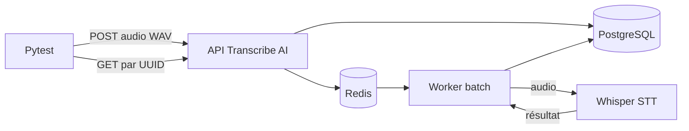

# Intégration Transcribe AI

Cette intégration remplace le test qui supposait qu'une instance Transcribe AI
soit lancée manuellement sur le poste. Une fixture de session partagée démarre
désormais une stack isolée avec Testcontainers, puis détruit les ressources
Compose.

Les responsabilités des tests restent séparées :

- `test_compose.py`, dans ce répertoire, vérifie la configuration des images,
  des overlays, du port loopback et du périphérique d'exécution ;
- `test_transcription_client.py` vérifie séparément le contrat réel du
  `TranscriptionClient` ;
- le `conftest.py` de ce répertoire fournit leur fixture commune afin que la
  stack ne soit démarrée qu'une fois par session.

## Flux couvert



La fixture génère une clé API et des identifiants PostgreSQL éphémères. Elle
attend les healthchecks de PostgreSQL, Redis, de l'API et du service STT. Elle
produit ensuite, avec FFmpeg dans le conteneur STT, un court WAV vocal de test :
aucun audio utilisateur ni fichier `audio.m4a` n'est nécessaire.

Le test soumet ce WAV avec le vrai client Python, interroge le job jusqu'à son
état `COMPLETED` et vérifie qu'une transcription non vide est retournée. Le
texte obtenu et les secrets ne sont jamais inclus dans les messages d'erreur.

Les scénarios de résilience peuvent arrêter puis redémarrer uniquement `api` et
`mono-voice-worker`. L'API est attendue par son healthcheck puis par une requête
HTTP authentifiée ; le worker batch, qui n'expose aucun endpoint de santé, est
attendu jusqu'au marqueur de démarrage de l'image épinglée. PostgreSQL, Redis et
le service STT ne sont pas pilotables par cette interface de test.

L'API de la fixture accepte les quatre formats pris en charge par le produit :
WAV, MP3, OGG et M4A. L'image épinglée attend leur extension sans point dans
`FORMAT_AUDIO_ALLOWED`, sous la forme d'une liste séparée par des virgules :
`wav,mp3,ogg,m4a`. Le scénario contractuel réel conserve un WAV synthétique afin
de ne pas multiplier quatre transcriptions coûteuses pour vérifier une règle de
configuration.

## Modes CPU et GPU

Le fichier `compose.yml` porte les services communs. `compose.cpu.yml` masque
explicitement CUDA ; `compose.gpu.yml` réserve un GPU au runtime NVIDIA. La
fixture sélectionne l'overlay avec `TRANSCRIBE_AI_TEST_DEVICE` :

```bash
TRANSCRIBE_AI_TEST_DEVICE=cpu \
uv run --all-packages pytest -m transcribe_ai -vv --maxfail=1
```

Le CPU est utilisé lorsque la variable est absente. Pour valider CUDA :

```bash
TRANSCRIBE_AI_TEST_DEVICE=gpu \
uv run --all-packages pytest -m transcribe_ai -vv --maxfail=1
```

La fixture contrôle `torch.cuda.is_available()` dans le conteneur. Elle échoue
si le runtime obtenu diffère du mode demandé : il n'existe aucun fallback GPU
vers CPU silencieux.

## Prérequis et ressources

- Docker avec le plugin Compose ;
- un hôte et un daemon Docker `linux/amd64` ;
- un accès réseau à chaque session pour récupérer le modèle Whisper `tiny` ; le
  premier lancement récupère aussi les images ;
- pour le mode GPU, un GPU NVIDIA, un pilote compatible et NVIDIA Container
  Toolkit configuré dans Docker.

L'image STT est volumineuse. Le premier téléchargement peut prendre plusieurs
minutes et consommer plus de 10 Go une fois extrait. Le modèle `tiny` est placé
dans un volume jetable ; il est donc téléchargé de nouveau après un teardown
complet. Le mode CPU est sensiblement plus lent que le mode GPU.

La suite ne doit pas être parallélisée. Un nom de projet Compose aléatoire évite
les collisions ; seul le port de l'API est publié, de façon aléatoire sur
`127.0.0.1`. À la fin de la session, conteneurs, réseau et volumes sont supprimés
et leur disparition est vérifiée. Les images restent dans le cache Docker.

## Portée de sécurité

Ces images Transcribe AI v1 sont réservées à l'intégration. Elles sont figées
par digest, mais une inspection montre que les images applicatives amont
embarquent encore des artefacts `.git` et `.env` dans leurs couches. Avant tout
usage de production, elles doivent être reconstruites avec un `.dockerignore`
strict et tout secret potentiellement publié doit être renouvelé. Les secrets
de cette fixture sont, eux, générés à chaque session et ne sont jamais intégrés
aux images.
