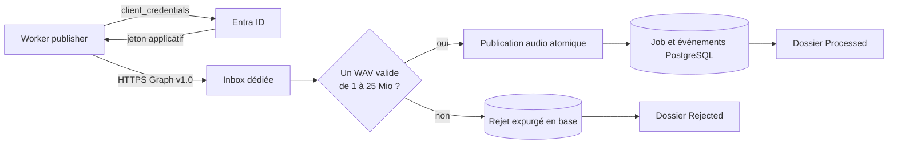

# Worker publisher

`glpi-ticketing-worker-publisher` ingère les messages vocaux d'une boîte
Exchange Online dédiée. Il remplace la création HTTP de jobs : un message
contenant exactement une pièce jointe WAV valide produit un audio canonique et
un job `pending` consommable par le worker d'automatisation.

Le processus est singleton. PostgreSQL porte son état durable et le volume
audio partagé porte uniquement les octets publiés. Le web consulte les jobs et
les heartbeats, mais ne crée aucun job.

## Flux



Une itération respecte l'ordre suivant :

1. reprendre une ingestion `processing` ou un retry échu déjà persisté ;
2. seulement si aucun travail durable n'est disponible, paginer l'Inbox de la
   plus ancienne à la plus récente ;
3. enregistrer chaque message découvert avec son identifiant immuable ;
4. sélectionner exactement une pièce jointe WAV, non inline, non vide et dont
   la taille annoncée ne dépasse pas 25 Mio ;
5. télécharger le contenu dans un fichier temporaire non publié, sans écrire
   au-delà de la limite, puis valider sa structure RIFF/WAVE ;
6. publier l'audio par écriture atomique sous la clé canonique
   `{ingestion_uuid}.wav`, puis créer le job et ses événements dans une
   transaction PostgreSQL ;
7. déplacer le message dans `Processed` après la publication durable, ou dans
   `Rejected` après l'enregistrement durable d'un rejet.

Un autre message portant des octets identiques crée volontairement un autre
job. Le publisher ne déduplique pas les contenus audio.

## Reprise, erreurs et traçabilité

Les statuts d'ingestion sont `pending`, `processing`, `retry_scheduled`,
`completed`, `failed` et `blocked`. Les étapes sont `discovery`, `validation`,
`publication` et `acknowledgement`.

- Une indisponibilité temporaire de Graph ou du stockage planifie un retry
  persistant avec backoff exponentiel. Une panne PostgreSQL arrête le processus,
  que Docker relance ; l'état déjà commité est alors repris.
- Un message sans unique WAV exploitable, vide, corrompu ou trop volumineux est
  enregistré `failed`, puis déplacé dans `Rejected`.
- Une ambiguïté limitée au message devient `blocked`.
- Une incohérence systémique non récupérable bloque la consommation. Le
  heartbeat rend cet état visible au dashboard.

La publication et l'acquittement sont rejouables. Si la réponse au déplacement
Graph est perdue, le client relit le dossier courant du message avant de
décider de réessayer. Si le processus s'arrête entre la publication locale et
le déplacement distant, l'ingestion persistée est reprise avant toute nouvelle
découverte.

Toutes les requêtes de boîte portent `Prefer: IdType="ImmutableId"`. Les
identifiants de message et de pièce jointe sont opaques : ils ne sont pas
journalisés. Les erreurs et événements conservent seulement l'UUID d'ingestion,
l'étape, une catégorie et un code technique expurgés. Aucun jeton, contenu de
mail, nom de pièce jointe ni octet audio n'apparaît dans les logs.

Le worker publie un heartbeat PostgreSQL avec son état et, pendant un
traitement, `current_ingestion_uuid`. Une seconde instance échoue à acquérir le
verrou advisory et termine avec le code `3`.

## Authentification Entra ID

L'application utilise OAuth 2.0 `client_credentials` via MSAL et le scope
`https://graph.microsoft.com/.default`. Deux fichiers PEM distincts sont
nécessaires :

- la clé privée associée à l'application Entra ID ;
- le certificat public X.509 associé, au format `BEGIN CERTIFICATE`.

Ce certificat public exact doit être chargé dans **App registrations >
Certificates & secrets > Certificates** pour l'application identifiée par
`PUBLISHER_ENTRA_CLIENT_ID`. Un fichier limité à `BEGIN PUBLIC KEY` n'est pas
un certificat et ne peut pas être utilisé par ce flux.

La passphrase de la clé privée est facultative si celle-ci n'est pas chiffrée.
En production, les deux fichiers sont montés séparément et en lecture seule ;
la clé privée et sa passphrase restent des secrets d'exploitation. Ils ne
doivent jamais être placés dans Git, dans une image ou dans les logs.

L'autorisation recommandée est **Exchange Online Application RBAC** avec le
rôle `Application Mail.ReadWrite`, limité à la seule boîte dédiée. N'ajoutez
pas en parallèle une permission applicative `Mail.ReadWrite` à l'échelle du
tenant : l'union des autorisations supprimerait le cloisonnement attendu.

L'administrateur Exchange doit enregistrer le service principal avec
`New-ServicePrincipal`, créer le scope de ressources limité à la boîte, lui
attribuer `Application Mail.ReadWrite`, puis contrôler la portée effective avec
`Test-ServicePrincipalAuthorization`. Suivre la
[procédure Microsoft Application RBAC](https://learn.microsoft.com/en-us/exchange/permissions-exo/application-rbac) :
l'Object ID demandé lors de l'enregistrement est celui de l'**Enterprise
Application**, pas celui de l'App Registration.

## Configuration

Les variables sont lues depuis l'environnement ou le fichier `.env` de la
racine lorsqu'une commande est lancée depuis celle-ci.

| Variable | Défaut | Rôle |
| --- | --- | --- |
| `PUBLISHER_ENTRA_TENANT_ID` | obligatoire | UUID du tenant Entra ID. |
| `PUBLISHER_ENTRA_CLIENT_ID` | obligatoire | UUID de l'application Entra ID. |
| `PUBLISHER_MAILBOX_ID` | obligatoire | Object ID Entra de l'utilisateur boîte dédié, pas son Exchange GUID. |
| `PUBLISHER_ENTRA_PRIVATE_KEY_PEM_PATH` | obligatoire | Chemin lisible de la clé privée PEM. |
| `PUBLISHER_ENTRA_CERTIFICATE_PEM_PATH` | obligatoire | Chemin lisible du certificat public X.509 PEM. |
| `PUBLISHER_ENTRA_PRIVATE_KEY_PASSPHRASE` | vide | Passphrase facultative de la clé privée. |
| `DATABASE_URL` | obligatoire | URL SQLAlchemy `postgresql+psycopg`. |
| `AUDIO_ROOT` | `/data/audios` | Racine du stockage partagé. |
| `PUBLISHER_LOG_LEVEL` | `INFO` | Niveau applicatif `INFO` ou `DEBUG`. |
| `PUBLISHER_GRAPH_PAGE_SIZE` | `50` | Taille des pages Graph, de 1 à 1 000. |
| `PUBLISHER_MAX_ATTACHMENT_BYTES` | `26214400` | Limite WAV, plafonnée à 25 Mio. |
| `PUBLISHER_HTTP_TIMEOUT_SECONDS` | `10` | Timeout Entra ID et Graph. |
| `PUBLISHER_POLL_INTERVAL_SECONDS` | `30` | Attente lorsque la file est vide. |
| `PUBLISHER_HEARTBEAT_INTERVAL_SECONDS` | `10` | Fréquence du heartbeat. |
| `PUBLISHER_RETRY_INITIAL_SECONDS` | `5` | Premier délai du backoff. |
| `PUBLISHER_RETRY_MAX_SECONDS` | `300` | Plafond du backoff. |
| `PUBLISHER_SYSTEM_PROBE_INTERVAL_SECONDS` | `60` | Cadence des checkpoints d'arrêt pendant un blocage système verrouillé. |

`PUBLISHER_RETRY_INITIAL_SECONDS` ne peut pas dépasser
`PUBLISHER_RETRY_MAX_SECONDS`. Les chemins de clé privée et de certificat
doivent viser deux fichiers lisibles et distincts.

Un blocage système terminal suspend les appels Graph. L'intervalle de probe ne
relance donc pas automatiquement le service externe : il permet seulement au
processus verrouillé de vérifier régulièrement une demande d'arrêt. Après
correction de la configuration ou des droits Entra ID, redémarrez le worker.

Pour Dokploy, utilisez les variables hôte décrites dans
[`infra/docker/.env.example`](../../infra/docker/.env.example) :
`PUBLISHER_ENTRA_PRIVATE_KEY_PEM_HOST_PATH` et
`PUBLISHER_ENTRA_CERTIFICATE_PEM_HOST_PATH`. Le Compose les monte vers les
chemins internes attendus par le processus.

## Architecture des fichiers

```text
apps/worker-publisher/
├── pyproject.toml
├── README.md
├── src/glpi_ticketing_worker_publisher/
│   ├── __main__.py            entrée `python -m`
│   ├── application.py         cycle de vie du processus et signaux
│   ├── composition.py         assemblage des adaptateurs
│   ├── settings.py            configuration validée
│   ├── graph/
│   │   ├── auth.py            jeton applicatif MSAL
│   │   ├── client.py          client Microsoft Graph v1.0
│   │   ├── contracts.py       ports et erreurs expurgées
│   │   └── models.py          modèles HTTP minimaux
│   ├── publisher/
│   │   ├── audio.py           sélection, inspection et publication WAV
│   │   ├── lifecycle.py       transaction et transitions PostgreSQL
│   │   ├── outcomes.py        résultats typés d'une itération
│   │   ├── ports.py           protocoles injectables
│   │   ├── runner.py          boucle et attentes
│   │   └── service.py         orchestration du cas d'usage
│   └── runtime/
│       ├── context.py         ressources du processus
│       ├── healthcheck.py     sonde du heartbeat
│       ├── heartbeat.py       publication de l'état runtime
│       └── signals.py         arrêt coopératif
└── tests/
    ├── unit/
    └── integration/graph/     faux Graph HTTP local et stateful
```

Le client Graph ignore PostgreSQL et le volume. Le service métier orchestre les
adaptateurs, tandis que la transaction reste dans la couche de cycle de vie.

## Démarrage et validation

Depuis la racine, après migration de la base et configuration de `.env` :

```bash
uv run --package glpi-ticketing-worker-publisher \
  glpi-ticketing-publisher
```

La forme module est également disponible :

```bash
uv run --package glpi-ticketing-worker-publisher \
  python -m glpi_ticketing_worker_publisher
```

Tests ciblés :

```bash
uv run --package glpi-ticketing-worker-publisher pytest \
  apps/worker-publisher/tests/unit -q

uv run --package glpi-ticketing-worker-publisher pytest \
  apps/worker-publisher/tests/integration/graph -q
```

Le faux serveur Graph est lié uniquement à `127.0.0.1`. Il vérifie notamment
la pagination, le streaming borné, les dossiers idempotents et la
réconciliation d'une réponse perdue sans contacter Microsoft 365.

## Limites du MVP

- un seul publisher est supporté ;
- seule une pièce jointe WAV est acceptée par message ;
- la liste paginée de l'Inbox est interrogée par polling, sans abonnement
  Graph ni delta query ;
- les rejets restent traçables en base et dans `Rejected`, mais le dashboard
  n'offre pas encore de liste dédiée aux ingestions mail ;
- les alertes restent locales au dashboard, sans notification externe ;
- l'E2E global automatise la frontière durable produite par le publisher sans
  utiliser de tenant Entra ID réel ; les contrats Graph et l'orchestration du
  publisher sont validés dans leurs suites dédiées.
