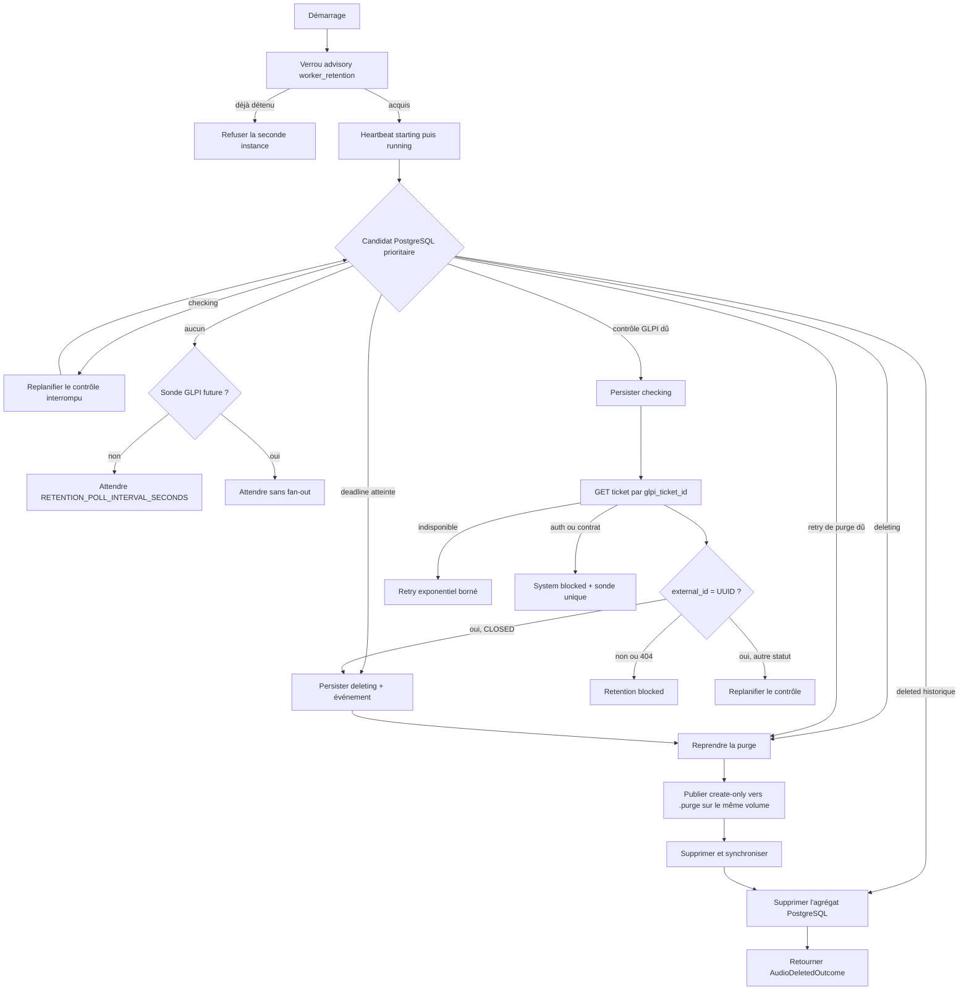

# Worker de rétention

Cette application applique la politique de conservation des audios après la
fin d'un job. PostgreSQL est son unique source de vérité : elle ne parcourt
jamais le volume pour découvrir du travail. Elle lit un ticket GLPI directement
par son identifiant connu, conserve l'audio tant que le ticket n'est pas fermé
et le supprime au plus tard à la deadline persistée. Une fois cette suppression
confirmée, elle supprime immédiatement l'agrégat PostgreSQL associé au job.

Le worker est un membre autonome du workspace. Il partage les packages
`common`, `database` et `glpi-client`, mais n'importe aucun module interne du
worker d'automatisation.

## Entrées et sorties

### Entrées

- une base PostgreSQL migrée contenant les jobs et leurs rétentions ;
- un répertoire audio canonique existant et non symbolique, `/data/audios` par défaut ;
- un système de fichiers Linux local prenant en charge les liens durs et la
  synchronisation de répertoire pour la quarantaine crash-safe ;
- un ticket GLPI déjà connu par `glpi_ticket_id` pour chaque job `completed` ;
- les identifiants OAuth Password du client GLPI de rétention ;
- les intervalles de polling, contrôle et retry.

Le worker ne calcule pas les durées de conservation initiales. Le worker
d'automatisation crée la ligne `audio_retentions` et persiste notamment
`hard_delete_at` et `next_check_at` lorsqu'il termine un job.

### Sorties de `run_once()`

Une itération avance au plus une rétention et retourne un résultat immuable et
expurgé :

| Résultat | Signification |
| --- | --- |
| `IdleOutcome` | Aucun travail n'est éligible. |
| `DependencyWaitingOutcome` | La sonde GLPI unique n'est pas encore due. |
| `CheckRecoveredOutcome` | Un état `checking` interrompu a été remis en file. |
| `GlpiCheckRescheduledOutcome` | Le ticket n'est pas fermé et un prochain contrôle est planifié. |
| `RetryScheduledOutcome` | Une indisponibilité temporaire a été persistée avec backoff. |
| `SystemBlockedOutcome` | Une erreur GLPI globale exige une sonde différée. |
| `RetentionBlockedOutcome` | Une ambiguïté propre à cette rétention exige une décision opérateur. |
| `AudioDeletedOutcome` | L'audio et l'agrégat PostgreSQL associé sont supprimés. |
| `StaleCandidateOutcome` | Une transition concurrente a rendu la sélection caduque sans action externe. |

Aucun outcome, événement, log ou heartbeat ne contient de secret, de réponse
HTTP brute ou de chemin absolu. Les erreurs observables utilisent uniquement
une catégorie et un code technique bornés.

## Pipeline



La priorité est volontairement indépendante de GLPI pour les deadlines. Une
panne ou une erreur d'authentification GLPI suspend les nouveaux contrôles
distants par une seule sonde persistée, mais n'empêche jamais les suppressions
locales déjà engagées ni les deadlines absolues.

Un statut `CLOSED` entraîne une suppression anticipée uniquement si
`external_id` correspond exactement au UUID du job. `SOLVED` et tous les
statuts ouverts conservent l'audio. Si la deadline est franchie pendant l'appel
GLPI, elle prévaut sur une replanification ou un retry.

## Purge crash-safe

La suppression utilise la quarantaine privée
`/data/audios/.purge/{storage_key}` :

1. une transaction courte persiste `deleting` et
   `audio_deletion_started` ;
2. le nom en quarantaine est publié sans remplacement par lien dur, puis le nom
   canonique est retiré ;
3. les répertoires sont synchronisés, le fichier est supprimé, puis la
   quarantaine est synchronisée ;
4. une nouvelle transaction supprime les événements de l'ingestion, l'ingestion
   acceptée éventuelle, les événements du job, la rétention, puis le job.

Après un crash, le worker reprend selon l'état exact : fichier canonique seul,
deux noms du même inode, fichier en quarantaine seul ou deux entrées absentes.
Si le fichier a disparu mais que la transaction PostgreSQL n'a pas été validée,
la rétention reste en `deleting` et la purge est retentée intégralement. Une
erreur SQL intermédiaire annule toute la transaction et ne laisse aucune ligne
orpheline. Les anciennes rétentions déjà persistées avec le statut `deleted`
sont également supprimées unitairement, sans retenter une opération sur le
volume audio.

Deux noms portant des inodes distincts, un lien symbolique, un fichier non
régulier ou une `storage_key` invalide sont des ambiguïtés terminales pour la
rétention ; aucun chemin arbitraire n'est supprimé.

Aucune transaction SQL ne reste ouverte pendant un appel HTTP ou une opération
de stockage. La transaction finale verrouille et revalide toujours le job avant
de supprimer son agrégat. Chaque repository ne supprime que son propre modèle ;
le service applicatif orchestre leur ordre sans `ON DELETE CASCADE`.

Les ingestions placées dans `Rejected` sans création de job ne sont pas
concernées : elles restent observables et rejouables selon le comportement
existant.

## Runtime et heartbeat

Le processus conserve une connexion PostgreSQL dédiée au verrou advisory
`WorkerServiceName.RETENTION`. La propriété du verrou est vérifiée avant et
après chaque itération, ainsi qu'autour des appels GLPI et des purges. Une perte
de connexion fait échouer le processus en mode fermé : aucun outcome ou
heartbeat de succès n'est publié après la perte du verrou.

Le heartbeat distingue `starting`, `running`, `degraded`, `blocked` et
`stopped`. Une panne GLPI et une panne de stockage sont mémorisées séparément :
la résolution de l'une ne masque pas l'autre. Un blocage propre à un job ne
place pas le processus entier dans l'état `blocked`.

Les attentes de polling, de backoff et de sonde sont découpées selon
`WORKER_HEARTBEAT_INTERVAL_SECONDS`. Entre deux tranches, le worker revalide le
verrou et rafraîchit le dernier état runtime, sans thread et sur la connexion
PostgreSQL propriétaire du verrou. Une requête GLPI synchrone ne publie pas de
heartbeat intermédiaire ; un checkpoint est effectué avant et après l'appel.
Les timeouts HTTPX bornent l'inactivité de chaque phase réseau, pas une deadline
murale totale. La détection des heartbeats périmés — donc des processus sans
checkpoint récent, potentiellement non réactifs — est exposée dans le
dashboard sans affirmer que le processus est arrêté.

L'image exécute aussi le module
`mevo2glpi_worker_retention.runtime.healthcheck`. Cette sonde vérifie
PostgreSQL, exige un heartbeat `worker_retention` présent, non `stopped` et
récent, puis crée et supprime un fichier de sonde sous `/data/audios` afin de
confirmer l'accès en lecture-écriture nécessaire aux purges. Un état `blocked`
ou `degraded` encore frais reste healthy. Le seuil
`WORKER_HEALTHCHECK_STALE_AFTER_SECONDS`, fixé à `45` secondes par défaut, doit
être strictement supérieur à `WORKER_HEARTBEAT_INTERVAL_SECONDS`. Les erreurs
sont réduites à un code technique expurgé.

La fermeture suit l'ordre heartbeat `stopped`, client HTTP, verrou advisory,
puis moteur SQLAlchemy.

Les codes de sortie sont communs aux trois workers :

| Code | Signification |
| --- | --- |
| `0` (`SUCCESS`) | arrêt normal ou signal coopératif géré |
| `1` (`UNEXPECTED_ERROR`) | erreur inattendue, perte du verrou ou heartbeat impossible ; le runtime de conteneur peut relancer le processus |
| `2` (`CONFIGURATION_ERROR`) | configuration invalide nécessitant une correction opérateur |
| `3` (`SINGLETON_CONFLICT`) | une autre instance détient déjà le verrou singleton |
| `130` (`INTERRUPTED`) | `KeyboardInterrupt` échappé des gestionnaires coopératifs |

Un `RetentionBlockedOutcome` reste propre à une ligne de rétention et ne stoppe
pas le processus. Un `SystemBlockedOutcome` sondable conserve le worker vivant
et observable ; il ne devient pas un code de sortie `3`.

## Organisation du code

```text
src/mevo2glpi_worker_retention/
├── application.py          # frontière CLI et codes de sortie
├── composition.py          # construction des adaptateurs
├── settings.py             # contrat d'environnement Pydantic
├── runtime/
│   ├── context.py          # ressources, singleton et fencing
│   ├── heartbeat.py        # projection des outcomes vers le runtime
│   ├── healthcheck.py      # adaptateur PostgreSQL de la sonde conteneur
│   └── signals.py          # arrêt coopératif SIGINT/SIGTERM
└── retention/
    ├── lifecycle.py        # transactions multi-modèles courtes
    ├── outcomes.py         # résultats publics expurgés
    ├── policies.py         # calendrier des contrôles et deadlines
    ├── ports.py            # contrats internes et work items détachés
    ├── runner.py           # boucle avec sommeil injecté
    ├── service.py          # orchestration de run_once()
    └── stages/
        ├── glpi_check.py   # lecture et classification GLPI
        └── audio_purge.py  # adaptateur de purge clôturé par le verrou
```

Seul `lifecycle.py` connaît les repositories SQLAlchemy. `service.py` orchestre
des ports et des stages sans construire de client HTTP, de session ou de
repository. `application.py` reste une frontière de processus testable.

## Configuration

| Variable | Défaut | Rôle |
| --- | --- | --- |
| `APP_ENVIRONMENT` | `development` | Environnement `development`, `staging` ou `production`. |
| `APP_RELEASE` | `development` | Branche `main` en staging ou tag stable `vX.Y.Z` en production. |
| `APP_COMMIT_SHA` | `unknown` | SHA Git complet obligatoire hors développement local. |
| `DATABASE_URL` | obligatoire | URL SQLAlchemy `postgresql+psycopg`, conservée comme secret. |
| `DATABASE_CONNECT_TIMEOUT_SECONDS` | `5` | Timeout d'établissement PostgreSQL. |
| `AUDIO_ROOT` | `/data/audios` | Répertoire canonique existant et non symbolique. |
| `WORKER_HEARTBEAT_INTERVAL_SECONDS` | `10` | Cadence maximale des checkpoints de heartbeat pendant les attentes coopératives. |
| `WORKER_HEALTHCHECK_STALE_AFTER_SECONDS` | `45` | Âge maximal du heartbeat accepté par la sonde conteneur ; strictement supérieur à sa cadence. |
| `RETENTION_POLL_INTERVAL_SECONDS` | `60` | Attente maximale lorsqu'aucune opération n'est due. |
| `RETENTION_RETRY_INITIAL_SECONDS` | `5` | Premier délai du backoff exponentiel. |
| `RETENTION_RETRY_MAX_SECONDS` | `300` | Plafond du backoff exponentiel. |
| `RETENTION_SYSTEM_PROBE_INTERVAL_SECONDS` | `60` | Délai avant une nouvelle sonde après un blocage GLPI global. |
| `RETENTION_CHECK_INTERVAL_HOURS` | `6` | Intervalle entre deux contrôles GLPI, aussi utilisé avant le premier contrôle. |
| `GLPI_BASE_URL` | obligatoire | URL HTTP(S) de GLPI sans identifiants, query ou fragment. |
| `GLPI_USERNAME` | obligatoire | Utilisateur GLPI réservé au worker. |
| `GLPI_PASSWORD` | obligatoire | Mot de passe OAuth, masqué par la configuration. |
| `GLPI_CLIENT_ID` | obligatoire | Identifiant du client OAuth Password. |
| `GLPI_CLIENT_SECRET` | obligatoire | Secret du client OAuth, masqué par la configuration. |
| `GLPI_HTTP_TIMEOUT_SECONDS` | `10` | Timeout de chaque opération HTTP GLPI. |

Toutes les durées doivent être strictement positives. Les durées décimales
refusent `NaN` et les infinis ; le délai initial de retry ne peut pas dépasser
son plafond. L'ancien nom `RETENTION_FIRST_CHECK_HOURS` n'est plus interprété.

## Exécution locale

Depuis la racine, après migration de PostgreSQL et création de la racine audio :

```bash
uv run --package mevo2glpi-worker-retention \
  mevo2glpi-worker-retention
```

L'entrée module équivalente est :

```bash
uv run --package mevo2glpi-worker-retention \
  python -m mevo2glpi_worker_retention
```

Le [Dockerfile du worker](../../infra/docker/apps/worker-retention/Dockerfile)
installe l'application sans dépendances de développement et l'exécute en
non-root. Dans Compose, `/data/audios` est monté en lecture-écriture car ce
worker est l'unique application chargée de la quarantaine et de la suppression
des octets après ingestion. Les procédures de
[staging](../../docs/procedures/staging.md) et de
[production](../../docs/procedures/production.md) décrivent sa configuration
Dokploy et le montage en lecture seule du bundle de confiance interne.

## Tests

```bash
uv run --all-packages pytest apps/worker-retention/tests/unit
uv run --all-packages pytest -m database \
  apps/worker-retention/tests/integration/database -vv
uv run --all-packages pytest -m glpi \
  packages/glpi-client/tests/integration/glpi \
  apps/worker-retention/tests/integration/glpi -vv --maxfail=1
uv run ruff format --check .
uv run ruff check .
```

Les tests unitaires injectent l'horloge, le sommeil, les ports et les ressources
runtime. Les tests PostgreSQL valident les transactions, le singleton et les
reprises de purge ; les tests GLPI réels restent isolés derrière le marqueur
`glpi`.
