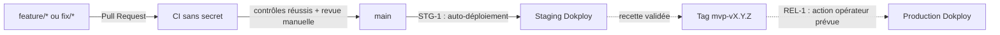

# Intégration continue et promotion des versions

Ce document décrit le fonctionnement de la CI mise en place au jalon CI-1 et
le processus de promotion retenu pour la suite du projet. La CI valide le code
sans déployer, sans secret et sans contacter les services réels de
l'établissement.

## Flux Git retenu



Les traits pleins représentent les périmètres CI-1 et STG-1. Le trait pointillé
décrit encore la promotion de release manuelle qui sera finalisée séparément.

- `feature/*` porte une évolution fonctionnelle ;
- `fix/*` porte une correction ;
- `main` est l'unique branche longue ;
- un tag annoté `mvp-vX.Y.Z` identifie une version recettée ;
- la production n'est jamais déployée automatiquement à la suite d'un push.

Une branche d'environnement `staging` ou `production` n'est pas créée. Les
environnements sont des installations Dokploy distinctes, avec leurs propres
bases, volumes, réseaux et secrets.

## Contrôles de CI-1

Le workflow [`.github/workflows/ci.yml`](../.github/workflows/ci.yml) est
déclenché par une Pull Request vers `main`, un push sur `main` ou une demande
manuelle. Il exécute uniquement des contrôles déterministes avec des données
synthétiques :

1. vérification du formatage Ruff ;
2. analyse statique Ruff ;
3. suite Pytest locale, incluant les contrats HTTP simulés et le faux serveur
   Graph stateful ;
4. migrations et intégrations PostgreSQL jetables ;
5. rendu statique des manifestes Docker Compose production et staging avec
   leurs configurations d'exemple.

Les suites `deployment`, `glpi`, `transcribe_ai` et `e2e`, qui construisent ou
démarrent des stacks lourdes, ne font pas partie du contrôle automatique de
chaque Pull Request. Elles restent des contrôles de recette manuels. Le staging
déployé exerce Graph et Transcribe au moyen d'un simulateur interne et GLPI au
moyen d'une instance 11.0.7 isolée.

La CI ne réalise aucune des opérations suivantes :

- déployer dans Dokploy ;
- exécuter une migration sur une base persistante ;
- lire une boîte Exchange ;
- appeler GLPI ou Transcribe AI ;
- lire un fichier `.env`, une clé privée, un certificat ou un secret de
  production.

## Reproduire la CI localement

Depuis la racine du dépôt, synchroniser l'environnement verrouillé :

```bash
uv sync --locked --all-packages --all-groups
```

Exécuter la qualité et la suite locale :

```bash
uv run ruff format --check .
uv run ruff check .
uv run --all-packages pytest -m "not database and not deployment and not glpi and not transcribe_ai and not e2e"
```

Avec Docker disponible, exécuter les migrations et intégrations PostgreSQL :

```bash
uv run --all-packages pytest -m database -vv --maxfail=1
```

Le manifeste Compose peut être rendu sans démarrer les services :

```bash
GTA_DOKPLOY_ENV_FILE=./infra/docker/.env.example docker compose --project-directory . --file infra/docker/docker-compose.prod.yml config --quiet
GTA_DOKPLOY_ENV_FILE=./infra/docker/staging.env.example docker compose --project-directory . --file infra/docker/docker-compose.staging.yml config --quiet
```

Ces commandes n'autorisent pas l'utilisation d'un fichier d'environnement
réel. Toute donnée de test doit être fictive et dépourvue de donnée patient.

## Sécurité du workflow

Le dépôt est privé sous GitHub Free. Ce plan fournit un quota mensuel de
GitHub Actions, mais ne permet pas d'imposer sur ce dépôt les approbations
GitHub Environments ni les protections de branche utilisées comme barrière de
déploiement sur les offres supérieures.

En conséquence :

- le workflow possède uniquement la permission `contents: read` ;
- aucun secret GitHub Actions de staging ou de production n'est créé ;
- les actions utilisées sont épinglées à une révision immuable ;
- deux exécutions concurrentes de la même branche sont évitées et une ancienne
  exécution peut être annulée au profit du commit le plus récent ;
- chaque job possède un délai maximal ;
- la fusion reste une décision humaine après lecture des résultats ;
- les secrets d'exécution resteront exclusivement dans chaque projet Dokploy.

L'absence de protection technique de `main` est une limite assumée du plan
GitHub actuel. Il ne faut ni pousser directement sur `main`, ni fusionner une
Pull Request dont un contrôle est rouge ou encore en cours. Un passage à une
offre GitHub prenant en charge les protections des dépôts privés permettrait de
rendre ces règles obligatoires.

## Checklist de Pull Request

Avant d'ouvrir la Pull Request :

- [ ] la branche suit la convention `feature/*` ou `fix/*` ;
- [ ] le périmètre est limité à un changement cohérent ;
- [ ] aucun secret, `.env`, certificat, audio réel ou donnée sensible n'est
      présent dans le diff ;
- [ ] les dépendances et `uv.lock` sont cohérents si une dépendance change ;
- [ ] les migrations sont additives et testées depuis une base neuve et la
      révision précédente ;
- [ ] les commandes locales pertinentes réussissent ;
- [ ] la documentation d'exploitation est adaptée si le comportement ou la
      configuration change.

Avant la fusion :

- [ ] tous les jobs GitHub Actions sont terminés avec succès ;
- [ ] les logs ne contiennent aucune donnée sensible ;
- [ ] le diff final et les éventuels changements de déploiement ont été relus ;
- [ ] aucun commit non prévu n'a été ajouté à la branche ;
- [ ] le message de fusion respecte Conventional Commits.

## Promotion vers staging et production

Le staging Dokploy suit `main` avec l'auto-déploiement activé. Il possède des
ressources isolées, un GLPI 11.0.7 et un simulateur Graph/Transcribe. Il ne
reçoit aucun identifiant ou certificat de production. Sa procédure complète
est décrite dans [staging.md](staging.md).

Après une recette staging réussie :

1. suspendre temporairement les fusions dans `main` ;
2. relever le SHA effectivement déployé en staging ;
3. vérifier que ce SHA est celui de `origin/main` ;
4. créer et pousser un tag annoté `mvp-vX.Y.Z` sur ce SHA ;
5. vérifier que le tag et `origin/main` désignent toujours le même commit ;
6. déclencher manuellement le déploiement production dans Dokploy ;
7. contrôler dans les journaux Dokploy le SHA réellement cloné ;
8. vérifier migrations, healthchecks et heartbeats ;
9. rouvrir les fusions uniquement après la décision de maintien ou de retour
   arrière.

Dokploy reconstruit actuellement les images depuis le dépôt. Un tag constitue
une référence d'audit, mais son webhook ne garantit pas à lui seul que Dokploy
clone ce tag plutôt que la branche configurée. Le gel des fusions et la
comparaison des SHA compensent cette limite tant qu'aucun registre d'images
n'est utilisé.

Le retour arrière sera d'abord testé sur staging. Sans registre, il nécessite
de reconstruire une ancienne révision, par exemple au moyen d'une branche
temporaire `rollback/mvp-vX.Y.Z` créée exactement depuis le tag précédent. Une
migration incompatible n'est pas annulée par un retour arrière applicatif :
les migrations doivent donc rester additives et compatibles avec la version
précédente.

## Responsabilités opérateur

L'opérateur reste responsable de :

- vérifier les résultats de CI avant fusion ;
- confirmer l'isolation du staging avant toute recette ;
- conserver l'auto-déploiement de production désactivé ;
- contrôler les SHA lors d'une promotion ;
- sauvegarder les données persistantes avant une migration de production ;
- ne jamais lancer automatiquement une commande de maintenance telle qu'un
  backfill en mode `apply` ;
- conserver une trace du tag, du SHA, de la migration et du résultat de la
  recette associés à chaque release.

## Limites de CI-1

- GitHub Free ne rend pas les règles de fusion techniquement obligatoires sur
  ce dépôt privé ;
- la CI ne prouve pas le fonctionnement des services Microsoft, GLPI ou
  Transcribe AI réels ;
- les images staging et production seront reconstruites séparément tant qu'un
  registre n'est pas adopté ;
- le correctif des dates GLPI et son outil `dry-run`/`apply` restent hors du
  périmètre de CI-1.
