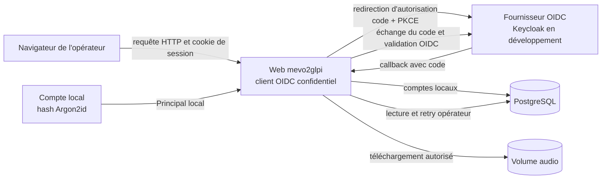
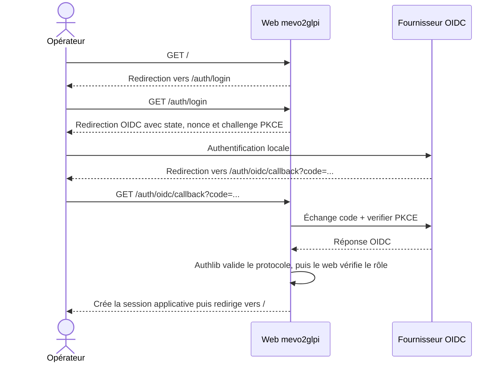

# Authentification du web : locale ou OIDC

> **Statut : implémenté.** Le web impose un mode d'authentification explicite
> `local` ou `oidc`. Keycloak fournit le laboratoire OIDC de développement,
> mais l'adaptateur s'appuie uniquement sur le standard OpenID Connect et reste
> compatible avec un autre fournisseur conforme.

## Contexte et objectif

Le dashboard, les API métier et les téléchargements audio sont protégés par
une authentification applicative. Deux modes exclusifs répondent aux contextes
des établissements :

- `local` pour administrer des comptes propres à mevo2glpi dans PostgreSQL ;
- `oidc` pour déléguer l'authentification à un fournisseur d'identité.

Le [laboratoire Keycloak local](../procedures/keycloak-local.md) permet de
manipuler manuellement les realms, clients, rôles et utilisateurs synthétiques.
L'intégration applicative cible le standard OpenID Connect (OIDC), et
non des API privées de Keycloak, afin de pouvoir raccorder ultérieurement le
Keycloak de l'établissement sans réécrire le cœur de l'authentification.

## Périmètre

L'implémentation couvre :

- l'application web dans les trois environnements ;
- un Keycloak de développement contenant exclusivement des identités
  synthétiques ;
- la connexion locale ou OIDC et la déconnexion applicative ;
- la protection restrictive des pages, API et téléchargements ;
- un rôle unique autorisant l'accès à mevo2glpi ;
- la protection CSRF des actions qui modifient l'état applicatif ;
- des comptes locaux administrés par une CLI ;
- des logs d'authentification structurés et expurgés ;
- les tests automatisés et une validation manuelle avec Keycloak local.

Il ne comprend pas :

- le déploiement de Keycloak en staging ou en production ;
- une modification des workers ou de leur authentification ;
- la persistance de l'identité de l'opérateur dans les événements métier ;
- la synchronisation des comptes locaux avec un annuaire ;
- le logout centralisé auprès du fournisseur OIDC.

Il n'existe pas de mode `disabled` ni de bascule automatique entre `oidc` et
`local`. Une configuration absente ou incohérente empêche le web de démarrer.

## Décisions d'architecture

### Deux modes, un contrat applicatif commun

Les deux modes produisent le même `Principal` minimal, puis le même cookie de
session signé. PostgreSQL ne contient pas les sessions et persiste seulement
les comptes locaux.

En mode local, le compte reste la source d'autorisation et est relu à chaque
requête. En mode OIDC, Authlib valide le protocole puis le web ne conserve que
le sujet pseudonymisé et le rôle applicatif requis.

### Contrat OIDC générique

L'application web se comporte comme un client OIDC confidentiel. Elle découvre
les endpoints et les clés publiques depuis l'URL d'issuer. Les seuls éléments
spécifiques à Keycloak sont la configuration du realm, du client et du mapper
de rôle.

Le flux retenu est **Authorization Code avec PKCE**. Il inclut également :

- `state` pour lier la réponse au parcours de connexion initié ;
- `nonce` pour lier l'ID token à cette authentification ;
- une URI de redirection exacte, sans joker ;
- la validation de la signature, de l'issuer, de l'audience et de l'expiration
  de l'ID token.

Les grants implicite, Password et Client Credentials ne sont pas utilisés par
le web.

### Architecture cible



Le fournisseur OIDC authentifie l'utilisateur. mevo2glpi reste responsable de
décider si l'identité authentifiée possède le rôle requis. En mode local,
mevo2glpi authentifie et autorise le compte lui-même.

## Flux de connexion



Le web ne conserve ni access token, ni ID token, ni refresh token après le
callback. Il crée une session applicative courte à partir des seules
informations nécessaires.
Cette session permet au web de continuer à répondre pendant une indisponibilité
temporaire du fournisseur, jusqu'à son expiration.

## Autorisation

L'application exige par défaut le rôle suivant :

```text
mevo2glpi-access
```

Le fournisseur expose les rôles applicatifs dans une claim multivaluée,
`roles` par défaut. Le web exige la présence de
`mevo2glpi-access` au moment du callback :

- identité non authentifiée : redirection vers la connexion pour une page HTML
  ou réponse `401` pour une API ;
- identité authentifiée sans le rôle : réponse `403` ;
- identité authentifiée avec le rôle : création de la session applicative.

Ce rôle autorise initialement la consultation et l'action de retry déjà
existante. Une séparation ultérieure entre consultation et administration ne
sera ajoutée que si le besoin fonctionnel le justifie.

Une modification de rôle chez le fournisseur prend effet au plus tard à
l'expiration de la session applicative, car les tokens OIDC ne sont pas
conservés ni rafraîchis. En mode local, la désactivation du compte ou une
réinitialisation du mot de passe révoque immédiatement ses cookies existants
grâce à `session_version`.

## Routes publiques et protégées

La stratégie est restrictive par défaut : toute nouvelle route est protégée
tant qu'elle n'est pas explicitement ajoutée à l'allowlist publique.

| Surface | Accès sans session |
| --- | --- |
| `/health` | public, pour les sondes techniques |
| `/static/*` | public, sans donnée métier |
| `/auth/login` | public |
| `/auth/oidc/callback` | public, mais validé par `state` et `nonce` |
| dashboard et pages de détail | protégé |
| `/api/*`, sauf éventuelle route technique explicitement listée | protégé |
| `/audios/*` | protégé |
| `/docs`, `/redoc` et `/openapi.json` | protégé |

L'allowlist porte sur des chemins exacts ou des préfixes explicitement prévus ;
elle ne doit pas permettre de contourner la protection par une URL proche.

## Session applicative

La session commune aux deux modes est portée par le cookie signé
`mevo2glpi_session`. Un cookie signé garantit l'intégrité, mais ne chiffre pas
son contenu. Il ne doit donc contenir que des données minimales :

- le mode d'authentification ;
- un sujet applicatif pseudonyme ;
- les rôles applicatifs normalisés ;
- la `session_version` d'un compte local ;
- les dates d'émission et d'expiration ;
- la valeur nécessaire à la protection CSRF.

Le nom, l'adresse e-mail, les tokens OIDC et toute autre donnée personnelle ne
sont pas conservés dans le cookie.

Paramètres appliqués :

- durée maximale : 30 minutes ;
- `HttpOnly=true` ;
- `SameSite=Lax` ;
- `Secure=false` uniquement en développement HTTP local ;
- `Secure=true` obligatoire hors développement ;
- chemin `/`.

Une signature invalide, une expiration, un mode différent ou une rotation du
secret de session invalide la session sans restaurer automatiquement l'accès.
PostgreSQL ne contient aucune table de sessions.

En mode local, le web relit à chaque requête l'activation et la
`session_version` du compte. Cette lecture indexée permet une révocation
immédiate après désactivation ou réinitialisation du mot de passe. En mode
OIDC, la session reste valide jusqu'à son expiration absolue.

Authlib utilise un second cookie signé, limité à dix minutes et au chemin
`/auth`, uniquement pour conserver `state`, `nonce` et le verifier PKCE entre
le départ et le callback. Ce cookie transactionnel n'est pas une session
applicative et ne contient aucun token OIDC.

## Protection CSRF

OIDC `state` protège le parcours de connexion, mais ne protège pas les actions
effectuées après connexion.

Les requêtes qui modifient un état doivent présenter un jeton CSRF lié à la
session :

- `POST /api/jobs/{audio_uuid}/retry` ;
- la déconnexion applicative, exposée en `POST` ;
- toute future route `POST`, `PUT`, `PATCH` ou `DELETE` utilisant la session.

Le dashboard transmet le jeton dans un en-tête dédié. Une valeur absente,
incorrecte ou issue d'une autre session produit une réponse `403` sans lancer
le cas d'usage métier.

## Déconnexion

La déconnexion invalide le cookie de session mevo2glpi et le cookie
transactionnel OIDC éventuel. Elle ne termine pas encore la session SSO chez
le fournisseur : une nouvelle connexion OIDC peut donc être immédiate tant
que cette session distante reste active.

## Configuration applicative

Le mode est obligatoire et exclusif :

| Variable | Rôle |
| --- | --- |
| `WEB_AUTH_MODE` | `local` ou `oidc` |
| `WEB_AUTH_SESSION_SECRET` | secret de signature d'au moins 32 caractères |
| `WEB_AUTH_SESSION_MAX_AGE_SECONDS` | durée maximale, `1800` par défaut |
| `WEB_AUTH_COOKIE_SECURE` | impose le cookie HTTPS |
| `WEB_AUTH_REQUIRED_ROLE` | rôle exigé, `mevo2glpi-access` par défaut |
| `WEB_AUTH_ISSUER_URL` | issuer exact du fournisseur OIDC |
| `WEB_AUTH_CLIENT_ID` | identifiant du client confidentiel |
| `WEB_AUTH_CLIENT_SECRET` | secret du client, injecté à l'exécution |
| `WEB_AUTH_REDIRECT_URI` | callback exact `/auth/oidc/callback` |
| `WEB_AUTH_ROLES_CLAIM` | claim multivaluée, `roles` par défaut |

Règles de validation :

- en mode `local`, les variables propres à OIDC doivent rester absentes ;
- en mode `oidc`, issuer, client ID, client secret et callback sont
  obligatoires ;
- hors environnement `development`, l'issuer et les URI doivent utiliser
  HTTPS et `WEB_AUTH_COOKIE_SECURE` doit être vrai ;
- un secret ne doit jamais apparaître dans un message d'erreur, un log ou une
  représentation des settings ;
- une indisponibilité du fournisseur ne déclenche jamais une bascule vers
  `local` ni un contournement de l'authentification.

Exemple exclusivement synthétique pour le développement :

```dotenv
WEB_AUTH_MODE=oidc
WEB_AUTH_ISSUER_URL=http://localhost:18084/realms/mevo2glpi-development
WEB_AUTH_CLIENT_ID=mevo2glpi-web
WEB_AUTH_CLIENT_SECRET=development-only-client-secret
WEB_AUTH_REDIRECT_URI=http://127.0.0.1:8000/auth/oidc/callback
WEB_AUTH_ROLES_CLAIM=roles
WEB_AUTH_SESSION_SECRET=development-only-session-secret-at-least-32-characters
WEB_AUTH_SESSION_MAX_AGE_SECONDS=1800
WEB_AUTH_COOKIE_SECURE=false
WEB_AUTH_REQUIRED_ROLE=mevo2glpi-access
```

Ces valeurs ne doivent jamais être réutilisées sur un environnement partagé.

## Keycloak de développement

Le laboratoire actuel est isolé dans
`infra/docker/development/docker-compose.keycloak.yml`. Il démarre Keycloak et
sa propre base PostgreSQL. Sur une base neuve, il importe la configuration
versionnée
`infra/docker/development/keycloak/mevo2glpi-development-realm.json`, puis
conserve les manipulations dans un volume local. Il permet d'apprendre depuis
la console d'administration sans modifier mevo2glpi.

La configuration locale reproductible est la suivante :

- image officielle Keycloak épinglée par version et digest, jamais `latest` ;
- démarrage avec `start-dev --import-realm` ;
- port hôte `127.0.0.1:18084` ;
- issuer exact
  `http://localhost:18084/realms/mevo2glpi-development` ;
- realm `mevo2glpi-development` ;
- client confidentiel `mevo2glpi-web` ;
- Standard Flow et PKCE activés ;
- Implicit Flow, Direct Access Grants et Service Accounts désactivés ;
- URI de callback exacte
  `http://127.0.0.1:8000/auth/oidc/callback` ;
- origine exacte `http://127.0.0.1:8000`, sans joker ;
- rôle client `mevo2glpi-access` ;
- un utilisateur synthétique autorisé et un utilisateur synthétique sans rôle ;
- session SSO expirant après 30 minutes d'inactivité ;
- persistance PostgreSQL locale : un realm existant n'est jamais écrasé par
  l'import au démarrage ;
- aucun compte, secret ou certificat réel dans le dépôt.

Le realm versionné utilise des variables d'environnement pour ses secrets
synthétiques. Le fichier d'exemple contient uniquement des valeurs locales
explicitement identifiées comme non sensibles.

`start-dev` est strictement réservé au développement. Un raccordement OIDC en
staging ou production utilise une instance administrée et un client distinct
par environnement.

## Mode local

Les comptes locaux sont administrés avec `mevo2glpi-web-users`. Le mot de
passe est lu de manière interactive, confirmé, contrôlé, puis haché avec
Argon2id via `pwdlib`. Il n'est jamais accepté dans les arguments de ligne de
commande.

```bash
uv run --package mevo2glpi-web mevo2glpi-web-users create operator-local
uv run --package mevo2glpi-web mevo2glpi-web-users list
uv run --package mevo2glpi-web mevo2glpi-web-users disable operator-local
uv run --package mevo2glpi-web mevo2glpi-web-users enable operator-local
uv run --package mevo2glpi-web mevo2glpi-web-users reset-password operator-local
```

Le mode local applique une normalisation restrictive des identifiants, une
politique de mot de passe, un hash factice pour un compte inconnu, un message
d'erreur générique et un ralentissement progressif des échecs. La page de
connexion est protégée par un jeton CSRF temporaire à double soumission.

## Journalisation de sécurité

Le web journalise les connexions, échecs, limitations et déconnexions sous
forme structurée et expurgée. Aucun événement d'authentification n'est persisté
dans PostgreSQL.

Ces logs contiennent uniquement le mode, l'opération, le résultat, une
catégorie et un code technique borné. Ils ne contiennent jamais le nom
d'utilisateur, le mot de passe, le sujet OIDC, un token ou une réponse brute du
fournisseur. Leur conservation relève de la plateforme de centralisation des
logs de l'établissement.

Le journal d'accès brut d'Uvicorn est désactivé, car une URL de callback OIDC
contient temporairement un code d'autorisation et un `state`. Le reverse proxy
placé devant le web doit appliquer la même règle : ne pas journaliser la query
string de `/auth/oidc/callback` ou la supprimer avant centralisation.

## Gestion des indisponibilités et des erreurs

Le comportement doit rester fermé par défaut :

- configuration OIDC invalide : refus de démarrer le web ;
- découverte OIDC ou fournisseur indisponible lors d'une nouvelle connexion :
  réponse contrôlée, sans bascule vers `local` ;
- callback invalide, expiré ou rejoué : refus de la connexion ;
- signature, issuer, audience, nonce ou rôle invalide : refus de la connexion ;
- session OIDC existante valide : utilisable jusqu'à son expiration, même si
  le fournisseur devient temporairement indisponible ;
- compte local désactivé ou dont la version change : cookie immédiatement
  refusé ;
- lecture PostgreSQL impossible en mode local : réponse `503`, sans accès.

Les logs peuvent contenir l'opération, la catégorie d'erreur et un code
technique non sensible. Ils ne doivent jamais contenir :

- access token, ID token ou refresh token ;
- code d'autorisation ;
- client secret ou secret de session ;
- nom, adresse e-mail ou identifiant de connexion d'un utilisateur ;
- contenu d'un audio, d'une transcription ou d'un ticket.

## Intégration dans le dépôt

L'implémentation reste limitée à l'application web :

- un module `auth/` pour les modes local et OIDC, les modèles internes et la
  session commune ;
- un middleware d'authentification appliquant la protection par défaut ;
- des routes et controllers dédiés à la connexion, au callback et à la
  déconnexion ;
- l'ajout du jeton CSRF aux templates et aux appels JavaScript de retry ;
- les settings conditionnels et fermés par défaut ;
- le modèle et le repository `WebUser` ;
- une migration Alembic additive ;
- la fixture versionnée du realm de développement ;
- les tests unitaires, contractuels et d'intégration nécessaires ;
- la documentation de développement local.

Authlib porte le client OIDC, `itsdangerous` signe le cookie commun et
`pwdlib[argon2]` gère les mots de passe locaux.

## Stratégie de tests

### Tests unitaires et contractuels

- validation conditionnelle des settings `local` et `oidc` ;
- absence des secrets dans les erreurs et représentations ;
- matrice des routes publiques, protégées, `401` et `403` ;
- validation de `state`, `nonce`, PKCE, issuer, audience et expiration ;
- refus d'un callback rejoué ou altéré ;
- refus d'une identité sans `mevo2glpi-access` ;
- création, expiration et altération du cookie de session ;
- attributs `HttpOnly`, `SameSite` et `Secure` du cookie ;
- CSRF valide, absent et incorrect sur retry et logout ;
- révocation locale par `session_version` ;
- authentification, limitation et administration des comptes locaux ;
- journalisation structurée expurgée ;
- contrat statique du Compose et du realm Keycloak ;
- vérification que les routes existantes ne deviennent pas publiques par
  omission.

Les tests automatisés doivent utiliser des tokens, clés et identités
synthétiques. Ils ne contactent aucun service externe.

### Validation manuelle locale

La validation locale doit démontrer :

1. le démarrage reproductible de Keycloak et l'import du realm ;
2. la redirection du dashboard vers la page de connexion ;
3. un accès accordé à l'utilisateur possédant le rôle ;
4. un refus `403` pour l'utilisateur sans rôle ;
5. l'accès au dashboard, aux détails et à un téléchargement audio autorisé ;
6. un retry accepté avec le bon jeton CSRF et refusé sans celui-ci ;
7. une déconnexion supprimant la session locale ;
8. l'absence de token et de secret dans les logs.

## Compatibilité et retour arrière

L'authentification est obligatoire : un retour arrière vers une version sans
authentification rouvrirait le dashboard et ne constitue pas une stratégie
acceptable. La migration PostgreSQL est additive ; un rollback applicatif doit
conserver la table des comptes tant que des comptes existent.

## Décisions à prendre avant staging et production

Les points suivants restent volontairement ouverts :

- disponibilité d'un Keycloak de staging ;
- realm, client, groupes et attribution du rôle gérés par l'établissement ;
- URLs publiques, reverse proxy, certificats et issuer exacts ;
- niveau de disponibilité attendu pour le fournisseur d'identité ;
- besoin de révocation anticipée et de logout centralisé ;
- traçabilité de l'opérateur dans les événements métier ;
- forme pseudonymisée de l'identité éventuellement persistée ;
- séparation future entre rôles de consultation et d'administration.

La traçabilité de l'opérateur dans les événements métier reste à réévaluer.
Les logs d'authentification ne contiennent ni nom, ni adresse électronique, ni
`sub` OIDC brut.

## Références

- [Keycloak — OpenID Connect layers](https://www.keycloak.org/securing-apps/oidc-layers)
- [Keycloak — exécution en conteneur](https://www.keycloak.org/server/containers)
- [Authlib — OAuth clients for web applications](https://docs.authlib.org/en/latest/oauth2/client/web/)
- [Starlette — SessionMiddleware](https://www.starlette.io/middleware/#sessionmiddleware)
