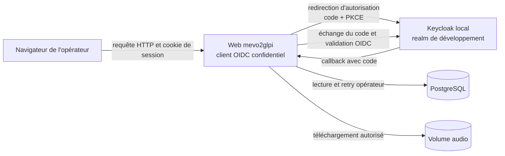
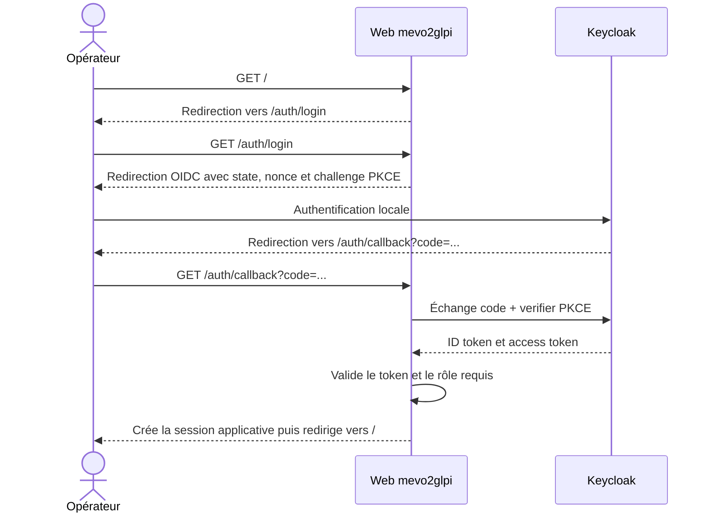

# Authentification OIDC avec Keycloak

> **Statut : évolution future, non planifiée et non implémentée.** Ce document
> conserve une piste de conception. Il ne décrit pas une capacité disponible
> ni un jalon engagé en développement, staging ou production.

## Contexte et objectif

Le dashboard mevo2glpi est actuellement protégé uniquement par son exposition
sur le réseau interne. La cible est d'ajouter une authentification applicative
avant d'étendre son accès ou les actions proposées aux opérateurs.

Si cette évolution est engagée, sa première validation utilisera un Keycloak
local et reproductible. L'intégration proposée cible le standard OpenID
Connect (OIDC), et non des API privées de Keycloak, afin de pouvoir raccorder
ultérieurement le Keycloak de l'établissement sans réécrire le cœur de
l'authentification.

## Périmètre proposé pour une première expérimentation

Cette expérimentation future comprendrait uniquement :

- l'application web exécutée en développement local ;
- un Keycloak de développement contenant exclusivement des identités
  synthétiques ;
- la connexion et la déconnexion OIDC ;
- la protection restrictive des pages, API et téléchargements ;
- un rôle unique autorisant l'accès à mevo2glpi ;
- la protection CSRF des actions qui modifient l'état applicatif ;
- les tests automatisés et une validation manuelle avec le Keycloak local.

Il ne comprend pas :

- le raccordement au Keycloak de production de l'établissement ;
- le déploiement de Keycloak en staging ou en production ;
- une modification des workers ou de leur authentification ;
- une migration PostgreSQL ;
- la persistance de l'identité de l'opérateur dans les événements métier ;
- la gestion des comptes, mots de passe ou groupes réels de l'établissement.

Les configurations staging et production restent inchangées tant que cette
évolution n'est pas explicitement décidée, implémentée et qualifiée. Leur accès
doit continuer à être limité par le DNS, le pare-feu et le reverse proxy tant
que l'authentification n'y est pas activée.

## Décisions d'architecture

### Contrat OIDC générique

L'application web se comporte comme un client OIDC confidentiel. Elle découvre
les endpoints et les clés publiques depuis l'URL d'issuer. Les seuls éléments
spécifiques à Keycloak sont la configuration du realm, du client et du mapper
de rôle.

Le flux retenu est **Authorization Code avec PKCE**. Il inclut également :

- `state` pour lier la réponse au parcours de connexion initié ;
- `nonce` pour lier l'ID token à cette authentification ;
- une URI de redirection exacte, sans joker ;
- la validation de la signature, de l'issuer, de l'audience et de l'expiration
  de l'ID token.

Les grants implicite, Password et Client Credentials ne sont pas utilisés par
le web.

### Architecture cible



Keycloak authentifie l'utilisateur. mevo2glpi reste responsable de décider si
l'identité authentifiée possède le rôle requis et peut accéder à
l'application.

## Flux de connexion



Le web ne conserve ni access token ni refresh token après le callback. Il crée
une session applicative courte à partir des seules informations nécessaires.
Cette session permet au web de continuer à répondre pendant une indisponibilité
temporaire de Keycloak, jusqu'à son expiration.

## Autorisation

La première expérimentation définirait un unique rôle client Keycloak :

```text
mevo2glpi-access
```

Le realm configure un mapper OIDC qui expose les rôles applicatifs dans une
claim multivaluée `roles` de l'ID token. Le web exige la présence de
`mevo2glpi-access` au moment du callback :

- identité non authentifiée : redirection vers la connexion pour une page HTML
  ou réponse `401` pour une API ;
- identité authentifiée sans le rôle : réponse `403` ;
- identité authentifiée avec le rôle : création de la session applicative.

Ce rôle autorise initialement la consultation et l'action de retry déjà
existante. Une séparation ultérieure entre consultation et administration ne
sera ajoutée que si le besoin fonctionnel le justifie.

Une modification de rôle dans Keycloak prend effet au plus tard à l'expiration
de la session applicative, car les tokens OIDC ne sont pas conservés ni
rafraîchis.

## Routes publiques et protégées

La stratégie est restrictive par défaut : toute nouvelle route est protégée
tant qu'elle n'est pas explicitement ajoutée à l'allowlist publique.

| Surface | Accès sans session |
| --- | --- |
| `/health` | public, pour les sondes techniques |
| `/static/*` | public, sans donnée métier |
| `/auth/login` | public |
| `/auth/callback` | public, mais validé par `state` et `nonce` |
| dashboard et pages de détail | protégé |
| `/api/*`, sauf éventuelle route technique explicitement listée | protégé |
| `/audios/*` | protégé |
| `/docs`, `/redoc` et `/openapi.json` | protégé |

L'allowlist porte sur des chemins exacts ou des préfixes explicitement prévus ;
elle ne doit pas permettre de contourner la protection par une URL proche.

## Session applicative

La session est portée par un cookie signé. Un cookie signé garantit
l'intégrité, mais ne chiffre pas son contenu. Il ne doit donc contenir que des
données minimales :

- le `sub` OIDC pseudonyme ;
- les rôles applicatifs normalisés ;
- l'expiration de la session ;
- la valeur nécessaire à la protection CSRF.

Le nom, l'adresse e-mail, les tokens OIDC et toute autre donnée personnelle ne
sont pas conservés dans le cookie.

Paramètres cibles :

- durée maximale : 30 minutes ;
- `HttpOnly=true` ;
- `SameSite=Lax` ;
- `Secure=false` uniquement en développement HTTP local ;
- `Secure=true` obligatoire hors développement ;
- chemin `/`.

Une signature invalide, une expiration ou une rotation du secret de session
invalide la session sans restaurer automatiquement l'accès.

La session signée et sans état est volontairement limitée au développement.
Avant une activation en production, il faudra décider si une session opaque
stockée côté serveur, une révocation anticipée ou un back-channel logout sont
nécessaires.

## Protection CSRF

OIDC `state` protège le parcours de connexion, mais ne protège pas les actions
effectuées après connexion.

Les requêtes qui modifient un état doivent présenter un jeton CSRF lié à la
session :

- `POST /api/jobs/{audio_uuid}/retry` ;
- la déconnexion applicative, exposée en `POST` ;
- toute future route `POST`, `PUT`, `PATCH` ou `DELETE` utilisant la session.

Le dashboard transmet le jeton dans un en-tête dédié. Une valeur absente,
incorrecte ou issue d'une autre session produit une réponse `403` sans lancer
le cas d'usage métier.

## Déconnexion

La déconnexion suit deux étapes :

1. invalider le cookie de session mevo2glpi ;
2. rediriger vers l'endpoint `end_session_endpoint` annoncé par Keycloak, avec
   une URI de retour exacte et autorisée.

La déconnexion locale doit réussir même si Keycloak est temporairement
indisponible. L'application ne doit jamais conserver la session parce que la
déconnexion distante a échoué.

## Configuration applicative cible

L'activation reste explicite afin de préserver le fonctionnement actuel :

| Variable | Rôle |
| --- | --- |
| `WEB_AUTH_MODE` | `disabled` ou `oidc` |
| `WEB_AUTH_ISSUER_URL` | issuer exact du realm OIDC |
| `WEB_AUTH_CLIENT_ID` | identifiant du client confidentiel |
| `WEB_AUTH_CLIENT_SECRET` | secret du client, injecté à l'exécution |
| `WEB_AUTH_REDIRECT_URI` | callback exact du web |
| `WEB_AUTH_POST_LOGOUT_REDIRECT_URI` | retour autorisé après déconnexion |
| `WEB_AUTH_SESSION_SECRET` | secret de signature des sessions |
| `WEB_AUTH_SESSION_MAX_AGE_SECONDS` | durée maximale, cible `1800` |
| `WEB_AUTH_COOKIE_SECURE` | impose le cookie HTTPS |
| `WEB_AUTH_REQUIRED_ROLE` | rôle exigé, cible `mevo2glpi-access` |

Règles de validation prévues :

- en mode `disabled`, les variables OIDC ne sont pas requises ;
- en mode `oidc`, toutes les variables obligatoires doivent être présentes ;
- hors environnement `development`, l'issuer et les URI doivent utiliser
  HTTPS et `WEB_AUTH_COOKIE_SECURE` doit être vrai ;
- un secret ne doit jamais apparaître dans un message d'erreur, un log ou une
  représentation des settings ;
- une indisponibilité de Keycloak ne doit jamais désactiver implicitement
  l'authentification.

Exemple exclusivement synthétique pour le développement :

```dotenv
WEB_AUTH_MODE=oidc
WEB_AUTH_ISSUER_URL=http://127.0.0.1:18084/realms/mevo2glpi-development
WEB_AUTH_CLIENT_ID=mevo2glpi-web
WEB_AUTH_CLIENT_SECRET=development-only-client-secret
WEB_AUTH_REDIRECT_URI=http://127.0.0.1:8000/auth/callback
WEB_AUTH_POST_LOGOUT_REDIRECT_URI=http://127.0.0.1:8000/
WEB_AUTH_SESSION_SECRET=development-only-session-secret
WEB_AUTH_SESSION_MAX_AGE_SECONDS=1800
WEB_AUTH_COOKIE_SECURE=false
WEB_AUTH_REQUIRED_ROLE=mevo2glpi-access
```

Ces valeurs ne doivent jamais être réutilisées sur un environnement partagé.

## Keycloak de développement

Keycloak rejoindra les services de test définis dans
`infra/docker/development/docker-compose.test-services.yml`.

La cible locale est la suivante :

- image officielle Keycloak épinglée par version et digest, jamais `latest` ;
- démarrage avec `start-dev --import-realm` ;
- port hôte `127.0.0.1:18084` ;
- realm `mevo2glpi-development` ;
- client confidentiel `mevo2glpi-web` ;
- Standard Flow et PKCE activés ;
- Implicit Flow, Direct Access Grants et Service Accounts désactivés ;
- URI de callback exacte
  `http://127.0.0.1:8000/auth/callback` ;
- origine exacte `http://127.0.0.1:8000`, sans joker ;
- rôle client `mevo2glpi-access` ;
- un utilisateur synthétique autorisé et un utilisateur synthétique sans rôle ;
- aucune persistance : le realm est réimporté lorsque le conteneur est recréé ;
- aucun compte, secret ou certificat réel dans le dépôt.

Le realm versionné utilisera des variables d'environnement pour ses secrets
synthétiques. Le fichier d'exemple pourra contenir des valeurs locales
explicitement identifiées comme non sensibles.

`start-dev` est strictement réservé au développement. Le futur raccordement à
un Keycloak staging ou production utilisera une instance administrée et un
client distinct par environnement.

## Gestion des indisponibilités et des erreurs

Le comportement doit rester fermé par défaut :

- configuration OIDC invalide : refus de démarrer le web ;
- découverte OIDC ou Keycloak indisponible lors d'une nouvelle connexion :
  réponse contrôlée `503`, sans bascule vers `disabled` ;
- callback invalide, expiré ou rejoué : refus de la connexion ;
- signature, issuer, audience, nonce ou rôle invalide : refus de la connexion ;
- session existante valide : utilisable jusqu'à son expiration, même si
  Keycloak devient temporairement indisponible ;
- erreur de déconnexion distante : suppression locale de la session maintenue.

Les logs peuvent contenir l'opération, la catégorie d'erreur et un code
technique non sensible. Ils ne doivent jamais contenir :

- access token, ID token ou refresh token ;
- code d'autorisation ;
- client secret ou secret de session ;
- nom, adresse e-mail ou identifiant de connexion d'un utilisateur ;
- contenu d'un audio, d'une transcription ou d'un ticket.

## Intégration envisagée dans le dépôt

L'implémentation future devrait rester limitée à l'application web et à
l'environnement local :

- un module `auth/` pour le client OIDC, les modèles internes et la session ;
- un middleware d'authentification appliquant la protection par défaut ;
- des routes et controllers dédiés à la connexion, au callback et à la
  déconnexion ;
- l'ajout du jeton CSRF aux templates et aux appels JavaScript de retry ;
- les settings conditionnels de l'application web ;
- le service Keycloak et le realm de développement ;
- les tests unitaires, contractuels et d'intégration nécessaires ;
- la documentation de développement local.

Les dépendances envisagées sont Authlib pour le client OIDC et `itsdangerous`
pour la signature de session, en réutilisant HTTPX et Starlette déjà présents
dans le socle web. Elles ne seront ajoutées qu'au moment de l'implémentation.

## Stratégie de tests

### Tests unitaires et contractuels

- validation conditionnelle des settings `disabled` et `oidc` ;
- absence des secrets dans les erreurs et représentations ;
- matrice des routes publiques, protégées, `401` et `403` ;
- validation de `state`, `nonce`, PKCE, issuer, audience et expiration ;
- refus d'un callback rejoué ou altéré ;
- refus d'une identité sans `mevo2glpi-access` ;
- création, expiration et altération du cookie de session ;
- attributs `HttpOnly`, `SameSite` et `Secure` du cookie ;
- CSRF valide, absent et incorrect sur retry et logout ;
- suppression locale de la session quand la déconnexion distante échoue ;
- contrat statique du Compose et du realm Keycloak ;
- vérification que les routes existantes ne deviennent pas publiques par
  omission.

Les tests automatisés doivent utiliser des tokens, clés et identités
synthétiques. Ils ne contactent aucun service externe.

### Validation manuelle locale

La validation de cette expérimentation devra démontrer :

1. le démarrage reproductible de Keycloak et l'import du realm ;
2. la redirection du dashboard vers la page de connexion ;
3. un accès accordé à l'utilisateur possédant le rôle ;
4. un refus `403` pour l'utilisateur sans rôle ;
5. l'accès au dashboard, aux détails et à un téléchargement audio autorisé ;
6. un retry accepté avec le bon jeton CSRF et refusé sans celui-ci ;
7. une déconnexion supprimant la session locale ;
8. l'absence de token et de secret dans les logs.

## Compatibilité et retour arrière

`WEB_AUTH_MODE=disabled` conserve le comportement actuel. Il constitue le
mécanisme de compatibilité pendant le développement, pas une bascule
automatique en cas d'erreur.

Cette expérimentation ne modifierait ni le schéma PostgreSQL ni les formats
persistés.
Un retour arrière consiste donc à redéployer la version précédente du web et à
retirer les variables OIDC. Les workers et leurs traitements restent
indépendants.

## Décisions à prendre avant staging et production

Les points suivants restent volontairement ouverts :

- disponibilité d'un Keycloak de staging ;
- realm, client, groupes et attribution du rôle gérés par l'établissement ;
- URLs publiques, reverse proxy, certificats et issuer exacts ;
- niveau de disponibilité attendu pour le fournisseur d'identité ;
- sessions signées sans état ou sessions opaques stockées côté serveur ;
- besoin de révocation anticipée et de logout centralisé ;
- traçabilité de l'opérateur dans les événements métier ;
- forme pseudonymisée de l'identité éventuellement persistée ;
- séparation future entre rôles de consultation et d'administration.

La traçabilité de l'opérateur est un prérequis à réévaluer avant la production.
Dans cette expérimentation, les événements continueraient d'identifier seulement le
canal `web`, sans enregistrer de nom, d'adresse e-mail ni de `sub` OIDC.

## Références

- [Keycloak — OpenID Connect layers](https://www.keycloak.org/securing-apps/oidc-layers)
- [Keycloak — exécution en conteneur](https://www.keycloak.org/server/containers)
- [Authlib — OAuth clients for web applications](https://docs.authlib.org/en/latest/oauth2/client/web/)
- [Starlette — SessionMiddleware](https://www.starlette.io/middleware/#sessionmiddleware)
