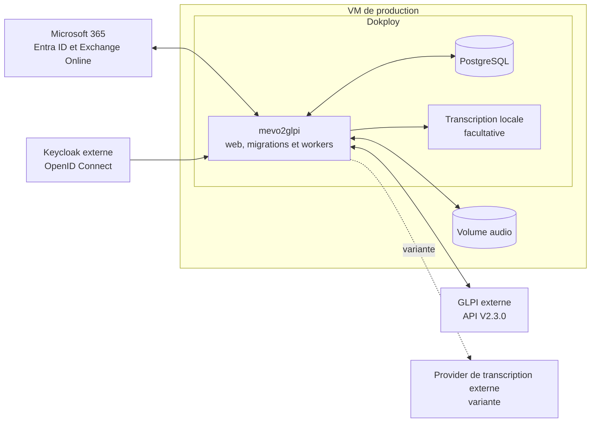

# Déployer l'environnement de production

Ce parcours décrit une installation initiale de mevo2glpi dans Dokploy. Il ne
déploie aucun simulateur : Microsoft 365, Keycloak et GLPI sont des services
externes réels. PostgreSQL est créé dans Dokploy. La
transcription utilise soit la stack Parakeet locale, soit une API externe
compatible OpenAI.

Une seule voie de transcription doit être configurée. Le provider reste
obligatoire pour exécuter le worker d'automatisation, mais sa stack peut être
hébergée dans la VM ou hors de celle-ci.

## Étapes

1. [Vérifier les prérequis](01-prerequis.md).
2. [Préparer le réseau, le DNS et TLS](02-reseau-dns-et-tls.md).
3. [Configurer Exchange Online et Entra ID](03-exchange-online-et-entra-id.md).
4. [Configurer l'Identity Provider OpenID Connect](04-keycloak-externe.md).
5. [Préparer GLPI](05-glpi-externe.md).
6. [Créer PostgreSQL, le volume et les secrets hôte](06-postgresql-et-stockage.md).
7. [Choisir la transcription](07-transcription.md).
8. [Créer les projets Dokploy](08-configuration-dokploy.md).
9. [Déployer les services](09-deploiement.md).
10. [Valider l'installation](10-validation.md).
11. [Mettre à jour une installation existante](11-mise-a-jour.md).
12. [Revenir en arrière et diagnostiquer](12-rollback-et-diagnostic.md).

## Principes d'exploitation

- Déployer uniquement un tag annoté immuable `vX.Y.Z` et consigner son SHA.
- Laisser l'auto-déploiement désactivé.
- Ne publier que le web derrière Traefik ; PostgreSQL, les workers et la
  transcription restent privés.
- Ne jamais désactiver la vérification TLS.
- Ne placer aucun secret, certificat privé ou fichier `.env` réel dans Git.
- Employer uniquement des contenus synthétiques lors de la recette.

Les choix techniques sont décrits dans la
[référence d'architecture](../../reference/architecture.md). Les fichiers
Compose et les exemples d'environnement restent la source de vérité pour les
variables et les services.
