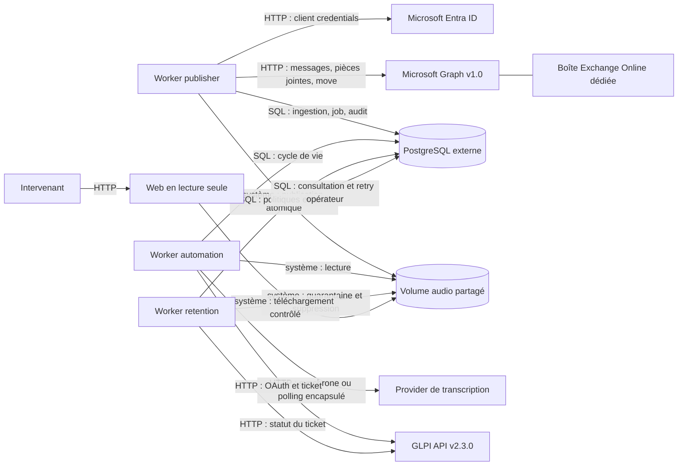
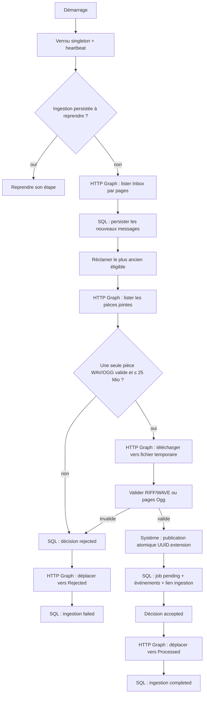
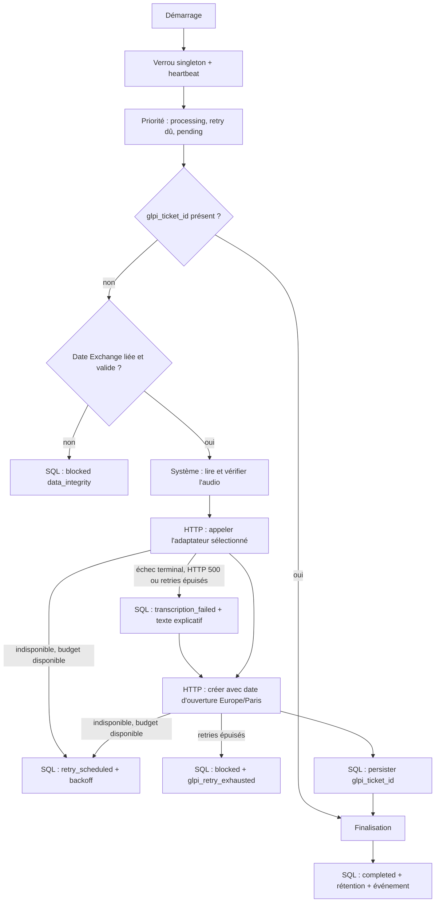
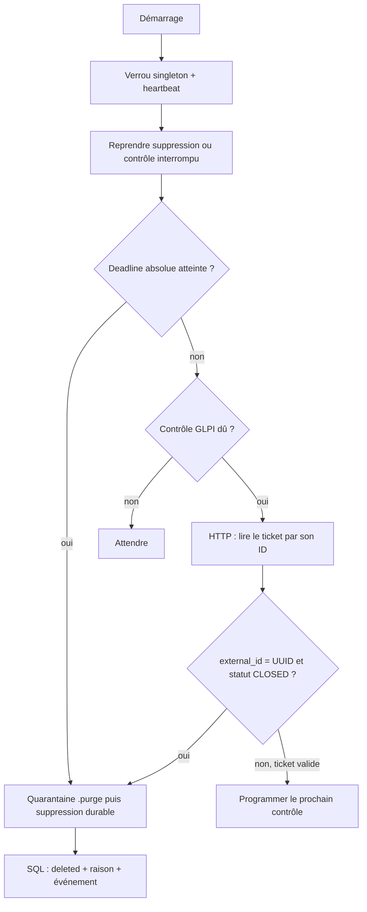
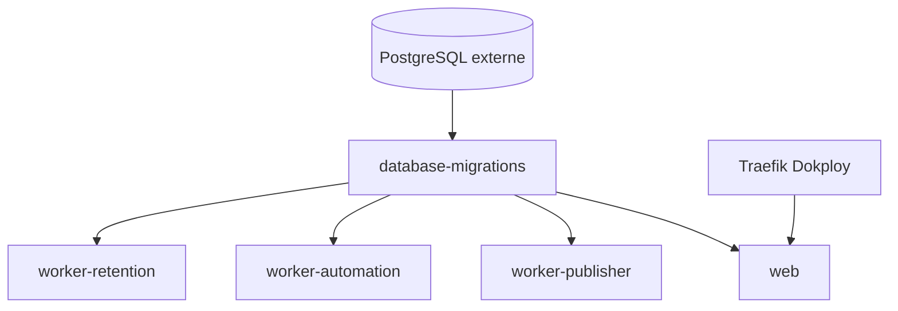

# Architecture fonctionnelle du MVP

Ce document décrit l'architecture effectivement livrée. PostgreSQL porte le
cycle de vie et l'audit ; le volume partagé porte uniquement les octets audio.
Le déploiement comprend cinq applications uv, dont trois workers persistants.

## Vue d'ensemble



Principes structurants :

- PostgreSQL est l'unique source de vérité des états métier ;
- le volume audio n'est jamais parcouru pour retrouver un job ;
- chaque worker est un singleton protégé par un verrou advisory PostgreSQL ;
- les transactions restent courtes et ne couvrent jamais un appel HTTP ;
- les erreurs persistées et journalisées sont expurgées ;
- la transcription, les réponses HTTP brutes, les secrets et les identifiants
  opaques Exchange ne sont pas journalisés ;
- un effet distant ambigu n'est jamais rejoué aveuglément.

## Applications et responsabilités

| Application | Type | Responsabilité |
| --- | --- | --- |
| `database-migrations` | one-shot | Attendre PostgreSQL puis exécuter `alembic upgrade head`. |
| `web` | HTTP persistant | Afficher les jobs, événements, workers et alertes ; permettre le téléchargement contrôlé et le retry opérateur. |
| `worker-publisher` | worker persistant | Transformer les messages Exchange contenant un WAV ou OGG valide en jobs durables. |
| `worker-automation` | worker persistant | Transcrire l'audio, créer le ticket GLPI et finaliser le job. |
| `worker-retention` | worker persistant | Contrôler le ticket et supprimer l'audio conformément à sa politique. |

Le web n'est plus une voie d'ingestion. Il ne propose aucun dépôt de fichier et
ne possède aucune route de création de job. Son unique commande métier est le
réarmement explicite d'un job `failed` ou `blocked`.

## Organisation du workspace

```text
.
├── apps/
│   ├── database-migrations/      application Alembic one-shot
│   ├── web/                      FastAPI, dashboard et API de consultation
│   ├── worker-publisher/         Exchange Online / Graph vers job audio
│   ├── worker-automation/        provider de transcription vers GLPI
│   └── worker-retention/         politique de conservation des audios
├── packages/
│   ├── common/                   stockage canonique, purge et backoff
│   ├── database/                 modèles SQLAlchemy et repositories
│   └── glpi-client/              client GLPI v2.3.0 partagé
├── infra/docker/
│   ├── apps/                    images et Compose des applications
│   ├── simulators/              doubles Graph, Transcribe AI et GLPI optionnel
│   └── transcription/           moteur ASR déployable indépendamment
├── tests/
│   ├── deployment/               contrats statiques et smoke tests Compose
│   └── e2e/                      recette aval sans tenant Microsoft réel
└── docs/                         architecture et procédures de démonstration
```

Les applications orchestrent les transactions qui touchent plusieurs modèles.
Un repository manipule un seul modèle et ne fait pas de `commit`. La session
SQLAlchemy joue directement le rôle d'unité de travail ; aucune abstraction
supplémentaire n'est interposée.

Le web suit la direction d'appel :

```text
Routes -> Controllers -> Services -> Repositories / Storage
```

Les schémas Pydantic restent des contrats HTTP. Les modèles SQLAlchemy et les
objets métier internes n'y sont pas placés.

## Modèle persistant

Les états sont des `VARCHAR` contraints par des `CHECK`, et non des enums
PostgreSQL natifs. Tous les timestamps sont des `TIMESTAMPTZ` en UTC.

### Ingestion Exchange

`mail_ingestions` conserve l'état durable d'un message sans son contenu :

- clé primaire `uuid` ;
- couple unique `(mailbox_id, message_id)` ;
- `attachment_id` et `job_uuid` lorsqu'ils sont connus ;
- l'extension audio sélectionnée, persistée avant le téléchargement afin que
  la reprise après crash conserve le même contrat de validation ;
- état `pending`, `processing`, `retry_scheduled`, `completed`, `failed` ou
  `blocked` ;
- étape `discovery`, `validation`, `publication` ou `acknowledgement` ;
- décision `accepted` ou `rejected` au stade d'accusé ;
- taille, compteurs de tentative, échéance de retry et erreurs expurgées ;
- dates de réception, début, mise à jour et fin.

`mail_ingestion_events` est un journal append-only des transitions du
publisher. Il ne contient ni objet du message, ni expéditeur, ni nom de pièce
jointe, ni octets audio. Les identifiants Graph sont persistés comme des chaînes
opaques et ne sont pas écrits dans les logs.

Une contrainte garantit un seul `mail_ingestions.status='processing'`, en
cohérence avec le singleton publisher.

### Jobs audio vers ticket

`ticket_creation_jobs` porte notamment :

| Colonne | Contrat |
| --- | --- |
| `uuid` | UUID primaire, commun au job, à l'audio et à `external_id` GLPI. |
| `status` | `pending`, `processing`, `retry_scheduled`, `completed`, `failed` ou `blocked`. |
| `stage` | `transcription`, `glpi_creation` ou `finalization`, nullable avant le traitement. |
| `storage_key` | Clé relative canonique unique `{uuid}.{extension}`. |
| `audio_extension` | Extension validée ; le publisher produit `wav` ou `ogg`. |
| `audio_size_bytes` | Taille positive vérifiée avant traitement et téléchargement. |
| `glpi_ticket_id` | Identifiant positif, persisté dès confirmation de la création GLPI. |
| `transcription_provider_job_id` | Identifiant distant optionnel, utilisé uniquement par le provider historique avec polling. |
| `attempt_count` | Nombre total monotone de tentatives. |
| `consecutive_retry_count` | Série globale d'indisponibilités du job, utilisée par le backoff et plafonnée par configuration. |
| `next_attempt_at` | Échéance d'un retry programmé. |
| `last_error_*` | Portée, catégorie et code technique expurgés. |

`ticket_creation_job_events` conserve l'historique append-only. Son `actor`
vaut `worker_publisher`, `worker_automation`, `worker_retention` ou `web`.
L'événement `job_created` est écrit par le publisher dans la même transaction
que la création du job.

### Rétention audio

`audio_retentions` possède la même clé que le job :

- politique `ticket_or_deadline` pour un job terminé, ou `deadline_only` pour
  un job `failed` ou `blocked` ;
- état `inactive`, `scheduled`, `checking`, `retry_scheduled`, `deleting`,
  `deleted` ou `blocked` ;
- deadline absolue, prochaine vérification et dernier contrôle ;
- dernier statut numérique GLPI observé ;
- compteurs de retry et erreurs expurgées ;
- raison de suppression, début de quarantaine et confirmation de suppression.

`glpi_ticket_id` n'est pas dupliqué dans cette table. La relance opérateur
désactive la rétention dans la même transaction que le retour du job à
`pending`. Elle est refusée si une suppression a déjà commencé.

### État des workers

`worker_runtime_status` contient une ligne par worker :

```text
service_name, instance_id, state, last_heartbeat_at,
current_job_uuid, current_ingestion_uuid,
last_error_category, last_error_code, updated_at
```

`state` vaut `starting`, `running`, `degraded`, `blocked` ou `stopped`.
`current_ingestion_uuid` appartient au publisher ; `current_job_uuid` aux deux
autres workers. Le dashboard calcule `fresh`, `stale` ou `absent` sans les
persister.

## Stockage audio et invariants

Un accès suit toujours ce chemin :

```text
UUID -> clé primaire PostgreSQL -> storage_key -> AUDIO_ROOT/storage_key
```

La résolution SQL utilise l'index de clé primaire et le système de fichiers
reçoit un nom exact. Le code nominal n'utilise ni `glob`, ni `find`, ni
énumération de répertoire. `storage_key` est relative, canonique et confinée à
`AUDIO_ROOT` ; un chemin absolu, une traversée ou un lien symbolique est refusé.

Le publisher écrit d'abord un fichier `.part` unique sur le même volume,
effectue les synchronisations nécessaires, puis publie le nom canonique sans
écraser un fichier existant. Après un crash, une publication déjà présente
n'est acceptée que si sa taille et son empreinte correspondent exactement au
flux téléchargé. Une collision différente bloque l'ingestion.

Le fichier ne change jamais de répertoire selon l'état métier. `completed` et
`failed` sont des valeurs PostgreSQL. Seul le worker de rétention utilise une
quarantaine interne `.purge` lors d'une suppression crash-safe.

## Pipeline du worker publisher

### Authentification et périmètre Microsoft

Le publisher utilise le grant OAuth 2.0 `client_credentials` avec une
application Entra ID. MSAL signe l'assertion client à partir de deux fichiers
distincts montés en lecture seule :

- une clé privée PEM, protégée comme un secret ;
- un certificat public X.509 PEM associé à la clé.

Une passphrase de clé privée peut être fournie par variable d'environnement.
Les deux chemins doivent être distincts. Aucun contenu de clé, certificat,
jeton ou passphrase n'est journalisé.

L'autorisation Exchange Online recommandée est `Application Mail.ReadWrite`
limitée à la boîte dédiée par Application RBAC. Il ne faut pas cumuler ce rôle
restreint avec une permission applicative tenant-wide qui élargirait les droits
effectifs.

Toutes les requêtes mailbox utilisent Microsoft Graph `v1.0` et l'en-tête :

```http
Prefer: IdType="ImmutableId"
```

La boîte est identifiée par son UUID Entra, pas par une adresse saisie dans les
logs ou l'interface.

### Traitement d'un message



Le contrat exige exactement une pièce jointe visible, de type fichier, avec
une extension `.wav` ou `.ogg`, non vide et ne dépassant pas 25 Mio.
L'extension retenue est persistée avant le téléchargement : une reprise utilise
donc le même inspecteur et la même clé de stockage. La structure RIFF/WAVE ou le
framing, les continuations, la fin de flux et le CRC des pages Ogg sont
contrôlés sans décoder le codec ; les codecs
téléphoniques tels que G.711 A-law ou µ-law restent donc acceptables.

Une paire message/audio produit un UUID d'ingestion. Cet UUID devient aussi
l'UUID du job, le nom canonique de l'audio et l'`external_id` GLPI. Aucun
dédupliquage par empreinte audio n'est effectué : deux messages distincts avec
les mêmes octets produisent deux jobs distincts.

Le message n'est déplacé dans `Processed` qu'après publication durable de
l'audio et création transactionnelle du job. Un rejet de contenu est persisté
avant le déplacement dans `Rejected`. Une réponse de déplacement perdue est
réconciliée en vérifiant le dossier cible, ce qui évite de dupliquer un effet.

Au démarrage et avant toute découverte, le publisher reprend en priorité une
ingestion `processing` ou un retry arrivé à échéance. Une erreur transitoire
Graph ou stockage conserve l'état durable et programme un backoff exponentiel
plafonné ; avant l'accusé, le message reste dans Inbox. Une perte PostgreSQL
arrête le processus, que Docker relance, puis le dernier état commité est
repris. `Retry-After` est respecté dans la limite du plafond configuré. Une
erreur systémique non réessayable passe le heartbeat à `blocked` et verrouille
la consommation jusqu'à l'arrêt ou à l'intervention d'un opérateur.

Une commande de rejeu réservée à l'exploitation peut sélectionner un lot borné
d'ingestions `failed/rejected` par code et fenêtre de réception. Elle ne parle
qu'à PostgreSQL, partage le verrou singleton du publisher et propose un
`dry-run` sans écriture. En application, chaque ligne est réarmée dans une
transaction distincte et reçoit l'événement `operator_replay_requested`.
Le message n'est pas déplacé par cette commande : le publisher le reprend par
son Immutable ID, même depuis `Rejected`, puis applique le flux nominal jusqu'à
`Processed`. Il n'est donc ni nécessaire ni souhaitable de le remettre
manuellement dans Inbox.

## Pipeline du worker d'automatisation



La transcription n'est pas persistée. Un redémarrage retranscrit donc tout job
sans `glpi_ticket_id`, même si une étape de transcription avait déjà réussi.
Avec l'adaptateur historique, l'identifiant provider est persisté dès la
soumission, mais ne remplace pas le contenu de transcription. Un provider
synchrone n'a aucun identifiant distant à exposer au domaine.

La date d'ouverture du ticket provient exclusivement de
`mail_ingestions.received_at`, conservée en UTC. Le service applicatif relit
l'ingestion liée dans la transaction d'acquisition du job, puis le client GLPI
convertit cet instant avec le fuseau IANA `Europe/Paris` et renseigne le champ
métier `date`. `date_creation` reste l'horodatage technique géré par GLPI. Une
date source absente ou incohérente bloque le job avant tout appel externe ;
aucune date de traitement n'est utilisée comme repli.

`glpi_ticket_id` constitue la frontière de durabilité GLPI. Dès qu'il est
persisté, le worker considère la création confirmée et reprend directement la
finalisation. Tant qu'il manque, le client peut réconcilier une création par
`external_id`; GLPI ne garantit pas son unicité et une ambiguïté bloque le job.

Une indisponibilité produit `retry_scheduled` avec backoff tant que son budget
global au job n'est pas épuisé. La valeur par défaut autorise trois
reprogrammations après la tentative initiale. Un échec terminal de
transcription, une réponse HTTP `500` ou l'épuisement de ses retries produit un
ticket explicatif et conserve l'audio sous la rétention normale d'un succès.
L'épuisement des retries GLPI produit `blocked` avec
`glpi_retry_exhausted`, conserve l'audio et libère la file. Un rejet terminal
GLPI peut encore produire `failed`. Une réponse incohérente ou un état propre
au job impossible à réconcilier produit `blocked`. Une erreur globale
d'autorisation bloque le worker au niveau système sans reclasser arbitrairement
le job. Les appels HTTP et le polling n'ouvrent aucune transaction longue.

## Pipeline du worker de rétention



Politique configurée par défaut :

| Situation | Conservation |
| --- | --- |
| Job `completed` | Contrôle GLPI toutes les 6 heures ; purge dès `CLOSED` avec `external_id` correct ; deadline absolue à 90 jours. |
| Job `failed` | Alerte immédiate ; purge absolue après 30 jours. |
| Job `blocked` | Alerte immédiate, sans retry automatique ; purge absolue après 90 jours. |

`SOLVED` ne permet pas une suppression anticipée. Une indisponibilité GLPI
conserve l'audio et programme un backoff. À la deadline absolue, la purge ne
dépend plus de GLPI. Les lignes PostgreSQL et leurs événements restent après
suppression des octets.

La quarantaine `.purge` permet de reprendre une suppression après chaque point
de crash : audio encore canonique, présent sous les deux noms avec le même
inode, présent seulement en quarantaine ou déjà absent. Deux inodes différents
sont bloqués sans écrasement.

## API et interface web

| Méthode et chemin | Comportement |
| --- | --- |
| `GET /` | Dashboard de consultation. |
| `GET /api/jobs` | Pagination par curseur, filtre d'état et recherche par UUID. |
| `GET /api/jobs/{uuid}` | Détail d'un job ; `404` si absent. |
| `GET /api/jobs/{uuid}/events` | Historique paginé append-only. |
| `GET /api/observability` | États des trois workers et alertes agrégées. |
| `GET /audios/{uuid}` | Téléchargement d'un audio terminé encore sous rétention active. |
| `POST /api/jobs/{uuid}/retry` | Réarmement audité d'un job `failed` ou `blocked`. |

`POST /api/jobs` et `POST /audios` n'existent pas. Les lectures ne modifient ni
la base ni le volume. Le volume est monté en lecture seule dans le conteneur
web.

Le téléchargement est fail-closed : le job doit être `completed`, la
rétention doit être active, la clé doit être canonique et la taille du fichier
doit correspondre à la base. Un audio en suppression ou supprimé retourne
`410`; une rétention absente ou inactive est une incohérence et n'expose pas le
fichier.

Le retry opérateur retourne `202` uniquement si l'audio existe encore et si
aucune suppression n'a commencé. Il remet le job à `pending`, désactive sa
rétention et ajoute `operator_retry_requested` dans une transaction unique.

## Observabilité, retry et autonomie

Le dashboard attend les trois services `worker_publisher`,
`worker_automation` et `worker_retention`. Il alerte sur :

- un worker absent, arrêté, stale, bloqué ou dégradé ;
- des jobs `failed` ou `blocked` ;
- des jobs `pending` trop anciens ;
- des retries ou deadlines de rétention en retard.

Les heartbeats sont écrits pendant les attentes coopératives. Un appel HTTP en
cours ne crée pas de thread de heartbeat ; ses timeouts bornent la période sans
checkpoint. L'état `degraded` représente une dépendance temporairement
indisponible ; `blocked` représente une situation dont le rejeu automatique
serait dangereux ou inutile.

Le backoff exponentiel est partagé comme politique mais chaque worker possède
ses variables d'intervalle initial et maximal. Pour `worker-automation`, la
série reste globale à tout le pipeline car une reprise GLPI retranscrit encore
l'audio ; elle est plafonnée par `WORKER_MAX_CONSECUTIVE_RETRIES`. Les sondes
de blocage système restent régies séparément. Les erreurs et alertes exposent
uniquement une catégorie et un code technique stable.

Les codes de sortie des workers sont stables :

| Code | Signification |
| ---: | --- |
| `0` | arrêt normal ou signal coopératif ; |
| `1` | erreur technique inattendue ou perte du verrou ; |
| `2` | configuration invalide ; |
| `3` | conflit singleton ; |
| `130` | interruption non absorbée. |

Un job ou une ingestion `failed`/`blocked` n'entraîne pas à lui seul l'arrêt du
processus. Docker redémarre les processus réellement en échec ; les retries
métier restent pilotés par PostgreSQL.

## Déploiement Dokploy

Le point d'entrée est :

```text
infra/docker/apps/docker-compose.prod.yml
```

Il déclare les cinq applications et charge la configuration de services avec
le fichier `.env` Dokploy. PostgreSQL et Traefik sont fournis par la plateforme
et ne sont pas créés par ce Compose.



`database-migrations` termine avec succès avant le démarrage des quatre
processus persistants. Seul le web rejoint le réseau Traefik et expose le port
interne `8000`. Les cinq applications rejoignent le réseau privé de la base
selon leurs besoins.

Les montages du volume audio sont :

- publisher et retention : lecture-écriture ;
- automation et web : lecture seule.

Le publisher reçoit en plus trois montages distincts en lecture seule : bundle
CA, clé privée Entra et certificat public X.509. Les autres appels HTTPS
utilisent également le bundle CA configuré, sans désactiver la vérification
TLS.

Le Compose partage encore un rôle PostgreSQL entre migrations et runtimes.
Cela simplifie le MVP mais accorde aux applications des privilèges de schéma
inutiles. Une exploitation renforcée doit séparer le propriétaire Alembic des
rôles DML applicatifs.

## Politique de tests

La validation est répartie par frontière :

- tests unitaires déterministes pour les règles, transitions, parseurs,
  erreurs, API et boucles ;
- tests d'intégration PostgreSQL pour les contraintes, repositories,
  transactions, verrous et reprises ;
- faux Microsoft Graph HTTP stateful pour les contrats Graph, la pagination,
  `ImmutableId`, les téléchargements, déplacements et réponses ambiguës ;
- stacks jetables GLPI et provider historique pour leurs clients ;
- tests de contrat déterministes du client OpenAI compatible et recette
  Parakeet CPU en staging ;
- tests de déploiement pour le rendu, les images, la sécurité et la topologie
  du Compose ;
- E2E aval pour publisher-boundary -> automation -> GLPI -> web -> retention.

La recette E2E n'utilise pas un tenant Microsoft réel et ne démarre pas le
publisher de production. Elle injecte, par une commande réservée aux tests, la
sortie durable exacte de sa frontière : fichier audio canonique, job `pending`
et événement `job_created` avec l'acteur `worker_publisher`. Les échanges Entra
et Graph restent couverts par les tests du publisher avec des doubles
contrôlés. Cette séparation rend l'E2E reproductible sans secret ni boîte
Exchange externe.

## Limites opérationnelles du MVP

- un seul exemplaire de chaque type de worker est autorisé ; il n'existe pas
  de lease par job ni de traitement parallèle ;
- le publisher fait du polling paginé, adapté à la volumétrie visée d'environ
  50 messages par jour ;
- une unique pièce jointe WAV ou OGG est acceptée par le publisher ; MP3 et M4A
  restent refusés ;
- les contrôles RIFF/WAVE et Ogg ne décodent pas le codec et ne mesurent pas la
  qualité audio, même si le framing, les continuations, la fin de flux et le
  CRC Ogg sont vérifiés ;
- les rejets d'ingestion sont audités en base mais ne disposent pas d'un écran
  Exchange dédié dans le dashboard ;
- les alertes restent internes au dashboard, sans notification mail ou Teams ;
- la transcription n'est pas persistée et peut être redemandée après un crash ;
- GLPI ne garantit pas l'unicité d'`external_id` ; la réconciliation traite
  plusieurs résultats comme une ambiguïté ;
- la rétention des lignes PostgreSQL et des événements n'est pas automatisée ;
- la sauvegarde et la restauration de PostgreSQL, du volume audio et des
  fichiers Entra relèvent de l'exploitation Dokploy ;
- l'accès au dashboard repose sur le périmètre réseau interne ; aucune gestion
  d'identité utilisateur n'est incluse.
