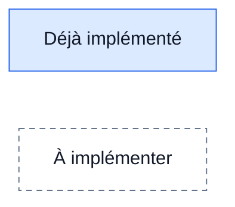
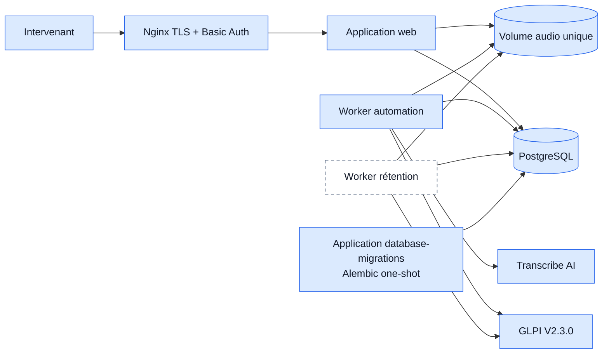
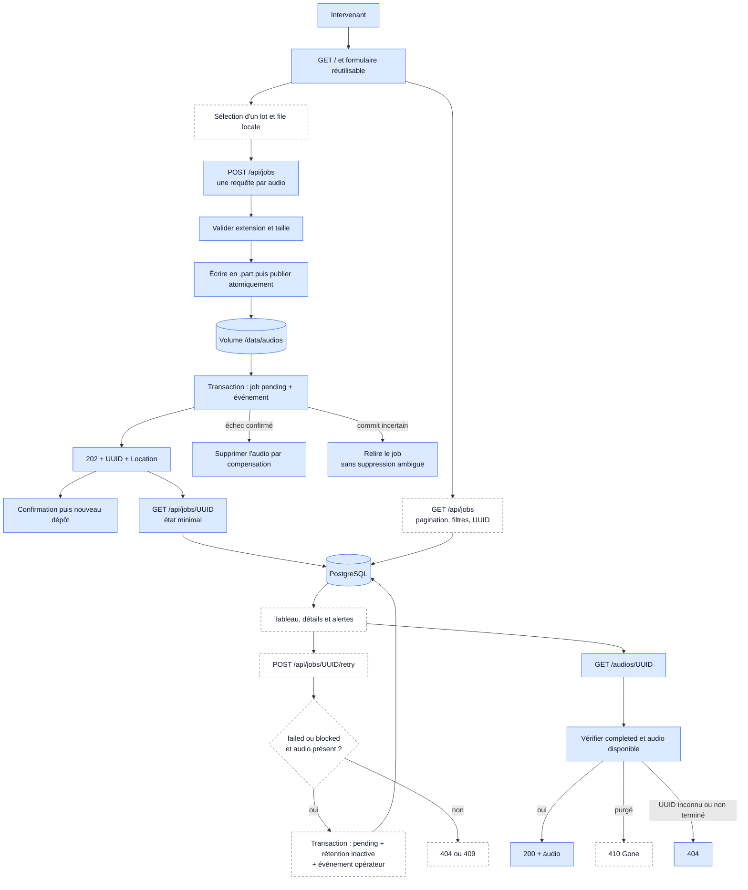
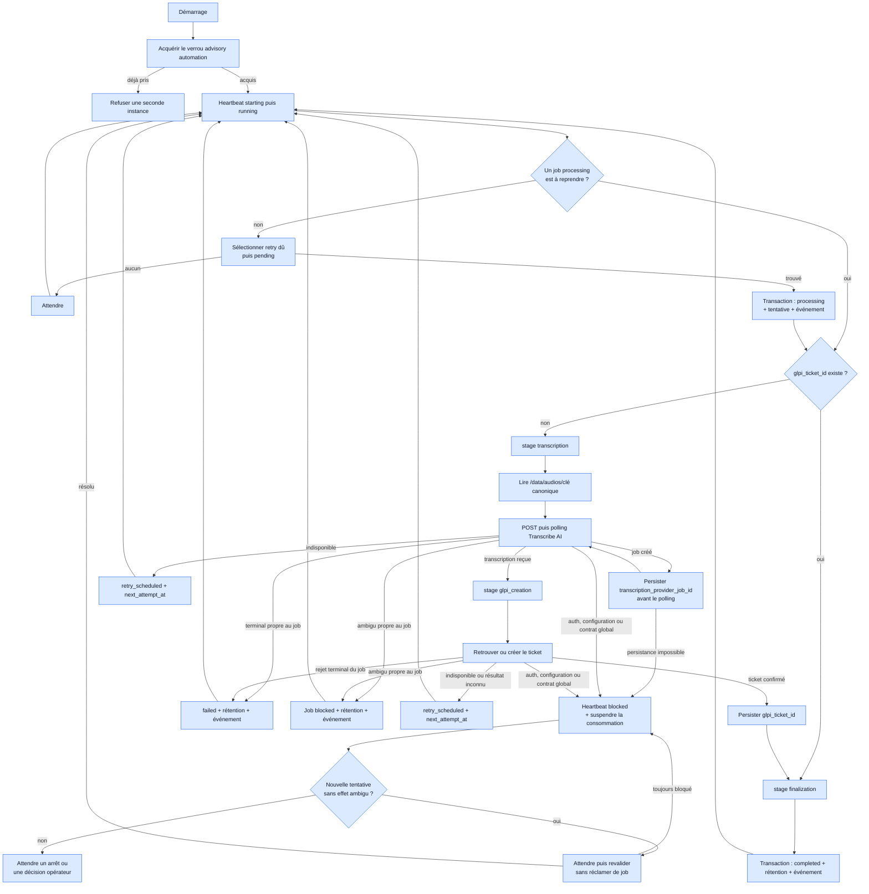
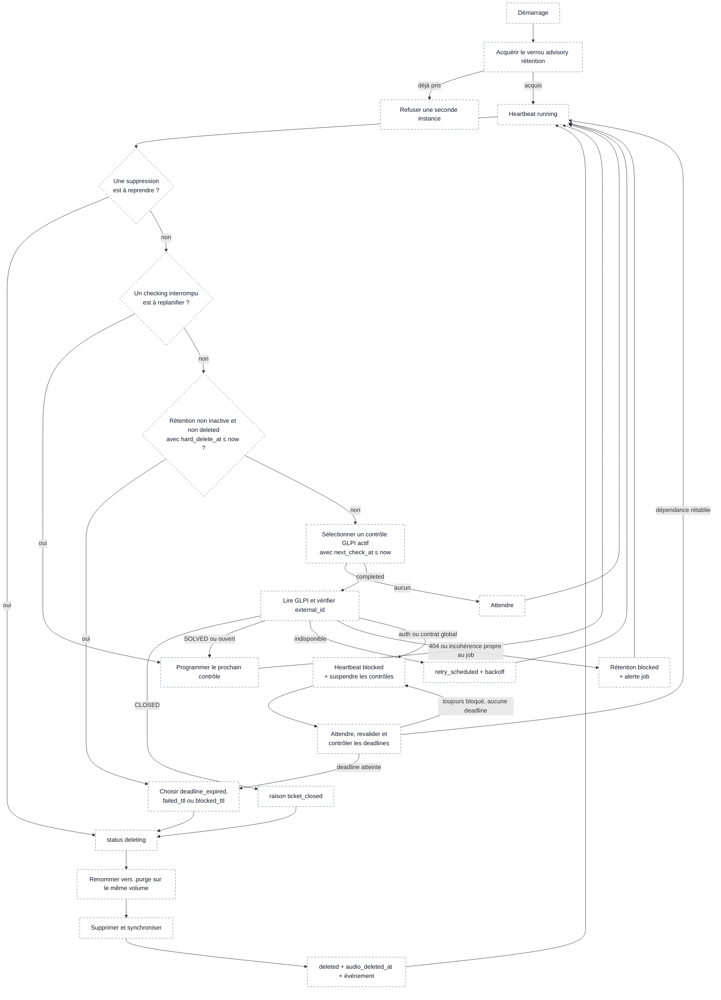
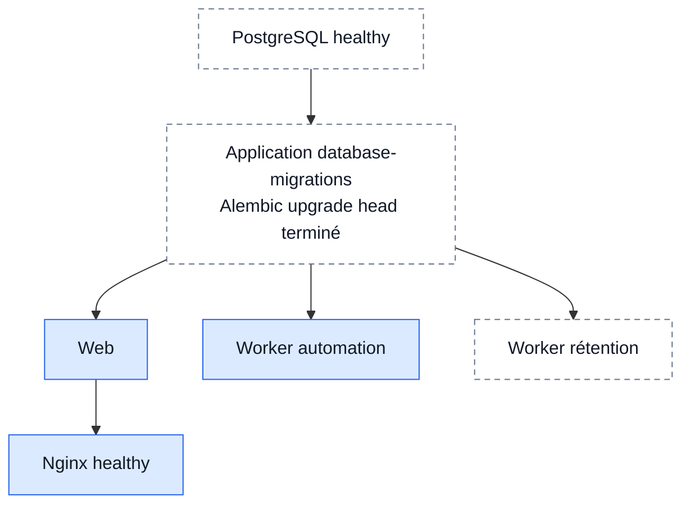

# Architecture cible du MVP

Ce document décrit la cible de la branche `mvp/job-lifecycle`. Il complète le
README racine, qui continue de documenter le comportement du POC figé par le
tag `poc-v0.1.0`.

Il s'agit d'un document vivant : un composant blanc et en pointillés n'est pas
encore implémenté. Lorsqu'un jalon est terminé et validé, sa classe Mermaid
doit passer de `future` à `implemented`.



## Décisions validées

- PostgreSQL devient l'unique source de vérité du cycle de vie des jobs.
- Les octets audio ne sont pas stockés dans PostgreSQL. Ils restent dans un
  volume persistant dont la racine configurable vaut `/data/audios` dans le
  déploiement Docker. La base conserve la clé relative canonique
  `{uuid}.{extension}` et l'application résout le chemin
  `audio_root / storage_key`.
- Le MVP exécute un seul worker d'automatisation et un seul worker de
  rétention. Chaque type de worker protège son unicité avec un verrou advisory
  PostgreSQL conservé sur une connexion dédiée.
- Il n'y a donc ni lease par job, ni `lease_owner`, ni `SKIP LOCKED` dans ce
  MVP. Une éventuelle parallélisation demandera de réintroduire un mécanisme de
  réclamation concurrente.
- La transcription n'est pas persistée. Après un redémarrage, tout job sans
  `glpi_ticket_id` est retranscrit, quelle que soit sa dernière étape connue.
- Seul un ticket GLPI au statut contractuel `CLOSED`, avec un `external_id`
  correspondant à l'UUID du job, autorise une suppression anticipée.
  `SOLVED` ne suffit pas.
- Les alertes du MVP sont affichées dans le dashboard. Aucun canal externe
  comme le mail ou Teams n'est inclus dans ce périmètre.
- Une indisponibilité temporaire ne provoque pas l'arrêt du worker. Celui-ci
  reste vivant avec un heartbeat `degraded`, persiste un backoff plafonné et
  suspend les nouvelles réclamations qui dépendent du service indisponible.
  Docker ne redémarre que les processus réellement arrêtés ; les notifications
  externes restent hors du MVP.
- Les migrations sont portées par une application uv dédiée
  `apps/database-migrations`. Le package `packages/database` expose les
  modèles et les accès partagés, mais ne possède ni l'historique Alembic ni le
  point d'entrée de déploiement.
- Un opérateur peut réarmer explicitement un job `failed` ou `blocked` avec
  `POST /api/jobs/{uuid}/retry`. Cette action est auditée et ne supprime aucun
  événement antérieur.
- Le MVP est déployé sur une base PostgreSQL et un volume audio neufs. Aucun
  import automatique des répertoires `pending`, `processing`, `completed` ou
  `failed` du POC n'est prévu. Le tag `poc-v0.1.0` reste le point de retour vers
  ce format historique.
- Docker Compose reste l'orchestrateur du déploiement mono-serveur.

## Structure cible du workspace

Légende : `🟦` existe déjà ou est réutilisé ; `⬜` reste à créer ou à adapter
pour le MVP.

```text
.
├── apps/
│   ├── database-migrations/                           🟦 application one-shot
│   │   ├── pyproject.toml
│   │   ├── src/glpi_ticketing_database_migrations/
│   │   │   ├── __init__.py
│   │   │   ├── __main__.py
│   │   │   ├── application.py
│   │   │   ├── settings.py
│   │   │   ├── alembic.ini
│   │   │   └── migrations/
│   │   │       ├── env.py
│   │   │       ├── script.py.mako
│   │   │       └── versions/
│   │   └── tests/
│   │       ├── unit/
│   │       └── integration/
│   │
│   ├── web/                                           🟦 à enrichir
│   │   ├── src/glpi_ticketing_web/
│   │   │   ├── __main__.py                            🟦
│   │   │   ├── application.py                         🟦 composition DB
│   │   │   ├── settings.py                            🟦 DB + stockage unique
│   │   │   ├── web.py                                 🟦 assemblage FastAPI
│   │   │   ├── routes/                                🟦 routes fines
│   │   │   ├── controllers/                           🟦 traduction HTTP
│   │   │   ├── services/                              🟦 use cases ; ⬜ listing + retry
│   │   │   ├── schemas/                               🟦 ingestion ; ⬜ dashboard
│   │   │   ├── middlewares/                           🟦 couche réservée
│   │   │   ├── templates/
│   │   │   │   └── index.html                         ⬜ dashboard par lot
│   │   │   └── static/
│   │   │       ├── css/app.css                        🟦 base ; ⬜ dashboard
│   │   │       └── js/upload.js                       🟦 base ; ⬜ dashboard
│   │   └── tests/                                     🟦 à compléter
│   │
│   ├── worker-automation/                             🟦 worker persistant
│   │   ├── src/glpi_ticketing_worker_automation/
│   │   │   ├── __main__.py                            🟦
│   │   │   ├── application.py                         🟦 CLI + boucle
│   │   │   ├── composition.py                         🟦 assemblage des services
│   │   │   ├── settings.py                            🟦 contrat MVP
│   │   │   ├── runtime/                               🟦 ressources + heartbeat
│   │   │   ├── transcription/                         🟦
│   │   │   └── worker/
│   │   │       ├── audio.py                           🟦 inspection canonique
│   │   │       ├── lifecycle.py                       🟦 transactions multi-modèles
│   │   │       ├── outcomes.py                        🟦 résultats expurgés
│   │   │       ├── ports.py                           🟦 contrats internes
│   │   │       ├── policies.py                        🟦 retry + rétention
│   │   │       ├── service.py                         🟦 orchestration lisible
│   │   │       ├── stages/                            🟦 Transcribe AI + GLPI
│   │   │       ├── transitions.py                     🟦 décisions persistantes
│   │   │       └── runner.py                          🟦 autonomie singleton
│   │   └── tests/                                     🟦 unitaires + intégration DB
│   │
│   └── worker-retention/                              ⬜ nouvelle application
│       ├── pyproject.toml
│       ├── README.md
│       ├── src/glpi_ticketing_worker_retention/
│       │   ├── __init__.py
│       │   ├── __main__.py
│       │   ├── application.py
│       │   ├── settings.py
│       │   └── retention/
│       │       ├── processor.py
│       │       └── runner.py
│       └── tests/
│           ├── unit/
│           └── integration/
│
├── packages/
│   ├── common/                                        🟦
│   │   └── src/glpi_ticketing_common/
│   │       └── audio_files.py                         🟦 stockage canonique unique
│   │
│   ├── database/                                      🟦 fondation persistante
│   │   ├── pyproject.toml
│   │   ├── src/glpi_ticketing_database/
│   │   │   ├── __init__.py
│   │   │   ├── engine.py                              🟦
│   │   │   ├── models/                                🟦
│   │   │   │   ├── __init__.py                        🟦 façade publique
│   │   │   │   ├── base.py                            🟦 metadata partagée
│   │   │   │   ├── enums.py                           🟦 valeurs persistées
│   │   │   │   ├── ticket_creation_job.py             🟦
│   │   │   │   ├── audio_retention.py                 🟦
│   │   │   │   ├── ticket_creation_job_event.py       🟦
│   │   │   │   └── worker_runtime_status.py           🟦
│   │   │   ├── repositories/                          🟦 un repository par modèle
│   │   │   │   ├── __init__.py                        🟦 façade publique
│   │   │   │   ├── _validation.py                     🟦 validations partagées
│   │   │   │   ├── ticket_creation_job.py             🟦
│   │   │   │   ├── ticket_creation_job_event.py       🟦
│   │   │   │   ├── audio_retention.py                 🟦
│   │   │   │   └── worker_runtime_status.py           🟦
│   │   │   └── advisory_locks.py                      🟦 singleton par service
│   │   └── tests/
│   │
│   └── glpi-client/                                   ⬜ extraction du client
│       ├── pyproject.toml
│       ├── src/glpi_ticketing_glpi/
│       │   ├── client.py
│       │   ├── contracts.py
│       │   └── models.py
│       └── tests/
│
├── docs/
│   └── mvp-architecture.md                            🟦
│
├── infra/docker/
│   ├── docker-compose.prod.yaml                       ⬜ PostgreSQL + services
│   ├── database-migrations/Dockerfile                 ⬜
│   ├── retention/Dockerfile                           ⬜
│   ├── worker/Dockerfile                              🟦 à adapter
│   ├── web/Dockerfile                                 🟦 à adapter
│   └── nginx/                                         🟦
│
└── tests/deployment/                                  🟦 à adapter
```

Les modèles sont séparés par table afin que chaque module porte ses colonnes,
contraintes et index. `models/__init__.py` reste leur façade publique et importe
les quatre classes : un import de `glpi_ticketing_database.models` enregistre
donc toujours le schéma complet dans l'unique `Base.metadata`. Les enums restent
centralisés car plusieurs tables partagent leurs valeurs persistées.

Les repositories sont séparés par modèle. Aucun repository ne crée ou ne
modifie implicitement une autre table : le web orchestre la création du job et
de son événement initial, tandis que `AutomationJobLifecycleService` coordonne
job, événement et rétention côté worker dans une même transaction SQLAlchemy.

Aucune classe `UnitOfWork` personnalisée n'est ajoutée. La session SQLAlchemy
porte déjà cette responsabilité ; les applications ouvrent explicitement une
transaction courte et injectent la session dans les repositories.

L'application `database-migrations` dépend de `packages/database` pour
importer les métadonnées SQLAlchemy. La dépendance reste à sens unique : le
package partagé ne connaît ni Alembic, ni l'application de migration. Cette
application exécute `alembic upgrade head`, puis termine ; elle n'expose aucun
port et n'est jamais importée par le web ou les workers.

Le client GLPI ne doit pas migrer dans `packages/database` : les deux workers
le partagent, mais il reste un adaptateur HTTP indépendant de la persistance.

## Architecture runtime cible



Permissions cibles sur le volume :

- le web dispose d'un accès lecture/écriture pour publier les uploads et servir
  les audios autorisés par la base ;
- le worker d'automatisation dispose d'un accès en lecture seule ;
- le worker de rétention dispose d'un accès lecture/écriture pour mettre en
  quarantaine puis supprimer ;
- PostgreSQL et le service de migration n'accèdent jamais aux octets audio.

## Modèle persistant cible

Les valeurs d'état sont stockées en `VARCHAR` avec des contraintes `CHECK`, et
non comme enums natifs PostgreSQL, afin de conserver des migrations Alembic
simples pendant l'évolution du MVP. Tous les timestamps sont des
`TIMESTAMPTZ` en UTC et les valeurs initiales utilisent des defaults serveur.

### `ticket_creation_jobs`

| Colonne | Contrat |
| --- | --- |
| `uuid` | UUID primaire ; UUID audio, identifiant métier et `external_id` GLPI |
| `status` | `pending`, `processing`, `retry_scheduled`, `completed`, `failed` ou `blocked` |
| `stage` | `transcription`, `glpi_creation` ou `finalization`, nullable avant traitement |
| `storage_key` | Clé relative canonique unique `{uuid}.{extension}` |
| `audio_extension` | Extension validée sans point : `wav`, `mp3`, `ogg` ou `m4a` |
| `audio_size_bytes` | Taille strictement positive |
| `glpi_ticket_id` | Identifiant positif nullable, persisté avant finalisation |
| `transcription_provider_job_id` | Identifiant distant nullable ; texte tant que son contrat n'impose pas un UUID canonique |
| `attempt_count` | Nombre total et monotone de tentatives du pipeline |
| `consecutive_retry_count` | Indisponibilités temporaires consécutives utilisées pour le backoff |
| `next_attempt_at` | Date de reprise d'un `retry_scheduled` |
| `last_error_scope` | `job` ou `system`, nullable |
| `last_error_category` | Catégorie technique expurgée, nullable |
| `last_error_code` | Code technique expurgé, nullable |
| `created_at` | Date d'acceptation du job |
| `first_started_at` | Premier passage effectif en traitement |
| `updated_at` | Dernière transition persistée |
| `finished_at` | Date d'entrée dans un état terminal ou bloqué |

Index minimaux :

- `(created_at, uuid)` partiel pour `status = 'pending'` ;
- `(next_attempt_at, created_at, uuid)` partiel pour
  `status = 'retry_scheduled'` ;
- `(updated_at DESC, uuid DESC)` pour le dashboard ;
- `(status, updated_at DESC, uuid DESC)` pour le dashboard filtré ;
- index unique nullable sur `glpi_ticket_id` tant qu'une seule instance GLPI
  est ciblée ;
- index unique partiel garantissant un seul job `processing` dans le MVP.

### Résolution d'un audio par `storage_key`

Le dashboard et les workers ne recherchent jamais un UUID en parcourant le
volume. Une lecture suit toujours le même chemin :

```text
UUID
  -> recherche par clé primaire dans ticket_creation_jobs
  -> lecture de storage_key
  -> ouverture directe de /data/audios/{storage_key}
```

La recherche PostgreSQL utilise l'index de clé primaire. Le système de
fichiers résout ensuite un nom exact ; le code n'utilise ni `glob`, ni `find`,
ni `Path.iterdir()` pour retrouver un audio. Le coût ne dépend donc pas d'un
parcours linéaire de tous les fichiers par l'application.

`storage_key` est une clé relative validée, jamais un chemin absolu fourni par
l'utilisateur. Pour le MVP, sa forme canonique est `{uuid}.{extension}`. Elle
reste stable pendant toutes les transitions du job : `failed` et `completed`
ne sont pas des répertoires, mais uniquement des valeurs en base. Si le volume
devient très volumineux, de nouvelles clés pourront être partitionnées par
préfixe UUID, par exemple `7a/85/{uuid}.wav`, sans réintroduire une organisation
par état.

`storage_key` est l'emplacement faisant autorité. `audio_extension` est une
métadonnée immuable, validée lors du dépôt et utilisée pour le type de contenu ;
le repository `TicketCreationJobRepository` garantit leur cohérence.

### `audio_retentions`

Cette table remplace le nom initial `TicketRetention`. La politique porte sur
l'audio et doit aussi couvrir les jobs `failed` ou `blocked`, qui peuvent ne
jamais avoir de ticket GLPI.

| Colonne | Contrat |
| --- | --- |
| `job_uuid` | Clé primaire et étrangère vers `ticket_creation_jobs.uuid` |
| `policy` | `ticket_or_deadline` ou `deadline_only` |
| `status` | `inactive`, `scheduled`, `checking`, `retry_scheduled`, `deleting`, `deleted` ou `blocked` |
| `hard_delete_at` | Échéance absolue, nullable uniquement lorsque la rétention est `inactive` |
| `next_check_at` | Prochain contrôle GLPI ou prochain retry de rétention éligible |
| `last_checked_at` | Dernier contrôle tenté, nullable |
| `last_glpi_status` | Statut GLPI typé observé, nullable |
| `check_attempt_count` | Nombre total et monotone de contrôles |
| `consecutive_retry_count` | Indisponibilités temporaires consécutives utilisées pour le backoff |
| `deletion_reason` | `ticket_closed`, `deadline_expired`, `failed_ttl` ou `blocked_ttl`, nullable |
| `deletion_started_at` | Début de la mise en quarantaine, nullable |
| `audio_deleted_at` | Suppression durable confirmée, nullable |
| `last_error_category` | Catégorie expurgée, nullable |
| `last_error_code` | Code expurgé, nullable |
| `created_at` | Création de la politique |
| `updated_at` | Dernière transition |

L'identifiant GLPI reste uniquement dans `ticket_creation_jobs` afin d'éviter
deux valeurs susceptibles de diverger.

Index minimaux :

- `(hard_delete_at, job_uuid)` partiel pour les rétentions non `inactive` et
  non `deleted` ;
- `(next_check_at, job_uuid)` partiel pour les contrôles GLPI planifiés ;
- index unique partiel garantissant une seule rétention `checking` ou
  `deleting` dans le MVP.

Une relance opérateur place la rétention existante en `inactive` et remet
`hard_delete_at` et `next_check_at` à `NULL` dans la même transaction que le
retour du job à `pending`. Une nouvelle entrée dans `completed`, `failed` ou
`blocked` réactive ensuite la ligne et recalcule sa deadline. Le worker de
rétention ne sélectionne jamais une ligne `inactive`.

### `ticket_creation_job_events`

Table append-only utilisée par le détail du dashboard :

```text
event_id, job_uuid, occurred_at, status, stage, event_type,
error_scope, error_category, technical_code, actor
```

`actor` vaut `web`, `worker_automation` ou `worker_retention`. Aucun événement
ne contient de transcription, de secret, de chemin absolu ou de réponse HTTP
brute.

### `worker_runtime_status`

Une ligne est conservée par service singleton :

```text
service_name, instance_id, state, last_heartbeat_at,
current_job_uuid, last_error_category, last_error_code, updated_at
```

`state` vaut `starting`, `running`, `degraded`, `blocked` ou `stopped`. Le
dashboard produit une alerte si un heartbeat dépasse le seuil configuré.

## États `failed` et `blocked`

### `failed`

Un job est `failed` uniquement lorsqu'un échec est explicitement terminal et
propre à cet audio ou à son ticket :

- Transcribe AI refuse explicitement la soumission dans une enveloppe métier
  reçue sous HTTP 200 ;
- Transcribe AI expose le statut contractuel exact `FAILED` ;
- une transcription annoncée comme terminée est vide ou invalide ;
- GLPI retourne un rejet sémantique allowlisté démontrant que le contenu du
  ticket ne peut pas être créé sans modifier les données de ce job.

Une nouvelle tentative automatique avec les mêmes données n'aurait aucune
chance raisonnable de réussir. Le worker persiste l'échec, crée un événement et
continue avec le job suivant.

### `blocked`

Un job ou le service est `blocked` lorsque progresser automatiquement serait
dangereux ou ambigu :

- erreur d'authentification ou d'autorisation globale ;
- réponse distante malformée, statut inconnu ou évolution de contrat ;
- UUID, `external_id` ou identifiant de ticket incohérent ;
- plusieurs tickets GLPI portent le même `external_id` ;
- configuration invalide, clé de stockage inattendue ou fichier manquant ;
- état PostgreSQL et état du stockage impossibles à réconcilier sûrement.

Un blocage propre à un job est persisté et le worker continue avec les autres
jobs. Un blocage systémique passe le heartbeat du worker à `blocked`, suspend
la consommation et alerte le dashboard afin d'éviter de bloquer toute la file
de la même manière.

### Transitions autorisées

| Depuis | Vers | Déclencheur |
| --- | --- | --- |
| `pending` | `processing` | Le worker singleton commence le job |
| `processing` | `retry_scheduled` | Une indisponibilité temporaire impose un backoff |
| `retry_scheduled` | `processing` | `next_attempt_at` est atteint |
| `processing` | `completed` | Le ticket GLPI est confirmé et la finalisation est persistée |
| `processing` | `failed` | Un rejet terminal propre au job est confirmé |
| `processing` | `blocked` | La poursuite automatique est ambiguë ou dangereuse |
| `failed` ou `blocked` | `pending` | Un opérateur appelle explicitement l'API de retry |

`completed` reste l'état final du traitement, y compris après suppression des
octets audio. La purge est représentée par `audio_retentions.status=deleted` et
ne réécrit pas l'historique du job.

`POST /api/jobs/{uuid}/retry` est accepté uniquement pour un job `failed` ou
`blocked` dont l'audio existe encore. L'opération conserve `uuid`,
`glpi_ticket_id`, `attempt_count`, `created_at` et tous les événements. Elle
remet `stage`, `finished_at` et `next_attempt_at` à `NULL`, efface l'erreur
courante, remet `transcription_provider_job_id` à `NULL` et
`consecutive_retry_count` à zéro, désactive la rétention et ajoute un événement
`operator_retry_requested`. Un UUID inconnu retourne `404` ; un état non
relançable ou un audio déjà purgé retourne `409`.

## Pipeline de l'application web

L'adaptateur web suit les couches
`Routes -> Controllers -> Services -> Repositories/Storage`. Les routes ne
contiennent aucune règle métier ; les controllers possèdent uniquement la
traduction HTTP et les services restent importables sans FastAPI.



Le navigateur envoie chaque fichier du lot dans une requête distincte, avec
une concurrence locale bornée. Un échec n'annule pas les autres uploads et la
limite HTTP continue de s'appliquer par fichier.

L'écriture du fichier précède l'insertion SQL. Le worker ne découvre les jobs
que par PostgreSQL : un éventuel fichier orphelin ne peut pas être consommé. Le
worker de rétention supprime les fichiers sans ligne associée uniquement
après un délai de sécurité configurable.

Si l'accusé de réception du `COMMIT` est perdu, le web ouvre une nouvelle
session et vérifie l'UUID. Une ligne cohérente confirme le succès. Une ligne
absente ne confirme toutefois pas l'échec : le premier backend peut encore
achever le commit. Le web conserve donc aussi l'audio dans ce cas. Un orphelin
est réconciliable après un délai de sécurité, contrairement à un job `pending`
dont les octets auraient été supprimés.

Le traitement nominal n'énumère jamais le volume. Seule une tâche de
maintenance du worker de rétention peut effectuer un scan borné des fichiers
`.part` et des orphelins assez anciens. Avant toute suppression, elle vérifie
qu'aucune ligne ne référence la `storage_key` concernée.

`GET /api/jobs/{uuid}` retourne `404` seulement si la ligne n'existe pas. Une
purge ne supprime jamais le job ni ses événements.

## Pipeline du worker d'automatisation



Les transactions sont courtes et ne restent jamais ouvertes pendant un appel
Transcribe AI, GLPI ou une attente. Un retry métier ne redémarre pas le
conteneur : il persiste `retry_scheduled`, libère le job et laisse la boucle
traiter un autre job éligible.

La sélection applique strictement la priorité `processing`, puis retry arrivé
à échéance, puis `pending`. Un retry de portée `system` non encore échu bloque
la réclamation de nouveaux jobs : il sert de sonde unique et évite de propager
la même panne à toute la file. Le backoff exponentiel vaut 5 secondes au
premier échec, double à chaque échec consécutif et reste plafonné à 300
secondes. Le singleton du MVP n'ajoute pas de jitter.

`consecutive_retry_count` représente une série globale d'échecs temporaires du
pipeline, et non un compteur distinct par dépendance. Une réussite Transcribe
suivie d'une indisponibilité GLPI ne remet donc pas la série à zéro : la reprise
GLPI impose encore une nouvelle transcription. Seul le futur réarmement
opérateur réinitialise explicitement ce compteur.

Le test de `glpi_ticket_id` s'applique aussi à un job réarmé par un opérateur.
Si le ticket est déjà confirmé, le worker reprend la finalisation sans demander
une transcription inutile. Sans identifiant GLPI persisté, il redemande la
transcription puisque son contenu n'est pas conservé.

Un crash technique inattendu peut être relancé par Docker Compose. Un résultat
`failed` ou `blocked` est un état métier persisté, pas une raison de redémarrer
aveuglément le processus.

Le worker écrit dès l'itération 3 un heartbeat minimal aux frontières de sa
boucle : `starting`, `running`, `degraded`, `blocked` et `stopped`. Une erreur
système immédiate laisse le job `processing`. Elle est sondée uniquement si la
répétition ne peut pas dupliquer un effet distant ; après un `POST` accepté non
persisté, une rupture du polling ou un contrat GLPI incohérent, le blocage est
verrouillé et le processus reste vivant sans rappeler le processeur. La
périodicité indépendante des appels longs, la détection de heartbeat périmé et
les alertes du dashboard restent le périmètre de l'itération 6.

Toutes les transactions du worker, y compris les heartbeats, utilisent la
connexion qui détient le verrou advisory. La perte de cette connexion fait donc
échouer le commit lui-même ; une ancienne instance ne peut pas valider une
transition SQL après la prise de possession par sa remplaçante. Le verrou est
également revalidé avant et après chaque itération et appel externe, ainsi
qu'autour de chaque lecture du polling de transcription. Si le `POST`
Transcribe AI a réussi mais que son identifiant ne peut pas être persisté,
l'erreur expurgée devient un blocage système et le job reste `processing` ; il
n'est jamais classé `failed` pour une panne de PostgreSQL.

Le résultat du polling doit porter exactement le même identifiant provider que
celui persisté par le callback de soumission. Une divergence de chemin, d'UUID
audio ou d'identifiant provider est traitée comme une rupture de contrat
systémique : le job reste `processing` et aucun ticket GLPI n'est créé. Un
`SIGINT` ou `SIGTERM` observé pendant le polling produit de même une sortie
interrompue sans programmer de retry ; le prochain démarrage reprend ce job en
priorité.

Le client GLPI revalide le verrou avant et après chacune de ses requêtes. Cette
barrière réduit la fenêtre de course, mais ne peut pas annuler une création
HTTP déjà en vol et GLPI ne garantit pas l'unicité de `external_id`. La
recherche de réconciliation reste donc nécessaire et ne constitue pas un jeton
de fencing distribué.

Avant tout appel distant, le worker vérifie également que la taille du fichier
canonique correspond à `audio_size_bytes`. Une divergence bloque ce job avant
transcription. Cette vérification détecte une troncature ou un remplacement de
taille différente ; une empreinte de contenu reste hors périmètre de cette
itération.

L'audio reste à sa `storage_key` pendant toutes ces transitions. Le worker ne
scanne jamais le volume, ne déplace aucun fichier et ne crée aucun sidecar ;
`failed` et `completed` sont des états PostgreSQL, pas des répertoires.

## Pipeline du worker de rétention



La mise en quarantaine `.purge` rend chaque crash récupérable : le worker sait
reprendre si le fichier est encore à son emplacement canonique, déjà dans
`.purge` ou déjà absent. Pour un job, il ne supprime que sa clé de stockage
validée. Pour un orphelin découvert par la maintenance, il valide d'abord le
nom comme une clé canonique, vérifie son absence en base, puis supprime ce
chemin exact ; le glob de découverte n'est jamais utilisé directement comme
cible de suppression.

Si une suppression déjà engagée doit être réessayée ou bloquée, la rétention
conserve ensemble `deletion_reason` et `deletion_started_at`. Le prochain
passage reprend ainsi le même fichier `.purge` au lieu de perdre le contexte.
Ces deux champs restent obligatoirement vides pour `inactive`, `scheduled` et
`checking`. Un `retry_scheduled`, quelle que soit sa politique, possède un
`next_check_at` afin d'éviter une boucle de retry immédiate.

Une rétention `blocked` reste exclue des contrôles GLPI ordinaires, mais sa
deadline absolue reste prioritaire. Dès `hard_delete_at`, elle est donc
sélectionnée par la branche `Expired` et purgée sans dépendre de GLPI.
Un blocage systémique suspend seulement les appels GLPI : la boucle bloquée
continue de contrôler les deadlines qui ne nécessitent pas ce service.

Les jobs `failed` et `blocked` utilisent la politique `deadline_only` : ils ne
déclenchent aucun polling GLPI avant leur TTL. La sélection ordinaire concerne
uniquement les politiques `ticket_or_deadline` ; la branche `Expired` couvre
toutes les politiques non `inactive` et non `deleted`.

Un statut `checking` abandonné par un crash est replanifié avant toute nouvelle
requête GLPI. Le statut reste donc observable sans pouvoir rendre une ligne
définitivement inéligible.

## Stratégie de rétention proposée

Les durées ci-dessous sont des valeurs initiales proposées. Elles restent
configurables et doivent être confirmées en fonction de la politique de
protection des données de l'établissement.

| Situation | Politique proposée |
| --- | --- |
| Job `completed` | Contrôle GLPI toutes les 6 heures ; suppression dès `CLOSED` avec `external_id` correct ; suppression absolue 90 jours après `completed` |
| Job `failed` | Alerte immédiate ; conservation 30 jours pour diagnostic opérateur, puis suppression absolue |
| Job `blocked` | Alerte immédiate et absence de retry automatique ; conservation 90 jours pour intervention, puis suppression absolue |
| Job `pending` trop ancien | Alerte dashboard, aucune suppression automatique |
| Job `processing` après crash | Reprise prioritaire par le worker singleton |
| Job `retry_scheduled` en retard | Alerte dashboard puis reprise lorsque le service redevient disponible |
| Fichier `.part` ou audio sans ligne DB | Suppression seulement après 24 heures et vérification de l'absence de job |

Avant la deadline d'un job `completed` :

- `CLOSED` autorise la purge ;
- `SOLVED` ou un statut ouvert conserve l'audio ;
- une indisponibilité GLPI conserve l'audio et programme un backoff plafonné ;
- `401`, `403`, `404`, statut inconnu ou `external_id` incohérent bloque la
  rétention et alerte, sans suppression anticipée.

À la deadline absolue, la purge ne dépend plus de GLPI. La raison exacte est
persistée afin que le dashboard explique pourquoi l'audio a disparu.

Les lignes PostgreSQL et les événements restent après la suppression des
octets. Leur propre durée de conservation devra être définie avant la mise en
production ; elle est distincte de la rétention audio.

## Démarrage Docker Compose



Le web et les deux workers démarrent indépendamment après une migration
réussie. Ils ne dépendent pas les uns des autres. Le service
`database-migrations` utilise `restart: "no"`. Les clauses `depends_on` du web
et des workers emploient la condition Compose
`service_completed_successfully` pour ce service.

Le premier déploiement MVP crée un volume PostgreSQL et un volume audio vides.
Le Compose ne monte jamais les volumes historiques du POC et l'application de
migration ne transforme pas leurs répertoires.

PostgreSQL est épinglé par tag et digest, possède son propre volume, un
healthcheck ainsi qu'une procédure documentée de sauvegarde et restauration.

## Règle de préparation de chaque itération

Avant toute implémentation, une proposition est soumise pour validation. Elle
contient obligatoirement :

1. les comportements inclus et explicitement hors périmètre ;
2. les tests unitaires à ajouter ou adapter ;
3. les tests d'intégration à ajouter, ou la raison pour laquelle ils ne sont
   pas pertinents ;
4. les tests du POC devenus incompatibles, avec pour chacun la décision
   `conserver`, `adapter`, `remplacer` ou `supprimer` ;
5. le code du POC à adapter ou retirer, après vérification de ses imports et de
   ses consommateurs ;
6. les commandes de validation et le critère de sortie.

Un test n'est jamais supprimé uniquement parce qu'il échoue. Son intention
est conservée dans un nouveau test lorsque le comportement reste requis. Un
code historique n'est retiré qu'après migration de tous ses consommateurs et
vérification par recherche d'usage.

À la fin de chaque itération, la suite hors services externes doit rester
verte. Les diagrammes et l'arborescence passent de `future` à `implemented`
dans le même commit que le comportement correspondant.

## Roadmap d'implémentation

Le jalon documentaire 0 est suivi de huit itérations techniques. La branche
peut être temporairement non déployable entre les bascules du web et du worker,
mais chaque jalon reste testable et conserve une suite automatisée verte.

### Itération 0 — Figer l'architecture MVP

Périmètre : application de migration distincte, stockage canonique, machine à
états, retry opérateur, pipelines, roadmap et démarrage sur des volumes neufs.

- Tests unitaires : aucun, car aucun comportement exécutable ne change.
- Tests d'intégration : aucun.
- Tests POC retirés : aucun.
- Code POC retiré : aucun.
- Validation : liens Markdown, fences Mermaid, `git diff --check`, Ruff et suite
  locale inchangée.

### Itération 1 — Persistance et application de migration

Périmètre : `packages/database`, `apps/database-migrations`, SQLAlchemy,
PostgreSQL, schéma initial et exécution one-shot d'Alembic.

État : 🟦 implémenté sur la branche ; l'intégration dans les applications
métier et dans le Compose de production appartient aux itérations suivantes.

- Tests unitaires : invariants des modèles, valeurs d'états, construction de
  configuration et contrat du point d'entrée de migration.
- Tests d'intégration : PostgreSQL Testcontainers, migration d'une base vide,
  seconde exécution sans effet, contraintes et index attendus.
- Tests POC retirés : aucun ; aucune application métier ne consomme encore la
  base.
- Code POC retiré : aucun.
- Sortie : une base neuve atteint `head` de manière reproductible.

### Itération 2 — Ingestion persistée et stockage audio unique

Périmètre : publication atomique dans `/data/audios`, création du job
`pending`, événement initial et réponse `202` avec `Location`.

État : 🟦 implémenté sur la branche. La façade HTML reste disponible jusqu'au
dashboard par lot ; le worker consomme désormais ces jobs persistés depuis
l'itération 3.

- Tests unitaires : validation de `storage_key`, refus des traversées de
  chemin, écriture `.part`, compensation et contrats HTTP.
- Tests d'intégration : requête FastAPI avec PostgreSQL et volume temporaires,
  cohérence fichier/ligne, deux dépôts distincts et panne SQL simulée.
- Tests POC adaptés : tests web qui inspectaient directement `pending` ou
  `completed`. Leur intention fonctionnelle est conservée avec la base et le
  stockage canonique.
- Code POC adapté : configuration multi-répertoires du web et fonctions de
  publication. Les primitives de transition conservées provisoirement pour le
  worker historique ont été retirées à l'itération 3.
- Sortie : le web ne crée jamais un job consommable avant la publication
  durable de son audio.

### Itération 3 — Cycle de vie persistant du worker d'automatisation

Périmètre : sélection en base, verrou advisory singleton, reprise d'un job
`processing`, retries planifiés et transitions `completed`, `failed` ou
`blocked`.

État : 🟦 implémenté sur la branche. PostgreSQL pilote la sélection et toutes
les transitions ; le volume canonique ne représente plus l'état du job. Un
heartbeat minimal a été avancé depuis l'itération 6 pour rendre les blocages
système observables dès cette bascule.

- Tests unitaires : priorité de reprise, matrice des transitions, backoff,
  classification des erreurs, idempotence GLPI et transactions sans appel
  réseau ouvert.
- Tests d'intégration : worker avec PostgreSQL migré et stockage réel,
  crash/reprise avec ou sans ticket confirmé, échéance d'un retry et verrou
  advisory sur de vraies sessions PostgreSQL. Le pipeline E2E conserve le même
  audio à sa clé canonique et vérifie le job, la rétention et les événements.
- Tests POC remplacés :
  `apps/worker-automation/tests/unit/worker/test_scanner.py`, ainsi que les
  assertions des tests du service et E2E portant sur les déplacements entre
  `pending`, `processing`, `completed` et `failed` ou sur les sidecars. Les
  tests de `packages/common/tests/unit/test_audio_files.py` portant sur ces
  transitions ont été remplacés ; ceux portant sur l'écriture atomique sont
  conservés dans `test_audio_storage.py`.
- Code POC retiré : scanner de répertoires, transitions de volumes, sidecars
  JSON et état privé du processeur. Les primitives communes de stockage
  canonique restent partagées par le web et le worker.
- Sortie : le worker ne découvre plus aucun job depuis le système de fichiers.

### Itération 4 — API des jobs et dashboard par lot

Périmètre : liste paginée, recherche UUID, détail et événements, envoi de
plusieurs fichiers, téléchargement contrôlé et API de retry opérateur.

- Tests unitaires : DTO, pagination, filtres, transitions du retry, refus
  `404`/`409`, rendu du dashboard et absence de contenu sensible.
- Tests d'intégration : API avec PostgreSQL, lot partiellement refusé,
  recherche et tri, relance atomique avec rétention `inactive`, `404` inconnu
  et `410` après purge.
- Tests POC à adapter : tests centrés sur la page `uploaded.html` et sur la
  lecture directe de `completed`. Le comportement de dépôts successifs reste
  couvert dans le parcours par lot.
- Code POC à retirer si devenu sans consommateur : page de confirmation
  isolée et routes historiques remplacées par les contrats `/api/jobs`.
- Sortie : aucun listing ou téléchargement ne déduit l'état depuis un
  répertoire.

### Itération 5 — Client GLPI partagé et worker de rétention

Périmètre : extraction de `packages/glpi-client`, lecture du statut du ticket,
application `worker-retention`, deadlines et purge crash-safe.

- Tests unitaires : statuts GLPI, correspondance `external_id`, planification,
  priorité de deadline, quarantaine `.purge` et reprise de chaque point de
  crash. Une rétention `blocked` doit notamment être purgée lorsque sa
  deadline absolue est atteinte.
- Tests d'intégration : client sur GLPI Testcontainers, singleton de rétention,
  conservation de `SOLVED`, purge de `CLOSED`, indisponibilité et incohérence.
- Tests POC à déplacer : tests unitaires et contractuels du client GLPI
  quittent l'application worker pour le package partagé ; ils ne sont pas
  supprimés.
- Code POC à déplacer : client GLPI et ses contrats, après migration de tous
  les imports du worker d'automatisation.
- Sortie : la suppression anticipée exige `CLOSED` et un `external_id` exact.

### Itération 6 — Heartbeats, alertes et autonomie

Périmètre : états runtime des workers, alertes dashboard, détection des jobs
anciens et distinction entre retry métier et redémarrage de processus.

Un socle minimal est déjà présent depuis l'itération 3 pour le worker
d'automatisation : écriture des états runtime aux frontières de la boucle et
distinction entre blocage de job et blocage système. Cette itération ajoute la
périodicité pendant les traitements longs, les seuils d'absence et leur
présentation dans le dashboard.

- Tests unitaires : seuils de heartbeat, alertes dédupliquées, état
  `degraded`/`blocked`, horloge injectée et politique de sortie du processus.
- Tests d'intégration : heartbeat réel en base, arrêt d'un worker, reprise
  après indisponibilité et affichage de l'alerte correspondante.
- Tests POC à adapter : tests du runner qui attendent un arrêt global pour
  tout `BlockedOutcome`. Un blocage propre au job doit désormais laisser la
  boucle continuer.
- Code POC à adapter : politique d'arrêt du runner et composition des boucles.
- Sortie : le dashboard distingue un job en retry, un job bloqué et un worker
  absent.

### Itération 7 — Déploiement Docker Compose du MVP

Périmètre : PostgreSQL, migration one-shot, deux workers, web, Nginx, volumes,
healthchecks, politiques de redémarrage et documentation d'exploitation.

Jusqu'à ce jalon, le Compose versionné reste celui du POC et ne doit pas être
présenté comme un déploiement cohérent de la branche MVP.

- Tests unitaires : validation ciblée des settings et des commandes d'entrée ;
  aucun test Docker simulé.
- Tests d'intégration : smoke test Compose, ordre de démarrage, échec de
  migration bloquant, persistance après redémarrage et permissions des volumes.
- Tests POC à adapter : `tests/deployment/test_compose.py` pour les nouveaux
  services, variables et healthchecks.
- Code POC à adapter : Compose, fichiers d'environnement et images runtime ;
  les fichiers locaux encore utiles sont conservés avec des noms explicites.
- Sortie : un hôte vierge peut initialiser la stack avec des secrets injectés.

### Itération 8 — Validation E2E et publication du MVP

Périmètre : scénario complet upload, retry, reprise, ticket GLPI, dashboard,
fermeture du ticket, purge et audit persistant.

- Tests unitaires : uniquement les cas limites découverts pendant l'E2E.
- Tests d'intégration/E2E : stack complète, plusieurs audios, panne externe,
  redémarrage pendant `processing`, absence de doublon GLPI, alerte
  `failed`/`blocked`, purge anticipée et purge par deadline avec horloge
  contrôlée.
- Tests ou code POC à retirer : aucun par principe ; tout reliquat est d'abord
  qualifié par une recherche d'usage et par sa valeur de régression.
- Sortie : runbook de démonstration, limites résiduelles documentées et tag
  candidat `mvp-v1.0.0`.
