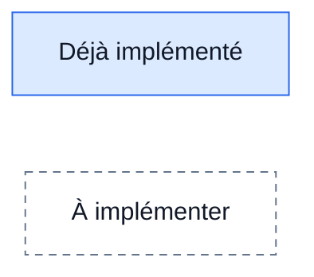
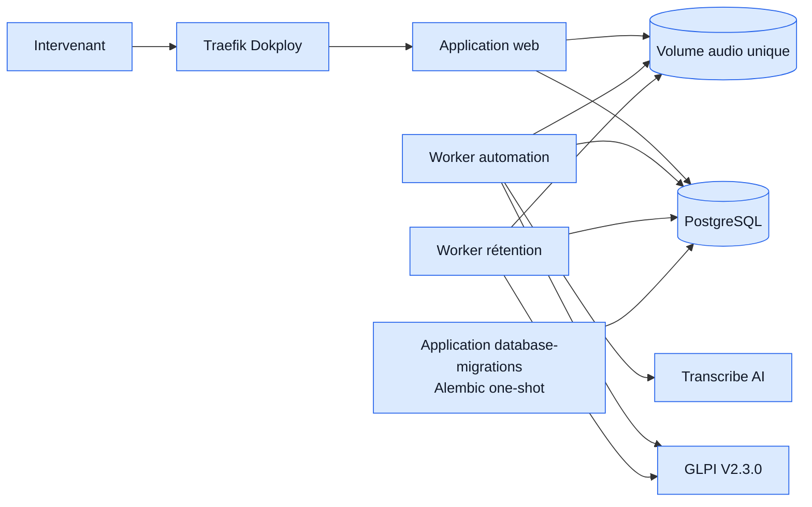
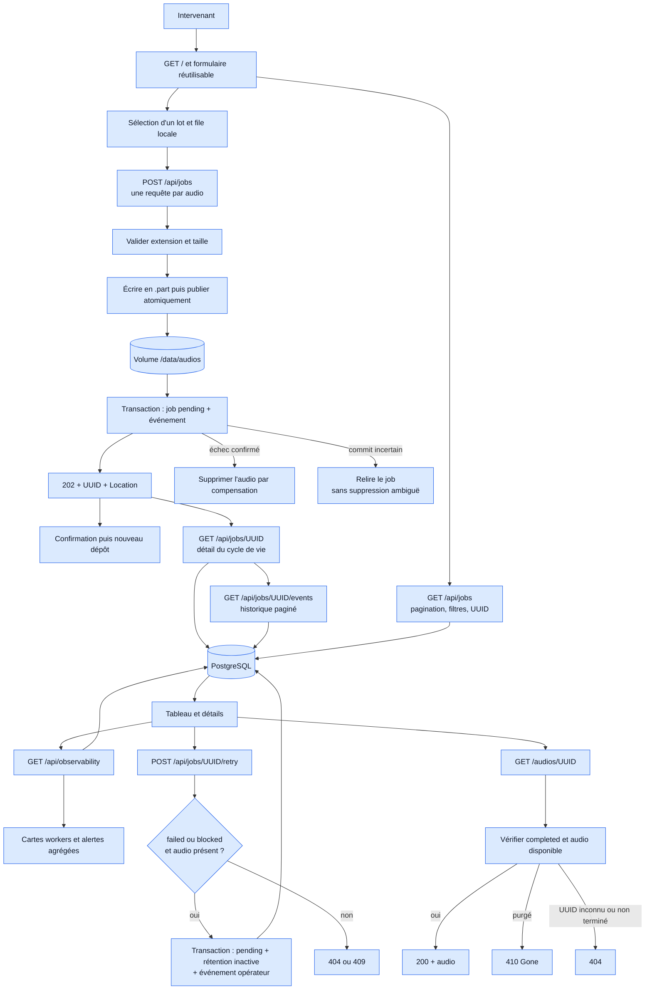
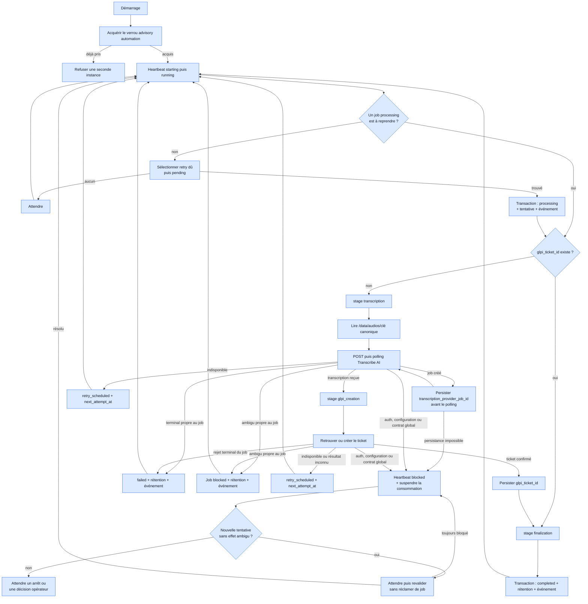
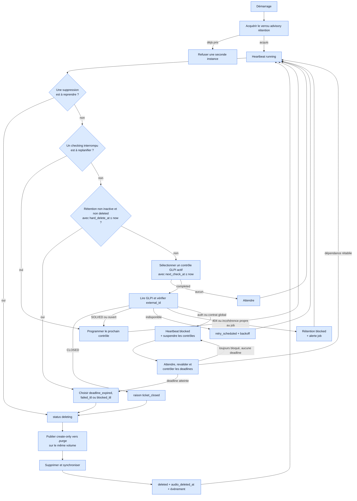
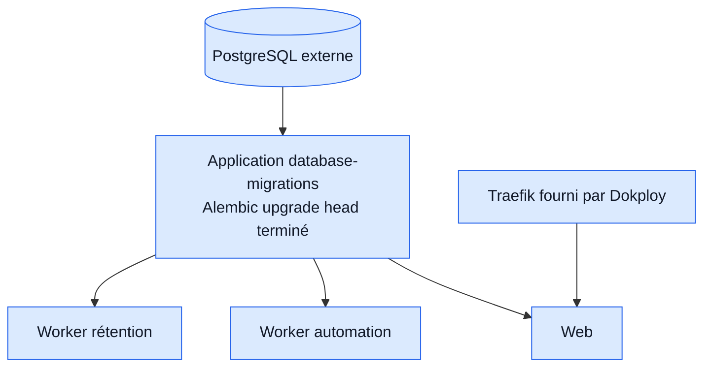

# Architecture cible du MVP

Ce document décrit la cible de la branche `mvp/job-lifecycle`. Il complète le
README racine, qui continue de documenter le comportement du POC figé par le
tag `poc-v0.1.0`.

Il s'agit d'un document vivant : un composant blanc et en pointillés n'est pas
encore implémenté. Lorsqu'un jalon est terminé et validé, sa classe Mermaid
doit passer de `future` à `implemented`.



## Décisions validées

- PostgreSQL devient l'unique source de vérité du cycle de vie des jobs.
- Les octets audio ne sont pas stockés dans PostgreSQL. Ils restent dans un
  volume persistant dont la racine configurable vaut `/data/audios` dans le
  déploiement Docker. La base conserve la clé relative canonique
  `{uuid}.{extension}` et l'application résout le chemin
  `audio_root / storage_key`.
- Le MVP exécute un seul worker d'automatisation et un seul worker de
  rétention. Chaque type de worker protège son unicité avec un verrou advisory
  PostgreSQL conservé sur une connexion dédiée.
- Il n'y a donc ni lease par job, ni `lease_owner`, ni `SKIP LOCKED` dans ce
  MVP. Une éventuelle parallélisation demandera de réintroduire un mécanisme de
  réclamation concurrente.
- La transcription n'est pas persistée. Après un redémarrage, tout job sans
  `glpi_ticket_id` est retranscrit, quelle que soit sa dernière étape connue.
- Seul un ticket GLPI au statut contractuel `CLOSED`, avec un `external_id`
  correspondant à l'UUID du job, autorise une suppression anticipée.
  `SOLVED` ne suffit pas.
- Le dernier statut observé dans GLPI est persisté sous sa forme numérique
  native dans `audio_retentions.last_glpi_status_id` (`SMALLINT` positif), et
  non sous un libellé susceptible de varier avec la langue ou la version.
- Les alertes du MVP sont affichées dans le dashboard. Aucun canal externe
  comme le mail ou Teams n'est inclus dans ce périmètre.
- Une indisponibilité temporaire ne provoque pas l'arrêt du worker. Celui-ci
  reste vivant avec un heartbeat `degraded`, persiste un backoff plafonné et
  suspend les nouvelles réclamations qui dépendent du service indisponible.
  Docker ne redémarre que les processus réellement arrêtés ; les notifications
  externes restent hors du MVP.
- Les migrations sont portées par une application uv dédiée
  `apps/database-migrations`. Le package `packages/database` expose les
  modèles et les accès partagés, mais ne possède ni l'historique Alembic ni le
  point d'entrée de déploiement.
- Un opérateur peut réarmer explicitement un job `failed` ou `blocked` avec
  `POST /api/jobs/{uuid}/retry`. Cette action est auditée et ne supprime aucun
  événement antérieur.
- Le MVP est déployé sur une base PostgreSQL et un volume audio neufs. Aucun
  import automatique des répertoires `pending`, `processing`, `completed` ou
  `failed` du POC n'est prévu. Le tag `poc-v0.1.0` reste le point de retour vers
  ce format historique.
- Docker Compose reste l'orchestrateur du déploiement mono-serveur.

## Structure cible du workspace

Légende : `🟦` existe déjà ou est réutilisé ; `⬜` reste à créer ou à adapter
pour le MVP.

```text
.
├── apps/
│   ├── database-migrations/                           🟦 application one-shot
│   │   ├── pyproject.toml
│   │   ├── src/glpi_ticketing_database_migrations/
│   │   │   ├── __init__.py
│   │   │   ├── __main__.py
│   │   │   ├── application.py
│   │   │   ├── settings.py
│   │   │   ├── alembic.ini
│   │   │   └── migrations/
│   │   │       ├── env.py
│   │   │       ├── script.py.mako
│   │   │       └── versions/
│   │   └── tests/
│   │       ├── unit/
│   │       └── integration/
│   │
│   ├── web/                                           🟦 dashboard MVP
│   │   ├── src/glpi_ticketing_web/
│   │   │   ├── __main__.py                            🟦
│   │   │   ├── application.py                         🟦 composition DB
│   │   │   ├── settings.py                            🟦 DB + stockage unique
│   │   │   ├── web.py                                 🟦 assemblage FastAPI
│   │   │   ├── routes/                                🟦 routes fines
│   │   │   ├── controllers/                           🟦 traduction HTTP
│   │   │   ├── services/                              🟦 use cases par responsabilité
│   │   │   │   ├── jobs/                              🟦 ingestion, requêtes, download, retry
│   │   │   │   └── observability/                     🟦 statuts runtime et alertes agrégées
│   │   │   ├── schemas/                               🟦 contrats ingestion + dashboard
│   │   │   ├── middlewares/                           🟦 couche réservée
│   │   │   ├── templates/
│   │   │   │   └── index.html                         🟦 dashboard par lot
│   │   │   └── static/
│   │   │       ├── css/app.css                        🟦 interface responsive
│   │   │       └── js/                                🟦 API, uploads, dashboard, assemblage
│   │   └── tests/                                     🟦 contrats + intégration PostgreSQL
│   │
│   ├── worker-automation/                             🟦 worker persistant
│   │   ├── src/glpi_ticketing_worker_automation/
│   │   │   ├── __main__.py                            🟦
│   │   │   ├── application.py                         🟦 CLI + boucle
│   │   │   ├── composition.py                         🟦 assemblage des services
│   │   │   ├── settings.py                            🟦 contrat MVP
│   │   │   ├── runtime/                               🟦 ressources + heartbeat
│   │   │   ├── transcription/                         🟦
│   │   │   └── worker/
│   │   │       ├── audio.py                           🟦 inspection canonique
│   │   │       ├── lifecycle.py                       🟦 transactions multi-modèles
│   │   │       ├── outcomes.py                        🟦 résultats expurgés
│   │   │       ├── ports.py                           🟦 contrats internes
│   │   │       ├── policies.py                        🟦 retry + rétention
│   │   │       ├── service.py                         🟦 orchestration lisible
│   │   │       ├── stages/                            🟦 Transcribe AI + GLPI
│   │   │       ├── transitions.py                     🟦 décisions persistantes
│   │   │       └── runner.py                          🟦 autonomie singleton
│   │   └── tests/                                     🟦 unitaires + intégration DB
│   │
│   └── worker-retention/                              🟦 worker de rétention persistant
│       ├── pyproject.toml
│       ├── README.md
│       ├── src/glpi_ticketing_worker_retention/
│       │   ├── __main__.py                            🟦
│       │   ├── application.py                         🟦 CLI + boucle
│       │   ├── composition.py                         🟦 assemblage des services
│       │   ├── settings.py                            🟦 contrat d'environnement
│       │   ├── runtime/                               🟦 verrou + heartbeat + signaux
│       │   └── retention/
│       │       ├── lifecycle.py                       🟦 transactions multi-modèles
│       │       ├── outcomes.py                        🟦 résultats expurgés
│       │       ├── policies.py                        🟦 contrôles et deadlines
│       │       ├── ports.py                           🟦 contrats internes
│       │       ├── service.py                         🟦 orchestration run_once
│       │       ├── runner.py                          🟦 boucle autonome
│       │       └── stages/                            🟦 lecture GLPI + purge
│       └── tests/
│           ├── unit/
│           └── integration/
│
├── packages/
│   ├── common/                                        🟦
│   │   └── src/glpi_ticketing_common/
│   │       ├── audio_files.py                         🟦 stockage canonique unique
│   │       ├── audio_purge.py                         🟦 quarantaine crash-safe
│   │       └── backoff.py                             🟦 retry exponentiel partagé
│   │
│   ├── database/                                      🟦 fondation persistante
│   │   ├── pyproject.toml
│   │   ├── src/glpi_ticketing_database/
│   │   │   ├── __init__.py
│   │   │   ├── engine.py                              🟦
│   │   │   ├── models/                                🟦
│   │   │   │   ├── __init__.py                        🟦 façade publique
│   │   │   │   ├── base.py                            🟦 metadata partagée
│   │   │   │   ├── enums.py                           🟦 valeurs persistées
│   │   │   │   ├── ticket_creation_job.py             🟦
│   │   │   │   ├── audio_retention.py                 🟦
│   │   │   │   ├── ticket_creation_job_event.py       🟦
│   │   │   │   └── worker_runtime_status.py           🟦
│   │   │   ├── repositories/                          🟦 un repository par modèle
│   │   │   │   ├── __init__.py                        🟦 façade publique
│   │   │   │   ├── _validation.py                     🟦 validations partagées
│   │   │   │   ├── ticket_creation_job.py             🟦
│   │   │   │   ├── ticket_creation_job_event.py       🟦
│   │   │   │   ├── audio_retention.py                 🟦
│   │   │   │   └── worker_runtime_status.py           🟦
│   │   │   └── advisory_locks.py                      🟦 singleton par service
│   │   └── tests/
│   │
│   └── glpi-client/                                   🟦 client partagé GLPI V2.3.0
│       ├── pyproject.toml                              🟦
│       ├── src/glpi_ticketing_glpi/                   🟦
│       │   ├── client.py                              🟦 création et lecture par ID
│       │   ├── contracts.py                           🟦 ports et erreurs expurgées
│       │   └── models.py                              🟦 commandes et statuts épinglés
│       └── tests/                                     🟦 unités + stack GLPI jetable
│
├── docs/
│   ├── mvp-architecture.md                            🟦
│   └── mvp-demo-runbook.md                            🟦 recette opérateur
│
├── infra/docker/
│   ├── docker-compose.prod.yml                        🟦 point d'entrée Dokploy
│   ├── docker-compose.prod.services.yml               🟦 services de production
│   ├── .env.example                                   🟦 configuration complète commentée
│   ├── database-migrations/Dockerfile                 🟦
│   ├── worker-automation/Dockerfile                   🟦
│   ├── worker-retention/Dockerfile                    🟦
│   └── web/Dockerfile                                 🟦
│
└── tests/
    ├── deployment/                                   🟦 smoke tests Compose MVP
    └── e2e/                                          🟦 recette métier 8A + 8B
```

Les modèles sont séparés par table afin que chaque module porte ses colonnes,
contraintes et index. `models/__init__.py` reste leur façade publique et importe
les quatre classes : un import de `glpi_ticketing_database.models` enregistre
donc toujours le schéma complet dans l'unique `Base.metadata`. Les enums restent
centralisés car plusieurs tables partagent leurs valeurs persistées.

Les repositories sont séparés par modèle. Aucun repository ne crée ou ne
modifie implicitement une autre table : le web orchestre la création du job et
de son événement initial, tandis que `AutomationJobLifecycleService` coordonne
job, événement et rétention côté worker dans une même transaction SQLAlchemy.

Aucune classe `UnitOfWork` personnalisée n'est ajoutée. La session SQLAlchemy
porte déjà cette responsabilité ; les applications ouvrent explicitement une
transaction courte et injectent la session dans les repositories.

L'application `database-migrations` dépend de `packages/database` pour
importer les métadonnées SQLAlchemy. La dépendance reste à sens unique : le
package partagé ne connaît ni Alembic, ni l'application de migration. Cette
application exécute `alembic upgrade head`, puis termine ; elle n'expose aucun
port et n'est jamais importée par le web ou les workers.

Le client GLPI ne doit pas migrer dans `packages/database` : les deux workers
le partagent, mais il reste un adaptateur HTTP indépendant de la persistance.

## Architecture runtime cible



Permissions cibles sur le volume :

- le web dispose d'un accès lecture/écriture pour publier les uploads et servir
  les audios autorisés par la base ;
- le worker d'automatisation dispose d'un accès en lecture seule ;
- le worker de rétention dispose d'un accès lecture/écriture pour mettre en
  quarantaine puis supprimer ;
- PostgreSQL et le service de migration n'accèdent jamais aux octets audio.

## Modèle persistant cible

Les valeurs d'état sont stockées en `VARCHAR` avec des contraintes `CHECK`, et
non comme enums natifs PostgreSQL, afin de conserver des migrations Alembic
simples pendant l'évolution du MVP. Tous les timestamps sont des
`TIMESTAMPTZ` en UTC et les valeurs initiales utilisent des defaults serveur.

### `ticket_creation_jobs`

| Colonne | Contrat |
| --- | --- |
| `uuid` | UUID primaire ; UUID audio, identifiant métier et `external_id` GLPI |
| `status` | `pending`, `processing`, `retry_scheduled`, `completed`, `failed` ou `blocked` |
| `stage` | `transcription`, `glpi_creation` ou `finalization`, nullable avant traitement |
| `storage_key` | Clé relative canonique unique `{uuid}.{extension}` |
| `audio_extension` | Extension validée sans point : `wav`, `mp3`, `ogg` ou `m4a` |
| `audio_size_bytes` | Taille strictement positive |
| `glpi_ticket_id` | Identifiant positif nullable, persisté avant finalisation |
| `transcription_provider_job_id` | Identifiant distant nullable ; texte tant que son contrat n'impose pas un UUID canonique |
| `attempt_count` | Nombre total et monotone de tentatives du pipeline |
| `consecutive_retry_count` | Indisponibilités temporaires consécutives utilisées pour le backoff |
| `next_attempt_at` | Date de reprise d'un `retry_scheduled` |
| `last_error_scope` | `job` ou `system`, nullable |
| `last_error_category` | Catégorie technique expurgée, nullable |
| `last_error_code` | Code technique expurgé, nullable |
| `created_at` | Date d'acceptation du job |
| `first_started_at` | Premier passage effectif en traitement |
| `updated_at` | Dernière transition persistée |
| `finished_at` | Date d'entrée dans un état terminal ou bloqué |

Index minimaux :

- `(created_at, uuid)` partiel pour `status = 'pending'` ;
- `(next_attempt_at, created_at, uuid)` partiel pour
  `status = 'retry_scheduled'` ;
- `(updated_at DESC, uuid DESC)` pour le dashboard ;
- `(status, updated_at DESC, uuid DESC)` pour le dashboard filtré ;
- index unique nullable sur `glpi_ticket_id` tant qu'une seule instance GLPI
  est ciblée ;
- index unique partiel garantissant un seul job `processing` dans le MVP.

### Résolution d'un audio par `storage_key`

Le dashboard et les workers ne recherchent jamais un UUID en parcourant le
volume. Une lecture suit toujours le même chemin :

```text
UUID
  -> recherche par clé primaire dans ticket_creation_jobs
  -> lecture de storage_key
  -> ouverture directe de /data/audios/{storage_key}
```

La recherche PostgreSQL utilise l'index de clé primaire. Le système de
fichiers résout ensuite un nom exact ; le code n'utilise ni `glob`, ni `find`,
ni `Path.iterdir()` pour retrouver un audio. Le coût ne dépend donc pas d'un
parcours linéaire de tous les fichiers par l'application.

`storage_key` est une clé relative validée, jamais un chemin absolu fourni par
l'utilisateur. Pour le MVP, sa forme canonique est `{uuid}.{extension}`. Elle
reste stable pendant toutes les transitions du job : `failed` et `completed`
ne sont pas des répertoires, mais uniquement des valeurs en base. Si le volume
devient très volumineux, de nouvelles clés pourront être partitionnées par
préfixe UUID, par exemple `7a/85/{uuid}.wav`, sans réintroduire une organisation
par état.

`storage_key` est l'emplacement faisant autorité. `audio_extension` est une
métadonnée immuable, validée lors du dépôt et utilisée pour le type de contenu ;
le repository `TicketCreationJobRepository` garantit leur cohérence.

### `audio_retentions`

Cette table remplace le nom initial `TicketRetention`. La politique porte sur
l'audio et doit aussi couvrir les jobs `failed` ou `blocked`, qui peuvent ne
jamais avoir de ticket GLPI.

| Colonne | Contrat |
| --- | --- |
| `job_uuid` | Clé primaire et étrangère vers `ticket_creation_jobs.uuid` |
| `policy` | `ticket_or_deadline` ou `deadline_only` |
| `status` | `inactive`, `scheduled`, `checking`, `retry_scheduled`, `deleting`, `deleted` ou `blocked` |
| `hard_delete_at` | Échéance absolue, nullable uniquement lorsque la rétention est `inactive` |
| `next_check_at` | Prochain contrôle GLPI ou prochain retry de rétention éligible |
| `last_checked_at` | Dernier contrôle tenté, nullable |
| `last_glpi_status_id` | Identifiant numérique positif du statut GLPI observé (`SMALLINT`), nullable |
| `check_attempt_count` | Nombre total et monotone de contrôles |
| `consecutive_retry_count` | Indisponibilités temporaires consécutives utilisées pour le backoff |
| `deletion_reason` | `ticket_closed`, `deadline_expired`, `failed_ttl` ou `blocked_ttl`, nullable |
| `deletion_started_at` | Début de la mise en quarantaine, nullable |
| `audio_deleted_at` | Suppression durable confirmée, nullable |
| `last_error_category` | Catégorie expurgée, nullable |
| `last_error_code` | Code expurgé, nullable |
| `created_at` | Création de la politique |
| `updated_at` | Dernière transition |

L'identifiant du ticket GLPI (`glpi_ticket_id`) reste uniquement dans
`ticket_creation_jobs` afin d'éviter deux valeurs susceptibles de diverger.

Index minimaux :

- `(hard_delete_at, job_uuid)` partiel pour les rétentions non `inactive` et
  non `deleted` ;
- `(next_check_at, job_uuid)` partiel pour les contrôles GLPI planifiés ;
- index unique partiel garantissant une seule rétention `checking` ou
  `deleting` dans le MVP.

Le sous-jalon 5B fournit une sélection déterministe sans verrou, puis des
transitions qui verrouillent et revalident la ligne ciblée. La priorité de
sélection est la suivante :

1. reprendre une rétention déjà `deleting` après un arrêt du processus ;
2. récupérer un contrôle `checking` interrompu et le replanifier ;
3. démarrer la première suppression lorsque `hard_delete_at` est atteinte et
   qu'aucun contexte de suppression n'existe encore ;
4. reprendre une suppression locale en `retry_scheduled` uniquement lorsque
   son `next_check_at` est atteint ;
5. démarrer un contrôle GLPI planifié et arrivé à échéance.

La sélection n'autorise pas à agir sur son seul instantané. Dans la transaction
qui confirme une transition, l'application respecte toujours l'ordre
`ticket_creation_jobs` puis `audio_retentions` puis
`ticket_creation_job_events`. Le job et la rétention sont verrouillés par leur
clé primaire ; l'événement append-only est ensuite inséré avant le commit.
Cet ordre unique évite que le worker de rétention et les autres applications
prennent les mêmes lignes dans un ordre inverse. Le sous-jalon 5B expose les
repositories et leurs invariants ; le service de cycle de vie du sous-jalon 5C
orchestre désormais ces transactions sans les maintenir ouvertes pendant un
appel GLPI ou un accès au volume audio.

Une relance opérateur place la rétention existante en `inactive` et remet
`hard_delete_at` et `next_check_at` à `NULL` dans la même transaction que le
retour du job à `pending`. Une nouvelle entrée dans `completed`, `failed` ou
`blocked` réactive ensuite la ligne et recalcule sa deadline. Le worker de
rétention ne sélectionne jamais une ligne `inactive`.

L'activation refuse de remplacer une rétention déjà active ou terminale. Elle
crée une ligne absente ou réactive uniquement une ligne `inactive`, ce qui
empêche une transition répétée d'effacer un contrôle, son backoff ou un
contexte de purge durable.

Cette relance est refusée dès que `deletion_started_at` existe, y compris si
la purge est en retry ou bloquée : l'audio peut déjà avoir été publié vers
`.purge` ou supprimé. Effacer ce contexte rendrait alors possible un nouveau
traitement sans octets canoniques et ferait perdre la reprise crash-safe.

### `ticket_creation_job_events`

Table append-only utilisée par le détail du dashboard :

```text
event_id, job_uuid, occurred_at, status, stage, event_type,
error_scope, error_category, technical_code, actor
```

`actor` vaut `web`, `worker_automation` ou `worker_retention`. Aucun événement
ne contient de transcription, de secret, de chemin absolu ou de réponse HTTP
brute.

Le schéma du sous-jalon 5B autorise les événements
`retention_retry_scheduled`, `retention_blocked`, `audio_deletion_started` et
`audio_deleted`. Depuis le sous-jalon 5C, l'application les écrit dans la même
transaction que la transition de rétention correspondante ; un repository de
modèle ne crée jamais implicitement l'événement d'un autre modèle.

### `worker_runtime_status`

Une ligne est conservée par service singleton :

```text
service_name, instance_id, state, last_heartbeat_at,
current_job_uuid, last_error_category, last_error_code, updated_at
```

`state` vaut `starting`, `running`, `degraded`, `blocked` ou `stopped`. Le
dashboard dérive `fresh`, `stale` ou `absent` sans les persister et produit une
alerte lorsque l'âge du dernier heartbeat dépasse strictement le seuil
configuré.

## Politique d'observabilité du dashboard

`GET /api/observability` lit les trois modèles séparément dans une session
courte, sans verrou ni commit. Il retourne toujours les deux workers attendus et
une liste bornée d'alertes agrégées. Aucun historique ou acquittement d'alerte
n'est persisté : une clé stable par worker ou condition remplace l'alerte au
polling suivant.

Pour un worker, une seule alerte est produite avec la priorité `absent`,
`stopped`, `stale`, `blocked`, puis `degraded`. Le seuil stale est de 45 secondes
par défaut, strictement supérieur à la cadence de heartbeat de 10 secondes. À
la frontière exacte, le heartbeat reste frais. `stale` signifie seulement
« aucun checkpoint récent, processus potentiellement non réactif » ; un appel
HTTP synchrone long peut retarder le checkpoint sans que le processus soit
arrêté.

Les conditions jobs sont `failed`, `blocked`, `pending` depuis plus de 15
minutes et retry dû depuis plus de 60 secondes. L'âge `pending` part de
`updated_at`, car un retry opérateur réarme un ancien job et actualise justement
ce timestamp. Les conditions de rétention distinguent contrôle GLPI et purge
locale. Une deadline dépassée après une grâce de 120 secondes prime sur un
blocage, qui prime sur un retry en retard ; une même rétention n'alimente donc
qu'un agrégat.

Ces valeurs sont configurées par `DASHBOARD_WORKER_STALE_AFTER_SECONDS`,
`DASHBOARD_PENDING_ALERT_AFTER_SECONDS`,
`DASHBOARD_RETRY_OVERDUE_GRACE_SECONDS` et
`DASHBOARD_RETENTION_DEADLINE_GRACE_SECONDS`. Le web lit également
`WORKER_HEARTBEAT_INTERVAL_SECONDS` afin de refuser un seuil stale inférieur ou
égal à la cadence attendue.

Chaque réponse expose seulement les états, compteurs, timestamps, UUID courant
du worker et codes d'erreur déjà expurgés. Elle ne contient ni transcription,
ni `storage_key`, ni identifiant Transcribe AI, ni réponse HTTP brute, ni
secret. `/health` reste une liveness indépendante de PostgreSQL ; une lecture
d'observabilité impossible retourne un `503` générique.

## Politique d'autonomie et codes de sortie

Les états métier et l'état du processus sont volontairement distincts. Un job
`failed` ou `blocked` n'arrête aucun worker. Une dépendance temporairement
indisponible conserve le processus vivant en `degraded`, tandis qu'un blocage
systémique sûr à sonder le conserve en `blocked`. Une opération distante au
résultat ambigu reste verrouillée sans rejeu automatique.

Les deux applications worker exposent les mêmes codes stables :

| Code | Nom | Politique |
| ---: | --- | --- |
| `0` | `SUCCESS` | Arrêt normal ou signal coopératif entièrement géré. |
| `1` | `UNEXPECTED_ERROR` | Défaillance technique inattendue, perte du verrou ou heartbeat impossible. Le processus sort en échec afin que l'orchestrateur puisse le relancer. |
| `2` | `CONFIGURATION_ERROR` | Configuration invalide. Une correction opérateur est nécessaire avant tout redémarrage utile. |
| `3` | `SINGLETON_CONFLICT` | Une autre instance possède déjà le verrou du même service. Aucun job n'est commencé par la seconde instance. |
| `130` | `INTERRUPTED` | `KeyboardInterrupt` échappé du mécanisme d'arrêt coopératif. |

Le nom `SINGLETON_CONFLICT` évite de confondre le code `3` avec les états
métier `blocked`. Un `BlockedOutcome`, un `RetentionBlockedOutcome` ou un
`SystemBlockedOutcome` n'est jamais traduit mécaniquement en code de sortie
`3`.

## États `failed` et `blocked`

### `failed`

Un job est `failed` uniquement lorsqu'un échec est explicitement terminal et
propre à cet audio ou à son ticket :

- Transcribe AI refuse explicitement la soumission dans une enveloppe métier
  reçue sous HTTP 200 ;
- Transcribe AI expose le statut contractuel exact `FAILED` ;
- une transcription annoncée comme terminée est vide ou invalide ;
- GLPI retourne un rejet sémantique allowlisté démontrant que le contenu du
  ticket ne peut pas être créé sans modifier les données de ce job.

Une nouvelle tentative automatique avec les mêmes données n'aurait aucune
chance raisonnable de réussir. Le worker persiste l'échec, crée un événement et
continue avec le job suivant.

### `blocked`

Un job ou le service est `blocked` lorsque progresser automatiquement serait
dangereux ou ambigu :

- erreur d'authentification ou d'autorisation globale ;
- réponse distante malformée, statut inconnu ou évolution de contrat ;
- UUID, `external_id` ou identifiant de ticket incohérent ;
- plusieurs tickets GLPI portent le même `external_id` ;
- configuration invalide, clé de stockage inattendue ou fichier manquant ;
- état PostgreSQL et état du stockage impossibles à réconcilier sûrement.

Un blocage propre à un job est persisté et le worker continue avec les autres
jobs. Un blocage systémique passe le heartbeat du worker à `blocked`, suspend
la consommation et alerte le dashboard afin d'éviter de bloquer toute la file
de la même manière.

### Transitions autorisées

| Depuis | Vers | Déclencheur |
| --- | --- | --- |
| `pending` | `processing` | Le worker singleton commence le job |
| `processing` | `retry_scheduled` | Une indisponibilité temporaire impose un backoff |
| `retry_scheduled` | `processing` | `next_attempt_at` est atteint |
| `processing` | `completed` | Le ticket GLPI est confirmé et la finalisation est persistée |
| `processing` | `failed` | Un rejet terminal propre au job est confirmé |
| `processing` | `blocked` | La poursuite automatique est ambiguë ou dangereuse |
| `failed` ou `blocked` | `pending` | Un opérateur appelle explicitement l'API de retry |

`completed` reste l'état final du traitement, y compris après suppression des
octets audio. La purge est représentée par `audio_retentions.status=deleted` et
ne réécrit pas l'historique du job.

`POST /api/jobs/{uuid}/retry` est accepté uniquement pour un job `failed` ou
`blocked` dont l'audio existe encore. L'opération conserve `uuid`,
`glpi_ticket_id`, `attempt_count`, `created_at` et tous les événements. Elle
remet `stage`, `finished_at` et `next_attempt_at` à `NULL`, efface l'erreur
courante, remet `transcription_provider_job_id` à `NULL` et
`consecutive_retry_count` à zéro, désactive la rétention et ajoute un événement
`operator_retry_requested`. Un UUID inconnu retourne `404` ; un état non
relançable ou un audio déjà purgé retourne `409`.

## Pipeline de l'application web

L'adaptateur web suit les couches
`Routes -> Controllers -> Services -> Repositories/Storage`. Les routes ne
contiennent aucune règle métier ; les controllers possèdent uniquement la
traduction HTTP et les services restent importables sans FastAPI.



Le navigateur envoie chaque fichier du lot dans une requête distincte, avec
une concurrence locale bornée. Un échec n'annule pas les autres uploads et la
limite HTTP continue de s'appliquer par fichier.

L'écriture du fichier précède l'insertion SQL. Le worker ne découvre les jobs
que par PostgreSQL : un éventuel fichier orphelin ne peut pas être consommé. Le
worker de rétention supprime les fichiers sans ligne associée uniquement
après un délai de sécurité configurable.

Si l'accusé de réception du `COMMIT` est perdu, le web ouvre une nouvelle
session et vérifie l'UUID. Une ligne cohérente confirme le succès. Une ligne
absente ne confirme toutefois pas l'échec : le premier backend peut encore
achever le commit. Le web conserve donc aussi l'audio dans ce cas. Un orphelin
est réconciliable après un délai de sécurité, contrairement à un job `pending`
dont les octets auraient été supprimés.

Le traitement nominal n'énumère jamais le volume. Seule une tâche de
maintenance du worker de rétention peut effectuer un scan borné des fichiers
`.part` et des orphelins assez anciens. Avant toute suppression, elle vérifie
qu'aucune ligne ne référence la `storage_key` concernée.

`GET /api/jobs/{uuid}` retourne `404` seulement si la ligne n'existe pas. Une
purge ne supprime jamais le job ni ses événements.

La relance opérateur verrouille et modifie successivement le job, la rétention
et l'historique dans une seule transaction. Si seul l'accusé du `COMMIT` est
perdu, une nouvelle session exige la cohérence des trois lignes avant de
confirmer le `202`. Un échec d'ajout de l'événement annule donc aussi le
réarmement et la désactivation de la rétention.

## Pipeline du worker d'automatisation



Les transactions sont courtes et ne restent jamais ouvertes pendant un appel
Transcribe AI, GLPI ou une attente. Un retry métier ne redémarre pas le
conteneur : il persiste `retry_scheduled`, libère le job et laisse la boucle
traiter un autre job éligible.

La sélection applique strictement la priorité `processing`, puis retry arrivé
à échéance, puis `pending`. Un retry de portée `system` non encore échu bloque
la réclamation de nouveaux jobs : il sert de sonde unique et évite de propager
la même panne à toute la file. Le backoff exponentiel vaut 5 secondes au
premier échec, double à chaque échec consécutif et reste plafonné à 300
secondes. Le singleton du MVP n'ajoute pas de jitter.

`consecutive_retry_count` représente une série globale d'échecs temporaires du
pipeline, et non un compteur distinct par dépendance. Une réussite Transcribe
suivie d'une indisponibilité GLPI ne remet donc pas la série à zéro : la reprise
GLPI impose encore une nouvelle transcription. Seul le futur réarmement
opérateur réinitialise explicitement ce compteur.

Le test de `glpi_ticket_id` s'applique aussi à un job réarmé par un opérateur.
Si le ticket est déjà confirmé, le worker reprend la finalisation sans demander
une transcription inutile. Sans identifiant GLPI persisté, il redemande la
transcription puisque son contenu n'est pas conservé.

Un `glpi_ticket_id` persisté est la frontière de durabilité du MVP : le worker
considère alors le ticket comme confirmé et termine le job sans relire GLPI.
La recherche par `external_id` appartient uniquement à la création ou à la
réconciliation effectuée tant que cet identifiant local n'a pas encore été
enregistré. La détection ultérieure d'un ticket supprimé ou incohérent relève
du contrôle de rétention, pas de la reprise du worker d'automatisation.

Un crash technique inattendu peut être relancé par Docker Compose. Un résultat
`failed` ou `blocked` est un état métier persisté, pas une raison de redémarrer
aveuglément le processus.

Le worker écrit depuis l'itération 3 les états `starting`, `running`,
`degraded`, `blocked` et `stopped`. Le sous-jalon 6A ajoute un checkpoint
périodique aux attentes coopératives : une attente est découpée selon
`WORKER_HEARTBEAT_INTERVAL_SECONDS`, puis le dernier état est republié après
revalidation du verrou. Une erreur
système immédiate laisse le job `processing`. Elle est sondée uniquement si la
répétition ne peut pas dupliquer un effet distant. Après un `POST` accepté dont
l'identifiant ne peut pas être persisté, une réponse contractuellement
incohérente, un `4xx` non réessayable pendant le polling ou un contrat GLPI
incohérent, le blocage est verrouillé et le processus reste vivant sans
rappeler le processeur. En revanche, un timeout, une panne transport ou un
`5xx` pendant le polling produit `retry_scheduled` puis une nouvelle soumission
Transcribe AI : le MVP ne persiste pas la transcription et l'API distante ne
garantit pas sa conservation. La périodicité est volontairement coopérative et
n'utilise aucun thread : une requête HTTP déjà en cours ne publie aucun
checkpoint. Les timeouts HTTPX bornent l'inactivité de chaque phase (`connect`,
`read`, `write`, `pool`), mais ne constituent pas une deadline murale totale :
un transfert lent qui continue de progresser peut donc durer plus longtemps.
La détection de heartbeat périmé et les alertes du dashboard restent le
périmètre du sous-jalon 6B.

Toutes les transactions du worker, y compris les heartbeats, utilisent la
connexion qui détient le verrou advisory. La perte de cette connexion fait donc
échouer le commit lui-même ; une ancienne instance ne peut pas valider une
transition SQL après la prise de possession par sa remplaçante. Le verrou est
également revalidé avant et après chaque itération et appel externe, ainsi
qu'autour de chaque lecture du polling de transcription. Si le `POST`
Transcribe AI a réussi mais que son identifiant ne peut pas être persisté,
l'erreur expurgée devient un blocage système et le job reste `processing` ; il
n'est jamais classé `failed` pour une panne de PostgreSQL.

Le résultat du polling doit porter exactement le même identifiant provider que
celui persisté par le callback de soumission. Une divergence de chemin, d'UUID
audio ou d'identifiant provider est traitée comme une rupture de contrat
systémique : le job reste `processing` et aucun ticket GLPI n'est créé. Un
`SIGINT` ou `SIGTERM` observé pendant le polling produit de même une sortie
interrompue sans programmer de retry ; le prochain démarrage reprend ce job en
priorité.

Le client GLPI revalide le verrou avant et après chacune de ses requêtes. Cette
barrière réduit la fenêtre de course, mais ne peut pas annuler une création
HTTP déjà en vol et GLPI ne garantit pas l'unicité de `external_id`. La
recherche de réconciliation reste donc nécessaire et ne constitue pas un jeton
de fencing distribué.

Avant tout appel distant, le worker vérifie également que la taille du fichier
canonique correspond à `audio_size_bytes`. Une divergence bloque ce job avant
transcription. Cette vérification détecte une troncature ou un remplacement de
taille différente ; une empreinte de contenu reste hors périmètre de cette
itération.

L'audio reste à sa `storage_key` pendant toutes ces transitions. Le worker ne
scanne jamais le volume, ne déplace aucun fichier et ne crée aucun sidecar ;
`failed` et `completed` sont des états PostgreSQL, pas des répertoires.

## Pipeline du worker de rétention



La mise en quarantaine `.purge` rend chaque crash récupérable : le worker sait
reprendre si le fichier est encore à son emplacement canonique, si les deux
noms désignent le même inode, s'il est uniquement dans `.purge` ou s'il est
déjà absent. Deux noms désignant des inodes distincts sont bloqués sans
écrasement. Pour un job, le worker ne supprime que sa clé de stockage validée.
Le scan borné et la suppression d'orphelins restent hors du sous-jalon 5C : le
worker actuel ne découvre jamais de cible en parcourant le volume.

Si une suppression déjà engagée doit être réessayée ou bloquée, la rétention
conserve ensemble `deletion_reason` et `deletion_started_at`. Le prochain
passage reprend ainsi le même fichier `.purge` au lieu de perdre le contexte.
Ces deux champs restent obligatoirement vides pour `inactive`, `scheduled` et
`checking`. Un `retry_scheduled`, quelle que soit sa politique, possède un
`next_check_at` afin d'éviter une boucle de retry immédiate.

Une rétention `blocked` sans contexte de suppression reste exclue des contrôles
GLPI ordinaires, mais sa première deadline absolue reste prioritaire. Dès
`hard_delete_at`, elle est donc sélectionnée par la branche `Expired` et la
purge peut démarrer sans dépendre de GLPI. En revanche, dès que
`deletion_started_at` est renseigné, la deadline ne court-circuite plus la
gestion d'une panne locale : une suppression `retry_scheduled` attend son
`next_check_at`, même si `hard_delete_at` est dépassée, et une suppression
`blocked` nécessite une décision opérateur. Cette distinction évite une boucle
de suppression immédiate qui ignorerait le backoff. Un blocage systémique
suspend seulement les appels GLPI : la boucle bloquée continue de contrôler
les premières deadlines qui ne nécessitent pas ce service.

Les jobs `failed` et `blocked` utilisent la politique `deadline_only` : ils ne
déclenchent aucun polling GLPI avant leur TTL. La sélection ordinaire concerne
uniquement les politiques `ticket_or_deadline` ; la branche `Expired` couvre
toutes les politiques non `inactive` et non `deleted`.

Un statut `checking` abandonné par un crash est replanifié avant toute nouvelle
requête GLPI. Le statut reste donc observable sans pouvoir rendre une ligne
définitivement inéligible.

## Stratégie de rétention proposée

Les durées ci-dessous sont des valeurs initiales proposées. Elles restent
configurables et doivent être confirmées en fonction de la politique de
protection des données de l'établissement.

| Situation | Politique proposée |
| --- | --- |
| Job `completed` | Contrôle GLPI toutes les 6 heures ; suppression dès `CLOSED` avec `external_id` correct ; suppression absolue 90 jours après `completed` |
| Job `failed` | Alerte immédiate ; conservation 30 jours pour diagnostic opérateur, puis suppression absolue |
| Job `blocked` | Alerte immédiate et absence de retry automatique ; conservation 90 jours pour intervention, puis suppression absolue |
| Job `pending` trop ancien | Alerte dashboard, aucune suppression automatique |
| Job `processing` après crash | Reprise prioritaire par le worker singleton |
| Job `retry_scheduled` en retard | Alerte dashboard puis reprise lorsque le service redevient disponible |
| Fichier `.part` ou audio sans ligne DB | Suppression seulement après 24 heures et vérification de l'absence de job |

Avant la deadline d'un job `completed` :

- `CLOSED` autorise la purge ;
- `SOLVED` ou un statut ouvert conserve l'audio ;
- une indisponibilité GLPI conserve l'audio et programme un backoff plafonné ;
- `404` ou un `external_id` incohérent bloque seulement la rétention concernée ;
- `401`, `403` ou un contrat/statut inconnu bloque la dépendance GLPI et
  programme une sonde unique, sans fan-out vers les autres contrôles.

À la deadline absolue, la purge ne dépend plus de GLPI. La raison exacte est
persistée afin que le dashboard explique pourquoi l'audio a disparu.

Les lignes PostgreSQL et les événements restent après la suppression des
octets. Leur propre durée de conservation devra être définie avant la mise en
production ; elle est distincte de la rétention audio.

## Démarrage Docker Compose



Le web et les deux workers démarrent indépendamment après une migration
réussie. Ils ne dépendent pas les uns des autres. Le service
`database-migrations` utilise `restart: "no"`. Les clauses `depends_on` du web
et des workers emploient la condition Compose
`service_completed_successfully` pour ce service.

Le Compose de production ne crée ni PostgreSQL ni reverse proxy. Il construit
uniquement les quatre images applicatives et utilise une base déjà provisionnée
via `DATABASE_URL`. Les quatre services rejoignent un réseau privé commun avec
PostgreSQL ; seul le web rejoint aussi le réseau proxy de Dokploy et expose le
port interne `8000` à Traefik, sans publier de port sur l'hôte.

Le premier déploiement crée seulement le volume audio nommé par
`AUDIO_VOLUME_NAME`. La sauvegarde et le cycle de vie PostgreSQL appartiennent
au service de base externe. Le Compose ne monte jamais les volumes historiques
du POC.

La configuration est centralisée dans `infra/docker/.env.example`. Le point
d'entrée Compose charge explicitement le `.env` généré dans ce répertoire pour
rester compatible avec le `--project-directory` racine de Dokploy. Le fragment
de services injecte ensuite à chaque conteneur uniquement les variables dont il
a besoin. Les secrets GLPI et Transcribe AI ne sont donc pas transmis au web ou
à l'application de migration. Un bundle de confiance monté en lecture seule
conserve la vérification TLS avec les autorités internes.

Le développement converge vers `main` par branches courtes. Dokploy construit
la révision Git sélectionnée ; un rollback redéploie le commit ou le tag Git
précédemment validé. Ce contrat simple n'introduit ni registre d'images, ni
manifeste de digests, ni branche d'environnement.

### Limite des droits PostgreSQL

Le MVP partage encore un même rôle PostgreSQL entre la migration, le web et
les workers. Ce choix simplifie le premier déploiement mais accorde aux
runtimes des droits de modification du schéma dont ils n'ont pas besoin. Avant
une production renforcée, il faudra séparer au minimum un rôle propriétaire
réservé aux migrations et un rôle runtime limité aux opérations DML attendues.

## Règle de préparation de chaque itération

Avant toute implémentation, une proposition est soumise pour validation. Elle
contient obligatoirement :

1. les comportements inclus et explicitement hors périmètre ;
2. les tests unitaires à ajouter ou adapter ;
3. les tests d'intégration à ajouter, ou la raison pour laquelle ils ne sont
   pas pertinents ;
4. les tests du POC devenus incompatibles, avec pour chacun la décision
   `conserver`, `adapter`, `remplacer` ou `supprimer` ;
5. le code du POC à adapter ou retirer, après vérification de ses imports et de
   ses consommateurs ;
6. les commandes de validation et le critère de sortie.

Un test n'est jamais supprimé uniquement parce qu'il échoue. Son intention
est conservée dans un nouveau test lorsque le comportement reste requis. Un
code historique n'est retiré qu'après migration de tous ses consommateurs et
vérification par recherche d'usage.

À la fin de chaque itération, la suite hors services externes doit rester
verte. Les diagrammes et l'arborescence passent de `future` à `implemented`
dans le même commit que le comportement correspondant.

## Roadmap d'implémentation

Le jalon documentaire 0 est suivi de huit itérations techniques. La branche
peut être temporairement non déployable entre les bascules du web et du worker,
mais chaque jalon reste testable et conserve une suite automatisée verte.

### Itération 0 — Figer l'architecture MVP

Périmètre : application de migration distincte, stockage canonique, machine à
états, retry opérateur, pipelines, roadmap et démarrage sur des volumes neufs.

- Tests unitaires : aucun, car aucun comportement exécutable ne change.
- Tests d'intégration : aucun.
- Tests POC retirés : aucun.
- Code POC retiré : aucun.
- Validation : liens Markdown, fences Mermaid, `git diff --check`, Ruff et suite
  locale inchangée.

### Itération 1 — Persistance et application de migration

Périmètre : `packages/database`, `apps/database-migrations`, SQLAlchemy,
PostgreSQL, schéma initial et exécution one-shot d'Alembic.

État : 🟦 implémenté sur la branche ; l'intégration dans les applications
métier et dans le Compose de production appartient aux itérations suivantes.

- Tests unitaires : invariants des modèles, valeurs d'états, construction de
  configuration et contrat du point d'entrée de migration.
- Tests d'intégration : PostgreSQL Testcontainers, migration d'une base vide,
  seconde exécution sans effet, contraintes et index attendus.
- Tests POC retirés : aucun ; aucune application métier ne consomme encore la
  base.
- Code POC retiré : aucun.
- Sortie : une base neuve atteint `head` de manière reproductible.

### Itération 2 — Ingestion persistée et stockage audio unique

Périmètre : publication atomique dans `/data/audios`, création du job
`pending`, événement initial et réponse `202` avec `Location`.

État : 🟦 implémenté sur la branche. À ce jalon, la façade HTML était conservée
temporairement ; elle a été remplacée par le dashboard par lot à l'itération 4.
Le worker consomme ces jobs persistés depuis l'itération 3.

- Tests unitaires : validation de `storage_key`, refus des traversées de
  chemin, écriture `.part`, compensation et contrats HTTP.
- Tests d'intégration : requête FastAPI avec PostgreSQL et volume temporaires,
  cohérence fichier/ligne, deux dépôts distincts et panne SQL simulée.
- Tests POC adaptés : tests web qui inspectaient directement `pending` ou
  `completed`. Leur intention fonctionnelle est conservée avec la base et le
  stockage canonique.
- Code POC adapté : configuration multi-répertoires du web et fonctions de
  publication. Les primitives de transition conservées provisoirement pour le
  worker historique ont été retirées à l'itération 3.
- Sortie : le web ne crée jamais un job consommable avant la publication
  durable de son audio.

### Itération 3 — Cycle de vie persistant du worker d'automatisation

Périmètre : sélection en base, verrou advisory singleton, reprise d'un job
`processing`, retries planifiés et transitions `completed`, `failed` ou
`blocked`.

État : 🟦 implémenté sur la branche. PostgreSQL pilote la sélection et toutes
les transitions ; le volume canonique ne représente plus l'état du job. Un
heartbeat de frontière a été avancé depuis l'itération 6 pour rendre les
blocages système observables dès cette bascule ; le sous-jalon 6A lui ajoute la
cadence coopérative pendant les attentes.

- Tests unitaires : priorité de reprise, matrice des transitions, backoff,
  classification des erreurs, idempotence GLPI et transactions sans appel
  réseau ouvert.
- Tests d'intégration : worker avec PostgreSQL migré et stockage réel,
  crash/reprise avec ou sans ticket confirmé, échéance d'un retry et verrou
  advisory sur de vraies sessions PostgreSQL. Le pipeline E2E conserve le même
  audio à sa clé canonique et vérifie le job, la rétention et les événements.
- Tests POC remplacés :
  `apps/worker-automation/tests/unit/worker/test_scanner.py`, ainsi que les
  assertions des tests du service et E2E portant sur les déplacements entre
  `pending`, `processing`, `completed` et `failed` ou sur les sidecars. Les
  tests de `packages/common/tests/unit/test_audio_files.py` portant sur ces
  transitions ont été remplacés ; ceux portant sur l'écriture atomique sont
  conservés dans `test_audio_storage.py`.
- Code POC retiré : scanner de répertoires, transitions de volumes, sidecars
  JSON et état privé du processeur. Les primitives communes de stockage
  canonique restent partagées par le web et le worker.
- Sortie : le worker ne découvre plus aucun job depuis le système de fichiers.

### Itération 4 — API des jobs et dashboard par lot

Périmètre : liste paginée, recherche UUID, détail et événements, envoi de
plusieurs fichiers, téléchargement contrôlé et API de retry opérateur.

État : 🟦 implémenté sur la branche. Le navigateur borne les dépôts à trois
requêtes simultanées et PostgreSQL reste l'unique source de vérité de toutes
les vues. L'accès demeure volontairement limité au réseau interne ;
l'authentification applicative est reportée avant toute exposition élargie.

- Tests unitaires : DTO, pagination, filtres, transitions du retry, refus
  `404`/`409`, rendu du dashboard et absence de contenu sensible.
- Tests d'intégration : API avec PostgreSQL, lot partiellement refusé,
  recherche et tri, relance atomique avec rétention `inactive`, `404` inconnu
  et `410` après purge.
- Tests POC adaptés : les tests centrés sur la page `uploaded.html` sont
  remplacés par les contrats du formulaire multiple réutilisable. Les tests de
  téléchargement créent désormais aussi l'état de rétention attendu et
  distinguent `404`, `410` et invariant de stockage.
- Code POC retiré : page `uploaded.html`, script `upload.js`, route
  `POST /audios` et méthode de controller associée. Les use cases web sont
  segmentés par responsabilité dans `services/jobs/`.
- Sortie : aucun listing ou téléchargement ne déduit l'état depuis un
  répertoire.

### Itération 5 — Client GLPI partagé et worker de rétention

Périmètre : extraction de `packages/glpi-client`, lecture du statut du ticket,
application `worker-retention`, deadlines et purge crash-safe.

État : 🟦 sous-jalons 5A, 5B et 5C implémentés sur la branche. Le client GLPI, ses
contrats et sa stack Testcontainers appartiennent désormais au package
partagé. La lecture directe par identifiant est épinglée sur l'API V2.3.0 et
retourne le statut numérique GLPI 11.0.8. Le sous-jalon 5B ajoute la migration,
les contraintes, la sélection priorisée et les transitions atomiques de
`audio_retentions`, ainsi que les valeurs d'événement associées. Le sous-jalon
5C ajoute l'application `worker-retention`, l'orchestration multi-modèles en
transactions courtes, la barrière de sonde GLPI et la purge crash-safe via
`.purge`.

- Tests unitaires : statuts GLPI, correspondance `external_id`, planification,
  priorité de deadline, quarantaine `.purge` et reprise de chaque point de
  crash. Une rétention `blocked` doit notamment être purgée lorsque sa
  deadline absolue est atteinte.
- Tests d'intégration : client sur GLPI Testcontainers, singleton de rétention,
  conservation de `SOLVED`, purge de `CLOSED`, indisponibilité et incohérence.
- Tests déplacés : les tests contractuels du client GLPI vivent dans le package
  partagé ; la fixture Testcontainers est enregistrée une seule fois pour le
  client, le worker de rétention et le pipeline E2E.
- Code déplacé : le client GLPI et ses contrats sont désormais dans
  `packages/glpi-client`, consommé par les deux workers.
- Sortie : la suppression anticipée exige `CLOSED` et un `external_id` exact.

### Itération 6 — Heartbeats, alertes et autonomie

Périmètre : états runtime des workers, alertes dashboard, détection des jobs
anciens et distinction entre retry métier et redémarrage de processus.

État : sous-jalons 6A et 6B 🟦 implémentés sur la branche.

Le socle présent depuis l'itération 3 écrivait les états runtime aux frontières
de la boucle. Le sous-jalon 6A ajoute une cadence commune de 10 secondes
configurable par `WORKER_HEARTBEAT_INTERVAL_SECONDS`. Les attentes d'idle, de
backoff, de sonde et de polling sont découpées sans thread par la primitive
partagée `wait_with_periodic_checkpoint()`. Le checkpoint revalide le verrou,
puis republie l'état `running`, `degraded` ou `blocked` avec son contexte
expurgé. Les appels HTTP synchrones sont encadrés par des checkpoints ; leurs
timeouts bornent l'inactivité des phases réseau, pas nécessairement leur durée
murale totale.

Le sous-jalon 6A formalise également les sorties `SUCCESS=0`,
`UNEXPECTED_ERROR=1`, `CONFIGURATION_ERROR=2`, `SINGLETON_CONFLICT=3` et
`INTERRUPTED=130`. Un blocage propre à un job laisse la boucle continuer ; un
blocage système sondable conserve le processus vivant. Une impossibilité de
prouver la propriété du verrou ou de persister le heartbeat échoue en mode
fermé avec le code `1`.

- Tests unitaires 6A : validation de l'intervalle, découpage des attentes sans
  sommeil réel, arrêt coopératif, cadence monotone injectée, conservation des
  états `degraded`/`blocked`, checkpoints autour des appels distants et codes
  de sortie.
- Tests d'intégration 6A : progression réelle du heartbeat PostgreSQL pendant
  une attente, conservation du contexte expurgé et arrêt fail-closed après
  perte du verrou.
- Tests existants : aucun test n'est supprimé. Les anciens tests du runner ont
  déjà été remplacés à l'itération 3 ; un `BlockedOutcome` propre au job ne
  constitue plus une politique d'arrêt sur la branche MVP.
- Code POC au sous-jalon 6A : le tag `poc-v0.1.0` reste inchangé et aucun
  fichier de son Compose n'était encore adapté ; leur remplacement intervient
  explicitement à l'itération 7.

Le sous-jalon 6B ajoute la lecture des statuts runtime, un seuil sans checkpoint
de 45 secondes, les alertes dédupliquées du dashboard, l'alerte `pending` après
15 minutes et une grâce de 60 secondes pour un retry arrivé à échéance. Une
deadline audio dépassée de plus de 120 secondes prime sur les autres alertes de
rétention. Le terme `stale` signifie donc « aucun checkpoint récent, processus
potentiellement non réactif », et non une preuve certaine que le processus est
arrêté. Le seuil est validé comme strictement supérieur à la cadence de
heartbeat attendue.

- Tests unitaires 6B : seuils exacts, priorisation, déduplication et données
  expurgées.
- Tests d'intégration 6B : heartbeat frais, périmé ou absent, agrégats jobs et
  rétentions, puis affichage correspondant dans le dashboard.
- Tests existants 6B : aucun test ni endpoint jobs n'est supprimé. Le polling
  du dashboard est déplacé vers l'assemblage JavaScript afin de rafraîchir jobs
  et observabilité avec un seul timer sérialisé.
- Sortie de l'itération complète : le dashboard distingue un job en retry, un
  job bloqué et un worker absent.

### Itération 7 — Déploiement Docker Compose du MVP

Périmètre : migration one-shot, deux workers, web, volume audio, healthchecks
et politiques de redémarrage. PostgreSQL et Traefik sont gérés par Dokploy en
dehors de ce Compose.

État : 🟦 implémenté sous la forme d'un point d'entrée Dokploy unique
`infra/docker/docker-compose.prod.yml`, d'un fragment de services interne et
d'un `.env.example` commenté.

- Tests unitaires : validation ciblée des settings et des commandes d'entrée.
- Tests de déploiement : rendu du Compose, ordre de démarrage, volume audio,
  réseau externe, absence de ports publiés et isolation des secrets.
- Sortie : Dokploy peut construire les quatre applications depuis le dépôt,
  joindre une base existante et router le web sur son port interne `8000`.

### Itération 8 — Validation E2E du MVP

Périmètre : scénario complet upload, retry, reprise, ticket GLPI, dashboard,
fermeture du ticket, purge et audit persistant.

L'itération est découpée en trois frontières afin de ne pas confondre un défaut
de bootstrap Docker, une régression métier et un défaut du contrat Dokploy.

#### Sous-jalon 8A — Socle E2E racine

`tests/e2e` complète temporairement le Compose par un PostgreSQL jetable et un
port web lié à loopback, puis le connecte aux stacks GLPI et Transcribe AI de
test. Les ports, réseaux, volumes, bases et identifiants sont propres à la
session. Traefik n'est pas simulé : ce jalon valide le pipeline métier et les
images applicatives, pas l'installation Dokploy. Le sous-jalon attend chaque
service par une sonde bornée puis détruit les ressources qu'il a créées, mais
ne porte encore aucun scénario métier.

La validation CPU est obligatoire et doit être exécutée seule, sans
`pytest-xdist` :

```bash
TRANSCRIBE_AI_TEST_DEVICE=cpu \
uv run pytest -m e2e tests/e2e -vv --maxfail=1
```

Le même socle peut être validé sur GPU en complément, jamais à la place du
CPU, avec `TRANSCRIBE_AI_TEST_DEVICE=gpu`. Les identifiants sont exclusivement
éphémères et ne doivent jamais provenir de l'environnement réel de Dokploy.

#### Sous-jalon 8B — Scénarios métier

Le sous-jalon est implémenté par neuf scénarios sous `tests/e2e`. Ils valident
plusieurs audios, les pannes Transcribe AI et GLPI, la barrière anti-fan-out,
le redémarrage pendant `processing`, l'absence de doublon GLPI, les alertes
`failed`/`blocked`, le retry opérateur et les purges `ticket_closed` et
`deadline_expired`.

Le contrôle temporel ne modifie que `next_check_at` et `hard_delete_at` sur une
rétention déjà `scheduled` ; toutes les transitions restent exécutées par les
services applicatifs. Le seul cas limite métier découvert impose la priorité de
la deadline au moment de la décision : si une réponse GLPI `CLOSED` arrive
après `hard_delete_at`, l'audit conserve le statut observé mais le motif de
suppression reste `deadline_expired`.

L'auto-restart borné de Docker est prouvé dans la suite `deployment` par un
processus qui échoue naturellement. Le scénario E2E injecte un vrai `SIGKILL`,
redémarre ensuite explicitement le conteneur et vérifie séparément la reprise
persistée et l'idempotence GLPI.

Aucun test ou code POC n'a été retiré : la recherche d'usage n'a identifié
aucun reliquat dont l'intention serait remplacée par ces scénarios. Le runbook
et les limites résiduelles sont consignés dans
[`docs/mvp-demo-runbook.md`](mvp-demo-runbook.md).

#### Sous-jalon 8C — Déploiement Dokploy simplifié

Le déploiement expose un unique point d'entrée
`infra/docker/docker-compose.prod.yml` à Dokploy. Ce wrapper charge
explicitement `infra/docker/.env`, expose les quatre noms de services au parseur
de Dokploy et inclut le fragment qui porte leur configuration complète. La
fusion des ressources homonymes requiert Docker Compose 5.0 ou ultérieur. La clé
du réseau proxy reste `dokploy-network` afin de correspondre au réseau et au
label Traefik injectés par Dokploy. Dokploy clone le dépôt, construit les quatre
Dockerfiles et fournit Traefik. Le Compose n'embarque donc ni Nginx, ni
PostgreSQL, ni logique de publication vers un registre.

L'opérateur renseigne `infra/docker/.env.example` dans Dokploy, connecte le
PostgreSQL provisionné séparément au réseau privé indiqué, fournit le bundle CA
attendu, puis associe un domaine interne au service `web` sur le port `8000`.
La migration one-shot reste la barrière de démarrage des trois processus
persistants.

- Tests statiques : rendu Compose, liste exacte des quatre services, absence de
  port hôte, de Nginx et de PostgreSQL, isolation des secrets et exhaustivité du
  fichier d'environnement.
- Tests E2E : PostgreSQL reste créé par la fixture jetable, hors du contrat de
  production ; les scénarios métier 8B sont conservés.
- Sortie : le même commit contient le Compose autonome et son contrat de
  configuration, directement exploitables par un service Compose Dokploy.
