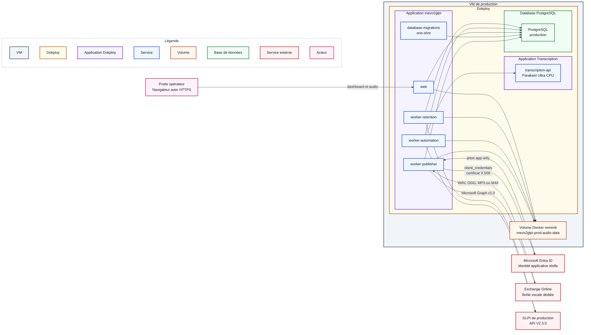

# Procédure de déploiement initial en production

## Objectif et périmètre

Cette procédure décrit l'installation initiale de mevo2glpi dans un
environnement Dokploy de production. Elle suppose que les mêmes
composants ont déjà été validés en staging sur le SHA destiné à la production.

La production utilise des services réels :

- une boîte Exchange Online exclusivement dédiée aux messages vocaux ;
- une application Microsoft Entra ID authentifiée par certificat ;
- Microsoft Graph v1.0 ;
- l'instance GLPI de production ;
- PostgreSQL créé comme une application Database dans Dokploy ;
- Parakeet comme provider nominal de transcription dans Dokploy ;
- un volume Docker persistant pour les audios.

Le worker consomme exclusivement le contrat de transcription
OpenAI-compatible. Aucun simulateur n'est déployé en production.

Cette procédure ne couvre pas la promotion d'une nouvelle version sur une
installation existante, la rotation des certificats ou une migration
destructive. Ces opérations relèveront de la
[procédure de mise à jour](mise-a-jour.md).

## Architecture cible

Le pipeline est identique à celui qualifié en staging, mais Microsoft Entra ID,
Exchange Online et GLPI sont les services réels de production :



Deux applications Docker Compose Dokploy sont déployées séparément :

1. **Transcription**, avec le service Parakeet ;
2. **mevo2glpi**, avec le web, la migration one-shot et les trois workers.

PostgreSQL est créé séparément comme une application **Database** dans
Dokploy. Le volume audio appartient au projet mevo2glpi et reste partagé par les
services qui en ont besoin.

Le rôle de Microsoft Entra ID est d'authentifier l'application. L'autorisation
d'accéder à la seule boîte dédiée est portée par Exchange Online Application
RBAC.

## Prérequis

### Système et dimensionnement

Le système de référence qualifié est **Ubuntu Server 24.04 LTS**. La procédure
peut fonctionner sur une autre distribution Linux prise en charge par Dokploy,
mais cette variante doit être qualifiée séparément.

Le profil de référence exécute Parakeet et PostgreSQL sur la même VM. Prévoir au
minimum :

- 4 vCPU ;
- 12 Gio de RAM ;
- 50 Gio d'espace disque.

Ce dimensionnement constitue un minimum de départ, pas une garantie de capacité.
Surveiller l'espace disque, la mémoire, la charge CPU et la durée des
transcriptions dès la mise en service.

### GLPI de production

La version actuellement qualifiée est **GLPI 11.0.7** avec l'API explicitement
épinglée **V2.3.0**. Disposer :

- d'une URL directe ne passant pas par un portail SSO interactif ;
- de l'API V2 activée ;
- d'un utilisateur technique réservé à l'application ;
- d'un client OAuth Password avec le scope `api` ;
- des droits minimaux pour créer et consulter les tickets attendus ;
- d'une source de demande `MEVO` et de son identifiant local ;
- du fuseau `Europe/Paris` pour le compte ou le fuseau global hérité.

Références :

- [API REST V2 de GLPI](https://help.glpi-project.org/documentation/modules/configuration/general/api/restful-api-v2) ;
- [clients OAuth GLPI](https://help.glpi-project.org/documentation/modules/configuration/oauth-clients).

La documentation OpenAPI doit répondre sur :

```text
https://NOM_GLPI_PRODUCTION/api.php/v2.3.0/doc.json
```

### Microsoft Entra ID et Exchange Online

Disposer des droits administratifs nécessaires pour :

- créer une App Registration Entra ID single-tenant dédiée au publisher ;
- charger un certificat public X.509 sur cette application ;
- référencer son Enterprise Application dans Exchange Online ;
- créer un scope limité à la boîte dédiée ;
- attribuer le rôle `Application Mail.ReadWrite` à ce scope ;
- tester l'autorisation sur une boîte incluse et une boîte exclue.

La boîte Exchange Online doit être exclusivement consacrée à ce flux. Avant le
premier démarrage, son Inbox doit contenir uniquement les messages que
l'application est autorisée à traiter. Le publisher consomme tout le backlog
présent, du message le plus ancien au plus récent.

Les dossiers `Processed` et `Rejected` sont créés automatiquement et de manière
idempotente par le publisher. Ils ne doivent pas être créés manuellement.

Références officielles :

- [authentification applicative Microsoft Graph](https://learn.microsoft.com/en-us/graph/auth-v2-service) ;
- [Exchange Online RBAC for Applications](https://learn.microsoft.com/en-us/exchange/permissions-exo/application-rbac) ;
- [ajout d'un certificat à une application Entra](https://learn.microsoft.com/en-us/entra/identity-platform/how-to-add-credentials) ;
- [déplacement d'un message avec Microsoft Graph](https://learn.microsoft.com/en-us/graph/api/message-move?view=graph-rest-1.0).

### Git et Dokploy

Disposer :

- de l'URL du dépôt public ou, si l'intégration GitHub de Dokploy est retenue,
  du droit d'installer une GitHub App limitée à `mevo2glpi` ;
- d'un tag annoté immuable `vX.Y.Z` créé sur le SHA validé en staging ;
- du SHA Git complet correspondant ;
- de secrets, réseaux et volumes propres à la production.

L'auto-déploiement doit rester désactivé. Une mise en production est une action
manuelle et contrôlée.

### DNS, réseau et accès

Les noms symboliques doivent être remplacés par les valeurs validées par
l'administrateur réseau. Les conteneurs utilisent la résolution DNS et la
sortie réseau de la VM ; leurs flux peuvent donc apparaître avec l'adresse
source de celle-ci.

#### Matrice DNS

| Nom | Cible attendue | Résolution requise depuis | Action |
| --- | --- | --- | --- |
| `NOM_VM_PRODUCTION` | adresse IP de la VM | postes opérateurs et administrateurs | créer un enregistrement interne `A` et, si utilisé, `AAAA` |
| `NOM_GLPI_PRODUCTION` | adresse IP du GLPI | VM de production | rendre le nom résolvable par le DNS utilisé par Docker |
| `login.microsoftonline.com` | adresses publiées par Microsoft | VM de production | autoriser la résolution pour l'obtention du jeton Entra |
| `graph.microsoft.com` | adresses publiées par Microsoft | VM de production | autoriser la résolution pour Microsoft Graph |
| `github.com`, et `api.github.com` si une GitHub App est utilisée | adresses publiées par GitHub | VM de production | autoriser la résolution nécessaire pour récupérer le dépôt public et, le cas échéant, utiliser l'intégration GitHub |
| `auth.docker.io`, `registry-1.docker.io`, `production.cloudfront.docker.com`, `ghcr.io`, `pkg-containers.githubusercontent.com` | adresses publiées par Docker Hub et GHCR | VM de production | autoriser la résolution pour télécharger les images de base |
| suffixes `huggingface.co` et `hf.co`, avec leurs sous-domaines | adresses publiées par Hugging Face | VM de production | autoriser la résolution pour télécharger le modèle Parakeet épinglé |

#### Matrice des flux à autoriser au pare-feu

| Source | Destination | Protocole | Port destination | Action | Usage |
| --- | --- | --- | ---: | --- | --- |
| réseau des opérateurs | `NOM_VM_PRODUCTION` / Traefik | TCP | 443 | autoriser | consulter le dashboard et télécharger les audios autorisés |
| réseau des opérateurs | `NOM_VM_PRODUCTION` / Traefik | TCP | 80 | autoriser uniquement pour une redirection vers HTTPS ; sinon refuser | redirection sans contenu applicatif en clair |
| réseau d'administration ou bastion | VM de production | TCP | 22 | autoriser de manière restreinte | administration SSH par clé |
| réseau d'administration | VM de production / Dokploy | TCP | 3000 | autoriser de manière restreinte | administration de Dokploy en HTTPS |
| VM de production | DNS de l'établissement | UDP et TCP | 53 | autoriser | résolution DNS de la VM et des conteneurs |
| VM de production, service de synchronisation système | serveur NTP de l'établissement | UDP | 123 | autoriser si nécessaire | maintenir l'horloge système |
| VM de production | domaines GitHub, registres et Hugging Face listés ci-dessus | TCP | 443 | autoriser en sortie | construire et déployer les applications |
| VM de production | `login.microsoftonline.com` | TCP | 443 | autoriser en sortie | obtenir le jeton applicatif Entra |
| VM de production | `graph.microsoft.com` | TCP | 443 | autoriser en sortie | lire et déplacer les messages Exchange |
| VM de production | `NOM_GLPI_PRODUCTION` | TCP | 443 | autoriser en sortie | créer et consulter les tickets GLPI |

La politique cible est de refuser tout autre flux. PostgreSQL, les workers et
le moteur de transcription ne doivent jamais être publiés directement sur
l'hôte ni exposés par Traefik.

## Préparation de la VM

### Installer et sécuriser Dokploy

L'installation de référence utilise la version autohébergée Docker de Dokploy.
La version qualifiée est **Dokploy v0.30.10**.

```bash
curl --fail --show-error --location https://github.com/Dokploy/dokploy/releases/download/v0.30.10/install.sh | sudo sh
```

Le script installe Docker si nécessaire, initialise Docker Swarm et déploie
Dokploy. Les ports `80`, `443` et `3000` doivent être disponibles. Ne pas
utiliser le script générique visant automatiquement la dernière version.

Après installation :

- appliquer les mises à jour de sécurité du système ;
- vérifier Docker et Docker Compose ;
- configurer le fuseau `Europe/Paris` et NTP ;
- protéger l'accès Dokploy par HTTPS ;
- limiter SSH et Dokploy aux réseaux d'administration ;
- surveiller le disque, la mémoire, le CPU et l'expiration des certificats.

### Installer la confiance envers les services HTTPS internes

Installer uniquement les autorités nécessaires à la validation des certificats
du serveur GLPI et du fournisseur OIDC lorsque celui-ci utilise la PKI interne.
Le même bundle est monté dans le web pour la découverte OIDC et dans les
workers pour GLPI. Le bundle système doit conserver les autorités publiques
requises pour Microsoft, GitHub, les registres et Hugging Face.

```bash
sudo install -m 0644 /chemin/ca-interne.pem /usr/local/share/ca-certificates/mevo2glpi-internal-ca.crt
sudo update-ca-certificates
```

Le chemin fourni à Dokploy sera :

```dotenv
CA_BUNDLE_HOST_PATH=/etc/ssl/certs/ca-certificates.crt
```

Valider GLPI sans désactiver TLS :

```bash
openssl s_client -connect NOM_GLPI_PRODUCTION:443 -servername NOM_GLPI_PRODUCTION -CAfile /etc/ssl/certs/ca-certificates.crt -verify_return_error </dev/null
curl --fail --silent --show-error https://NOM_GLPI_PRODUCTION/api.php/v2.3.0/doc.json >/dev/null
```

Le résultat OpenSSL attendu est `Verify return code: 0 (ok)`.

### Préparer le certificat HTTPS du dashboard

Demander à l'administrateur système :

- un nom DNS interne pointant vers la VM ;
- un certificat serveur couvrant exactement ce nom dans son SAN ;
- la chaîne complète et la clé privée correspondante ;
- le responsable et la date de renouvellement.

Importer le certificat dans l'interface **Certificates** de Dokploy et le
sélectionner pour le domaine du web. Sa clé privée reste dans Dokploy/Traefik et
ne doit jamais être montée dans les applications.

### Installer les fichiers PEM Entra du publisher

La clé privée et le certificat public X.509 doivent être deux fichiers PEM
distincts. Seul le certificat public est chargé dans Entra ID ; la clé privée
reste sur la VM.

Créer un répertoire non accessible aux utilisateurs ordinaires, puis installer
les fichiers fournis par le responsable de l'application Entra :

```bash
sudo install -d -o root -g 10001 -m 0750 /etc/mevo2glpi/secrets
sudo install -o root -g 10001 -m 0640 /chemin/publisher-private-key.pem /etc/mevo2glpi/secrets/publisher-private-key.pem
sudo install -o root -g 10001 -m 0640 /chemin/publisher-certificate.pem /etc/mevo2glpi/secrets/publisher-certificate.pem
```

Vérifier les métadonnées et la validité sans afficher les clés :

```bash
sudo stat -c '%n uid=%u gid=%g mode=%a' /etc/mevo2glpi/secrets/publisher-private-key.pem /etc/mevo2glpi/secrets/publisher-certificate.pem
sudo openssl pkey -in /etc/mevo2glpi/secrets/publisher-private-key.pem -check -noout
sudo openssl x509 -in /etc/mevo2glpi/secrets/publisher-certificate.pem -noout -subject -issuer -dates -fingerprint -sha256
sudo openssl pkey -in /etc/mevo2glpi/secrets/publisher-private-key.pem -pubout -outform DER | sha256sum
sudo openssl x509 -in /etc/mevo2glpi/secrets/publisher-certificate.pem -pubkey -noout | openssl pkey -pubin -outform DER | sha256sum
```

Le certificat doit contenir `BEGIN CERTIFICATE`, et non uniquement
`BEGIN PUBLIC KEY`. Les deux dernières commandes doivent produire le même
SHA-256, ce qui confirme que le certificat correspond à la clé privée.
Consigner l'empreinte du certificat, son expiration et son responsable, sans
enregistrer la clé privée ni sa passphrase.

### Créer la clé de protection du numéro d'origine

Créer une clé dédiée, distincte des clés Entra et des autres secrets :

```bash
sudo sh -c 'umask 027; openssl rand -base64 32 > /etc/mevo2glpi/secrets/originating-phone-number.key'
sudo chown root:10001 /etc/mevo2glpi/secrets/originating-phone-number.key
sudo chmod 0640 /etc/mevo2glpi/secrets/originating-phone-number.key
sudo stat -c '%n uid=%u gid=%g mode=%a' /etc/mevo2glpi/secrets/originating-phone-number.key
```

Ne jamais afficher ni committer son contenu. Publisher et automation montent
le même fichier en lecture seule. Conserver cette clé pendant les mises à jour
et les restaurations tant qu'un job est en cours ; sa perte rendrait sa
métadonnée d'origine indéchiffrable.

### Créer les réseaux

Créer les réseaux partagés une seule fois, depuis Dokploy ou sur la VM :

```bash
sudo docker network create --driver bridge mevo2glpi-prod-database-network
sudo docker network create --driver bridge --internal mevo2glpi-prod-transcription-network
```

`dokploy-network` est créé et géré par Dokploy. Le réseau database est partagé
entre PostgreSQL et les services applicatifs concernés, sans port PostgreSQL
publié. Le réseau transcription reste interne à Docker.

## Configurer Microsoft Entra ID et Exchange Online

### Créer l'identité applicative

Créer une App Registration **single-tenant** réservée au publisher. Relever :

- le Tenant ID ;
- l'Application (client) ID ;
- l'Object ID de l'Enterprise Application, aussi appelé service principal ;
- l'Object ID Entra de l'utilisateur représentant la boîte dédiée.

Charger le certificat public X.509 dans **App registrations > Certificates &
secrets > Certificates**. Ne jamais charger ni transmettre la clé privée.

Ne pas accorder en parallèle une permission applicative Microsoft Graph
`Mail.ReadWrite` à l'échelle du tenant. Les permissions Entra et Exchange RBAC
sont additives : une permission Entra non bornée annulerait le cloisonnement à
la boîte.

### Limiter l'application à la boîte dédiée

La méthode de référence est **Exchange Online RBAC for Applications**, qui
remplace les anciennes Application Access Policies pour une nouvelle
configuration.

L'exemple ci-dessous utilise `CustomAttribute15`. L'administrateur Exchange doit
d'abord confirmer que cet attribut est libre et approuver sa valeur. Sinon, il
doit choisir un autre attribut ou un autre scope supporté.

Depuis un poste d'administration approuvé disposant du module
`ExchangeOnlineManagement`, contrôler d'abord que l'attribut retenu n'est ni
déjà utilisé par la boîte, ni porté par une autre boîte :

```powershell
Connect-ExchangeOnline

Get-Mailbox -Identity "BOITE_DEDIEE_UPN" |
  Format-List PrimarySmtpAddress,CustomAttribute15

Get-Recipient `
  -RecipientPreviewFilter "CustomAttribute15 -eq 'MEVO2GLPI-PUBLISHER'"
```

Après validation de ces contrôles par l'administrateur Exchange, appliquer la
configuration :

```powershell

Set-Mailbox -Identity "BOITE_DEDIEE_UPN" -CustomAttribute15 "MEVO2GLPI-PUBLISHER"

New-ManagementScope `
  -Name "mevo2glpi Publisher Mailbox" `
  -RecipientRestrictionFilter "CustomAttribute15 -eq 'MEVO2GLPI-PUBLISHER'"

New-ServicePrincipal `
  -AppId "APPLICATION_CLIENT_ID" `
  -ObjectId "ENTERPRISE_APPLICATION_OBJECT_ID" `
  -DisplayName "mevo2glpi Publisher"

New-ManagementRoleAssignment `
  -Name "mevo2glpi Publisher Mail.ReadWrite" `
  -Role "Application Mail.ReadWrite" `
  -App "ENTERPRISE_APPLICATION_OBJECT_ID" `
  -CustomResourceScope "mevo2glpi Publisher Mailbox"
```

Pour `New-ServicePrincipal`, utiliser l'Object ID de l'**Enterprise
Application**, pas l'Object ID affiché sur la page App Registration.

Avant de créer les objets, vérifier qu'un scope, un service principal ou une
affectation portant ces noms n'existe pas déjà. Ne pas dupliquer aveuglément la
configuration lors d'une reprise de procédure.

Répéter ensuite `Get-Recipient -RecipientPreviewFilter` et vérifier que le
filtre sélectionne exactement la boîte dédiée. Dans un environnement hybride,
l'attribut peut être maîtrisé par l'annuaire source ; l'administrateur doit
alors effectuer la modification au bon endroit ou choisir un autre scope.

Tester ensuite les deux sens du cloisonnement :

```powershell
Test-ServicePrincipalAuthorization `
  -Identity "ENTERPRISE_APPLICATION_OBJECT_ID" `
  -Resource "BOITE_DEDIEE_UPN"

Test-ServicePrincipalAuthorization `
  -Identity "ENTERPRISE_APPLICATION_OBJECT_ID" `
  -Resource "BOITE_HORS_PERIMETRE_UPN"
```

Le rôle `Application Mail.ReadWrite` doit retourner `InScope=True` uniquement
pour la boîte dédiée et `InScope=False` pour la boîte de contrôle. La commande
de test ne tient pas compte d'éventuelles permissions organisationnelles
accordées directement dans Entra : celles-ci doivent être contrôlées et
retirées séparément.

Une modification d'autorisation peut nécessiter de 30 minutes à 2 heures avant
d'être reflétée par les appels réels, même si la commande de test est déjà
positive.

## Porte de validation 1 — Socle et dépendances

Ne pas créer les projets applicatifs tant que les contrôles suivants ne sont
pas validés :

- [ ] la VM respecte le dimensionnement retenu ;
- [ ] Ubuntu, Docker, Docker Compose et Dokploy sont opérationnels ;
- [ ] la date, le fuseau et NTP sont corrects ;
- [ ] les noms du dashboard et de GLPI sont résolus ;
- [ ] la chaîne TLS de GLPI est valide ;
- [ ] l'API GLPI V2.3.0 délivre un token OAuth sans exposer celui-ci ;
- [ ] les réseaux database et transcription existent ;
- [ ] le certificat Entra public chargé correspond à la clé privée conservée
      sur la VM et n'est pas expiré ;
- [ ] les deux fichiers PEM sont lisibles par le GID `10001` ;
- [ ] l'autorisation Exchange est `InScope=True` sur la boîte dédiée et
      `InScope=False` sur une boîte hors périmètre ;
- [ ] le scope Exchange sélectionne exactement la boîte dédiée ;
- [ ] aucune permission Entra `Mail.ReadWrite` tenant-wide ne contourne ce
      scope ;
- [ ] le contenu initial de l'Inbox a été contrôlé et son traitement approuvé ;
- [ ] les flux réseau respectent la matrice du pare-feu ;
- [ ] le certificat HTTPS du dashboard est valide et non expiré.

Consigner la date, l'opérateur, les versions, les empreintes publiques et le
résultat des contrôles sans enregistrer de secret.

## Configuration de GitHub et Dokploy

### Raccorder le dépôt GitHub

Le dépôt `mevo2glpi` est public. Dokploy peut le récupérer directement depuis
son URL sans secret GitHub. Une GitHub App reste optionnelle si l'intégration
Dokploy associée est souhaitée ; dans ce cas, la limiter à ce seul dépôt.

Vérifier que Dokploy peut récupérer le tag retenu et son SHA sans placer de
Personal Access Token dans le Compose ou l'environnement.

### Créer le service PostgreSQL

Créer PostgreSQL comme une application **Database** dans Dokploy, puis
rattacher son service à `mevo2glpi-prod-database-network`. Aucun domaine ni
port public ne doit lui être associé.

Reporter les paramètres de connexion internes fournis par Dokploy dans
`DATABASE_URL`. Le hostname dépend du nom interne réellement attribué au
service ; ne pas supposer qu'il s'agit de `localhost`.

### Créer les deux projets Compose

Créer les projets dans cet ordre :

| Ordre | Projet | Fichier Compose | Modèle d'environnement |
| ---: | --- | --- | --- |
| 1 | Transcription | `infra/docker/transcription/docker-compose.transcription.yml` | `infra/docker/transcription/production.env.example` |
| 2 | Applications | `infra/docker/apps/docker-compose.prod.yml` | `infra/docker/apps/.env.example` |

Pour les deux projets :

- sélectionner le même dépôt et le même tag immuable `vX.Y.Z` ;
- relever le SHA complet du tag et l'utiliser dans `APP_COMMIT_SHA` ;
- conserver l'auto-déploiement désactivé ;
- désactiver toute exposition publique non demandée ;
- déployer manuellement la transcription avant les applications.

`APP_COMMIT_SHA` fournit une identité affichée par l'application, mais ne
verrouille pas à lui seul le checkout Git. Vérifier dans Dokploy que le tag et
le SHA réellement extraits correspondent avant chaque build.

### Renseigner l'environnement de transcription

Reprendre le modèle de transcription et adapter au minimum :

```dotenv
COMPOSE_PROJECT_NAME=mevo2glpi-prod-transcription
APP_RELEASE=vX.Y.Z
APP_COMMIT_SHA=SHA_COMPLET_DU_TAG
TRANSCRIPTION_NETWORK_NAME=mevo2glpi-prod-transcription-network
TRANSCRIPTION_NETWORK_ALIAS=mevo2glpi-prod-transcription
TRANSCRIPTION_API_KEY=SECRET_PROPRE_A_LA_PRODUCTION
```

Conserver l'URL immuable du modèle et son SHA-256. Utiliser les limites CPU et
mémoire qualifiées en staging.

### Renseigner l'environnement applicatif

Copier le contenu de `infra/docker/apps/.env.example` dans l'onglet
**Environment** du projet Applications et remplacer tous les placeholders.
Le worker accepte uniquement le contrat synchrone OpenAI-compatible. Parakeet
est l'implémentation nominale de cette procédure ; un autre serveur compatible
doit être qualifié séparément. Contrôler notamment :

- `APP_ENVIRONMENT=production` ;
- `APP_RELEASE=vX.Y.Z` et `APP_COMMIT_SHA` contient le SHA complet du tag ;
- `DATABASE_NETWORK_NAME=mevo2glpi-prod-database-network` ;
- `TRANSCRIPTION_NETWORK_NAME=mevo2glpi-prod-transcription-network` ;
- `AUDIO_VOLUME_NAME=mevo2glpi-prod-audio-data` ;
- `DATABASE_URL` cible exclusivement la Database de production ;
- `CA_BUNDLE_HOST_PATH=/etc/ssl/certs/ca-certificates.crt` ;
- `PUBLIC_BASE_URL` contient le domaine HTTPS interne du dashboard ;
- `WEB_AUTH_MODE=oidc` pour déléguer l'authentification au fournisseur de
  l'établissement ;
- `WEB_AUTH_SESSION_SECRET` contient un secret aléatoire propre à la
  production, d'au moins 32 caractères ;
- `WEB_AUTH_COOKIE_SECURE=true` ;
- `WEB_AUTH_ISSUER_URL`, `WEB_AUTH_CLIENT_ID`,
  `WEB_AUTH_CLIENT_SECRET` et `WEB_AUTH_REDIRECT_URI` correspondent au client
  OIDC confidentiel de production ;
- `WEB_AUTH_REDIRECT_URI` cible exactement le domaine HTTPS du web suivi de
  `/auth/oidc/callback` ;
- `WEB_AUTH_REQUIRED_ROLE` et `WEB_AUTH_ROLES_CLAIM` correspondent au rôle et
  à la claim plate configurés chez le fournisseur ;
- `TRANSCRIPTION_PROVIDER=openai_compatible` ;
- `OPENAI_COMPATIBLE_TRANSCRIPTION_BASE_URL=http://mevo2glpi-prod-transcription:5092/v1` ;
- `OPENAI_COMPATIBLE_TRANSCRIPTION_API_KEY` est identique à
  `TRANSCRIPTION_API_KEY` dans le projet Transcription ;
- `OPENAI_COMPATIBLE_TRANSCRIPTION_MODEL=parakeet-ultra` ;
- `OPENAI_COMPATIBLE_TRANSCRIPTION_LANGUAGE=fr` ;
- `TRANSCRIPTION_HTTP_TIMEOUT_SECONDS=180` pour l'inférence CPU ;
- `FAILED_RETENTION_DAYS=10` pour la rétention absolue des jobs en échec ;
- `REJECTED_INGESTION_RETENTION_DAYS=90` ;
- `RETENTION_CHECK_INTERVAL_HOURS=6` cadence les contrôles GLPI et les scans
  des rejets. La purge traite au plus 100 ingestions par transaction ;
- `PUBLISHER_ENTRA_TENANT_ID` contient le Tenant ID ;
- `PUBLISHER_ENTRA_CLIENT_ID` contient l'Application (client) ID ;
- `PUBLISHER_MAILBOX_ID` contient l'Object ID Entra de l'utilisateur de la
  boîte, pas son Exchange GUID ;
- les deux chemins hôte PEM pointent vers `/etc/mevo2glpi/secrets` ;
- `GLPI_BASE_URL` et les identifiants ciblent exclusivement la production ;
- `GLPI_TICKET_REQUEST_SOURCE_ID` correspond à la source `MEVO` de cette
  instance.

Le Compose impose `PUBLISHER_GRAPH_AUTH_MODE=entra_certificate` et
`PUBLISHER_GRAPH_BASE_URL=https://graph.microsoft.com/v1.0`. La passphrase de
la clé privée reste vide uniquement si la clé n'est pas chiffrée.

Lorsqu'un établissement ne dispose pas encore de fournisseur OIDC, il peut
choisir `WEB_AUTH_MODE=local`, laisser toutes les variables OIDC absentes et
créer les comptes opérateurs avec `mevo2glpi-web-users`. Ce choix doit être
arrêté avant le déploiement : aucune bascule automatique ou combinaison des
deux modes n'existe. Le mode OIDC reste recommandé lorsqu'un fournisseur
d'identité administré est disponible.

Ne jamais créer ou committer un fichier `.env` réel. Les valeurs doivent être
enregistrées directement dans le gestionnaire d'environnement Dokploy.

La politique doit être validée en staging avant son déploiement. En production,
la purge supprime automatiquement les événements et l'ingestion PostgreSQL
après expiration, mais ne supprime pas le message du dossier Exchange
`Rejected`.

### Configurer le domaine du web

Dans le projet Applications, associer uniquement le service `web` :

- au nom DNS interne de production ;
- au port interne `8000` ;
- au chemin `/` ;
- à HTTPS avec le certificat importé dans Dokploy.

Ne publier directement aucun port du web, des workers, de PostgreSQL ou du
moteur de transcription. Le domaine doit passer par Traefik et
`dokploy-network`.

## Déploiement et validations techniques

### 1. Déployer la transcription

Déployer le projet Transcription et attendre que `transcription-api` soit
`healthy`. Le service ne reçoit ni domaine Dokploy ni publication Traefik.

Depuis son terminal :

```bash
python -c 'import urllib.request; print(urllib.request.urlopen("http://127.0.0.1:5092/health/ready", timeout=5).read().decode())'
```

Ne pas poursuivre tant que le modèle n'est pas chargé.

### 2. Déployer les applications

Confirmer une dernière fois que le backlog Inbox est autorisé au traitement,
puis déployer le projet Applications. Le publisher peut commencer à consommer
la boîte dès son démarrage.

Vérifier dans cet ordre :

1. `database-migrations` termine avec le code `0` ;
2. `web`, `worker-publisher`, `worker-automation` et `worker-retention`
   démarrent ;
3. le dashboard affiche les trois heartbeats ;
4. un opérateur possédant le rôle requis peut ouvrir le dashboard et un compte
   sans ce rôle reçoit `403` ;
5. l'environnement, le tag et le SHA correspondent au déploiement ;
6. le publisher obtient un jeton et accède à la boîte sans erreur `401` ou
   `403` ;
7. automation et retention joignent GLPI sans erreur TLS ;
8. aucun journal ne contient de secret, de jeton, d'identifiant de connexion,
   d'identifiant de message, d'audio, de transcription ou de réponse HTTP
   brute.

Le healthcheck du publisher valide PostgreSQL, le volume et son heartbeat, mais
pas l'accès Entra/Graph. La vérification des journaux et la recette fonctionnelle
sont donc obligatoires pour qualifier cette frontière.

## Porte de validation 2 — Déploiement

La recette fonctionnelle peut commencer uniquement lorsque :

- [ ] la transcription est `healthy` ;
- [ ] la migration est terminée avec le code `0` ;
- [ ] le web et les trois workers sont en cours d'exécution ;
- [ ] les trois heartbeats sont frais ;
- [ ] PostgreSQL ne possède ni domaine ni port public ;
- [ ] `production`, le tag et le SHA attendus sont affichés ;
- [ ] seul le web est accessible via Traefik ;
- [ ] le certificat HTTPS est accepté depuis un poste opérateur ;
- [ ] le parcours OIDC autorise le rôle attendu et refuse un compte sans ce
      rôle ;
- [ ] GLPI est joignable avec vérification TLS ;
- [ ] le publisher accède à la seule boîte autorisée sans erreur Entra/Graph ;
- [ ] aucun traitement antérieur inattendu n'a été déclenché.

## Recette fonctionnelle

La recette utilise les services réels, mais uniquement des données fictives et
non sensibles. Prévenir les opérateurs GLPI afin que le ticket de recette soit
identifiable et traité comme tel.

1. envoyer dans la boîte dédiée un message contenant exactement un WAV, OGG,
   MP3 ou M4A fictif ne dépassant pas 25 Mio ;
2. vérifier que le publisher découvre le message et crée un job `pending` ;
3. vérifier le déplacement du message dans `Processed` ;
4. suivre les transitions `pending`, `processing`, puis `completed` ;
5. vérifier la transcription sans journaliser son contenu ;
6. vérifier la création d'un unique ticket dans GLPI ;
7. vérifier la correspondance entre l'UUID du job et `external_id` ;
8. vérifier l'identifiant GLPI et les événements expurgés dans le dashboard ;
9. télécharger l'audio fictif via HTTPS depuis un poste autorisé ;
10. clôturer le ticket de recette selon la procédure fonctionnelle retenue.

Ne jamais utiliser une donnée patient, un enregistrement réel ou une boîte
utilisateur pour cette recette.

## Diagnostic

Identifier d'abord la frontière défaillante :

1. authentification par certificat auprès de Microsoft Entra ID ;
2. autorisation Exchange RBAC et accès Graph à la boîte ;
3. persistance PostgreSQL et publication sur le volume audio ;
4. transcription par le provider OpenAI-compatible ;
5. création ou consultation GLPI ;
6. rétention ;
7. dashboard, Traefik et certificat opérateur.

Interprétations principales :

- `401` Entra/Graph : vérifier tenant, client ID, certificat, clé associée,
  passphrase et expiration ;
- `403` Graph : vérifier le rôle Exchange, son scope, le mailbox Object ID et
  l'absence de délai de propagation ;
- erreur TLS : vérifier le nom DNS et la chaîne de confiance sans désactiver la
  validation ;
- heartbeat publisher dégradé : vérifier les événements expurgés et l'état
  courant avant tout redémarrage ;
- absence de nouveau message : contrôler l'Inbox, le scope RBAC et la
  pagination avant de modifier PostgreSQL.

Les logs ne doivent fournir que les UUID applicatifs, étapes, catégories et
codes techniques expurgés. Ne pas publier `docker compose config`, qui peut
résoudre des valeurs sensibles. Ne jamais lancer de nettoyage Docker global
pour diagnostiquer la production.

## Limites et points de vigilance

- le dashboard reste limité au réseau interne même avec l'authentification
  applicative ;
- le healthcheck publisher ne teste pas Entra ID ou Microsoft Graph ;
- toute l'Inbox existante est éligible au premier démarrage ;
- les changements Exchange RBAC peuvent demander jusqu'à deux heures de
  propagation ;
- les sauvegardes PostgreSQL et audio ne sont pas automatisées par le dépôt :
  elles doivent être configurées et qualifiées au niveau de l'hyperviseur ;
- sans point de reprise externe testé, une perte de la VM, de la Database ou du
  volume peut être irréversible ;
- un rollback applicatif ne rétrograde pas automatiquement PostgreSQL et
  n'annule ni un déplacement Exchange ni un ticket déjà créé dans GLPI.

## Échec initial et retour arrière

En cas d'échec :

1. arrêter immédiatement les trois workers pour figer les nouvelles mutations ;
2. conserver les journaux expurgés nécessaires au diagnostic ;
3. ne supprimer ni la Database PostgreSQL ni le volume audio ;
4. vérifier si des messages ont été déplacés ou des tickets créés ;
5. corriger la configuration ou redéployer le même tag ;
6. ne jamais rétrograder Alembic sans procédure explicitement validée.

En l'absence d'un point de reprise de l'hyperviseur dont la restauration a été
qualifiée, cette procédure ne permet pas de restaurer un état antérieur de
PostgreSQL ou du volume audio. Un redéploiement applicatif ne répare pas
automatiquement les effets déjà produits dans Exchange ou GLPI. Les mises à
jour planifiées sont donc lancées uniquement après vidage des jobs `pending` et
`processing` selon la [procédure dédiée](mise-a-jour.md).

Dès qu'une première version est opérationnelle, toute nouvelle version doit
suivre la [procédure de mise à jour](mise-a-jour.md), notamment pour le point de
reprise et la politique de retour arrière.

## Résultat attendu

La production est valide lorsque :

- les deux portes de validation sont signées ;
- la transcription et les applications sont saines ;
- les migrations sont à jour ;
- les trois workers ont un heartbeat frais ;
- l'application Entra est limitée à la boîte dédiée ;
- un message fictif traverse Exchange, Parakeet et GLPI sans doublon ;
- le tag et le SHA validés en staging sont affichés ;
- seul le dashboard est exposé aux opérateurs autorisés ;
- aucun secret, jeton ou contenu sensible n'est présent dans les journaux.
