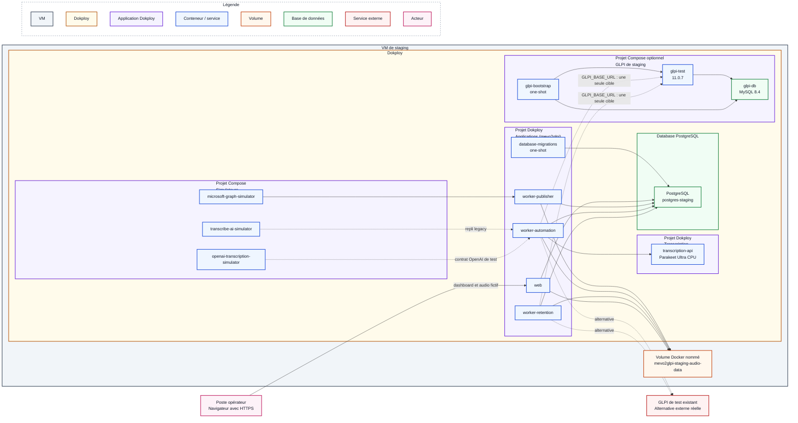

# Procédure de déploiement en staging

## Objectif et périmètre

Cette procédure décrit l'installation initiale et la recette de mevo2glpi dans
un environnement Dokploy de staging. Deux cibles GLPI sont possibles :

- une instance de test existante, accessible directement en HTTPS depuis la VM ;
- le Compose GLPI 11.0.7 autonome du dépôt, réservé au staging lorsque
  l'instance externe n'est pas disponible.

Une seule cible doit être configurée dans `GLPI_BASE_URL` pour une recette
donnée. Le GLPI conteneurisé ne remplace pas la qualification finale contre
l'instance de test représentative de celle utilisée par l'établissement.

Le staging n'utilise ni boîte Exchange de production, ni GLPI de production,
ni audio réel. Une mise à jour d'un environnement déjà installé suit la
[procédure de mise à jour](mise-a-jour.md).

## Architecture cible

Voici le schéma distinguant les services simulés / mocks des services réels
testés en staging :



Microsoft Graph, le contrat Transcribe AI historique et le contrat de
transcription OpenAI-compatible sont réunis dans un Compose de simulateurs. Le
simulateur Graph ne teste donc pas l'authentification Microsoft Entra ID. La
transcription Parakeet, les services mevo2glpi et PostgreSQL sont déployés dans
Dokploy. GLPI est soit l'instance de test externe, soit le projet Compose
autonome optionnel affiché dans le schéma.

Les déploiements Dokploy sont séparés :

1. **Simulateurs**, projet Compose avec Microsoft Graph, Transcribe AI et le
   contrat OpenAI-compatible ;
2. **Transcription**, projet Compose avec Parakeet ;
3. **Applications (mevo2glpi)**, projet Compose avec le web, la migration
   one-shot et les trois workers ;
4. **GLPI de staging**, projet Compose optionnel avec GLPI, MySQL et son
   bootstrap idempotent.

PostgreSQL reste déployé séparément comme une application **Database** dans
Dokploy. Il ne constitue pas un projet Docker Compose supplémentaire.

Les contrats techniques restent décrits dans les README des
[providers de test](../../infra/docker/providers/README.md), du
[GLPI conteneurisé](../../infra/docker/providers/glpi-test/README.md) et de la
[transcription](../../infra/docker/transcription/README.md).

## Prérequis

### Système et dimensionnement

Le système de référence qualifié pour ce projet est **Ubuntu Server 24.04
LTS**. Dokploy indique également prendre en charge plusieurs versions
d'Ubuntu, Debian, Fedora et CentOS, mais ces variantes ne sont pas qualifiées
par cette procédure. Consulter les
[prérequis officiels de Dokploy](https://docs.dokploy.com/docs/core/installation).

Prévoir au minimum :

- 4 vCPU ;
- 12 Gio de RAM ;
- 50 Gio d'espace disque.

### Cible GLPI de test

Le staging est qualifié avec **GLPI 11.0.7** et la version d'API explicitement
épinglée **V2.3.0**. Pour une instance existante, les prérequis GLPI sont :

- l'API V2 activée ;
- une URL directe ne passant pas par un portail SSO interactif ;
- un utilisateur technique exclusivement réservé au staging ;
- les droits minimaux permettant de créer et consulter les tickets attendus ;
- un client OAuth autorisant le grant Password et le scope `api` ;
- le client ID et le secret associés ;
- une source de demande `MEVO` et son identifiant propre à cette instance ;
- le fuseau `Europe/Paris` pour l'utilisateur ou le fuseau global hérité.

Références officielles :

- [API REST V2 de GLPI](https://help.glpi-project.org/documentation/modules/configuration/general/api/restful-api-v2) ;
- [création des clients OAuth GLPI](https://help.glpi-project.org/documentation/modules/configuration/oauth-clients).

La documentation OpenAPI de l'instance doit répondre sur :

```text
https://NOM_GLPI_TEST/api.php/v2.3.0/doc.json
```

Le Compose GLPI optionnel automatise l'installation, l'activation de l'API V2,
la création de l'utilisateur technique, du client OAuth Password et de la
source `MEVO`. Il exige néanmoins un domaine HTTPS de staging, des secrets
exclusivement synthétiques et deux volumes neufs ou explicitement identifiés
comme appartenant à cet environnement.

### DNS, réseau et accès

Les noms ci-dessous sont symboliques et doivent être remplacés par les valeurs
validées par l'administrateur réseau. Les conteneurs utilisent la résolution DNS
et la sortie réseau de la VM ; selon le pare-feu, leurs flux sortants peuvent
donc apparaître avec l'adresse source de la VM.

#### Matrice DNS

| Nom | Cible attendue | Résolution requise depuis | Action |
| --- | --- | --- | --- |
| `NOM_VM_STAGING` | adresse IP de la VM de staging | postes opérateurs et administrateurs | créer un enregistrement interne `A` et, si utilisé, `AAAA` |
| `NOM_GLPI_TEST` | adresse du GLPI externe, ou adresse de la VM lorsque le Compose optionnel est utilisé | VM de staging et postes chargés de la recette GLPI | rendre le nom résolvable par le DNS utilisé par Docker et les postes concernés |
| `github.com`, `api.github.com` | adresses publiées par GitHub | VM de staging | autoriser leur résolution pour récupérer le dépôt privé |
| `auth.docker.io`, `registry-1.docker.io`, `production.cloudfront.docker.com`, `ghcr.io`, `pkg-containers.githubusercontent.com` | adresses publiées par Docker Hub et GHCR | VM de staging | autoriser leur résolution pour télécharger les images de base |
| suffixes `huggingface.co` et `hf.co`, avec tous leurs sous-domaines | adresses publiées par Hugging Face | VM de staging | autoriser leur résolution pour télécharger le modèle Parakeet épinglé |

#### Matrice des flux à autoriser au pare-feu

| Source | Destination | Protocole | Port destination | Action | Usage |
| --- | --- | --- | ---: | --- | --- |
| réseau des opérateurs | `NOM_VM_STAGING` / Traefik | TCP | 443 | autoriser | consulter le dashboard et les audios fictifs en HTTPS |
| réseau des opérateurs | `NOM_VM_STAGING` / Traefik | TCP | 80 | autoriser uniquement si une redirection HTTP vers HTTPS est requise ; sinon refuser | redirection vers HTTPS, sans contenu applicatif en clair |
| réseau d'administration ou bastion | VM de staging | TCP | 22 | autoriser de manière restreinte | administration SSH par clé |
| réseau d'administration | VM de staging / Dokploy | TCP | 3000 | autoriser de manière restreinte | administration de Dokploy en HTTPS |
| VM de staging | DNS de l'établissement | UDP et TCP | 53 | autoriser | résolution des noms internes et externes par la VM et les conteneurs |
| VM de staging (service de synchronisation système) | serveur NTP de l'établissement | UDP | 123 | autoriser si nécessaire | maintenir l'horloge système de la VM |
| VM de staging | domaines externes listés dans la matrice DNS | TCP | 443 | autoriser en sortie | récupérer le dépôt, les images et le modèle Parakeet épinglé |
| VM de staging | `NOM_GLPI_TEST` | TCP | 443 | autoriser en sortie | appels à l'API GLPI V2 par les workers `automation` et `retention`, avec vérification TLS ; ce flux peut revenir vers Traefik sur la même VM avec le Compose optionnel |

La politique cible est de refuser tout autre flux. PostgreSQL, les workers, les
mocks et le moteur de transcription ne doivent jamais être publiés directement
sur l'hôte ni exposés par Traefik.

### GitHub et Dokploy

Disposer :

- du droit d'installer une GitHub App sur le dépôt privé ;
- d'une référence Git `main` ayant passé la CI ;
- du SHA Git complet correspondant ;
- de valeurs distinctes de la production pour les secrets, réseaux et volumes.

## Préparation de la VM

### Installer et sécuriser Dokploy

L'installation recommandée pour le staging est la version autohébergée Docker
de Dokploy, installée avec le script officiel fourni par le projet. La version
qualifiée par cette procédure est **Dokploy v0.30.10**.

Utiliser le script attaché à cette release afin d'installer exactement cette
version :

```bash
curl --fail --show-error --location https://github.com/Dokploy/dokploy/releases/download/v0.30.10/install.sh | sudo sh
```

Le script installe Docker s'il est absent, initialise Docker Swarm et déploie
Dokploy. Les ports `80`, `443` et `3000` doivent donc être disponibles avant son
exécution. Ne pas utiliser le script générique `dokploy.com/install.sh` pour une
installation reproductible : il cible automatiquement la dernière version
stable. Consulter la
[procédure officielle](https://docs.dokploy.com/docs/core/installation) et
consigner la version installée dans le compte rendu de recette.

Après installation :

- appliquer les mises à jour de sécurité du système ;
- vérifier que Docker et Docker Compose fonctionnent ;
- configurer le fuseau `Europe/Paris` ;
- activer une synchronisation NTP ;
- protéger l'accès administrateur Dokploy par HTTPS ;
- limiter les accès système et Dokploy aux personnes autorisées ;
- surveiller au minimum l'espace disque, la mémoire et l'expiration des
  certificats.

### Installer la confiance envers GLPI

Le bundle CA sert aux connexions HTTPS des conteneurs vers la cible GLPI. Avec
une instance externe, le trafic sort de la VM ; avec le Compose optionnel, il
rejoint le domaine GLPI publié par Traefik sur cette même VM. Ce bundle n'est
pas le certificat présenté aux opérateurs par le dashboard.

À partir d'une CA fournie par l'administrateur système :

```bash
sudo install -m 0644 /chemin/ca-interne.pem /usr/local/share/ca-certificates/mevo2glpi-internal-ca.crt
sudo update-ca-certificates
```

Le chemin utilisé dans l'environnement Dokploy sera alors :

```dotenv
CA_BUNDLE_HOST_PATH=/etc/ssl/certs/ca-certificates.crt
```

Le fichier doit être lisible par l'UID/GID non privilégié `10001`. Ne jamais
désactiver la vérification TLS pour contourner une chaîne incomplète.

Pour une instance existante, valider GLPI à cette étape. Pour le Compose
optionnel, effectuer les mêmes contrôles après son premier déploiement :

```bash
openssl s_client -connect NOM_GLPI_TEST:443 -servername NOM_GLPI_TEST -CAfile /etc/ssl/certs/ca-certificates.crt -verify_return_error </dev/null
```

Le résultat attendu est `Verify return code: 0 (ok)`.

Vérifier ensuite que la documentation de l'API épinglée est accessible :

```bash
curl --fail --silent --show-error https://NOM_GLPI_TEST/api.php/v2.3.0/doc.json >/dev/null
```

Avec une instance existante, obtenir une fois un token avec l'utilisateur et
le client OAuth de staging en suivant la documentation GLPI. Avec le Compose
optionnel, ce contrôle est effectué après son bootstrap. Ne pas afficher le
token, les identifiants ou la réponse complète dans le terminal partagé ou le
compte rendu.

### Préparer les certificats HTTPS entrants

Le certificat **entrant** protège l'accès des opérateurs au dashboard et aux
audios fictifs. Avec le Compose GLPI optionnel, un certificat couvre également
le domaine GLPI de staging. Ces certificats sont terminés par Traefik et ne sont
jamais montés dans les applications.

Demander à l'administrateur système :

- un nom DNS interne pointant vers la VM ;
- un certificat serveur couvrant exactement ce nom dans son SAN ;
- la chaîne complète du certificat ;
- la clé privée correspondante, transmise par un canal approuvé ;
- la CA racine ou intermédiaire déjà approuvée par les postes opérateur ;
- le responsable et la date de renouvellement.

Importer chaque certificat et sa clé dans l'interface **Certificates** de
Dokploy, puis sélectionner le certificat correspondant pour le domaine du web
et, s'il existe, celui du GLPI conteneurisé. Consulter la documentation Dokploy
sur les
[certificats](https://docs.dokploy.com/docs/core/certificates) et les
[domaines](https://docs.dokploy.com/docs/core/docker-compose/domains).

La clé privée reste dans le gestionnaire de certificats Dokploy/Traefik. Elle
ne doit jamais apparaître dans le dépôt, un fichier `.env`, un volume
applicatif ou les logs.

### Créer les réseaux et le répertoire de recette

Créer les réseaux partagés une seule fois. Cette opération peut être réalisée
directement depuis l'interface graphique de Dokploy ou en ligne de commande sur
la VM. Pour la variante en ligne de commande :

```bash
sudo docker network create --driver bridge --internal mevo2glpi-staging-simulators-network
sudo docker network create --driver bridge --internal mevo2glpi-staging-transcription-network
sudo docker network create --driver bridge mevo2glpi-staging-database-network
```

`dokploy-network` est créé et géré par Dokploy.

Les trois simulateurs et mevo2glpi sont des projets Compose exécutés sur la
même VM. Un réseau externe `bridge` et `internal` leur permet de communiquer
sans publier les simulateurs. Vérifier les réseaux avec :

```bash
sudo docker network inspect --format '{{.Name}} {{.Driver}} {{.Internal}}' mevo2glpi-staging-simulators-network mevo2glpi-staging-transcription-network mevo2glpi-staging-database-network
```

Les réseaux simulateurs et transcription doivent indiquer `bridge true`. Le
réseau de base de données doit indiquer `bridge false`, car la sortie réseau
des workers ne dépend pas de ce réseau.

Préparer le répertoire d'audios fictifs avant de déployer les simulateurs. Son
existence est obligatoire, même s'il reste vide. Le groupe `10001` correspond
au groupe non privilégié des conteneurs :

```bash
sudo install -d -o root -g 10001 -m 0750 /srv/mevo2glpi-staging/audio-fixtures
```

## Porte de validation 1 — Socle VM

Ne pas créer les projets applicatifs tant que les contrôles suivants ne sont
pas validés :

- [ ] la VM respecte le dimensionnement choisi ;
- [ ] Ubuntu, Docker, Docker Compose et Dokploy sont opérationnels ;
- [ ] la date, l'heure, le fuseau et NTP sont corrects ;
- [ ] les noms du dashboard et, si elle est déjà disponible, de la cible GLPI
      sont résolus correctement ;
- [ ] pour une cible GLPI existante, sa chaîne TLS est valide avec le bundle CA
      configuré ;
- [ ] pour une cible GLPI existante, l'API V2.3.0 répond et le grant OAuth
      Password délivre un token sans exposer celui-ci ;
- [ ] les trois réseaux `mevo2glpi-staging-*` existent, les réseaux des
      simulateurs et de la transcription sont `bridge`/`internal`, et aucun
      domaine ni port public n'expose PostgreSQL ;
- [ ] le répertoire de fixtures est lisible par le GID `10001` ;
- [ ] les certificats du dashboard et, s'il est prévu, du GLPI conteneurisé
      couvrent leur nom DNS et ne sont pas expirés ;
- [ ] les ports et flux réseau respectent les règles du pare-feu.

Consigner la date, l'opérateur, la version Dokploy et le résultat des contrôles
sans enregistrer de secret.

## Configuration de GitHub et Dokploy

### Créer la GitHub App

Dans Dokploy, ouvrir **Git**, choisir GitHub, puis utiliser **Create GitHub
App**. Installer l'application uniquement sur le dépôt `mevo2glpi`, et non sur
tous les dépôts de l'organisation.

Suivre la
[procédure GitHub officielle de Dokploy](https://docs.dokploy.com/docs/core/github).
La clé privée de la GitHub App reste gérée par Dokploy et ne doit jamais être
copiée dans un `.env` ou dans Git.

Vérifier que Dokploy peut :

1. lister le dépôt privé ;
2. lister la branche `main` ;
3. récupérer le SHA qui a passé la CI ;
4. reconstruire sans utiliser de jeton personnel dans le Compose.

La GitHub App doit être révoquée ou renouvelée si la VM est compromise ou si
elle n'est plus utilisée.

### Créer le service PostgreSQL de staging

Créer PostgreSQL comme une application **Database** dans Dokploy, puis
rattacher son service à `mevo2glpi-staging-database-network`. Aucun domaine ni
port public ne doit lui être associé.

La configuration se limite aux opérations suivantes :

1. créer l'application Database PostgreSQL dans Dokploy ;
2. la rattacher à `mevo2glpi-staging-database-network` ;
3. reporter les paramètres de connexion internes fournis par Dokploy dans
   `DATABASE_URL` ;
4. vérifier la connexion depuis `database-migrations` avant de lancer les
   services persistants.

Après le rattachement, valider depuis un conteneur jetable que l'alias utilisé
dans `DATABASE_URL` est résolu et que PostgreSQL écoute. Cette commande ne
transmet aucun identifiant :

```bash
sudo docker run --rm --network mevo2glpi-staging-database-network --read-only --cap-drop ALL --security-opt no-new-privileges:true python:3.12.14-slim-bookworm@sha256:0f5b26b9518d002b6173fd61daad821fa340635ebfec5bba471013f9ca114579 python -c 'import socket; connection = socket.create_connection(("NOM_INTERNE_POSTGRES_STAGING", 5432), timeout=5); connection.close(); print("PostgreSQL DNS/TCP OK")'
```

Remplacer `NOM_INTERNE_POSTGRES_STAGING` par le nom ou l'alias réellement
attribué par Dokploy, puis reporter cette même valeur dans `DATABASE_URL`. Ne
pas modifier les autres composants de l'URL.

### Créer les projets et applications

Créer les déploiements dans cet ordre :

| Ordre | Déploiement Dokploy | Type | Source de configuration |
| ---: | --- | --- | --- |
| 1 | GLPI de staging, si l'instance externe est indisponible | Docker Compose | `infra/docker/providers/glpi-test/docker-compose.staging.yml` et `staging.env.example` |
| 2 | Simulateurs | Docker Compose | `infra/docker/providers/docker-compose.staging.yml` et `staging.env.example` |
| 3 | Transcription | Docker Compose | `infra/docker/transcription/docker-compose.transcription.yml` et `staging.env.example` |
| 4 | Applications | Docker Compose | `infra/docker/apps/docker-compose.staging.yml` et `staging.env.example` |

Pour tous les déploiements provenant du dépôt :

- sélectionner le même dépôt et la branche `main` ;
- relever le SHA complet de `main` avant le premier déploiement et vérifier que
  Dokploy extrait cette même révision pour chaque déploiement ;
- désactiver toute exposition publique non demandée ;
- conserver l'auto-déploiement désactivé et déclencher manuellement les
  déploiements dans l'ordre du tableau ;
- limiter les watch paths au périmètre du projet.

Renseigner ce même SHA dans `APP_COMMIT_SHA` pour les projets **Transcription**
et **Applications (mevo2glpi)**. GLPI et les trois simulateurs ne consomment ni
`APP_RELEASE` ni `APP_COMMIT_SHA` : leur révision est contrôlée directement
dans Dokploy.

Avant chaque déploiement manuel, vérifier que `main` pointe toujours vers le
SHA relevé. `APP_COMMIT_SHA` assure la traçabilité affichée par l'application,
mais ne verrouille pas à lui seul la révision extraite par Dokploy. Ne pas
activer l'auto-déploiement : les promotions sont déclenchées manuellement selon
la [procédure de mise à jour](mise-a-jour.md).

Watch paths recommandés :

```text
# GLPI de staging optionnel
infra/docker/providers/glpi-test/**
.dockerignore

# Simulateurs Microsoft Graph, Transcribe AI et OpenAI-compatible
providers/simulators/**
infra/docker/providers/docker-compose.staging.yml
infra/docker/providers/staging.env.example
infra/docker/providers/microsoft-graph-simulator/**
infra/docker/providers/transcribe-ai-simulator/**
infra/docker/providers/openai-transcription-simulator/**
.dockerignore
pyproject.toml
uv.lock

# Transcription
apps/transcription-api/**
infra/docker/transcription/**
.dockerignore
pyproject.toml
uv.lock

# Applications
apps/database-migrations/**
apps/web/**
apps/worker-automation/**
apps/worker-publisher/**
apps/worker-retention/**
packages/**
infra/docker/apps/**
.dockerignore
pyproject.toml
uv.lock
```

Le projet Compose Simulateurs doit rejoindre
`mevo2glpi-staging-simulators-network`, sans domaine ni port publié, avec les
alias :

- `mevo2glpi-staging-microsoft-graph` pour Microsoft Graph ;
- `mevo2glpi-staging-transcribe-ai` pour Transcribe AI ;
- `mevo2glpi-staging-openai-transcription` pour le contrat
  OpenAI-compatible.

Après déploiement, vérifier que ce réseau privé est leur seul réseau métier et
qu'aucune règle Traefik ne les expose. Le réseau `dokploy-network` n'est pas
nécessaire à ces mocks.

Le Compose impose une seule réplique, les healthchecks, une politique de
redémarrage, l'utilisateur non privilégié, un système de fichiers en lecture
seule, la suppression des capabilities, `no-new-privileges`, une limite de PID,
un `tmpfs` borné et la rotation des logs.

Pour Microsoft Graph, ajouter également le bind mount en lecture seule :

```text
/srv/mevo2glpi-staging/audio-fixtures:/fixtures/audio:ro
```

### Configurer le GLPI de staging optionnel

Ignorer cette section lorsqu'une instance GLPI de test existante est
disponible. Sinon, créer le projet Compose GLPI avec deux volumes neufs et les
valeurs synthétiques du modèle `staging.env.example`. Les noms de l'utilisateur
et du client OAuth doivent conserver le préfixe `glpi-test-` exigé par le
bootstrap.

Dans Dokploy, associer un domaine HTTPS uniquement au service `glpi-test`, sur
son port interne `80`. `glpi-db` et `glpi-bootstrap` ne rejoignent jamais
Traefik et ne reçoivent aucun domaine ni port public.

Le déploiement est valide lorsque :

1. `glpi-db` est sain ;
2. `glpi-test` termine son auto-installation et devient sain ;
3. `glpi-bootstrap` s'arrête avec le code `0` après avoir activé l'API V2 et
   créé l'utilisateur, le client OAuth et la source `MEVO` ;
4. le domaine HTTPS répond sur `/api.php/v2.3.0/doc.json` ;
5. un second lancement de `glpi-bootstrap` termine également avec le code `0`.

Récupérer ensuite l'identifiant local de la source `MEVO` depuis le terminal de
`glpi-test`, sans afficher les autres identifiants :

```bash
php /opt/glpi-test/bootstrap_request_source.php
```

Reporter le champ JSON `id` dans `GLPI_TICKET_REQUEST_SOURCE_ID` et renseigner
le domaine HTTPS dans `GLPI_BASE_URL`. Les identifiants GLPI/OAuth doivent être
identiques dans le Compose GLPI et dans le projet Applications. Leur rotation
après le premier bootstrap nécessite une procédure explicite ; modifier
simplement les variables provoque volontairement un échec de réconciliation.

### Renseigner les environnements

Les fichiers `*.env.example` sont des contrats de configuration, pas des
fichiers à déployer. Copier leur contenu dans l'onglet **Environment** du
projet ou de l'application Dokploy correspondant, puis remplacer tous les
placeholders.

Créer une clé synthétique propre au staging :

```bash
sudo install -d -o root -g 10001 -m 0750 /etc/mevo2glpi/secrets
sudo sh -c 'umask 027; openssl rand -base64 32 > /etc/mevo2glpi/secrets/staging-originating-phone-number.key'
sudo chown root:10001 /etc/mevo2glpi/secrets/staging-originating-phone-number.key
sudo chmod 0640 /etc/mevo2glpi/secrets/staging-originating-phone-number.key
```

Cette clé est commune uniquement aux services publisher et automation du
staging. Elle ne doit jamais reprendre la valeur de production.

Contrôler les invariants suivants :

- `APP_ENVIRONMENT=staging` ;
- `APP_RELEASE=main` et `APP_COMMIT_SHA` contient le SHA complet réellement
  déployé ;
- `COMPOSE_PROJECT_NAME=mevo2glpi-staging` pour les applications,
  `mevo2glpi-staging-simulators` pour les simulateurs et
  `mevo2glpi-staging-transcription` pour la transcription ;
- `SIMULATORS_NETWORK_NAME=mevo2glpi-staging-simulators-network` ;
- `TRANSCRIPTION_NETWORK_NAME=mevo2glpi-staging-transcription-network` ;
- `TRANSCRIPTION_NETWORK_ALIAS=mevo2glpi-staging-transcription` ;
- `DATABASE_NETWORK_NAME=mevo2glpi-staging-database-network` ;
- `AUDIO_VOLUME_NAME=mevo2glpi-staging-audio-data` ;
- `TRANSCRIPTION_API_KEY` est identique dans les projets transcription et
  applications ;
- `TRANSCRIBE_AI_SIMULATOR_API_KEY` est identique dans le service Transcribe AI
  du projet Simulateurs et le projet Applications si le repli legacy doit
  rester testable ;
- en fonctionnement nominal avec Parakeet,
  `OPENAI_TRANSCRIPTION_SIMULATOR_API_KEY` peut être distincte des autres
  clés ; pour tester ce mock, la synchroniser avec `TRANSCRIPTION_API_KEY` et
  `OPENAI_COMPATIBLE_TRANSCRIPTION_BASE_URL` doit cibler
  `http://mevo2glpi-staging-openai-transcription:8080/v1` ;
- `PUBLISHER_MAILBOX_ID` dans le projet Applications est strictement identique
  à `MICROSOFT_GRAPH_SIMULATOR_MAILBOX_ID` dans le service Graph ;
- le bind Graph utilise exactement `/srv/mevo2glpi-staging/audio-fixtures` comme
  source et `/fixtures/audio` comme cible en lecture seule ;
- `DATABASE_URL` cible exclusivement la base staging ;
- `GLPI_BASE_URL` et les identifiants ciblent exclusivement la cible GLPI de
  test choisie pour cette recette ;
- `GLPI_TICKET_REQUEST_SOURCE_ID` correspond à la source `MEVO` de cette
  instance et non à l'identifiant de production ;
- `CA_BUNDLE_HOST_PATH=/etc/ssl/certs/ca-certificates.crt` ;
- `PUBLIC_BASE_URL` contient le domaine HTTPS interne du web ;
- `ORIGINATING_PHONE_NUMBER_KEY_HOST_PATH` cible
  `/etc/mevo2glpi/secrets/staging-originating-phone-number.key` ;
- `REJECTED_INGESTION_RETENTION_DAYS=90`,
  `REJECTED_INGESTION_RETENTION_BATCH_SIZE=100` et
  `REJECTED_INGESTION_RETENTION_SCAN_INTERVAL_HOURS=6` ;
- `REJECTED_INGESTION_RETENTION_MODE=report` pour le premier déploiement : ce
  mode compte les rejets expirés sans les supprimer.

Le provider nominal est `openai_compatible`. Le mock Transcribe AI reste
disponible uniquement pour une bascule legacy explicite ; aucun basculement
automatique n'est réalisé.

### Configurer le domaine du web

Dans le projet Compose Applications, associer uniquement le service `web` :

- au nom DNS interne préparé ;
- au port interne `8000` ;
- au chemin `/` ;
- à HTTPS avec le certificat personnalisé importé.

Ne publier directement aucun port du web, des workers, des mocks, de
PostgreSQL ou du moteur de transcription. Le domaine Dokploy doit router le
trafic à travers Traefik et `dokploy-network`.

## Déploiement et validations techniques

### 1. Déployer GLPI si nécessaire

Si l'instance externe est indisponible, déployer d'abord le Compose GLPI et
réaliser tous les contrôles de la section « Configurer le GLPI de staging
optionnel ». Si l'instance externe est utilisée, vérifier simplement qu'elle
est saine avant de continuer.

### 2. Déployer les simulateurs

Déployer le projet Compose Simulateurs, qui contient
`microsoft-graph-simulator`, `transcribe-ai-simulator` et
`openai-transcription-simulator`, puis attendre que les trois services soient
`healthy`. Aucun port ne doit être publié vers l'hôte ou Traefik.

Dans le terminal du mock Microsoft Graph :

```bash
mevo2glpi-microsoft-graph-simulator-admin list-scenarios
```

Dans le terminal du mock Transcribe AI :

```bash
mevo2glpi-transcribe-ai-simulator-smoke
```

Dans le terminal du mock OpenAI-compatible :

```bash
python -c 'import urllib.request; print(urllib.request.urlopen("http://127.0.0.1:8080/health", timeout=5).read().decode())'
```

Ne pas poursuivre si l'un de ces trois contrôles échoue. Le mock
OpenAI-compatible valide le contrat synchrone sans mesurer la qualité du modèle
Parakeet ; la stack Transcription reste nécessaire pour cette recette.

### 3. Déployer la transcription

Déployer la stack transcription et attendre que `transcription-api` soit
`healthy`. Le service reste exclusivement sur le réseau privé de
transcription, sans domaine Dokploy ni publication Traefik.

Depuis son terminal, vérifier la readiness sans exposer le service :

```bash
python -c 'import urllib.request; print(urllib.request.urlopen("http://127.0.0.1:5092/health/ready", timeout=5).read().decode())'
```

Ne pas poursuivre tant que le modèle n'est pas chargé et que la sonde n'est pas
saine.

### 4. Déployer les applications

Déployer le projet Applications. Les projets Dokploy ne pouvant pas exprimer
de dépendance entre eux, les mocks, la transcription et la cible GLPI doivent
déjà être sains.

Vérifier dans cet ordre :

1. `database-migrations` termine avec le code `0` ;
2. `web`, `worker-publisher`, `worker-automation` et `worker-retention`
   démarrent ;
3. le dashboard affiche les trois workers avec des heartbeats frais ;
4. l'environnement, la release et le SHA affichés correspondent au déploiement ;
5. automation et retention joignent le GLPI de test sans erreur TLS ;
6. aucun journal ne contient de secret, d'audio, de transcription ou de
   réponse HTTP brute ;
7. le worker retention journalise un rapport agrégé des ingestions rejetées
   éligibles, sans identifiant Graph ni contenu de message.

Après validation du nombre annoncé et du contenu de la vue « Messages rejetés »,
passer `REJECTED_INGESTION_RETENTION_MODE` à `apply`, redéployer uniquement les
applications, puis vérifier que les lignes de plus de 90 jours disparaissent
par lots bornés. Cette suppression PostgreSQL est irréversible ; les messages
restent dans le dossier Exchange `Rejected`.

## Porte de validation 2 — Déploiement

La recette fonctionnelle peut commencer uniquement lorsque :

- [ ] les trois simulateurs sont `healthy` ;
- [ ] la transcription est `healthy` ;
- [ ] avec le Compose GLPI optionnel, `glpi-db` et `glpi-test` sont sains et
      `glpi-bootstrap` a terminé deux fois avec le code `0` ;
- [ ] la migration est terminée avec le code `0` ;
- [ ] le web et les trois workers sont en cours d'exécution ;
- [ ] les trois heartbeats sont frais ;
- [ ] `staging`, `main` et le SHA attendu sont affichés ;
- [ ] seuls le web et, s'il est utilisé, `glpi-test` sont accessibles via
      Traefik ;
- [ ] le certificat HTTPS du web est accepté depuis un poste opérateur ;
- [ ] le GLPI de test est joignable avec vérification TLS.

## Recette fonctionnelle

### Parcours nominaux WAV, OGG, MP3 et M4A

Depuis le terminal du mock Microsoft Graph, injecter un WAV fictif :

```bash
mevo2glpi-microsoft-graph-simulator-admin seed --scenario valid-wav
```

Contrôler successivement :

1. la création de l'ingestion et du job ;
2. les transitions `pending`, `processing`, puis `completed` ;
3. le déplacement du message mocké dans `Processed` ;
4. la création d'un unique ticket dans le GLPI de test ;
5. la correspondance entre l'UUID du job et `external_id` dans GLPI ;
6. l'identifiant GLPI et les événements expurgés dans le dashboard ;
7. le téléchargement de l'audio fictif en HTTPS depuis un poste opérateur.

Rejouer le parcours avec les trois autres formats acceptés :

```bash
mevo2glpi-microsoft-graph-simulator-admin seed --scenario valid-ogg
mevo2glpi-microsoft-graph-simulator-admin seed --scenario valid-mp3
mevo2glpi-microsoft-graph-simulator-admin seed --scenario valid-m4a
```

### Rejets contrôlés

Lister les scénarios :

```bash
mevo2glpi-microsoft-graph-simulator-admin list-scenarios
```

Au minimum, vérifier qu'un message sans audio, avec plusieurs audios, avec un
audio vide ou avec un format non pris en charge est classé dans `Rejected`, que
son motif expurgé est persisté et que le publisher poursuit le traitement.

### Catalogue complet

Pour injecter une fois chacun des scénarios déterministes :

```bash
mevo2glpi-microsoft-graph-simulator-admin seed-suite
```

La commande affiche un manifeste JSON avec le scénario, le `message_id`, les
pièces jointes et la date de réception de chaque message créé. Elle n'attend pas
la fin des traitements et ne lance aucun `reset` automatique.

Les cas acceptés créent des jobs consultables dans le dashboard. Les rejets ne
sont pas encore affichés individuellement par le web : contrôler également le
dossier mocké `Rejected` et les logs expurgés du publisher. Une nouvelle
exécution de la commande produit de nouveaux messages et de nouveaux tickets
pour les scénarios acceptés.

### Audio fictif fourni par l'opérateur

Installer uniquement un WAV, OGG, MP3 ou M4A fictif ne dépassant pas 25 Mio :

```bash
sudo install -o root -g 10001 -m 0640 ./test-vocal.wav /srv/mevo2glpi-staging/audio-fixtures/test-vocal.wav
```

Puis l'injecter depuis le terminal du mock :

```bash
mevo2glpi-microsoft-graph-simulator-admin seed --audio-path /fixtures/audio/test-vocal.wav
```

Cette recette qualifie la transcription en français de messages courts ou
bruités et les limites CPU/mémoire. Retirer manuellement la fixture après la
recette.

### Rétention facultative

Sur cet environnement isolé, passer un ticket de test à `SOLVED` et confirmer
que l'audio reste disponible après un contrôle. Le passer ensuite à `CLOSED`,
attendre le contrôle suivant et confirmer la suppression des octets ainsi que
la réponse `410 Gone` au téléchargement. Avec la valeur de staging
`RETENTION_CHECK_INTERVAL_HOURS=6`, cette recette peut nécessiter jusqu'à six
heures d'attente entre deux contrôles GLPI.

## Diagnostic

Identifier d'abord la frontière défaillante :

1. découverte et acquittement dans le mock Graph ;
2. persistance PostgreSQL et publication sur le volume audio ;
3. provider de transcription ;
4. création ou consultation GLPI ;
5. rétention ;
6. dashboard, Traefik et certificat opérateur.

Les logs doivent fournir uniquement les UUID, étapes, catégories et codes
techniques expurgés. Ne pas publier la sortie complète de
`docker compose config`, qui peut résoudre des chemins et des valeurs
d'environnement. Ne jamais lancer de nettoyage Docker global pour diagnostiquer
cet environnement.

Limites connues :

- le mock Graph ne valide pas Microsoft Entra ID ;
- la qualité de Parakeet doit être confirmée avec des audios fictifs
  représentatifs ;
- le staging dépend du DNS, du routage, de NTP et des CA de la VM ;
- le web n'applique pas encore d'authentification utilisateur ;
- le rollback applicatif ne rétrograde pas automatiquement PostgreSQL ;
- les sauvegardes PostgreSQL et audio relèvent de la politique de
  l'hyperviseur et ne sont pas automatisées par le dépôt ;
- aucune opération de nettoyage ne doit viser le GLPI de test externe ni les
  volumes du Compose GLPI optionnel sans autorisation explicite.

## Nettoyage et retour arrière

Réinitialiser uniquement la boîte synthétique avec :

```bash
mevo2glpi-microsoft-graph-simulator-admin reset
```

Cette commande ne supprime pas les fixtures de la VM. Retirer manuellement les
fichiers fictifs devenus inutiles.

Ne jamais utiliser un nettoyage Docker global. Ne pas exécuter
`docker compose down -v` sur les projets Applications ou GLPI, afin de
conserver les volumes audio et GLPI/MySQL, et ne pas supprimer l'application
Database PostgreSQL ni son volume. Ces données doivent rester disponibles pour
l'analyse et le retour arrière.

En cas d'échec, arrêter les workers avant tout retour arrière et appliquer la
[procédure de mise à jour](mise-a-jour.md). Ne pas rétrograder une migration
Alembic sans procédure explicitement validée.

## Résultat attendu

Le staging est valide lorsque :

- les deux portes de validation sont signées ;
- les trois simulateurs, la transcription, les applications et la cible GLPI sont
  sains ;
- la migration est terminée ;
- les trois workers ont un heartbeat frais ;
- les parcours WAV, OGG, MP3 et M4A créent chacun un ticket corrélé dans le
  GLPI de test ;
- un opérateur peut télécharger l'audio fictif via HTTPS ;
- aucun service de production, secret de production ou donnée sensible n'a été
  utilisé.
