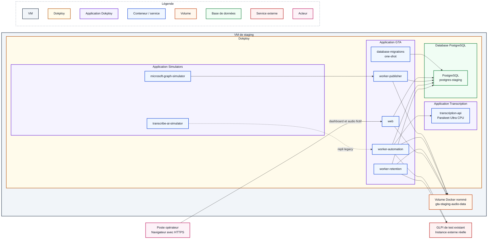

# Procédure de déploiement en staging

## Objectif et périmètre

Cette procédure décrit l'installation initiale et la recette de GLPI Ticketing
Automation dans un environnement Dokploy de staging. Elle suppose qu'une
instance GLPI de test existe déjà et qu'elle est accessible directement en
HTTPS depuis la VM de staging.

Il est techniquement possible de démarrer un GLPI conteneurisé pour un
laboratoire isolé. Cette variante est décrite dans la
[procédure de développement local](developpement-local.md), mais elle ne fait
pas partie du staging de référence : la recette doit porter sur une instance
GLPI de test représentative de celle utilisée par l'établissement.

Le staging n'utilise ni boîte Exchange de production, ni GLPI de production,
ni audio réel. Une mise à jour d'un environnement déjà installé suit la
[procédure de mise à jour](mise-a-jour.md).

## Architecture cible

Voici le schéma distinguant les services simulés / mocks des services réels
testés en staging :



Microsoft Graph et le contrat Transcribe AI historique sont mockés dans une
application Dokploy dédiée. Le simulateur Graph ne teste donc pas
l'authentification Microsoft Entra ID. La transcription Parakeet, les services
GTA et PostgreSQL sont déployés dans Dokploy, tandis que le GLPI de test reste
un service externe réel.

Trois applications Docker Compose Dokploy sont déployées séparément :

1. **Simulators**, avec les conteneurs Microsoft Graph et Transcribe AI ;
2. **Transcription**, avec le conteneur Parakeet ;
3. **GTA**, avec le web, la migration one-shot et les trois workers.

PostgreSQL est créé séparément comme une application **Database** dans
Dokploy ; il ne constitue pas un projet Docker Compose supplémentaire.

Les contrats techniques restent décrits dans les README des
[providers de test](../../infra/docker/providers/README.md) et de la
[transcription](../../infra/docker/transcription/README.md).

## Prérequis

### Système et dimensionnement

Le système de référence qualifié pour ce projet est **Ubuntu Server 24.04
LTS**. Dokploy indique également prendre en charge plusieurs versions
d'Ubuntu, Debian, Fedora et CentOS, mais ces variantes ne sont pas qualifiées
par cette procédure. Consulter les
[prérequis officiels de Dokploy](https://docs.dokploy.com/docs/core/installation).

Prévoir au minimum :

- 4 vCPU ;
- 12 Gio de RAM ;
- 50 Gio d'espace disque.

### GLPI de test existant

Le staging est qualifié avec **GLPI 11.0.7** et la version d'API explicitement
épinglée **V2.3.0**. Les prérequis GLPI sont :

- l'API V2 activée ;
- une URL directe ne passant pas par un portail SSO interactif ;
- un utilisateur technique exclusivement réservé au staging ;
- les droits minimaux permettant de créer et consulter les tickets attendus ;
- un client OAuth autorisant le grant Password et le scope `api` ;
- le client ID et le secret associés ;
- une source de demande `MEVO` et son identifiant propre à cette instance ;
- le fuseau `Europe/Paris` pour l'utilisateur ou le fuseau global hérité.

Références officielles :

- [API REST V2 de GLPI](https://help.glpi-project.org/documentation/modules/configuration/general/api/restful-api-v2) ;
- [création des clients OAuth GLPI](https://help.glpi-project.org/documentation/modules/configuration/oauth-clients).

La documentation OpenAPI de l'instance doit répondre sur :

```text
https://NOM_GLPI_TEST/api.php/v2.3.0/doc.json
```

### DNS, réseau et accès

Les noms ci-dessous sont symboliques et doivent être remplacés par les valeurs
validées par l'administrateur réseau. Les conteneurs utilisent la résolution DNS
et la sortie réseau de la VM ; selon le pare-feu, leurs flux sortants peuvent
donc apparaître avec l'adresse source de la VM.

#### Matrice DNS

| Nom | Cible attendue | Résolution requise depuis | Action |
| --- | --- | --- | --- |
| `NOM_VM_STAGING` | adresse IP de la VM de staging | postes opérateurs et administrateurs | créer un enregistrement interne `A` et, si utilisé, `AAAA` |
| `NOM_GLPI_TEST` | adresse IP du GLPI de test | VM de staging | rendre le nom résolvable par le DNS utilisé par Docker |
| `github.com`, `api.github.com` | adresses publiées par GitHub | VM de staging | autoriser leur résolution pour récupérer le dépôt privé |
| `auth.docker.io`, `registry-1.docker.io`, `production.cloudfront.docker.com`, `ghcr.io`, `pkg-containers.githubusercontent.com` | adresses publiées par Docker Hub et GHCR | VM de staging | autoriser leur résolution pour télécharger les images de base |
| suffixes `huggingface.co` et `hf.co`, avec tous leurs sous-domaines | adresses publiées par Hugging Face | VM de staging | autoriser leur résolution pour télécharger le modèle Parakeet épinglé |

#### Matrice des flux à autoriser au pare-feu

| Source | Destination | Protocole | Port destination | Action | Usage |
| --- | --- | --- | ---: | --- | --- |
| réseau des opérateurs | `NOM_VM_STAGING` / Traefik | TCP | 443 | autoriser | consulter le dashboard et les audios fictifs en HTTPS |
| réseau des opérateurs | `NOM_VM_STAGING` / Traefik | TCP | 80 | autoriser uniquement si une redirection HTTP vers HTTPS est requise ; sinon refuser | redirection vers HTTPS, sans contenu applicatif en clair |
| réseau d'administration ou bastion | VM de staging | TCP | 22 | autoriser de manière restreinte | administration SSH par clé |
| réseau d'administration | VM de staging / Dokploy | TCP | 3000 | autoriser de manière restreinte | administration de Dokploy en HTTPS |
| VM de staging | DNS de l'établissement | UDP et TCP | 53 | autoriser | résolution des noms internes et externes par la VM et les conteneurs |
| VM de staging (service de synchronisation système) | serveur NTP de l'établissement | UDP | 123 | autoriser si nécessaire | maintenir l'horloge système de la VM |
| VM de staging | domaines externes listés dans la matrice DNS | TCP | 443 | autoriser en sortie | récupérer le dépôt, les images et le modèle Parakeet épinglé |
| VM de staging | `NOM_GLPI_TEST` | TCP | 443 | autoriser en sortie | appels à l'API GLPI V2 par les workers `automation` et `retention`, avec vérification TLS |

La politique cible est de refuser tout autre flux. PostgreSQL, les workers, les
mocks et le moteur de transcription ne doivent jamais être publiés directement
sur l'hôte ni exposés par Traefik.

### GitHub et Dokploy

Disposer :

- du droit d'installer une GitHub App sur le dépôt privé ;
- d'une référence Git `main` ayant passé la CI ;
- du SHA Git complet correspondant ;
- de valeurs distinctes de la production pour les secrets, réseaux et volumes.

## Préparation de la VM

### Installer et sécuriser Dokploy

L'installation recommandée pour le staging est la version autohébergée Docker
de Dokploy, installée avec le script officiel fourni par le projet. La version
qualifiée par cette procédure est **Dokploy v0.30.10**.

Utiliser le script attaché à cette release afin d'installer exactement cette
version :

```bash
curl --fail --show-error --location https://github.com/Dokploy/dokploy/releases/download/v0.30.10/install.sh | sudo sh
```

Le script installe Docker s'il est absent, initialise Docker Swarm et déploie
Dokploy. Les ports `80`, `443` et `3000` doivent donc être disponibles avant son
exécution. Ne pas utiliser le script générique `dokploy.com/install.sh` pour une
installation reproductible : il cible automatiquement la dernière version
stable. Consulter la
[procédure officielle](https://docs.dokploy.com/docs/core/installation) et
consigner la version installée dans le compte rendu de recette.

Après installation :

- appliquer les mises à jour de sécurité du système ;
- vérifier que Docker et Docker Compose fonctionnent ;
- configurer le fuseau `Europe/Paris` ;
- activer une synchronisation NTP ;
- protéger l'accès administrateur Dokploy par HTTPS ;
- limiter les accès système et Dokploy aux personnes autorisées ;
- surveiller au minimum l'espace disque, la mémoire et l'expiration des
  certificats.

### Installer la confiance envers GLPI

Le bundle CA sert aux connexions **sortantes** des conteneurs vers le GLPI de
test, qui est externe à la VM. Ce bundle n'est pas le certificat présenté aux
opérateurs par le dashboard.

À partir d'une CA fournie par l'administrateur système :

```bash
sudo install -m 0644 /chemin/ca-interne.pem /usr/local/share/ca-certificates/gta-internal-ca.crt
sudo update-ca-certificates
```

Le chemin utilisé dans l'environnement Dokploy sera alors :

```dotenv
CA_BUNDLE_HOST_PATH=/etc/ssl/certs/ca-certificates.crt
```

Le fichier doit être lisible par l'UID/GID non privilégié `10001`. Ne jamais
désactiver la vérification TLS pour contourner une chaîne incomplète.

Valider GLPI :

```bash
openssl s_client -connect NOM_GLPI_TEST:443 -servername NOM_GLPI_TEST -CAfile /etc/ssl/certs/ca-certificates.crt -verify_return_error </dev/null
```

Le résultat attendu est `Verify return code: 0 (ok)`.

Vérifier ensuite que la documentation de l'API épinglée est accessible :

```bash
curl --fail --silent --show-error https://NOM_GLPI_TEST/api.php/v2.3.0/doc.json >/dev/null
```

Enfin, obtenir une fois un token avec l'utilisateur et le client OAuth de
staging en suivant la documentation GLPI. Ne pas afficher le token, les
identifiants ou la réponse complète dans le terminal partagé ou le compte rendu.

### Préparer le certificat HTTPS du dashboard

Le certificat **entrant** protège l'accès des opérateurs au dashboard et aux
audios fictifs. Il est terminé par Traefik et n'est jamais monté dans les
applications.

Demander à l'administrateur système :

- un nom DNS interne pointant vers la VM ;
- un certificat serveur couvrant exactement ce nom dans son SAN ;
- la chaîne complète du certificat ;
- la clé privée correspondante, transmise par un canal approuvé ;
- la CA racine ou intermédiaire déjà approuvée par les postes opérateur ;
- le responsable et la date de renouvellement.

Importer le certificat et sa clé dans l'interface **Certificates** de Dokploy,
puis sélectionner ce certificat personnalisé pour le domaine du web. Consulter
la documentation Dokploy sur les
[certificats](https://docs.dokploy.com/docs/core/certificates) et les
[domaines](https://docs.dokploy.com/docs/core/docker-compose/domains).

La clé privée reste dans le gestionnaire de certificats Dokploy/Traefik. Elle
ne doit jamais apparaître dans le dépôt, un fichier `.env`, un volume
applicatif ou les logs.

### Créer les réseaux et le répertoire de recette

Créer les réseaux partagés une seule fois. Cette opération peut être réalisée
directement depuis l'interface graphique de Dokploy ou en ligne de commande sur
la VM. Pour la variante en ligne de commande :

```bash
sudo docker network create --driver bridge --internal gta-staging-simulators-network
sudo docker network create --driver bridge --internal gta-staging-transcription-network
sudo docker network create --driver bridge gta-staging-database-network
```

`dokploy-network` est créé et géré par Dokploy.

Préparer le répertoire d'audios fictifs avant de déployer les simulateurs. Son
existence est obligatoire, même s'il reste vide. Le groupe `10001` correspond
au groupe non privilégié des conteneurs :

```bash
sudo install -d -o root -g 10001 -m 0750 /srv/gta-staging/audio-fixtures
```

## Porte de validation 1 — Socle VM

Ne pas créer les projets applicatifs tant que les contrôles suivants ne sont
pas validés :

- [ ] la VM respecte le dimensionnement choisi ;
- [ ] Ubuntu, Docker, Docker Compose et Dokploy sont opérationnels ;
- [ ] la date, l'heure, le fuseau et NTP sont corrects ;
- [ ] les noms GLPI et dashboard sont résolus correctement ;
- [ ] la chaîne TLS de GLPI est valide avec le bundle CA configuré ;
- [ ] l'API GLPI V2.3.0 répond et le grant OAuth Password délivre un token sans
      exposer celui-ci ;
- [ ] les trois réseaux existent et aucun domaine ni port public n'expose
      PostgreSQL ;
- [ ] le répertoire de fixtures est lisible par le GID `10001` ;
- [ ] le certificat du dashboard couvre son nom DNS et n'est pas expiré ;
- [ ] les ports et flux réseau respectent les règles du pare-feu.

Consigner la date, l'opérateur, la version Dokploy et le résultat des contrôles
sans enregistrer de secret.

## Configuration de GitHub et Dokploy

### Créer la GitHub App

Dans Dokploy, ouvrir **Git**, choisir GitHub, puis utiliser **Create GitHub
App**. Installer l'application uniquement sur le dépôt
`glpi-ticketing-automation`, et non sur tous les dépôts de l'organisation.

Suivre la
[procédure GitHub officielle de Dokploy](https://docs.dokploy.com/docs/core/github).
La clé privée de la GitHub App reste gérée par Dokploy et ne doit jamais être
copiée dans un `.env` ou dans Git.

Vérifier que Dokploy peut :

1. lister le dépôt privé ;
2. lister la branche `main` ;
3. récupérer le SHA qui a passé la CI ;
4. reconstruire sans utiliser de jeton personnel dans le Compose.

La GitHub App doit être révoquée ou renouvelée si la VM est compromise ou si
elle n'est plus utilisée.

### Créer le service PostgreSQL de staging

Créer PostgreSQL comme une application **Database** dans Dokploy, puis
rattacher son service à `gta-staging-database-network`. Aucun domaine ni port
public ne doit lui être associé.

La configuration se limite aux opérations suivantes :

1. créer l'application Database PostgreSQL dans Dokploy ;
2. la rattacher à `gta-staging-database-network` ;
3. reporter les paramètres de connexion internes fournis par Dokploy dans
   `DATABASE_URL`.

### Créer les trois projets Compose

Créer les projets dans cet ordre :

| Ordre | Projet | Fichier Compose | Modèle d'environnement |
| ---: | --- | --- | --- |
| 1 | Providers mocks | `infra/docker/providers/docker-compose.staging.yml` | `infra/docker/providers/staging.env.example` |
| 2 | Transcription | `infra/docker/transcription/docker-compose.transcription.yml` | `infra/docker/transcription/transcription.env.example` |
| 3 | Applications | `infra/docker/apps/docker-compose.staging.yml` | `infra/docker/apps/staging.env.example` |

Pour les trois projets :

- sélectionner le même dépôt et la branche `main` ;
- relever le SHA complet de `main` avant le premier déploiement et utiliser
  cette même valeur dans `APP_COMMIT_SHA` pour les trois projets ;
- désactiver toute exposition publique non demandée ;
- conserver l'auto-déploiement désactivé et déclencher manuellement les
  déploiements dans l'ordre providers, transcription, puis applications ;
- limiter les watch paths au périmètre du projet.

Avant chaque déploiement manuel, vérifier que `main` pointe toujours vers le
SHA relevé. `APP_COMMIT_SHA` assure la traçabilité affichée par l'application,
mais ne verrouille pas à lui seul la révision extraite par Dokploy. Ne pas
activer l'auto-déploiement tant que la
[procédure de mise à jour](mise-a-jour.md) ne l'encadre pas explicitement.

Watch paths recommandés :

```text
# Providers mocks
providers/**
infra/docker/providers/**
.dockerignore
pyproject.toml
uv.lock

# Transcription
apps/transcription-api/**
infra/docker/transcription/**
.dockerignore
pyproject.toml
uv.lock

# Applications
apps/database-migrations/**
apps/web/**
apps/worker-automation/**
apps/worker-publisher/**
apps/worker-retention/**
packages/**
infra/docker/apps/**
.dockerignore
pyproject.toml
uv.lock
```

### Renseigner les environnements

Les fichiers `*.env.example` sont des contrats de configuration, pas des
fichiers à déployer. Copier leur contenu dans l'onglet **Environment** du
projet Dokploy correspondant, puis remplacer tous les placeholders.

Contrôler les invariants suivants :

- `APP_ENVIRONMENT=staging` ;
- `APP_RELEASE=main` et `APP_COMMIT_SHA` contient le SHA complet réellement
  déployé ;
- `SIMULATORS_NETWORK_NAME=gta-staging-simulators-network` ;
- `TRANSCRIPTION_NETWORK_NAME=gta-staging-transcription-network` ;
- `TRANSCRIPTION_NETWORK_ALIAS=gta-staging-transcription` ;
- `DATABASE_NETWORK_NAME=gta-staging-database-network` ;
- `TRANSCRIPTION_API_KEY` est identique dans les projets transcription et
  applications ;
- `TRANSCRIBE_AI_SIMULATOR_API_KEY` est identique dans les projets providers et
  applications si le repli legacy doit rester testable ;
- `PUBLISHER_MAILBOX_ID` dans le projet Applications est strictement identique
  à `MICROSOFT_GRAPH_SIMULATOR_MAILBOX_ID` dans le projet Providers ;
- `MICROSOFT_GRAPH_SIMULATOR_AUDIO_FIXTURES_HOST_PATH` pointe vers le
  répertoire préparé sur la VM, qui existe et est lisible par le GID `10001` ;
- `DATABASE_URL` cible exclusivement la base staging ;
- `GLPI_BASE_URL` et les identifiants ciblent exclusivement le GLPI de test ;
- `GLPI_TICKET_REQUEST_SOURCE_ID` correspond à la source `MEVO` de cette
  instance et non à l'identifiant de production ;
- `CA_BUNDLE_HOST_PATH=/etc/ssl/certs/ca-certificates.crt` ;
- `PUBLIC_BASE_URL` contient le domaine HTTPS interne du web.

Le provider nominal est `openai_compatible`. Le mock Transcribe AI reste
disponible uniquement pour une bascule legacy explicite ; aucun basculement
automatique n'est réalisé.

### Configurer le domaine du web

Dans le projet Compose Applications, associer uniquement le service `web` :

- au nom DNS interne préparé ;
- au port interne `8000` ;
- au chemin `/` ;
- à HTTPS avec le certificat personnalisé importé.

Ne publier directement aucun port du web, des workers, des mocks, de
PostgreSQL ou du moteur de transcription. Le domaine Dokploy doit router le
trafic à travers Traefik et `dokploy-network`.

## Déploiement et validations techniques

### 1. Déployer les providers mocks

Déployer la stack providers et attendre que `microsoft-graph-simulator` et
`transcribe-ai-simulator` soient `healthy`. Aucun port ne doit être publié vers
l'hôte ou Traefik.

Dans le terminal du mock Microsoft Graph :

```bash
glpi-ticketing-microsoft-graph-simulator-admin list-scenarios
```

Dans le terminal du mock Transcribe AI :

```bash
glpi-ticketing-transcribe-ai-simulator-smoke
```

Ne pas poursuivre si l'un de ces deux contrôles échoue.

### 2. Déployer la transcription

Déployer la stack transcription et attendre que `transcription-api` soit
`healthy`. Le service reste exclusivement sur le réseau privé de
transcription, sans domaine Dokploy ni publication Traefik.

Depuis son terminal, vérifier la readiness sans exposer le service :

```bash
python -c 'import urllib.request; print(urllib.request.urlopen("http://127.0.0.1:5092/health/ready", timeout=5).read().decode())'
```

Ne pas poursuivre tant que le modèle n'est pas chargé et que la sonde n'est pas
saine.

### 3. Déployer les applications

Déployer le projet Applications. Les projets Compose ne pouvant pas exprimer
de dépendance entre eux, les deux stacks précédentes doivent déjà être saines.

Vérifier dans cet ordre :

1. `database-migrations` termine avec le code `0` ;
2. `web`, `worker-publisher`, `worker-automation` et `worker-retention`
   démarrent ;
3. le dashboard affiche les trois workers avec des heartbeats frais ;
4. l'environnement, la release et le SHA affichés correspondent au déploiement ;
5. automation et retention joignent le GLPI de test sans erreur TLS ;
6. aucun journal ne contient de secret, d'audio, de transcription ou de
   réponse HTTP brute.

## Porte de validation 2 — Déploiement

La recette fonctionnelle peut commencer uniquement lorsque :

- [ ] les deux mocks sont `healthy` ;
- [ ] la transcription est `healthy` ;
- [ ] la migration est terminée avec le code `0` ;
- [ ] le web et les trois workers sont en cours d'exécution ;
- [ ] les trois heartbeats sont frais ;
- [ ] `staging`, `main` et le SHA attendu sont affichés ;
- [ ] seul le web est accessible via Traefik ;
- [ ] le certificat HTTPS du web est accepté depuis un poste opérateur ;
- [ ] le GLPI de test est joignable avec vérification TLS.

## Recette fonctionnelle

### Parcours nominal WAV et OGG

Depuis le terminal du mock Microsoft Graph, injecter un WAV fictif :

```bash
glpi-ticketing-microsoft-graph-simulator-admin seed --scenario valid-wav
```

Contrôler successivement :

1. la création de l'ingestion et du job ;
2. les transitions `pending`, `processing`, puis `completed` ;
3. le déplacement du message mocké dans `Processed` ;
4. la création d'un unique ticket dans le GLPI de test ;
5. la correspondance entre l'UUID du job et `external_id` dans GLPI ;
6. l'identifiant GLPI et les événements expurgés dans le dashboard ;
7. le téléchargement de l'audio fictif en HTTPS depuis un poste opérateur.

Rejouer le parcours avec OGG :

```bash
glpi-ticketing-microsoft-graph-simulator-admin seed --scenario valid-ogg
```

### Rejets contrôlés

Lister les scénarios :

```bash
glpi-ticketing-microsoft-graph-simulator-admin list-scenarios
```

Au minimum, vérifier qu'un message sans audio, avec plusieurs audios, avec un
audio vide ou avec un format non pris en charge est classé dans `Rejected`, que
son motif expurgé est persisté et que le publisher poursuit le traitement.

### Audio fictif fourni par l'opérateur

Installer uniquement un WAV ou un OGG fictif de moins de 25 Mio :

```bash
sudo install -o root -g 10001 -m 0640 ./test-vocal.wav /srv/gta-staging/audio-fixtures/test-vocal.wav
```

Puis l'injecter depuis le terminal du mock :

```bash
glpi-ticketing-microsoft-graph-simulator-admin seed --audio-path /fixtures/audio/test-vocal.wav
```

Cette recette qualifie la transcription en français de messages courts ou
bruités et les limites CPU/mémoire. Retirer manuellement la fixture après la
recette.

### Rétention facultative

Sur cet environnement isolé, passer un ticket de test à `SOLVED` et confirmer
que l'audio reste disponible après un contrôle. Le passer ensuite à `CLOSED`,
attendre le contrôle suivant et confirmer la suppression des octets ainsi que
la réponse `410 Gone` au téléchargement. Avec la valeur de staging
`RETENTION_CHECK_INTERVAL_HOURS=6`, cette recette peut nécessiter jusqu'à six
heures d'attente entre deux contrôles GLPI.

## Diagnostic

Identifier d'abord la frontière défaillante :

1. découverte et acquittement dans le mock Graph ;
2. persistance PostgreSQL et publication sur le volume audio ;
3. provider de transcription ;
4. création ou consultation GLPI ;
5. rétention ;
6. dashboard, Traefik et certificat opérateur.

Les logs doivent fournir uniquement les UUID, étapes, catégories et codes
techniques expurgés. Ne pas publier la sortie complète de
`docker compose config`, qui peut résoudre des chemins et des valeurs
d'environnement. Ne jamais lancer de nettoyage Docker global pour diagnostiquer
cet environnement.

Limites connues :

- le mock Graph ne valide pas Microsoft Entra ID ;
- la qualité de Parakeet doit être confirmée avec des audios fictifs
  représentatifs ;
- le staging dépend du DNS, du routage, de NTP et des CA de la VM ;
- le web n'applique pas encore d'authentification utilisateur ;
- le rollback applicatif ne rétrograde pas automatiquement PostgreSQL ;
- aucune opération de nettoyage ne doit viser le GLPI de test externe.

## Nettoyage et retour arrière

Réinitialiser uniquement la boîte synthétique avec :

```bash
glpi-ticketing-microsoft-graph-simulator-admin reset
```

Cette commande ne supprime pas les fixtures de la VM. Retirer manuellement les
fichiers fictifs devenus inutiles.

Ne jamais utiliser un nettoyage Docker global. Ne pas exécuter
`docker compose down -v` sur le projet Applications, afin de conserver le
volume audio, et ne pas supprimer l'application Database PostgreSQL ni son
volume. Ces données doivent rester disponibles pour l'analyse et le retour
arrière.

En cas d'échec, arrêter les workers avant tout retour arrière et appliquer la
[procédure de mise à jour](mise-a-jour.md). Ne pas rétrograder une migration
Alembic sans procédure explicitement validée.

## Résultat attendu

Le staging est valide lorsque :

- les deux portes de validation sont signées ;
- les trois stacks sont saines ;
- la migration est terminée ;
- les trois workers ont un heartbeat frais ;
- les parcours WAV et OGG créent chacun un ticket corrélé dans le GLPI de test ;
- un opérateur peut télécharger l'audio fictif via HTTPS ;
- aucun service de production, secret de production ou donnée sensible n'a été
  utilisé.
