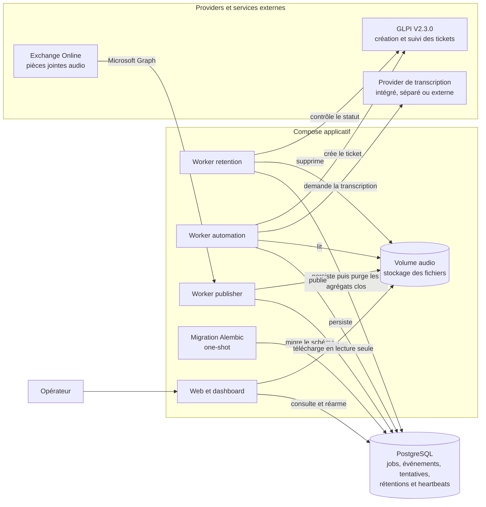

# Référence d'architecture

Cette vue détaille les services internes de mevo2glpi, leurs stockages et leurs
interactions avec les providers externes.

## Compose applicatif

Le Compose applicatif regroupe les cinq services du projet et crée le volume
audio partagé. PostgreSQL reste externe à ce Compose et le rejoint par un
réseau Docker privé. Dans la topologie de référence, il est néanmoins déployé
sur la même VM comme service **Database Dokploy** ; il ne s'agit pas d'une base
exposée hors de la plateforme.

### Worker retention

Il contrôle l'état du ticket GLPI et supprime l'audio lorsque le ticket est
fermé ou que son échéance absolue est atteinte. Ses transitions permettent de
reprendre une suppression interrompue sans perdre la traçabilité. Dès que la
suppression du fichier est confirmée, il supprime dans une transaction unique
l'ingestion acceptée éventuelle, les événements, la rétention et le job liés.
Indépendamment de GLPI et du volume audio, il applique également la durée de
conservation des ingestions terminées dans Exchange `Rejected` qui n'ont créé
aucun job. Ce second traitement utilise la cadence générale des contrôles de
rétention et supprime les agrégats expirés par transactions bornées à 100
ingestions.

### Worker automation

Il récupère les jobs éligibles dans PostgreSQL, transmet l'audio au provider de
transcription sélectionné, puis crée le ticket GLPI. Il applique les retries et
finalise le job dès que l'identifiant GLPI est durablement persisté.

### Worker publisher

Il surveille la boîte Exchange, valide les pièces jointes WAV, OGG, MP3 ou M4A,
publie l'audio dans le volume partagé, puis crée le job `pending` dans
PostgreSQL.

### Migration Alembic one-shot

Elle attend que PostgreSQL soit disponible, exécute `alembic upgrade head`,
puis s'arrête. Les quatre services persistants démarrent uniquement après son
succès.

### Web et dashboard

Le web expose le dashboard, les détails et événements des jobs, les alertes,
le téléchargement des audios autorisés et la relance par l'opérateur. Une vue
séparée présente les ingestions rejetées avec leur motif fonctionnel et leur
code technique, sans exposer les identifiants Microsoft Graph. Le web ne
constitue plus une voie d'ingestion.

### PostgreSQL

PostgreSQL est la source de vérité du système. Il persiste notamment les jobs,
les événements, les tentatives, les échéances de retry, les rétentions et les
heartbeats des workers. L'agrégat d'un job reste disponible tant que son audio
est conservé, puis il est purgé avec lui. Les ingestions rejetées sans job
restent observables pendant leur durée de conservation, puis leurs événements
et leur ligne principale sont supprimés dans une transaction unique.

### Volume audio

Le volume nommé stocke les fichiers audio sous une clé canonique. Le publisher
et le worker de rétention y accèdent en lecture-écriture ; le worker
d'automatisation et le web y accèdent uniquement en lecture.

## Providers et services externes

### Provider de transcription

Il transforme un audio en texte. Le contrat permet d'utiliser un service
intégré au Compose applicatif, une stack Docker locale indépendante ou un
provider externe. Dans l'état actuel du dépôt, l'API CPU locale est déployée
dans un projet Compose indépendant ; son intégration au Compose applicatif
nécessiterait une modification de l'infrastructure, mais pas du pipeline métier.

### Exchange Online

La boîte Exchange dédiée fournit les pièces jointes audio. Le publisher y
accède avec Microsoft Graph, puis classe les messages dans `Processed` ou
`Rejected` selon le résultat de l'ingestion.

### GLPI

GLPI reçoit les demandes de création de ticket et expose leur état au worker de
rétention. L'identifiant du ticket est persisté dans PostgreSQL avant la
finalisation du job.
