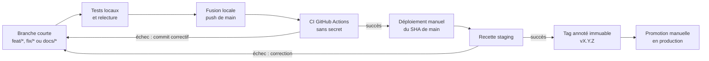

# Référence CI/CD

## Objectif et frontière

Ce document décrit le cycle complet d'une modification :

```text
développement -> push de main -> CI -> staging -> tag immuable -> production
```

Il définit les références Git à promouvoir et les portes de validation. Les
manipulations Dokploy — ordre d'arrêt, bouton **Deploy**, contrôles runtime et
rollback immédiat — sont décrites dans la
[procédure de mise à jour](../procedures/mise-a-jour.md).

Le projet ne met pas en œuvre un déploiement continu automatique. La CI est
automatique après un push, tandis que les promotions staging et production
restent manuelles.

## Pipeline



L'invariant principal est le suivant : **le tag de production pointe exactement
vers le SHA de `main` validé en staging**.

## 1. Développer sur une branche courte

`main` est l'unique branche longue. Utiliser :

- `feat/*` pour une évolution fonctionnelle ;
- `fix/*` pour une correction ;
- `docs/*` pour une modification documentaire isolée.

Créer la branche depuis un `main` à jour :

```bash
git switch main
git pull --ff-only
git switch -c feat/description-courte
```

Pendant le développement :

- limiter chaque changement à un périmètre cohérent ;
- ajouter les tests pertinents ;
- tester toute migration depuis une base neuve et depuis la révision
  précédente ;
- utiliser uniquement des données synthétiques ;
- mettre à jour la documentation et les configurations d'exemple ;
- utiliser Conventional Commits ;
- ne jamais ajouter de secret, certificat privé, audio réel, transcription ou
  donnée sensible au dépôt.

Les commandes locales sont décrites dans la
[procédure de développement](../procedures/developpement-local.md).

### Porte de validation locale

- [ ] le diff final a été relu ;
- [ ] les tests ciblés réussissent ;
- [ ] Ruff et les contrôles transversaux pertinents réussissent ;
- [ ] `uv.lock` est cohérent si une dépendance change ;
- [ ] aucun secret ni donnée réelle n'apparaît dans le diff ou les logs ;
- [ ] les impacts de configuration et d'exploitation sont documentés.

## 2. Fusionner et pousser directement `main`

Le processus courant n'utilise pas de Pull Request. Après les validations
locales, fusionner la branche localement puis pousser `main` :

```bash
MEVO2GLPI_CHANGE_BRANCH=feat/description-courte

git switch main
git pull --ff-only
git merge --ff-only "$MEVO2GLPI_CHANGE_BRANCH"
git push origin main
```

Le merge `--ff-only` préserve un historique linéaire et refuse une divergence.
En cas d'échec, remettre la branche à jour et rejouer les validations. Ne jamais
utiliser un push forcé pour contourner cette vérification.

Une branche peut être poussée sur le dépôt pour la partager ou la sauvegarder,
mais ce push ne déclenche pas la CI courante tant qu'il ne concerne ni `main`,
ni une Pull Request, ni un lancement manuel.

Ce flux direct correspond au fonctionnement actuel avec un mainteneur unique.
Une contribution provenant d'un autre établissement doit passer par une Pull
Request, une revue et une CI verte avant fusion, conformément à
[`CONTRIBUTING.md`](../../CONTRIBUTING.md). Si la maintenance devient partagée,
la protection de `main` et ce flux par Pull Request devront devenir la règle
commune.

## 3. Intégration continue

### Déclencheurs

Les deux workflows GitHub Actions sont déclenchés par :

- un push sur `main` ;
- une Pull Request vers `main`, même si ce mécanisme n'est pas utilisé par le
  processus courant ;
- un lancement manuel `workflow_dispatch`.

Leurs filtres de chemins évitent d'exécuter un périmètre qui n'a pas changé.
Une modification de la documentation ou des fichiers de gouvernance déclenche
la CI applications afin de vérifier au minimum les liens relatifs et les
contrôles généraux du dépôt.

### Workflows

| Workflow | Périmètre |
| --- | --- |
| [CI applications](../../.github/workflows/ci-apps.yml) | `apps/`, `packages/`, tests transversaux, Compose applicatifs, PostgreSQL de développement, image GLPI de test et stack de transcription |
| [CI providers de test](../../.github/workflows/ci-providers.yml) | simulateurs de `providers/`, images associées et Compose local ou staging |

Le workspace uv et `uv.lock` sont communs aux deux périmètres. Une modification
du manifeste racine, du verrou ou de `.dockerignore` peut déclencher les deux
workflows.

### Contrôles automatiques

Selon le périmètre, la CI exécute :

1. `ruff format --check` ;
2. `ruff check` ;
3. les suites Pytest locales déterministes ;
4. les migrations et intégrations PostgreSQL jetables ;
5. le rendu des manifestes Docker Compose ;
6. les contrats ciblés des images et de la stack de transcription ;
7. l'existence des cibles des liens Markdown relatifs.

Les suites `glpi`, `transcription_model`, `e2e` et certains
tests `deployment` restent des validations manuelles. La CI ne démontre donc
pas le fonctionnement des services réels de l'établissement.

### Sécurité de la CI

Les workflows :

- utilisent uniquement la permission GitHub `contents: read` ;
- n'utilisent aucun secret de staging ou de production ;
- ne lisent aucun fichier `.env` réel, certificat ou clé privée ;
- épinglent les actions tierces sur des révisions immuables ;
- n'appellent ni Exchange, ni GLPI, ni un provider réel ;
- ne déploient rien et ne modifient aucune base persistante.

### Résultat de la CI

Le push direct peut placer temporairement un commit en échec dans `main`. Si un
job échoue :

1. ne rien déployer en staging ;
2. créer un commit correctif ;
3. pousser de nouveau `main` ;
4. attendre la réussite de la nouvelle exécution ;
5. ne jamais réécrire l'historique par un push forcé.

### Porte de validation CI

- [ ] tous les workflows attendus sont terminés avec succès ;
- [ ] le SHA contrôlé par GitHub Actions correspond à `origin/main` ;
- [ ] les logs ne contiennent aucune donnée sensible ;
- [ ] aucun déploiement n'a commencé avant la fin des contrôles.

## 4. Promouvoir le SHA en staging

Relever le SHA exact validé par la CI :

```bash
git fetch origin --tags
git rev-parse origin/main^{commit}
```

L'auto-déploiement Dokploy reste désactivé. Dans le projet staging
**Applications (mevo2glpi)**, utiliser :

```text
APP_ENVIRONMENT=staging
APP_RELEASE=main
APP_COMMIT_SHA=<SHA_COMPLET_VALIDE_PAR_LA_CI>
```

Dans le projet **Transcription**, lorsqu'il est concerné, utiliser uniquement :

```text
APP_RELEASE=main
APP_COMMIT_SHA=<SHA_COMPLET_VALIDE_PAR_LA_CI>
```

Le projet **Providers mocks** ne consomme pas ces variables ; sa révision doit
être contrôlée depuis le déploiement Dokploy lorsqu'il est concerné.

Suspendre les nouveaux push de `main` pendant la recette, ou vérifier de nouveau
le SHA après le déploiement puis avant la validation. Les variables d'identité
sont déclaratives et ne verrouillent pas le checkout réalisé par Dokploy.

Exécuter le déploiement avec la
[procédure de mise à jour](../procedures/mise-a-jour.md), puis appliquer la
recette de la [procédure staging](../procedures/staging.md). Cette recette doit
au minimum valider :

- la migration ;
- l'identité `staging`, `main` et le SHA ;
- les heartbeats des workers ;
- les flux synthétiques WAV, OGG, MP3 et M4A ;
- la création du ticket dans le GLPI de test ;
- l'absence de secret ou de contenu métier dans les logs.

Toute modification après cette recette produit un nouveau SHA et invalide la
promotion. Le nouveau commit doit repasser par la CI et staging.

### Porte de validation staging

- [ ] le SHA déployé correspond au SHA validé par la CI ;
- [ ] la recette synthétique est réussie ;
- [ ] les anomalies et résultats sont consignés ;
- [ ] aucun commit ultérieur n'est inclus dans la future release.

## 5. Créer la release

Après validation de staging, créer un tag annoté sur le SHA exactement recetté :

```bash
git fetch origin --tags
git switch main
git pull --ff-only

MEVO2GLPI_RELEASE_TAG=vX.Y.Z
MEVO2GLPI_STAGING_SHA=<SHA_COMPLET_VALIDE_EN_STAGING>

test "$(git rev-parse HEAD)" = "$MEVO2GLPI_STAGING_SHA"
git tag -a "$MEVO2GLPI_RELEASE_TAG" "$MEVO2GLPI_STAGING_SHA" -m "release: $MEVO2GLPI_RELEASE_TAG"
git rev-parse "$MEVO2GLPI_RELEASE_TAG^{commit}"
git push origin "$MEVO2GLPI_RELEASE_TAG"
```

La commande `git rev-parse` doit retourner le SHA validé en staging. Le tag :

- respecte `vMAJEUR.MINEUR.CORRECTIF` ;
- n'est jamais déplacé, supprimé puis recréé ou réutilisé ;
- ne déclenche aucun déploiement automatique.

Utiliser `CORRECTIF` pour une correction compatible, `MINEUR` pour une
fonctionnalité compatible et `MAJEUR` pour un changement incompatible préparé
explicitement.

### Porte de validation release

- [ ] le tag est annoté ;
- [ ] il pointe exactement vers le SHA recetté ;
- [ ] ce SHA appartient à `main` et sa CI est verte ;
- [ ] le tag est poussé sans modifier un tag existant ;
- [ ] le résultat de la recette staging est associé à la release.

## 6. Promouvoir la release en production

Dans le projet production **Applications (mevo2glpi)**, utiliser exclusivement le tag
immuable et son SHA complet :

```text
APP_ENVIRONMENT=production
APP_RELEASE=vX.Y.Z
APP_COMMIT_SHA=<SHA_COMPLET_DU_TAG>
```

Dans le projet **Transcription**, lorsqu'il est concerné, utiliser :

```text
APP_RELEASE=vX.Y.Z
APP_COMMIT_SHA=<SHA_COMPLET_DU_TAG>
```

Ne jamais déployer `main`, une branche de fonctionnalité ou un alias mutable
comme `latest` en production. La promotion reste une action manuelle dans
Dokploy.

Appliquer la [procédure de mise à jour](../procedures/mise-a-jour.md) pour
l'arrêt, le déploiement, les contrôles et le rollback immédiat. La décision de
maintenir ou de retirer la release appartient à l'opérateur désigné pour la
fenêtre de maintenance.

### Porte de validation production

- [ ] le tag et son SHA correspondent à ceux validés en staging ;
- [ ] la procédure de mise à jour est entièrement validée ;
- [ ] le traitement synthétique autorisé est réussi ;
- [ ] la décision de maintien est consignée.

## Traçabilité attendue

Conserver pour chaque version :

- la branche de travail et les commits ;
- les validations locales exécutées ;
- le SHA de `main` contrôlé par la CI ;
- les résultats des workflows ;
- le SHA et le résultat de la recette staging ;
- le tag annoté et son SHA ;
- la date et le résultat de la promotion production ;
- l'identité de l'opérateur et du décideur, sans secret ni donnée sensible.

## Limites connues

- l'absence de Pull Request signifie que `main` peut temporairement être rouge ;
- GitHub Free ne rend pas toutes les règles de branche obligatoires sur ce dépôt
  privé ;
- les services réels sont validés en staging, pas par la CI ;
- les images staging et production sont reconstruites séparément en l'absence
  de registre d'images ;
- `APP_COMMIT_SHA` reste contrôlé par l'opérateur et ne verrouille pas le
  checkout Dokploy ;
- la production n'est jamais déployée automatiquement.
