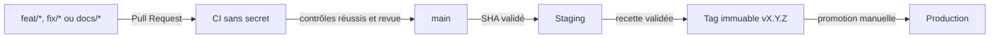

# Référence CI/CD

Ce document décrit les règles Git et les contrôles d'intégration continue du
dépôt. Il ne constitue pas une procédure de déploiement : la promotion, la
sauvegarde et le rollback sont décrits dans la
[procédure de mise à jour](../procedures/mise-a-jour.md).

## Flux Git

- `feat/*` porte une évolution fonctionnelle ;
- `fix/*` porte une correction ;
- `docs/*` porte un changement documentaire isolé ;
- `main` est l'unique branche longue ;
- un tag annoté `vX.Y.Z` identifie une version recettée ;
- la production n'est jamais déployée automatiquement après un push.

Les environnements staging et production sont deux installations Dokploy
distinctes. Ils ne sont pas représentés par des branches Git et ne partagent
ni base, ni volume audio, ni secret.

## Workflows GitHub Actions

Les deux workflows sont déclenchés par une Pull Request vers `main`, un push
sur `main` ou une demande manuelle. Leurs filtres de chemins évitent d'exécuter
un périmètre qui n'a pas changé.

| Workflow | Périmètre |
| --- | --- |
| [CI applications](../../.github/workflows/ci-apps.yml) | `apps/`, `packages/`, tests transversaux, Compose applicatifs, PostgreSQL de développement, image GLPI de test et stack de transcription |
| [CI providers de test](../../.github/workflows/ci-providers.yml) | Simulateurs de `providers/`, leurs images Docker et les Compose local et staging associés |

Le workspace uv et `uv.lock` sont communs aux deux périmètres. Une modification
du manifeste racine, du verrou ou de `.dockerignore` peut donc déclencher les
deux workflows. Un lancement manuel ignore les filtres de chemins.

## Contrôles automatiques

La CI utilise uniquement des données synthétiques et exécute selon le
périmètre concerné :

1. la vérification du formatage Ruff ;
2. l'analyse statique Ruff ;
3. les suites Pytest locales déterministes ;
4. les migrations et intégrations PostgreSQL jetables pour les applications ;
5. le rendu statique des manifestes Docker Compose concernés ;
6. les contrats ciblés des images et de la stack de transcription.

Les suites `glpi`, `transcribe_ai`, `transcription_model`, `e2e` et les tests
`deployment` qui construisent ou démarrent des conteneurs restent des
validations manuelles. La CI ne démontre donc pas le fonctionnement des
services réels de l'établissement.

La reproduction locale des contrôles est décrite dans la
[procédure de développement](../procedures/developpement-local.md).

## Sécurité de la CI

Les workflows :

- possèdent uniquement la permission GitHub `contents: read` ;
- n'utilisent aucun secret de staging ou de production ;
- n'ouvrent aucun fichier `.env` réel, certificat ou clé privée ;
- épinglent les actions tierces sur des révisions immuables ;
- annulent une exécution devenue obsolète au profit du commit le plus récent ;
- bornent la durée de chaque job.

La CI ne déploie rien, ne migre aucune base persistante et ne contacte ni une
boîte Exchange, ni GLPI, ni un provider de transcription réel.

Le dépôt privé utilise GitHub Free. Les protections de branche ne constituent
donc pas une barrière technique suffisante : la revue humaine et la lecture des
résultats de CI restent obligatoires avant toute fusion.

## Checklist de Pull Request

Avant l'ouverture :

- [ ] la branche respecte la convention `feat/*`, `fix/*` ou `docs/*` ;
- [ ] le changement forme un périmètre cohérent ;
- [ ] le diff ne contient aucun secret, `.env`, certificat, audio réel ou
      donnée sensible ;
- [ ] `uv.lock` est cohérent lorsqu'une dépendance change ;
- [ ] les migrations sont additives et testées depuis une base neuve et la
      révision précédente ;
- [ ] les contrôles locaux pertinents réussissent ;
- [ ] la documentation est adaptée si le comportement ou la configuration
      change.

Avant la fusion :

- [ ] les jobs GitHub Actions sont terminés avec succès ;
- [ ] les logs ne contiennent aucune donnée sensible ;
- [ ] le diff final et les changements de déploiement ont été relus ;
- [ ] aucun commit imprévu n'a été ajouté ;
- [ ] les messages de commit respectent Conventional Commits.

## Limites connues

- GitHub Free ne rend pas toutes les règles de fusion obligatoires sur ce dépôt
  privé ;
- les services externes réels sont validés en staging, pas par la CI ;
- les validations lourdes restent séquentielles et manuelles ;
- les images staging et production sont reconstruites séparément en l'absence
  de registre d'images ;
- `APP_COMMIT_SHA` reste contrôlé par l'opérateur tant qu'aucune injection
  Dokploy fiable n'est établie.
