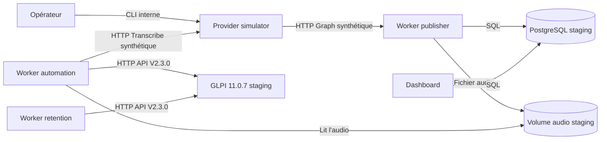

# Environnement staging Dokploy

Le staging valide le pipeline complet sans lire la boîte Exchange de
production et sans consommer le GPU Transcribe AI. Il suit automatiquement la
branche `main`, alors que le déploiement de production reste manuel.

## Architecture



Le manifeste est
[`infra/docker/docker-compose.staging.yml`](../infra/docker/docker-compose.staging.yml).
Il déploie les cinq applications du produit, le simulateur, GLPI, MySQL et le
bootstrap OAuth one-shot. PostgreSQL reste un service externe dédié au
staging.

## Isolation obligatoire

Le staging doit posséder ses propres :

- projet Compose `gta-staging` ;
- base et utilisateur PostgreSQL ;
- réseau PostgreSQL externe ;
- volume audio ;
- volumes GLPI et MySQL ;
- domaines web et GLPI ;
- secrets GLPI et simulateur.

Aucun certificat Entra, identifiant Exchange, secret GLPI de production ou
donnée réelle ne doit être copié dans cet environnement.

GLPI 11.0.7 est volontairement aligné sur la production. Cette version ne doit
pas être publiée directement sur Internet : son domaine staging doit rester
limité au LAN ou au VPN. La montée de version de GLPI devra être préparée sur
staging, puis appliquée aux deux environnements.

## Création du projet Dokploy

1. Vérifier que Dokploy est en version `v0.30.10`, version validée pour ce
   projet. Le correctif disponible depuis `v0.30.4` transmet explicitement le
   fichier `.env` situé à côté d'un Compose placé dans un sous-répertoire.
2. Créer un projet ou un environnement Dokploy distinct nommé `staging`.
3. Connecter le dépôt GitHub privé avec la GitHub App Dokploy.
4. Sélectionner la branche `main`.
5. Choisir le chemin Compose
   `./infra/docker/docker-compose.staging.yml`.
6. Activer l'auto-déploiement uniquement pour ce projet staging.
7. Laisser l'auto-déploiement désactivé sur le projet de production.

Dokploy écrit les variables de son onglet Environment dans le fichier `.env`
placé à côté du manifeste et le transmet à Docker Compose avec `--env-file`.
Une version de Dokploy antérieure à `v0.30.4` réintroduirait le défaut de
chargement décrit par l'issue
[#5252](https://github.com/Dokploy/dokploy/issues/5252).

## PostgreSQL

Créer une base et un utilisateur réservés au staging, puis attacher le service
PostgreSQL au réseau Docker externe configuré par
`DATABASE_NETWORK_NAME=gta-staging-database-network`.

`DATABASE_URL` doit viser le nom DNS Docker du service PostgreSQL, jamais
`localhost`. La base de production ne doit pas être réutilisée.

## Variables

Copier le contenu de
[`infra/docker/staging.env.example`](../infra/docker/staging.env.example) dans
l'onglet Environment de Dokploy, puis remplacer chaque `CHANGE_ME`.

Les identités créées par le bootstrap doivent conserver les préfixes suivants :

```text
GLPI_ADMIN_USERNAME=glpi-staging-...
GLPI_USERNAME=glpi-staging-...
GLPI_OAUTH_CLIENT_NAME=glpi-staging-...
```

Le bootstrap :

1. attend la fin de l'auto-installation GLPI ;
2. active l'API V2 ;
3. génère les clés OAuth si nécessaire ;
4. crée ou retrouve un administrateur staging distinct et lui attribue le
   profil `Super-Admin` sur l'entité racine ;
5. désactive les comptes GLPI de démonstration `glpi`, `tech`, `normal` et
   `post-only` ;
6. crée ou réconcilie l'utilisateur de service ;
7. crée ou réconcilie le client OAuth Password avec le scope `api`.

Il est idempotent et ne journalise aucun identifiant sensible.
GLPI ne devient `healthy` qu'après la publication atomique du marqueur de
bootstrap. En cas d'échec pendant la réconciliation, le marqueur reste absent
et les applications dépendantes ne démarrent pas.

Les mots de passe et identifiants OAuth doivent rester stables entre deux
déploiements. Si une valeur configurée ne correspond plus à la valeur déjà
stockée par GLPI, le bootstrap échoue sans modifier le secret existant. Toute
rotation doit donc être une opération explicite, préparée et tracée ; elle ne
doit pas être réalisée en changeant simplement une variable Dokploy.

## Domaines Dokploy

Configurer exactement deux domaines :

| Service | Port interne | Exposition |
|---|---:|---|
| `web` | `8000` | LAN/VPN |
| `glpi` | `80` | LAN/VPN |

Ne créer aucun domaine pour `provider-simulator`, `glpi-db`, les workers ou le
service de bootstrap. Aucun de ces services ne publie directement un port de
l'hôte.

## Première recette

Après le premier déploiement, vérifier dans Dokploy :

1. `database-migrations` est terminé avec le code `0` ;
2. `glpi-db`, `glpi` et `provider-simulator` sont healthy ;
3. `glpi-bootstrap` est terminé avec le code `0` ;
4. les trois workers et le web sont démarrés ;
5. les heartbeats des workers sont frais dans le dashboard.

Ouvrir ensuite un terminal dans `provider-simulator` et injecter un message :

```bash
glpi-ticketing-provider-simulator-admin seed --extension wav
```

Puis vérifier successivement :

- la création d'une ingestion mail ;
- la création et la complétion du job ;
- la présence du ticket dans GLPI staging ;
- le déplacement du message simulé dans `Processed` ;
- l'absence de secret, contenu audio ou transcription dans les journaux.

Rejouer la recette avec OGG :

```bash
glpi-ticketing-provider-simulator-admin seed --extension ogg
```

Le simulateur peut être remis à zéro avec :

```bash
glpi-ticketing-provider-simulator-admin reset
```

Son état est de toute façon effacé lors d'un redéploiement ou redémarrage.

## Limites

- le simulateur vérifie les contrats HTTP et le pipeline, pas la qualité de la
  transcription ;
- le test ponctuel du GPU réel reste une recette manuelle distincte avec un
  audio synthétique ;
- GLPI et MySQL conservent leurs données entre les déploiements ;
- un rollback applicatif ne supprime ni ne rétrograde automatiquement les
  migrations PostgreSQL ou GLPI.
