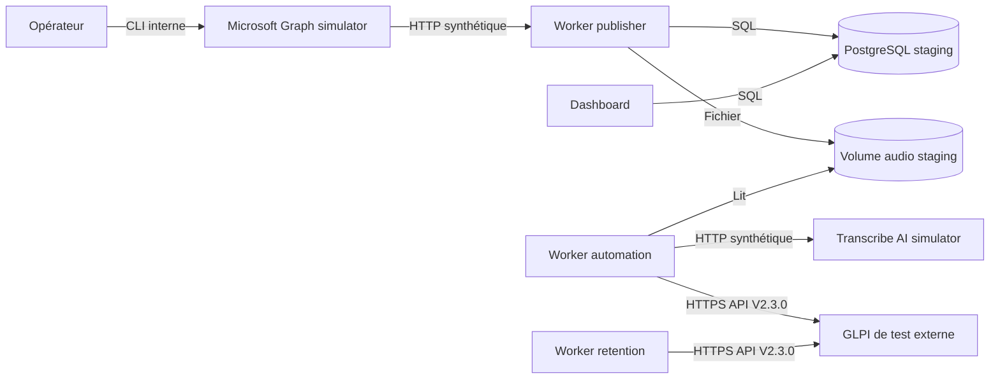

# Environnement staging Dokploy

Le staging valide le pipeline avec des données synthétiques. Microsoft Graph
et Transcribe AI sont simulés dans un projet Dokploy séparé ; GLPI est une
instance de test externe accessible en HTTPS. Aucun service de production ni
aucune donnée réelle ne doit être utilisé.

## Architecture



Deux projets Compose partagent uniquement le réseau Docker externe
`gta-staging-providers-network` :

- `infra/docker/providers/docker-compose.providers.yml` déploie les deux
  simulateurs ;
- `infra/docker/apps/docker-compose.staging.yml` déploie les cinq applications.

PostgreSQL reste un service externe dédié au staging. Le GLPI de test n'est pas
déployé par ce dépôt.

## Prérequis

Avant de déployer les applications :

1. vérifier que les deux simulateurs sont `healthy` ;
2. vérifier que le réseau `gta-staging-providers-network` existe et porte les
   deux projets ;
3. créer une base et un utilisateur PostgreSQL exclusivement réservés au
   staging ;
4. vérifier depuis la VM que le nom du GLPI de test est résolu et que son
   certificat est validé par le bundle configuré ;
5. disposer d'identifiants OAuth GLPI réservés au test.

Le test TLS ne doit jamais désactiver la vérification du certificat :

```bash
openssl s_client -connect NOM_GLPI:443 -servername NOM_GLPI -CAfile /chemin/ca.pem -verify_return_error </dev/null
```

Le résultat attendu est `Verify return code: 0 (ok)`. Si l'accès exige un
certificat client mTLS, le client applicatif doit être adapté avant le
déploiement : `CA_BUNDLE_HOST_PATH` configure uniquement la confiance envers le
certificat serveur.

## Déploiement applicatif

Créer un projet Docker Compose Dokploy avec :

```text
./infra/docker/apps/docker-compose.staging.yml
```

Copier les variables de `infra/docker/apps/staging.env.example` dans l'onglet
Environment, puis remplacer tous les placeholders. En particulier :

- `PROVIDERS_NETWORK_NAME` doit être identique dans les deux projets ;
- `TRANSCRIBE_AI_SIMULATOR_API_KEY` doit avoir la même valeur que dans la stack
  providers ;
- `PUBLISHER_MAILBOX_ID` doit correspondre à la boîte Graph fictive ;
- `GLPI_BASE_URL` doit contenir l'URL HTTPS du GLPI de test ;
- `CA_BUNDLE_HOST_PATH` doit désigner sur la VM le bundle qui valide GLPI et
  PostgreSQL.

Les projets Compose ne peuvent pas exprimer de `depends_on` entre eux. Les
providers doivent donc être déployés et sains avant les workers.

Le futur domaine Dokploy concernera uniquement le service `web`, sur son port
interne `8000`. Il n'est pas nécessaire pour valider l'exécution des workers,
mais les liens audio resteront inutilisables tant que `PUBLIC_BASE_URL` ne
désignera pas une URL accessible.

## Recette synthétique

Après le déploiement, vérifier :

1. `database-migrations` termine avec le code `0` ;
2. les trois workers et le web démarrent ;
3. leurs heartbeats sont présents dans PostgreSQL ;
4. aucun journal ne contient de secret, d'audio ou de transcription.

Dans le terminal du simulateur Microsoft, injecter un message :

```bash
glpi-ticketing-microsoft-graph-simulator-admin seed --extension wav
```

Puis contrôler la création de l'ingestion, la complétion du job, le déplacement
du message dans `Processed` et la création du ticket dans le GLPI de test.
Rejouer avec OGG :

```bash
glpi-ticketing-microsoft-graph-simulator-admin seed --extension ogg
```

Nettoyer uniquement l'état synthétique avec :

```bash
glpi-ticketing-microsoft-graph-simulator-admin reset
```

Le simulateur de transcription peut être contrôlé indépendamment :

```bash
glpi-ticketing-transcribe-ai-simulator-smoke
```

## Limites

- les simulateurs valident les contrats HTTP, pas Microsoft Entra ID ni la
  qualité de transcription ;
- le staging partage les contraintes réseau et TLS de la VM qui l'héberge ;
- un rollback applicatif ne supprime ni ne rétrograde automatiquement les
  migrations PostgreSQL ;
- aucune opération de nettoyage ne doit viser le GLPI de test externe.
