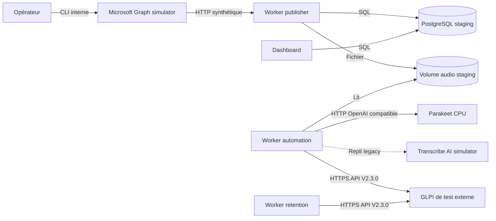

# Environnement staging Dokploy

Le staging valide le pipeline avec des données synthétiques. Microsoft Graph
est simulé ; Parakeet réalise la transcription sur CPU dans une stack Dokploy
indépendante des applications et des simulateurs. GLPI est une instance de test
externe accessible en HTTPS. Le simulateur Transcribe AI reste disponible
uniquement pour le contrat legacy et le retour arrière. Aucun service de
production ni aucune donnée réelle ne doit être utilisé.

## Architecture



Trois projets Compose sont déployés séparément :

- `infra/docker/simulators/docker-compose.simulators.yml` déploie le simulateur
  Graph et le simulateur Transcribe AI legacy ;
- `infra/docker/transcription/docker-compose.transcription.yml` déploie
  uniquement Parakeet ;
- `infra/docker/apps/docker-compose.staging.yml` déploie les cinq applications.

Ils utilisent deux réseaux Docker privés distincts :

- `gta-staging-simulators-network` relie les simulateurs aux seuls workers qui
  les consomment ;
- `gta-staging-transcription-network` relie uniquement Parakeet et
  `worker-automation`.

Dans Compose, `external: true` signifie que le réseau est partagé entre deux
projets et géré hors de leur cycle de vie. Cela ne publie aucun port sur l'hôte
et n'expose pas Parakeet à Traefik.

PostgreSQL reste un service externe dédié au staging. Le GLPI de test n'est pas
déployé par ce dépôt.

## Prérequis

Avant de déployer les applications :

1. vérifier que les deux simulateurs et Parakeet sont `healthy` ;
2. vérifier que `gta-staging-simulators-network` et
   `gta-staging-transcription-network` existent ;
3. créer une base et un utilisateur PostgreSQL exclusivement réservés au
   staging ;
4. vérifier depuis la VM que le nom du GLPI de test est résolu et que son
   certificat est validé par le bundle configuré ;
5. disposer d'identifiants OAuth GLPI réservés au test ;
6. créer `/srv/gta-staging/audio-fixtures` pour les enregistrements de recette
   fictifs, avec un accès en lecture pour l'UID/GID `10001` du simulateur.

Créer les réseaux une seule fois sur la VM de staging :

```bash
sudo docker network create --driver bridge --internal gta-staging-simulators-network
sudo docker network create --driver bridge --internal gta-staging-transcription-network
sudo install -d -o root -g 10001 -m 0750 /srv/gta-staging/audio-fixtures
```

Le test TLS ne doit jamais désactiver la vérification du certificat :

```bash
openssl s_client -connect NOM_GLPI:443 -servername NOM_GLPI -CAfile /chemin/ca.pem -verify_return_error </dev/null
```

Le résultat attendu est `Verify return code: 0 (ok)`. Si l'accès exige un
certificat client mTLS, le client applicatif doit être adapté avant le
déploiement : `CA_BUNDLE_HOST_PATH` configure uniquement la confiance envers le
certificat serveur.

## Déploiement des stacks

Déployer d'abord les simulateurs avec :

```text
./infra/docker/simulators/docker-compose.simulators.yml
```

Copier les variables de
`infra/docker/simulators/simulators.env.example` dans leur projet Dokploy.
`MICROSOFT_GRAPH_SIMULATOR_AUDIO_FIXTURES_HOST_PATH` doit désigner le répertoire
préparé sur la VM. Il est monté dans `/fixtures/audio` en lecture seule et le
déploiement échoue explicitement s'il est absent.

Déployer ensuite le moteur de transcription avec :

```text
./infra/docker/transcription/docker-compose.transcription.yml
```

Copier les variables de
`infra/docker/transcription/transcription.env.example` dans ce second projet.
La clé Parakeet et les limites CPU/RAM sont propres à cette stack.

Enfin, créer le projet applicatif avec :

```text
./infra/docker/apps/docker-compose.staging.yml
```

Copier les variables de `infra/docker/apps/staging.env.example` dans l'onglet
Environment, puis remplacer tous les placeholders. En particulier :

- `SIMULATORS_NETWORK_NAME` doit être identique dans les projets simulateurs et
  applications ;
- `TRANSCRIPTION_NETWORK_NAME` doit être identique dans les projets
  transcription et applications ;
- `TRANSCRIBE_AI_SIMULATOR_API_KEY` conserve la même valeur que dans la stack
  simulateurs pour permettre le repli legacy ;
- `PARAKEET_API_KEY` doit avoir la même valeur dans les projets transcription
  et applications ;
- `PUBLISHER_MAILBOX_ID` doit correspondre à la boîte Graph fictive ;
- `GLPI_BASE_URL` doit contenir l'URL HTTPS du GLPI de test ;
- `CA_BUNDLE_HOST_PATH` doit désigner sur la VM le bundle qui valide GLPI et
  PostgreSQL.

Les projets Compose ne peuvent pas exprimer de `depends_on` entre eux. Les
simulateurs et Parakeet doivent donc être déployés et sains avant les workers.
Une indisponibilité ultérieure de Parakeet est gérée par le retry applicatif.

La production reste configurée avec `TRANSCRIPTION_PROVIDER=legacy_polling`
pendant toute la recette. Après validation, le même Compose de transcription et
le même digest pourront être déployés dans un projet de production distinct,
avec un réseau et une clé propres, avant de basculer le worker.

Le futur domaine Dokploy concernera uniquement le service `web`, sur son port
interne `8000`. Il n'est pas nécessaire pour valider l'exécution des workers,
mais les liens audio resteront inutilisables tant que `PUBLIC_BASE_URL` ne
désignera pas une URL accessible.

## Recette synthétique

Après le déploiement, vérifier :

1. `database-migrations` termine avec le code `0` ;
2. les trois workers et le web démarrent ;
3. leurs heartbeats sont présents dans PostgreSQL ;
4. aucun journal ne contient de secret, d'audio ou de transcription.

Dans le terminal du simulateur Microsoft, injecter un message :

```bash
glpi-ticketing-microsoft-graph-simulator-admin seed --scenario valid-wav
```

Puis contrôler la création de l'ingestion, la complétion du job, le déplacement
du message dans `Processed` et la création du ticket dans le GLPI de test.
Rejouer avec OGG :

```bash
glpi-ticketing-microsoft-graph-simulator-admin seed --scenario valid-ogg
```

Le catalogue complet est disponible sans secret :

```bash
glpi-ticketing-microsoft-graph-simulator-admin list-scenarios
```

Pour mesurer la qualité avec un enregistrement fictif préparé par l'opérateur,
installer un WAV ou un OGG de moins de 25 Mio sur la VM :

```bash
sudo install -o root -g 10001 -m 0640 ./test-vocal.wav /srv/gta-staging/audio-fixtures/test-vocal.wav
```

Depuis le terminal Dokploy du simulateur Microsoft, injecter le fichier monté :

```bash
glpi-ticketing-microsoft-graph-simulator-admin seed --audio-path /fixtures/audio/test-vocal.wav
```

Le chemin hôte n'est pas transmis au simulateur Graph et le contenu injecté
reste en mémoire jusqu'au redémarrage ou au `reset`. Le fichier monté demeure
sur la VM après ces opérations et doit être retiré manuellement à la fin de la
recette. Aucune donnée patient, donnée sensible ou issue de la production ne
doit être utilisée.

Nettoyer uniquement l'état synthétique avec :

```bash
glpi-ticketing-microsoft-graph-simulator-admin reset
```

Le simulateur de transcription legacy peut être contrôlé indépendamment :

```bash
glpi-ticketing-transcribe-ai-simulator-smoke
```

Parakeet doit rester invisible depuis l'hôte et Traefik. Sa sonde peut être
interrogée depuis `worker-automation` :

```bash
python -c 'import httpx; print(httpx.get("http://gta-staging-parakeet:5092/health", timeout=5).json())'
```

## Limites

- le simulateur Graph valide son contrat HTTP, pas Microsoft Entra ID ;
- Parakeet permet une recette fonctionnelle mais ne garantit pas à lui seul la
  qualité de transcription sur les audios représentatifs ;
- le staging partage les contraintes réseau et TLS de la VM qui l'héberge ;
- un rollback applicatif ne supprime ni ne rétrograde automatiquement les
  migrations PostgreSQL ;
- aucune opération de nettoyage ne doit viser le GLPI de test externe.
