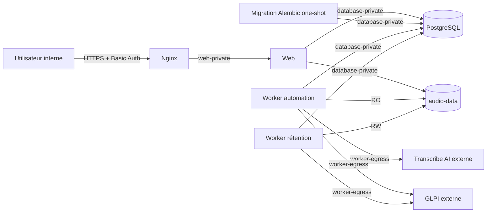

# Déploiement Docker Compose du MVP

Ce runbook décrit le déploiement mono-serveur du MVP. Le POC historique à
quatre répertoires est archivé par le tag immuable `poc-v0.1.0` ; ses anciens
manifestes et scripts ne doivent pas être réintroduits dans cette stack.

GLPI et Transcribe AI restent externes. Le Compose démarre PostgreSQL, applique
les migrations Alembic, puis lance le web, les deux workers et Nginx.

> [!CAUTION]
> N'exécutez jamais `docker compose down -v` sur staging ou production. Cette
> option détruit `postgres-data` et `audio-data`. Les procédures normales
> utilisent `stop`, `up` ou `down` sans `--volumes`.

## Architecture



Les responsabilités persistantes sont volontairement distinctes :

| Ressource | Propriétaires | Rôle |
| --- | --- | --- |
| `postgres-data` | PostgreSQL | source de vérité des jobs, événements, rétentions et heartbeats |
| `audio-data` | web en écriture, automation en lecture seule, rétention en écriture | octets audio canoniques et quarantaine privée `.purge` |
| `database-private` | PostgreSQL, migration, web et workers | trafic SQL non exposé à Nginx |
| `web-private` | web et Nginx | trafic HTTP interne sans accès direct à PostgreSQL |
| `worker-egress` | workers | accès sortant à GLPI et Transcribe AI |
| `proxy-edge` | Nginx | unique réseau portant le port publié |

Seul Nginx publie un port hôte. L'endpoint FastAPI `/health` et PostgreSQL ne
sont pas directement exposés.

Les exemples lient Nginx à `127.0.0.1`. Pour un accès depuis le réseau interne,
remplacez `GTA_NGINX_BIND_IP` par l'adresse dédiée du serveur et limitez ce port
au sous-réseau autorisé avec le pare-feu ; n'utilisez pas `0.0.0.0` sans cette
barrière.

Les images Python sont multi-stage, installées depuis `uv.lock` sans dépendance
de développement et exécutées en `10001:10001`. Les runtimes ont un rootfs en
lecture seule, un `/tmp` en tmpfs, aucune capability Linux et
`no-new-privileges`. Ces protections complètent les permissions distinctes du
volume audio ; elles ne remplacent pas l'isolation des secrets.

L'image PostgreSQL officielle épinglée est elle aussi forcée en `70:70`, sans
capability et avec un rootfs en lecture seule. Seuls `postgres-data`, `/tmp`,
`/var/run/postgresql` et la mémoire partagée restent inscriptibles.

## Arborescence et sources de configuration

```text
infra/docker/
├── compose.yaml
├── compose.internal-ca.yaml
├── database-migrations/Dockerfile
├── web/Dockerfile
├── worker-automation/Dockerfile
├── worker-retention/Dockerfile
├── nginx/
│   ├── Dockerfile
│   └── nginx.conf
└── environments/
    ├── dev/
    │   ├── compose.override.yaml
    │   ├── compose.env.example
    │   └── services/*.env.example
    ├── staging/
    │   ├── compose.override.yaml
    │   ├── compose.env.example
    │   ├── versions.env
    │   └── services/*.env.example
    └── prod/
        ├── compose.override.yaml
        ├── compose.env.example
        ├── versions.env
        └── services/*.env.example
```

`compose.yaml` contient les invariants. Les overlays ne décrivent que les
différences d'environnement : build local en développement, images de registre
épinglées par digest en staging et production. L'overlay de CA interne est
optionnel et doit toujours être ajouté explicitement à la commande lorsqu'il
est nécessaire.

Aucun profil Compose ne masque un service : une commande `up` ordinaire lance
toujours la stack complète et sa migration one-shot.

Les fichiers `*.example` sont des contrats, pas des configurations prêtes à
l'emploi. Les fichiers réels `compose.env`, `services/*.env` et `secrets/*`
sont ignorés par Git. Les `versions.env` staging et production sont au contraire
versionnés afin de rendre une promotion et un rollback auditables.

## Politique Git et promotion

- `main` reçoit des branches de travail courtes après revue ;
- le commit source `A` est construit une seule fois et produit cinq digests ;
- un commit manifeste `B` inscrit ces mêmes digests dans les deux
  `versions.env` suivis, puis est déployé en staging ;
- après validation, un tag immuable `mvp-vX.Y.Z` pointe vers `B` ;
- production est déployée depuis ce tag sans reconstruire les images ;
- `poc-v0.1.0` reste l'archive du POC et n'est jamais déplacé.

Un tag Git ne remplace pas un digest d'image. Le tag identifie le manifeste de
release autorisé ; les digests identifient exactement les artefacts exécutés.
Les labels OCI `org.opencontainers.image.revision` des images conservent le
commit source `A`, tandis que le tag pointe vers le commit manifeste `B`. Cette
séparation évite de devoir connaître le digest d'une image avant de committer
le fichier qui le référence. Le commit `B` ne modifie que les métadonnées de
déploiement et ne déclenche aucune reconstruction des images promues.

Les valeurs `sha256:000…000` et le registre `example.invalid` sont des
sentinelles volontaires. Staging et production restent non déployables tant
qu'elles n'ont pas été remplacées et que
`GTA_RELEASE_DIGESTS_CONFIRMED=1` n'est pas défini dans le `compose.env`
externe.

Les overlays de release utilisent `pull_policy: missing`. La livraison exécute
explicitement `docker compose pull` avant `up`, mais un reboot peut réutiliser
le cache si le registre est momentanément indisponible. Le digest immuable
empêche alors toute dérive vers une autre image.

## Prérequis

- hôte Linux avec Docker Engine 28.3.3+ et Docker Compose 2.33.1+ ;
- checkout appartenant à root sous `/opt/glpi-ticketing-automation` pour les
  exemples staging/prod ;
- espace local sauvegardable pour les deux volumes nommés ;
- certificat TLS, clé privée et fichier `htpasswd` bcrypt ;
- registre joignable contenant les cinq images applicatives épinglées ;
- GLPI V2.3.0 et Transcribe AI joignables depuis `worker-egress` ;
- client OAuth et utilisateur GLPI dédiés à l'environnement ;
- autorité de certification installée ou bundle interne explicite.

Le stockage de `audio-data` doit préserver les permissions POSIX, les liens
durs et la synchronisation de répertoires attendus par la purge crash-safe. Un
montage CIFS ou un stockage objet n'est pas qualifié par ce MVP.

`localhost` dans un fichier worker désigne le conteneur lui-même. Utilisez les
noms DNS ou adresses réellement accessibles depuis Docker. Ne désactivez
jamais la vérification TLS pour contourner une CA interne.

Le minimum Compose 2.33.1 est requis par `networks.*.gw_priority`. Cette règle
force la route par défaut des workers vers `worker-egress` et celle de Nginx
vers `proxy-edge`, au lieu de dépendre de l'ordre implicite des réseaux. Une
version plus ancienne peut refuser le manifeste ou choisir une route de sortie
incorrecte.

## Configuration et secrets

### Développement

Créez les fichiers locaux à partir des contrats :

```bash
cp infra/docker/environments/dev/compose.env.example \
  infra/docker/environments/dev/compose.env
cp infra/docker/environments/dev/services/database.env.example \
  infra/docker/environments/dev/services/database.env
cp infra/docker/environments/dev/services/migrations.env.example \
  infra/docker/environments/dev/services/migrations.env
cp infra/docker/environments/dev/services/web.env.example \
  infra/docker/environments/dev/services/web.env
cp infra/docker/environments/dev/services/worker-automation.env.example \
  infra/docker/environments/dev/services/worker-automation.env
cp infra/docker/environments/dev/services/worker-retention.env.example \
  infra/docker/environments/dev/services/worker-retention.env
install -d -m 0700 infra/docker/environments/dev/secrets
```

Placez ensuite sous `environments/dev/secrets/` :

- `postgres.password` en mode `0640`, groupe déclaré par
  `GTA_POSTGRES_SECRET_GID` ;
- `nginx.crt` en mode `0644` ;
- `nginx.key` et `nginx.htpasswd` en mode `0640`, groupe déclaré par
  `GTA_NGINX_SECRET_GID` ;
- éventuellement un bundle de CA interne.

Même en développement, les trois secrets privés restent propriété de root ;
les GID dédiés donnent uniquement la lecture aux processus conteneurisés.

Renseignez toutes les valeurs `CHANGE_ME`. Le mot de passe de
`postgres.password` doit être le même que celui encodé dans le `DATABASE_URL`
du fichier partagé `services/database.env`. Une valeur hexadécimale évite les
ambiguïtés d'encodage d'URL.

### Staging et production

Les secrets ne sont pas copiés dans le checkout :

```bash
sudo install -d -m 0750 \
  /etc/glpi-ticketing-automation/staging/services \
  /etc/glpi-ticketing-automation/staging/secrets
sudo install -m 0640 \
  infra/docker/environments/staging/compose.env.example \
  /etc/glpi-ticketing-automation/staging/compose.env
sudo install -m 0600 \
  infra/docker/environments/staging/services/database.env.example \
  /etc/glpi-ticketing-automation/staging/services/database.env
sudo install -m 0600 \
  infra/docker/environments/staging/services/migrations.env.example \
  /etc/glpi-ticketing-automation/staging/services/migrations.env
sudo install -m 0600 \
  infra/docker/environments/staging/services/web.env.example \
  /etc/glpi-ticketing-automation/staging/services/web.env
sudo install -m 0600 \
  infra/docker/environments/staging/services/worker-automation.env.example \
  /etc/glpi-ticketing-automation/staging/services/worker-automation.env
sudo install -m 0600 \
  infra/docker/environments/staging/services/worker-retention.env.example \
  /etc/glpi-ticketing-automation/staging/services/worker-retention.env
```

Répétez avec `prod`. Créez ensuite les quatre secrets indiqués par
`compose.env`. `postgres.password` doit appartenir à
`root:<GTA_POSTGRES_SECRET_GID>` avec le mode `0640`. La clé TLS et le
`htpasswd` doivent appartenir à `root:<GTA_NGINX_SECRET_GID>` avec le même mode.
Le certificat public reste propriété de root et peut être en `0644`.

Avec les GID proposés par les exemples :

```bash
sudo install -o root -g 20000 -m 0640 /path/to/postgres.password \
  /etc/glpi-ticketing-automation/prod/secrets/postgres.password
sudo install -o root -g 20001 -m 0640 /path/to/nginx.key \
  /etc/glpi-ticketing-automation/prod/secrets/nginx.key
sudo install -o root -g 20001 -m 0640 /path/to/nginx.htpasswd \
  /etc/glpi-ticketing-automation/prod/secrets/nginx.htpasswd
sudo install -o root -g root -m 0644 /path/to/nginx.crt \
  /etc/glpi-ticketing-automation/prod/secrets/nginx.crt
```

Adaptez le répertoire pour staging et les GID si l'hôte les réserve déjà.
Éditez ensuite `compose.env` et les cinq fichiers `services/*.env`, remplacez
tous les placeholders et ajoutez `GTA_RELEASE_DIGESTS_CONFIRMED=1` seulement
après avoir inscrit les cinq vrais digests dans le `versions.env` suivi.

Avec les secrets `file`, Compose conserve les permissions de la source hôte et
ne remappe pas son propriétaire pour l'utilisateur de l'image. Les groupes
supplémentaires déclarés par le manifeste sont donc nécessaires : un secret en
`0600 root:root` serait illisible par PostgreSQL ou Nginx non-root, tandis qu'un
fichier world-readable exposerait inutilement la donnée aux comptes locaux.
Choisissez deux GID dédiés, distincts et sans membre humain, puis reportez-les
dans `compose.env` avant de créer les conteneurs.

Les fichiers de services contiennent notamment les URLs et secrets GLPI et
Transcribe AI. Ils restent visibles pour un administrateur Docker via
l'inspection du conteneur : un coffre externe et des secrets fichiers
applicatifs restent une amélioration post-MVP.

Dans un fichier `env_file`, placez entre apostrophes les secrets contenant
notamment `$`, `#` ou des espaces afin d'éviter une interpolation involontaire.
Ne journalisez jamais le résultat de `docker compose config` sur un système de
CI : la forme développée peut contenir ces valeurs sensibles.

Le MVP utilise encore le même rôle PostgreSQL pour Alembic, le web et les deux
workers. Cette simplicité donne aux runtimes des droits de schéma excessifs.
Une production renforcée devra séparer le propriétaire de migration d'un rôle
runtime limité au DML.

## Commandes par environnement

Toutes les commandes partent de la racine du dépôt et nomment explicitement le
projet, le fichier d'environnement et les manifests. Cela évite qu'un
`COMPOSE_FILE` ou `COMPOSE_PROJECT_NAME` hérité du shell cible le mauvais
volume.

### Développement

```bash
docker compose --project-name gta-dev \
  --env-file infra/docker/environments/dev/compose.env \
  --file infra/docker/compose.yaml \
  --file infra/docker/environments/dev/compose.override.yaml \
  config --quiet

docker compose --project-name gta-dev \
  --env-file infra/docker/environments/dev/compose.env \
  --file infra/docker/compose.yaml \
  --file infra/docker/environments/dev/compose.override.yaml \
  up --detach --build --wait --wait-timeout 120
```

### Staging

Le checkout doit correspondre au commit manifeste `B` de `main` consigné pour
le déploiement, et non au commit source `A` utilisé pour construire les images.

```bash
sudo docker compose --project-name gta-staging \
  --env-file /etc/glpi-ticketing-automation/staging/compose.env \
  --env-file infra/docker/environments/staging/versions.env \
  --file infra/docker/compose.yaml \
  --file infra/docker/environments/staging/compose.override.yaml \
  config --quiet

sudo docker compose --project-name gta-staging \
  --env-file /etc/glpi-ticketing-automation/staging/compose.env \
  --env-file infra/docker/environments/staging/versions.env \
  --file infra/docker/compose.yaml \
  --file infra/docker/environments/staging/compose.override.yaml \
  pull

sudo docker compose --project-name gta-staging \
  --env-file /etc/glpi-ticketing-automation/staging/compose.env \
  --env-file infra/docker/environments/staging/versions.env \
  --file infra/docker/compose.yaml \
  --file infra/docker/environments/staging/compose.override.yaml \
  up --detach --remove-orphans --wait --wait-timeout 120
```

### Production

Vérifiez d'abord que `git describe --tags --exact-match` retourne le tag
`mvp-vX.Y.Z` attendu et que les cinq lignes de `prod/versions.env` sont
identiques à celles validées en staging.

```bash
sudo docker compose --project-name gta-prod \
  --env-file /etc/glpi-ticketing-automation/prod/compose.env \
  --env-file infra/docker/environments/prod/versions.env \
  --file infra/docker/compose.yaml \
  --file infra/docker/environments/prod/compose.override.yaml \
  config --quiet

sudo docker compose --project-name gta-prod \
  --env-file /etc/glpi-ticketing-automation/prod/compose.env \
  --env-file infra/docker/environments/prod/versions.env \
  --file infra/docker/compose.yaml \
  --file infra/docker/environments/prod/compose.override.yaml \
  pull

sudo docker compose --project-name gta-prod \
  --env-file /etc/glpi-ticketing-automation/prod/compose.env \
  --env-file infra/docker/environments/prod/versions.env \
  --file infra/docker/compose.yaml \
  --file infra/docker/environments/prod/compose.override.yaml \
  up --detach --remove-orphans --wait --wait-timeout 120
```

`gta-dev`, `gta-staging` et `gta-prod` produisent des volumes distincts. Ne
changez jamais le nom d'un projet déjà initialisé sans procédure de migration :
Compose créerait des volumes vides et donnerait l'impression d'une perte de
données.

## Migration one-shot et ordre de démarrage

L'ordre effectif est :

1. PostgreSQL devient `healthy` ;
2. `database-migrations` exécute `alembic upgrade head` et sort avec le code
   `0` ;
3. le web et les deux workers peuvent démarrer ;
4. Nginx attend que le web soit `healthy`.

La migration utilise `restart: "no"`. Une sortie non nulle empêche les
consommateurs dépendants de démarrer. Ne contournez pas cette barrière avec un
`docker compose up --no-deps`.

```bash
sudo docker compose --project-name gta-prod \
  --env-file /etc/glpi-ticketing-automation/prod/compose.env \
  --env-file infra/docker/environments/prod/versions.env \
  --file infra/docker/compose.yaml \
  --file infra/docker/environments/prod/compose.override.yaml \
  ps --all

sudo docker compose --project-name gta-prod \
  --env-file /etc/glpi-ticketing-automation/prod/compose.env \
  --env-file infra/docker/environments/prod/versions.env \
  --file infra/docker/compose.yaml \
  --file infra/docker/environments/prod/compose.override.yaml \
  logs --tail 200 database-migrations
```

Une migration déjà appliquée est idempotente. Au redémarrage simple de l'hôte,
le conteneur one-shot terminé peut rester à l'état `exited (0)` ; lors d'une
mise à jour de son image, Compose le recrée avant les runtimes.

## Healthchecks et redémarrage

| Service | Sonde | Politique de redémarrage |
| --- | --- | --- |
| PostgreSQL | `pg_isready` sur la base configurée | `unless-stopped` |
| migration | code de sortie d'Alembic | aucun redémarrage |
| web | `GET /health` local, liveness du processus | `unless-stopped` |
| worker automation | heartbeat PostgreSQL frais et montage audio réellement en lecture seule | `on-failure:5` |
| worker rétention | heartbeat PostgreSQL frais et montage audio réellement inscriptible | `on-failure:5` |
| Nginx | proxy interne vers le `/health` du web | `unless-stopped` |

Un état métier `degraded` ou `blocked` avec heartbeat frais reste sain au sens
Docker : le processus est vivant, observable et applique sa politique de sonde.
Docker ne doit pas le redémarrer en boucle. À l'inverse, un crash technique est
redémarré au maximum cinq fois pour chaque worker. Une politique de restart ne
réagit pas à elle seule à un conteneur seulement marqué `unhealthy` ; le
dashboard et la supervision hôte doivent donc alerter l'opérateur.

Le seuil conteneur `WORKER_HEALTHCHECK_STALE_AFTER_SECONDS` vaut 45 secondes
par défaut et doit rester strictement supérieur à
`WORKER_HEARTBEAT_INTERVAL_SECONDS`, 10 secondes par défaut. La sonde n'affiche
qu'un code technique expurgé.

Le `/health` web ne prouve ni la disponibilité de PostgreSQL, ni celle de GLPI
ou Transcribe AI. De même, `docker compose up --wait` ne constitue pas un test
fonctionnel de création de ticket. Après chaque déploiement, déposez un audio
synthétique non sensible et vérifiez le job, le ticket GLPI et les alertes du
dashboard.

Commandes d'exploitation courantes :

```bash
sudo docker compose --project-name gta-prod \
  --env-file /etc/glpi-ticketing-automation/prod/compose.env \
  --env-file infra/docker/environments/prod/versions.env \
  --file infra/docker/compose.yaml \
  --file infra/docker/environments/prod/compose.override.yaml \
  ps --all

sudo docker compose --project-name gta-prod \
  --env-file /etc/glpi-ticketing-automation/prod/compose.env \
  --env-file infra/docker/environments/prod/versions.env \
  --file infra/docker/compose.yaml \
  --file infra/docker/environments/prod/compose.override.yaml \
  logs --tail 200 web worker-automation worker-retention nginx
```

## Autorité de certification interne

Lorsque GLPI ou Transcribe AI présente une chaîne signée par une CA privée,
installez un bundle PEM sous `/etc/glpi-ticketing-automation/<env>/secrets/`,
ajoutez son chemin absolu avec `GTA_CA_BUNDLE` dans `compose.env`, puis ajoutez
le troisième manifeste à **toutes** les commandes :

```bash
sudo docker compose --project-name gta-prod \
  --env-file /etc/glpi-ticketing-automation/prod/compose.env \
  --env-file infra/docker/environments/prod/versions.env \
  --file infra/docker/compose.yaml \
  --file infra/docker/environments/prod/compose.override.yaml \
  --file infra/docker/compose.internal-ca.yaml \
  config --quiet
```

Cet overlay monte le même bundle en lecture seule dans les deux workers et
définit `SSL_CERT_FILE`. Il ne désactive jamais la validation TLS. Si systemd
est utilisé, ajoutez aussi ce `--file` aux trois commandes de l'unité ; une
validation ponctuelle qui ne serait pas reproduite au boot est insuffisante.

## Sauvegarde et restauration

Une sauvegarde cohérente associe toujours :

- un dump PostgreSQL ;
- un instantané de `audio-data`, y compris `.purge` ;
- le tag Git, les deux fichiers d'environnement versionnés et les digests ;
- l'horodatage UTC et le nom de projet Compose.

Avant l'instantané, empêchez les écritures et laissez PostgreSQL terminer les
transactions en cours :

```bash
sudo docker compose --project-name gta-prod \
  --env-file /etc/glpi-ticketing-automation/prod/compose.env \
  --env-file infra/docker/environments/prod/versions.env \
  --file infra/docker/compose.yaml \
  --file infra/docker/environments/prod/compose.override.yaml \
  stop web worker-automation worker-retention nginx
```

Produisez ensuite un `pg_dump --format=custom` depuis PostgreSQL, puis prenez un
snapshot du volume `gta-prod_audio-data` avec l'outil de sauvegarde qualifié par
l'exploitation. Ce snapshot doit préserver les fichiers cachés, permissions et
liens durs. Redémarrez les services avec la commande `up --detach --wait`.

Après avoir créé un répertoire de sauvegarde accessible uniquement à
l'opérateur, le dump peut être produit sans afficher le mot de passe :

```bash
sudo docker compose --project-name gta-prod \
  --env-file /etc/glpi-ticketing-automation/prod/compose.env \
  --env-file infra/docker/environments/prod/versions.env \
  --file infra/docker/compose.yaml \
  --file infra/docker/environments/prod/compose.override.yaml \
  exec --no-tty postgres sh -ec \
  'export PGPASSWORD="$(cat /run/secrets/postgres_password)"; exec pg_dump --format=custom --no-owner --username="$POSTGRES_USER" --dbname="$POSTGRES_DB"' \
  > /srv/backups/gta-prod/postgres.dump
```

La redirection est effectuée par le shell appelant : le répertoire cible doit
déjà être inscriptible par ce compte et rester en mode `0700`. Contrôlez le code
de sortie et testez le dump avec `pg_restore --list` avant de le déclarer
valide.

La restauration doit être répétée régulièrement sur un projet isolé, par
exemple `gta-restore-test`, jamais directement par-dessus les volumes actifs :

1. conserver les volumes de production intacts ;
2. créer des volumes PostgreSQL et audio neufs sous le projet de restauration ;
3. démarrer uniquement PostgreSQL ;
4. restaurer le dump avec `pg_restore --exit-on-error --no-owner` dans la base
   vide ;
5. restaurer intégralement `audio-data` ;
6. exécuter la migration one-shot pour atteindre la révision attendue ;
7. démarrer d'abord le web avec un port Nginx non conflictuel ;
8. vérifier plusieurs UUID, la quarantaine `.purge`, les téléchargements et un
   cycle fonctionnel synthétique.

Ne démarrez jamais les workers d'un exercice de restauration avec les
identifiants GLPI ou Transcribe AI de production : ils pourraient reprendre des
jobs restaurés et produire des effets réels. Gardez-les arrêtés ou injectez des
instances de test dédiées avant le cycle synthétique.

Un dump SQL sans le volume audio, ou l'inverse, n'est pas une sauvegarde
restaurable du service. Chiffrez les sauvegardes, limitez leur accès et appliquez
une durée de conservation indépendante de celle des audios applicatifs.

## Mise à jour et rollback

### Mise à jour

1. sauvegarder PostgreSQL et `audio-data` ;
2. choisir le commit source `A`, construire ses cinq images une seule fois et
   publier leurs digests ;
3. créer sur `main` le commit manifeste `B` qui inscrit exactement ces cinq
   digests dans `staging/versions.env` **et** `prod/versions.env` ;
4. déployer `B` en staging et réaliser la recette ;
5. créer le tag `mvp-vX.Y.Z` sur `B`, sans reconstruire les images ;
6. en production, valider `docker compose config --quiet`, tirer les images
   référencées par `prod/versions.env` dans le tag puis exécuter
   `up --detach --wait` ;
7. vérifier la migration, les healthchecks, le dashboard et un traitement
   synthétique.

Les conteneurs reçoivent `SIGTERM` et disposent d'une période d'arrêt avant
recréation. Les workers reprennent depuis PostgreSQL ; aucun scan du volume
audio n'est effectué.

### Rollback

Un rollback applicatif remet le checkout sur le tag précédent et restaure les
anciens digests ensemble. Ne modifiez jamais seulement une des cinq images.

Alembic n'effectue aucun downgrade automatique. Si la migration appliquée
n'est pas rétrocompatible avec les anciennes images, un simple rollback
d'images est dangereux : restaurez le couple dump PostgreSQL + snapshot audio
pris avant mise à jour. Validez d'abord cette restauration sous un nom de
projet isolé.

`docker compose down` sans `-v` conserve normalement les volumes, mais `stop`
est préféré pour une interruption temporaire. Vérifiez toujours les noms
`gta-<env>_postgres-data` et `gta-<env>_audio-data` avant une opération manuelle.

## Démarrage systemd

L'[unité fournie](../systemd/glpi-ticketing-automation.service.example) appelle
directement le socle et l'overlay production ; elle ne dépend plus d'un script
intermédiaire :

```bash
sudo install -m 0644 \
  infra/systemd/glpi-ticketing-automation.service.example \
  /etc/systemd/system/glpi-ticketing-automation.service
sudo systemctl daemon-reload
sudo systemctl enable --now glpi-ticketing-automation.service
sudo systemctl status glpi-ticketing-automation.service
```

`ExecStop` utilise `compose stop`, jamais `down -v`. Le checkout, les manifests
et les `versions.env` doivent appartenir à root et ne pas être modifiables par
le compte qui consulte le dashboard. Si l'overlay de CA est nécessaire,
adaptez explicitement `ExecStartPre`, `ExecStart` et `ExecStop` avant
l'activation.

Cette unité `oneshot` orchestre le boot mais ne suit pas ensuite chaque
conteneur détaché. Un worker qui épuise ses cinq redémarrages ne fait donc pas
échouer rétroactivement systemd : l'état runtime, le dashboard et une sonde
hôte de `docker compose ps` restent les sources d'alerte opérationnelle.
L'unité ne tire pas d'image au boot ; la procédure de livraison effectue le
`pull` explicite et le reboot utilise ensuite le digest présent en cache.

## Tests de déploiement

Le smoke test vérifie les manifests fusionnés, la migration one-shot, l'ordre
de démarrage, les healthchecks, les permissions audio et la persistance après
redémarrage. Il utilise un nom de projet et des volumes jetables :

```bash
uv run pytest -m deployment tests/deployment -vv --maxfail=1
```

Cette suite ne doit pas être parallélisée et ne doit jamais recevoir les
fichiers `/etc` de staging ou production.

## Limites du déploiement MVP

- un seul hôte, un worker de chaque type et aucune haute disponibilité ;
- authentification Basic au reverse proxy, sans comptes applicatifs ;
- secrets applicatifs injectés par environnement et visibles aux
  administrateurs Docker ;
- rôle PostgreSQL partagé entre migration et runtimes ;
- aucune notification externe des alertes ;
- aucune signature d'image ni politique de registre imposée par le dépôt ;
- sauvegarde, chiffrement au repos et supervision externe à opérer sur l'hôte ;
- GLPI et Transcribe AI ne sont ni déployés ni sauvegardés par cette stack.

Ces limites sont acceptables pour le MVP sur un réseau interne. Elles doivent
être traitées avant une exposition ou une disponibilité de production plus
exigeante.
