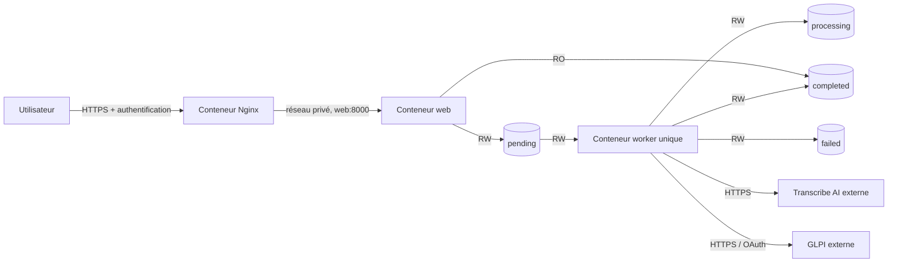

# Déploiement Docker du POC sur un serveur de test

> [!IMPORTANT]
> Cette procédure décrit exactement le déploiement figé par le tag
> `poc-v0.1.0`. Sur la branche `mvp/job-lifecycle`, l'application web utilise
> déjà PostgreSQL et le volume canonique `/data/audios`, tandis que le manifeste
> Compose conserve encore les quatre répertoires du POC. La branche MVP ne doit
> donc pas être déployée avec ce manifeste avant l'itération dédiée au packaging
> PostgreSQL, aux migrations et aux deux workers.

Ce répertoire transforme le workspace en trois images et une stack Docker
Compose destinée à **un seul serveur de démonstration** : Nginx, l'application
web et le worker. GLPI et Transcribe AI restent des services externes. Les stacks sous
`apps/worker-automation/tests/integration/` sont jetables et ne doivent jamais
être réutilisées pour ce déploiement.

Les responsabilités sont séparées par service :

```text
infra/docker/
├── .env.example
├── docker-compose.prod.yaml
├── prepare-host.sh
├── nginx/
│   ├── .dockerignore
│   ├── Dockerfile
│   └── nginx.conf
├── web/
│   ├── Dockerfile
│   └── web.env.example
└── worker/
    ├── Dockerfile
    ├── docker-compose.internal-ca.yaml
    ├── start-runtime.sh
    └── worker.env.example
```

Chaque service possède ainsi son Dockerfile ou son contrat d'environnement. Le
manifeste à la racine de `infra/docker` ne fait que les assembler. Nginx est le
seul point d'entrée réseau de la stack ; le web n'a aucun port publié.

## Architecture déployée



Nginx et le web partagent le bridge interne `web-private`. Nginx rejoint aussi
`proxy-edge`, seul réseau portant le binding HTTPS de l'hôte. Le worker utilise
un troisième bridge pour joindre les deux API et ne partage aucun réseau avec
Nginx ou le web. Les applications communiquent par les bind mounts audio, pas
par HTTP.

| Répertoire | Web | Worker | Pourquoi le conserver |
| --- | --- | --- | --- |
| `pending` | lecture/écriture | lecture/écriture | uploads encore non réclamés |
| `processing` | absent | lecture/écriture | reprise après arrêt ou blocage |
| `completed` | lecture seule | lecture/écriture | audios liés aux tickets confirmés |
| `failed` | absent | lecture/écriture | échecs terminaux et sidecars expurgés |

Le web et le worker partagent l'UID/GID fixe `10001:10001`. Nginx s'exécute avec
l'UID/GID non-root `101:101` et un groupe supplémentaire dédié à la lecture de
ses secrets. Les trois services utilisent un rootfs en lecture seule,
suppriment toutes les capabilities Linux et activent `no-new-privileges`. Leurs
répertoires temporaires sont des tmpfs. Les images Python, uv et Nginx
`1.30.4-alpine3.24` sont épinglées par tag et digest ; `uv.lock` est installé
avec `--locked`, sans dépendances de développement et en mode non éditable.

## Prérequis

- un hôte Linux avec Docker Engine 28.3.3 ou supérieur et Docker Compose 2.24
  ou supérieur ;
- un daemon Docker rootful sans `userns-remap` pour que l'UID/GID fixe `10001`
  corresponde à celui préparé sur les bind mounts de l'hôte ;
- le dépôt placé, dans les exemples, sous
  `/opt/glpi-ticketing-automation` sur un commit identifié ;
- un certificat TLS correspondant au nom public, sa clé privée et un fichier
  `htpasswd` bcrypt réservés au POC ;
- l'utilitaire `htpasswd` pour initialiser cette authentification ;
- des URL GLPI et Transcribe AI joignables **depuis un conteneur** ;
- un compte GLPI et un client OAuth Password réservés au POC ;
- un espace disque local sauvegardable pour les quatre répertoires audio.

`localhost` dans `worker.env` désignerait le conteneur worker, pas l'hôte. Il
faut utiliser des noms DNS ou des adresses réseau réelles. Il ne faut jamais
désactiver la validation TLS. Pour une autorité interne, utilisez l'overlay
`worker/docker-compose.internal-ca.yaml` décrit plus bas.

Le minimum Engine n'est pas cosmétique : des versions antérieures ont connu
des contournements du binding loopback depuis le réseau local, notamment après
un rechargement de `firewalld`. Le serveur doit conserver le mode bridge/NAT
standard et sa politique pare-feu doit être vérifiée après provisionnement.

## 1. Préparer les chemins persistants

Le script ne supprime rien. Il refuse les racines système trop larges et crée
les quatre sous-répertoires avec le propriétaire `10001:10001` et le mode
`0750`. Il refuse aussi une collision avec un utilisateur ou groupe de l'hôte,
car ce compte obtiendrait sinon un accès direct aux audios. Sur un chemin déjà
présent, le script réapplique propriétaire et mode aux répertoires ciblés :

```bash
cd /opt/glpi-ticketing-automation
sudo ./infra/docker/prepare-host.sh \
  /srv/glpi-ticketing-automation/audio
```

Le script vérifie aussi que le GID `10002`, réservé par défaut à la lecture des
secrets Nginx, n'appartient à aucun groupe de l'hôte et diffère du GID audio.
Si un autre GID est nécessaire, utilisez la même valeur pendant la préparation
et dans `compose.env` :

```bash
sudo GTA_NGINX_SECRET_GID=12002 ./infra/docker/prepare-host.sh \
  /srv/glpi-ticketing-automation/audio
```

Un disque local est recommandé pour le POC. Les primitives de publication
tolèrent des systèmes de fichiers distincts, mais un stockage réseau dont les
garanties de synchronisation sont inconnues doit être qualifié avant usage.

## 2. Installer la configuration hors du dépôt

```bash
sudo install -d -m 0750 /etc/glpi-ticketing-automation
sudo install -m 0600 infra/docker/.env.example \
  /etc/glpi-ticketing-automation/compose.env
sudo install -m 0640 infra/docker/web/web.env.example \
  /etc/glpi-ticketing-automation/web.env
sudo install -m 0600 infra/docker/worker/worker.env.example \
  /etc/glpi-ticketing-automation/worker.env
sudo install -o root -g 10002 -m 0644 /path/to/fullchain.pem \
  /etc/glpi-ticketing-automation/nginx.fullchain.pem
sudo install -o root -g 10002 -m 0640 /path/to/private.key \
  /etc/glpi-ticketing-automation/nginx.key
sudo install -o root -g 10002 -m 0640 /dev/null \
  /etc/glpi-ticketing-automation/nginx.htpasswd
sudo htpasswd -B /etc/glpi-ticketing-automation/nginx.htpasswd poc-user
sudo chown root:10002 /etc/glpi-ticketing-automation/nginx.htpasswd
sudo chmod 0640 /etc/glpi-ticketing-automation/nginx.htpasswd
sudoedit /etc/glpi-ticketing-automation/compose.env
sudoedit /etc/glpi-ticketing-automation/web.env
sudoedit /etc/glpi-ticketing-automation/worker.env
```

Toutes les valeurs `replace-with-...`, dont `GTA_VCS_REF`, doivent être
remplacées. Les URL et les valeurs fixes ne doivent pas être laissées
implicites. `PUBLIC_BASE_URL` doit être l'URL HTTPS réellement fournie par le
reverse proxy, sans sous-chemin. Le script de démarrage refuse les placeholders
ainsi qu'un `GTA_VCS_REF=unknown`, avant de démarrer le moindre conteneur.
Si vous avez choisi un autre GID, remplacez aussi `GTA_NGINX_SECRET_GID=10002`.

Les valeurs sensibles de `worker.env` sont entourées d'apostrophes. Conservez
ce quoting : Compose applique l'interpolation `$VAR` aux valeurs non quotées ou
entre guillemets doubles, tandis qu'une valeur entre apostrophes est littérale.
Une apostrophe appartenant au secret s'écrit `\'`. Le smoke test utilise
volontairement des secrets synthétiques contenant `$` et `#`, puis compare leur
empreinte dans le conteneur sans jamais les afficher.

Les secrets applicatifs du worker sont absents des images et injectés par un
`env_file` accessible seulement à root. Ils restent visibles à un
administrateur Docker dans l'inspection du conteneur. La clé TLS et le
`htpasswd` suivent déjà un contrat plus strict : secrets fichiers montés en
lecture seule uniquement dans Nginx. Leur GID supplémentaire est nécessaire car
Compose conserve les permissions réelles d'une source `file` et ne remappe pas
son propriétaire. Un coffre externe reste attendu pour le MVP.

## 3. Valider et construire les images

Les commandes suivantes utilisent les chemins et tags du fichier externe :

```bash
sudo docker compose \
  --env-file /etc/glpi-ticketing-automation/compose.env config --quiet

sudo docker compose \
  --env-file /etc/glpi-ticketing-automation/compose.env build --pull
```

`COMPOSE_FILE` est défini dans `compose.env` avec un chemin absolu. Il devient
la source unique utilisée par les commandes manuelles, l'unité systemd et
l'éventuel overlay de CA. Adaptez-le si le dépôt n'est pas installé sous
`/opt/glpi-ticketing-automation`.

Les images Python utilisent la racine du dépôt comme contexte : le verrou uv est
commun aux deux applications et au package partagé. Le contexte Nginx est au
contraire limité à `infra/docker/nginx`. Les deux fichiers `.dockerignore`
appliquent une allowlist ; les `.env`, tests, métadonnées Git, certificats et
fichiers de travail ne sont pas transmis au daemon Docker.

## 4. Configurer le reverse proxy Nginx

Le service `nginx` fait partie de la stack et utilise la configuration
versionnée [`nginx/nginx.conf`](nginx/nginx.conf). Il termine TLS sur son port
interne `8443`, applique l'authentification Basic, puis résout dynamiquement
`web:8000` sur le bridge `web-private`. Les identifiants Basic sont supprimés
avant le proxy vers FastAPI. Nginx remplace aussi les en-têtes d'origine par le
schéma HTTPS et l'adresse cliente qu'il observe. Uvicorn leur fait confiance
uniquement dans cette stack, car `web-private` ne contient que Nginx et le web.
Le web n'est jamais publié sur l'hôte.

Seul HTTPS est exposé : cette stack n'ouvre volontairement aucun port HTTP de
redirection. Le client doit donc utiliser directement l'URL `https://`.
`GTA_NGINX_BIND_IP=127.0.0.1` conserve l'accès sur le serveur lui-même. Pour
une démonstration depuis un autre poste, remplacez cette valeur par l'adresse IP
dédiée du serveur, ou par `0.0.0.0` uniquement avec une règle pare-feu bornée
aux postes autorisés. Le certificat doit couvrir le nom utilisé dans
`PUBLIC_BASE_URL`.

La limite Nginx est de 27 MiB afin d'inclure l'enveloppe multipart autour des
25 MiB applicatifs. Le buffering des requêtes et des réponses est désactivé :
un audio n'est pas recopié dans un répertoire persistant du proxy ; le spooling
restant se fait dans les tmpfs Nginx et web. La sonde interne Nginx joint
`GET /health` sans rendre un endpoint de santé non authentifié public.

### Rotation TLS ou Basic Auth

Installez les nouveaux fichiers de manière atomique avec le même GID et les
mêmes modes, validez la configuration, puis recréez uniquement Nginx :

```bash
sudo docker compose \
  --env-file /etc/glpi-ticketing-automation/compose.env \
  run --rm --no-deps nginx -t

sudo docker compose \
  --env-file /etc/glpi-ticketing-automation/compose.env \
  up --detach --no-deps --force-recreate --no-build --pull never \
  --wait --wait-timeout 45 nginx
```

Le montage des secrets fichiers est résolu à la création du conteneur : un
simple `nginx -s reload` ne constitue donc pas la procédure documentée. Cette
rotation ne recrée ni le web ni le worker et ne modifie aucun fichier audio.

## 5. Démarrer et vérifier

Démarrez d'abord le web et Nginx afin de vérifier le frontal sans consommer
d'audio :

```bash
sudo docker compose \
  --env-file /etc/glpi-ticketing-automation/compose.env \
  up --detach --no-build --pull never \
  --wait --wait-timeout 45 web nginx

curl --fail --silent --show-error \
  --cacert /etc/glpi-ticketing-automation/nginx.fullchain.pem \
  --resolve audio-poc.example.test:443:127.0.0.1 \
  --user poc-user https://audio-poc.example.test/health
```

L'option `--resolve` ci-dessus correspond au binding prudent par défaut sur le
loopback et au port `443`. Adaptez ses deux valeurs si `GTA_NGINX_BIND_IP` ou
`GTA_NGINX_HTTPS_PORT` diffère.

Après validation des deux API et de `PUBLIC_BASE_URL`, démarrez le worker :

```bash
sudo docker compose \
  --env-file /etc/glpi-ticketing-automation/compose.env \
  up --detach --no-deps --no-build --pull never worker

sudo docker compose \
  --env-file /etc/glpi-ticketing-automation/compose.env ps --all
```

Un test fonctionnel utilise un audio **synthétique et non sensible** : dépôt
via le frontal HTTPS, apparition transitoire dans `pending`/`processing`, ticket
GLPI avec le même `external_id`, puis audio dans `completed`. Vérifiez aussi
l'absence de transcription et de secret dans les logs.

## Politique de redémarrage et exploitation

Nginx et le web utilisent `restart: unless-stopped`. Le worker utilise
volontairement `restart: "no"` : son code de sortie `3` signifie que le pipeline
est bloqué et qu'une décision opérateur est requise. Une politique `always` ou
`on-failure` masquerait ce signal, créerait une boucle de redémarrage et
pourrait resoumettre un audio à Transcribe AI.

```bash
sudo docker compose \
  --env-file /etc/glpi-ticketing-automation/compose.env logs --tail 200 worker

sudo docker inspect \
  --format '{{.State.Status}} exit={{.State.ExitCode}} restarts={{.RestartCount}}' \
  "$(sudo docker compose \
    --env-file /etc/glpi-ticketing-automation/compose.env \
    ps --all --quiet worker)"
```

En cas de code `3`, inspectez `processing`, `failed` et le diagnostic expurgé,
corrigez la configuration ou le contrat, puis relancez explicitement. Si
l'unité systemd avait échoué, resynchronisez ensuite son état avec le conteneur :

```bash
sudo docker compose \
  --env-file /etc/glpi-ticketing-automation/compose.env \
  up --detach --no-deps --no-build --pull never \
  --wait --wait-timeout 45 worker

sudo systemctl reset-failed glpi-ticketing-automation.service
sudo systemctl start glpi-ticketing-automation.service
sudo systemctl is-active glpi-ticketing-automation.service
```

Ne déplacez pas automatiquement un fichier de `failed` vers `pending` : ce
répertoire est terminal. Un audio conservé dans `processing` est en revanche
repris conformément à la politique du POC et redemandera une transcription.

Le fichier
[`../systemd/glpi-ticketing-automation.service.example`](../systemd/glpi-ticketing-automation.service.example)
permet un démarrage au boot sans ajouter de boucle au worker. Adaptez son
`WorkingDirectory`, installez-le sous `/etc/systemd/system/`, puis activez-le :

```bash
sudo chown -R root:root /opt/glpi-ticketing-automation
sudo chmod -R go-w /opt/glpi-ticketing-automation
sudo install -m 0644 \
  infra/systemd/glpi-ticketing-automation.service.example \
  /etc/systemd/system/glpi-ticketing-automation.service
sudo systemctl daemon-reload
sudo systemctl enable --now glpi-ticketing-automation.service
```

L'unité s'exécute en root pour accéder au daemon Docker. Le checkout, le
manifeste Compose et `worker/start-runtime.sh` doivent donc appartenir à root et
ne jamais être modifiables par un compte non privilégié ; sinon une modification
locale deviendrait une exécution privilégiée au prochain démarrage. Vérifiez
les propriétaires et les droits de tous les composants du chemin avec
`namei -l /opt/glpi-ticketing-automation/infra/docker/worker/start-runtime.sh`.

Le script appelé par l'unité démarre et attend les healthchecks du web et de
Nginx, mais refuse un worker déjà actif mais `unhealthy` et ne redémarre pas un
ancien worker sorti avec un code non nul. Le frontal reste disponible si ce
garde arrête ensuite la reprise du worker. Avec `Type=oneshot`, le code `3`
place l'unité systemd dans l'état `failed`, tandis que les conteneurs web et
Nginx déjà démarrés restent disponibles. Le healthcheck worker crée puis
supprime une sentinelle unique dans chacun des quatre volumes afin de vérifier
leur écriture réelle. Seule la commande opérateur ci-dessus autorise sa reprise.
Il n'existe volontairement pas d'`ExecReload`
susceptible de relancer un audio. Après un redémarrage isolé du daemon Docker,
utilisez `systemctl restart glpi-ticketing-automation` : le même garde est
réappliqué. Le démarrage utilise `--no-build --pull never`, donc les images
doivent avoir été construites et validées avant l'activation de l'unité.
Un worker déjà `running` et `healthy` est volontairement laissé intact : ce
garde ne réconcilie ni son image ni son hash Compose. Toute livraison doit donc
suivre la procédure de mise à jour ci-dessous, qui arrête d'abord le worker.

## Autorité de certification interne

Placez hors du dépôt un bundle PEM complet, lisible par l'UID `10001` et
contenant à la fois les autorités système nécessaires et l'autorité interne.
`SSL_CERT_FILE` remplace en effet le chemin de confiance par défaut. Ajoutez son
chemin à `compose.env`, puis composez l'overlay :

```bash
sudo install -m 0644 /path/to/combined-trust-bundle.pem \
  /etc/glpi-ticketing-automation/trust-bundle.pem
```

```dotenv
GTA_CA_BUNDLE=/etc/glpi-ticketing-automation/trust-bundle.pem
COMPOSE_FILE=/opt/glpi-ticketing-automation/infra/docker/docker-compose.prod.yaml:/opt/glpi-ticketing-automation/infra/docker/worker/docker-compose.internal-ca.yaml
```

```bash
sudo docker compose \
  --env-file /etc/glpi-ticketing-automation/compose.env config --quiet
```

L'overlay monte le bundle en lecture seule et définit `SSL_CERT_FILE`. Il ne
désactive jamais la vérification des certificats. Comme `COMPOSE_FILE` porte la
combinaison, l'overlay reste actif au boot, lors d'une reprise et pendant une
mise à jour ; il ne dépend pas d'un `--file` ponctuel oublié à la commande
suivante.

## Mise à jour, rollback et sauvegarde

Avant une mise à jour, notez le commit et le tag actuellement déployés. Arrêtez
le worker proprement, positionnez le nouveau commit et renseignez à la fois son
tag immuable et son hash complet dans `GTA_IMAGE_TAG` et `GTA_VCS_REF`. Validez
le manifeste, construisez les trois images, puis ne reprenez le worker qu'après
les healthchecks du web et de Nginx. Un audio laissé dans `processing` sera
repris :

```bash
sudo docker compose \
  --env-file /etc/glpi-ticketing-automation/compose.env stop worker

# checkout du commit validé, puis mise à jour de GTA_IMAGE_TAG et GTA_VCS_REF
sudo docker compose \
  --env-file /etc/glpi-ticketing-automation/compose.env config --quiet
sudo docker compose \
  --env-file /etc/glpi-ticketing-automation/compose.env build --pull
sudo docker compose \
  --env-file /etc/glpi-ticketing-automation/compose.env \
  up --detach --no-build --pull never \
  --wait --wait-timeout 45 web nginx
curl --fail --silent --show-error \
  --cacert /etc/glpi-ticketing-automation/nginx.fullchain.pem \
  --resolve audio-poc.example.test:443:127.0.0.1 \
  --user poc-user https://audio-poc.example.test/health
sudo docker compose \
  --env-file /etc/glpi-ticketing-automation/compose.env \
  up --detach --no-deps --no-build --pull never \
  --wait --wait-timeout 45 worker
```

Si l'unité systemd est installée, terminez par :

```bash
sudo systemctl restart glpi-ticketing-automation.service
```

Son état reflète alors le démarrage des trois conteneurs. Le rollback suit exactement
la même procédure avec le commit, le lock, le tag et `GTA_VCS_REF` précédents.
Si la nouvelle image échoue avant la
reprise du worker, restaurez d'abord ces quatre références puis reconstruisez.
Les répertoires audio ne sont jamais supprimés par `compose down`.
Sauvegardez les quatre ensemble après arrêt du web et du worker pour obtenir un
instantané cohérent. Le POC ne chiffre pas les audios au repos et n'applique
pas de politique de rétention : ces deux règles doivent être imposées par le
serveur de test et définies avant le MVP.

## Smoke test automatisé des artefacts

Cette suite construit les trois images une seule fois, démarre une file vide,
valide réellement le certificat TLS et l'authentification Basic, puis effectue
un upload synthétique à travers Nginx. Elle vérifie aussi que le web n'a aucun
port hôte, que Nginx retrouve le web après sa recréation, les droits croisés,
les rootfs en lecture seule, les UID non-root, l'absence des outils de
développement et l'arrêt coopératif du worker. Elle couvre enfin les contextes
de build séparés, le quoting de secrets synthétiques, l'overlay de CA et le refus
du script systemd de relancer un worker bloqué. Elle n'appelle ni GLPI ni
Transcribe AI :

```bash
uv run pytest -m deployment tests/deployment -vv --maxfail=1
```

La suite utilise un projet Compose, des images et des répertoires temporaires
propres à la session, puis les détruit même en cas d'échec. Elle ne doit pas
être parallélisée.

## Limites assumées de cette itération

- un seul serveur, un seul worker et aucune haute disponibilité ;
- authentification uniquement au reverse proxy, pas dans l'application ;
- secrets applicatifs du worker injectés par environnement et visibles aux
  administrateurs Docker ;
- authentification Basic adaptée à un POC supervisé, sans comptes applicatifs
  ni gestion fine des autorisations ;
- le healthcheck Nginx vérifie le processus et le web en amont, mais pas la date
  d'expiration du certificat ; une sonde HTTPS externe doit porter cette alerte ;
- aucun heartbeat métier du worker ni alerte automatique sur le code `3` ;
- aucune politique egress interdisant au web les connexions sortantes ;
- aucune limite CPU/mémoire calibrée par mesure de charge ;
- aucune politique applicative de sauvegarde, chiffrement ou rétention ;
- construction sur le serveur possible, sans pipeline de signature ni registre
  d'images dans cette itération.

Ces limites sont acceptables pour une démonstration avec données synthétiques
sur un serveur de test isolé. Elles deviennent des chantiers explicites du MVP,
pas des garanties de production.

## Références techniques

- [uv dans Docker](https://docs.astral.sh/uv/guides/integration/docker/) pour
  le cache en deux temps, le lock et l'installation non éditable ;
- [spécification des services Compose](https://docs.docker.com/reference/compose-file/services/)
  pour `read_only`, `cap_drop`, `security_opt`, `init` et les bindings de port ;
- [syntaxe des fichiers d'environnement Compose](https://docs.docker.com/compose/how-tos/environment-variables/variable-interpolation/)
  pour le quoting littéral des secrets ;
- [politique de redémarrage Docker](https://docs.docker.com/engine/containers/start-containers-automatically/)
  pour la distinction entre arrêt et redémarrage automatique ;
- [notes Docker Engine 28.3.3](https://docs.docker.com/engine/release-notes/28/#2833)
  pour le correctif de sécurité du binding loopback après rechargement du
  pare-feu ;
- [secrets Docker Compose](https://docs.docker.com/compose/how-tos/use-secrets/)
  pour le montage fichier des secrets Nginx ;
- [image officielle Nginx](https://hub.docker.com/_/nginx/) et
  [authentification Basic](https://nginx.org/en/docs/http/ngx_http_auth_basic_module.html)
  pour le frontal conteneurisé ;
- [buffering du proxy Nginx](https://nginx.org/en/docs/http/ngx_http_proxy_module.html#proxy_request_buffering)
  pour le streaming des uploads hors stockage temporaire persistant.
