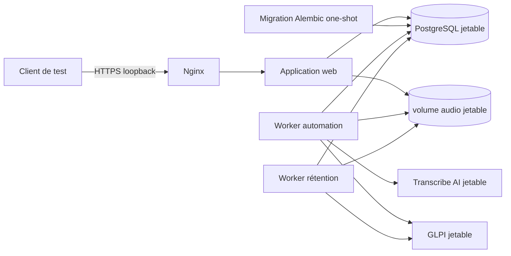

# Recette E2E racine du MVP

Cette suite constitue la frontière de validation du déploiement complet. Elle
ne remplace ni les tests unitaires, ni les contrats GLPI et Transcribe AI, ni le
smoke test Compose sous `tests/deployment`.

## Topologie



La stack applicative est celle du Compose MVP : PostgreSQL, migration one-shot,
web, worker d'automatisation, worker de rétention et Nginx. GLPI, sa base MySQL,
Transcribe AI et ses dépendances sont lancés comme services de test séparés.
Leurs URLs et identifiants éphémères sont injectés dans la stack applicative.

Aucun secret réel ni fichier sous
`/etc/glpi-ticketing-automation/{staging,prod}` ne doit être utilisé. Les ports
publiés le sont uniquement sur loopback et les réseaux, volumes, bases et
identifiants appartiennent à la session de test.

L'overlay E2E ajoute un réseau de contrôle jetable auquel seul PostgreSQL est
attaché. Le support de test peut ainsi avancer uniquement les timestamps
autorisés d'une rétention déjà dans l'état attendu, sans modifier le réseau
`database-private` ni fabriquer de transition métier en SQL.

## Frontière des sous-jalons

Le sous-jalon 8A valide uniquement le socle :

- création des services et ressources jetables ;
- injection des identifiants éphémères ;
- migration réussie et disponibilité bornée de la stack ;
- nettoyage des conteneurs, réseaux et volumes créés par la session.

Le sous-jalon 8B complète ce socle avec neuf scénarios :

- `test_job_lifecycle.py` : trois uploads concurrents, pipeline nominal,
  `blocked`, `failed`, alertes et retries opérateur ;
- `test_resilience.py` : pannes Transcribe AI et GLPI, barrière anti-fan-out,
  retranscription, reprise après `SIGKILL` et unicité du ticket ;
- `test_retention.py` : conservation `SOLVED`, purge `CLOSED` et purge par
  deadline sans GLPI ;
- `test_stack.py` : disponibilité et topologie du socle complet.

Le runbook de recette, les preuves attendues et les limites résiduelles sont
documentés dans
[`docs/mvp-demo-runbook.md`](../../docs/mvp-demo-runbook.md).

## Exécution obligatoire sur CPU

Le passage CPU est la validation de référence et reste obligatoire même si un
hôte GPU est disponible :

```bash
TRANSCRIBE_AI_TEST_DEVICE=cpu \
uv run pytest -m e2e tests/e2e -vv --maxfail=1
```

La suite doit rester strictement séquentielle. N'utilisez jamais
`pytest-xdist`, l'option `-n` ou une exécution concurrente avec les suites
`deployment`, `glpi` ou `transcribe_ai` : leurs stacks de session sont
volumineuses et partagent le même daemon Docker.

## Validation GPU optionnelle

Le GPU complète la validation CPU mais ne la remplace pas :

```bash
TRANSCRIBE_AI_TEST_DEVICE=gpu \
uv run pytest -m e2e tests/e2e -vv --maxfail=1
```

Ce mode exige un runtime NVIDIA fonctionnel et vérifie que Transcribe AI voit
réellement CUDA. Le premier lancement CPU ou GPU peut télécharger les images et
le modèle Whisper `tiny` ; l'hôte doit donc disposer de suffisamment de temps,
d'espace disque et de mémoire.

## Nettoyage et diagnostic

Les fixtures sont responsables uniquement des ressources qu'elles créent. Un
échec de disponibilité doit conserver une erreur bornée et expurgée, puis
déclencher le même nettoyage qu'un succès. Les journaux utiles au diagnostic ne
doivent contenir ni transcription, ni clé API, ni identifiant OAuth sensible.

Après la session, vérifiez qu'aucun conteneur, réseau ou volume portant le nom
du projet E2E jetable ne subsiste. Ne lancez jamais une commande de nettoyage
globale contre le daemon Docker de développement.
