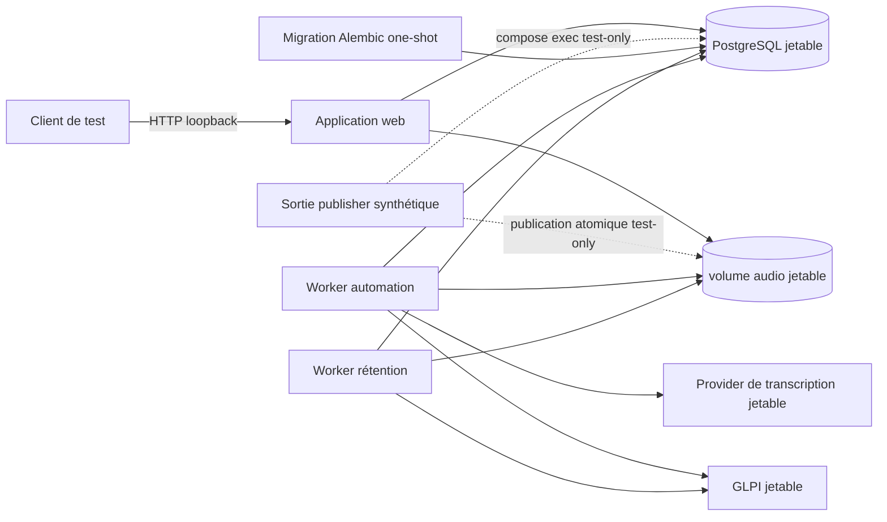

# Recette E2E du pipeline aval

Cette suite constitue la frontière de validation du déploiement complet. Elle
ne remplace ni les tests unitaires, ni les contrats GLPI et des providers de
transcription, ni le smoke test Compose sous `tests/deployment`.

## Topologie



La stack démarre la migration, le web, le worker d'automatisation et le worker
de rétention du Compose applicatif, puis lui ajoute un PostgreSQL exclusivement
réservé aux tests. Le vrai publisher n'est volontairement pas démarré : cette
recette aval ne possède ni application Entra ID ni boîte Exchange. Un helper
test-only
exécuté dans le conteneur de rétention reproduit uniquement sa frontière
durable : publication atomique de l'audio, création du job et évènement
`job_created` avec l'acteur `worker_publisher` dans une même séquence compensée.
Il ne simule ni Graph ni l'orchestration du publisher, couverts par leurs suites
dédiées.

GLPI, sa base MySQL et le provider sélectionné sont lancés comme services de
test séparés. Le scénario nominal construit l'API CPU Parakeet épinglée ; les
scénarios de résilience utilisent le simulateur OpenAI-compatible. Le Traefik
de Dokploy n'est pas simulé : la fixture publie directement FastAPI sur
loopback. Les URLs et identifiants éphémères sont injectés dans la stack
applicative.

Aucun secret réel ni fichier d'environnement Dokploy ne doit être utilisé. Les
ports publiés le sont uniquement sur loopback et les réseaux, volumes, bases
et identifiants appartiennent à la session de test.

La fixture ajoute un réseau de contrôle jetable auquel seul PostgreSQL est
attaché. Le support de test peut ainsi avancer uniquement les timestamps
autorisés d'une rétention déjà dans l'état attendu, sans fabriquer de
transition métier en SQL.

## Frontière des sous-jalons

Le sous-jalon 8A valide uniquement le socle :

- création des services et ressources jetables ;
- injection des identifiants éphémères ;
- migration réussie et disponibilité bornée de la stack ;
- nettoyage des conteneurs, réseaux et volumes créés par la session.

Le sous-jalon 8B complète ce socle avec neuf scénarios :

- `test_job_lifecycle.py` : trois sorties publisher synthétiques, pipeline nominal,
  `blocked`, `failed`, alertes et retries opérateur ;
- `test_resilience.py` : pannes du provider OpenAI-compatible et de GLPI,
  barrière anti-fan-out, retranscription et unicité du ticket ;
- `test_retention.py` : conservation `SOLVED`, purge `CLOSED` et purge par
  deadline sans GLPI ;
- `test_stack.py` : disponibilité et topologie du socle aval, avec publisher
  explicitement absent et signalé par le dashboard.

Le scénario `test_parakeet_nominal.py` complète cette régression historique. Il
construit le provider Parakeet CPU épinglé, injecte un audio français
synthétique, attend un job `completed`, vérifie les événements
`transcription_succeeded` et `ticket_confirmed`, puis contrôle le ticket GLPI
corrélé et son lien audio.

La stratégie de validation, les commandes communes et les limites de cette
frontière sont documentées dans la
[référence des tests](../../docs/reference/tests.md).

## Parcours nominal Parakeet sur CPU

Le passage nominal de référence est strictement CPU :

```bash
uv run pytest -m "e2e and transcription_model" \
  tests/e2e/test_parakeet_nominal.py -vv --maxfail=1
```

Le premier build télécharge les couches et le modèle GGUF épinglé puis
construit l'image locale. Prévoir un accès aux sources configurées, jusqu'à 45
minutes pour la première exécution, de l'espace disque et au moins la mémoire
requise par la stack GLPI, PostgreSQL et Parakeet.

## Régression du contrat OpenAI-compatible

Le passage avec le simulateur stateless reste disponible :

```bash
uv run --all-packages pytest -m "e2e and not transcription_model" \
  tests/e2e \
  -vv --maxfail=1
```

La suite doit rester strictement séquentielle. N'utilisez jamais
`pytest-xdist`, l'option `-n` ou une exécution concurrente avec les suites
`deployment` ou `glpi` : leurs stacks de session sont
volumineuses et partagent le même daemon Docker.

## Nettoyage et diagnostic

Les fixtures sont responsables uniquement des ressources qu'elles créent. Un
échec de disponibilité doit conserver une erreur bornée et expurgée, puis
déclencher le même nettoyage qu'un succès. Les journaux utiles au diagnostic ne
doivent contenir ni transcription, ni clé API, ni identifiant OAuth sensible.

Après la session, vérifiez qu'aucun conteneur, réseau ou volume portant le nom
du projet E2E jetable ne subsiste. Ne lancez jamais une commande de nettoyage
globale contre le daemon Docker de développement.
